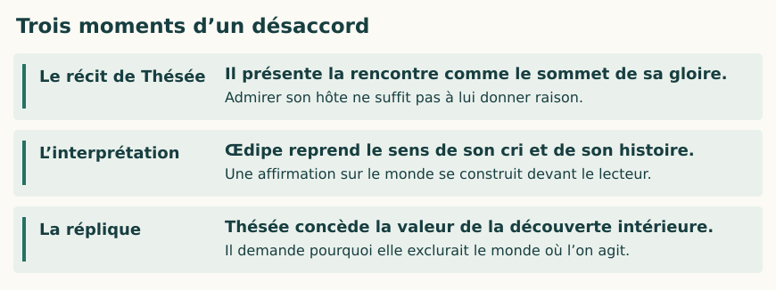

# Littérature — André Gide et Thésée · Oral PSL 2019 · Corrigé guidé

*Corrigé rédigé par IA, non officiel. Signalez toute erreur.*

**Rédaction** · GPT-6.2 Astra Ultra · vitesse non renseignée

**Révision (tour 1)** · GPT-6.2 Astra Ultra · vitesse non renseignée

## Feuillet de l’oral

Vous commenterez le texte ci-dessous en 20 minutes environ. Vous pouvez choisir de le commenter en suivant l’ordre de la lecture, ou de rassembler vos remarques selon un plan qui met en valeur les principaux enjeux du texte. Votre interprétation tiendra compte, par exemple, de son genre littéraire, de son contexte historique et culturel, de sa structure, de sa forme (vocabulaire, syntaxe, effets stylistiques et poétiques), de sa thématique et de sa tonalité. Votre commentaire sera suivi d’un entretien avec le jury.

André Gide, *Thésée* (1946). Le chapeau de la première page situe l’arrivée d’Œdipe à Colone. Le passage à commenter commence par « Cette rencontre à Colone de nos destins » et s’achève, à la fin de la deuxième page, par « je n’y serais sans doute point parvenu. ». La note au bas de la première page explique « impréhensible ». Le texte du dialogue se poursuit au-delà de cet appel de note.

## Préparer l’explication

**Où placer la pause ?** Lisez la parenthèse où Œdipe reprend le mot « insensible », puis reprenez le fil de sa phrase de part et d’autre du changement de page. La note de vocabulaire au bas du feuillet appartient à l’appareil de lecture, tandis que la rectification appartient au personnage. À laquelle de ces deux voix répond Thésée ?

Distinguez les trois voix, celle de Thésée narrateur, celle de Thésée interlocuteur et celle d’Œdipe qui raconte et réinterprète sa propre histoire. Relevez les expressions de certitude puis de doute dans la bouche du dernier. Elles montrent comment un plaidoyer apparemment assuré se corrige de l’intérieur.

À l’oral, donnez toute sa place à la concession de Thésée sur le monde intérieur avant d’en venir à son refus de l’opposition entre les deux mondes. Pour préparer l’entretien, reformulez la différence entre expliquer le geste à partir de l’instant où il s’est produit et lui donner rétrospectivement une signification à partir de ce qui a suivi.

## Commentaire de la rencontre à Colone

Dans *Thésée*, publié en 1946, André Gide laisse le héros grec raconter sa vie. Le passage distribué se situe à la fin du récit, lorsqu’il accueille à Colone un autre héros vieillissant, Œdipe. Un homme qui a su répondre jadis à l’énigme du Sphinx doit rendre à un interlocuteur compte de sa propre histoire. Nous pourrions attendre d’une rencontre aussi tardive que la sagesse de deux vies se résume en une même leçon. Or Thésée dit à plusieurs reprises qu’il ne comprend pas. Pourquoi le récit fait-il de cette difficulté le couronnement d’une carrière héroïque ? Il faut distinguer la confrontation telle que l’ordonne le narrateur, l’interprétation qu’Œdipe donne de la vue et les révisions que son discours subit à mesure qu’il se prolonge.

### Le héros narrateur fait une place à son égal

Au début, les deux possessifs du pluriel, « nos destins », « nos deux carrières », font converger deux vies vers le même carrefour. Mais le sujet de l’étonnement et le possesseur de la « gloire » sont exprimés au singulier. C’est encore Thésée qui distribue les places dans son récit et qui déplore que la postérité ait accordé si peu d’importance à cette rencontre. Sa manière de mesurer sa gloire demeure révélatrice. Jusqu’alors il a fait s’incliner les autres. Une incise vient aussitôt lui rappeler Dédale, auquel il faut réserver une exception. Le ton de cette rectification mêle la conscience de sa grandeur à une certaine familiarité. Le narrateur se montre en train d’ajuster sa propre légende.

Rencontrer enfin quelqu’un devant qui il éprouve un autre mouvement qu’un désir de l’emporter change le sens du mot « couronnement ». Un souverain pourrait chercher chez un hôte sa propre confirmation. Thésée trouve un homme dont un événement décisif lui reste inintelligible. Il l’interroge sur le geste par lequel il a perdu la vue. L’aveu d’insatisfaction est lui-même rectifié. L’explication ne l’a guère satisfait, ou peut-être est-ce lui qui l’a mal comprise. L’alternative ouvre un véritable espace de parole. Le narrateur peut reproduire le discours d’Œdipe tout en maintenant une différence entre ce qu’il a entendu, ce que l’autre a voulu dire et ce que le lecteur pourra en penser.

### Quel regard le héros a-t-il acquis ?

Œdipe prend la parole à partir d’une première interprétation, la colère qu’il ne pouvait diriger contre personne d’autre que lui-même. Il évoque ensuite un décor et une toile derrière lesquels il aurait voulu atteindre la réalité. L’image du théâtre est singulièrement efficace dans la bouche d’un héros tragique, qui raconte sa propre histoire comme s’il avait voulu sortir de la scène sur laquelle d’autres le regardent. Mais il se reprend aussitôt, par un « Mais non ! ». Donner à une réaction instinctive la clarté d’un projet serait peut-être lui prêter après coup un sens qu’elle n’avait pas encore. L’explication s’effectue devant nous par essais et corrections.

Le récit se noue autour d’un cri où obscurité et lumière sont identifiées. Personne n’y aurait compris ce qu’Œdipe croyait y dire. Là où les autres entendaient une plainte, lui parle d’une constatation. Le débat ne porte donc pas seulement sur le sens des mots, mais sur le type même d’acte de parole. Avec l’image d’un ciel intérieur qui s’étoile tandis que le dehors s’assombrit, Œdipe cherche à donner un équivalent visible de ce qu’il soutient pourtant inaccessible aux sens. La beauté de la description tient en partie à cette tension, il lui faut emprunter au monde extérieur les mots de lumière et de ciel pour dire ce qui prétend seul lui échapper.

La pause du personnage puis le souvenir du Sphinx font entrer dans cette opposition une ironie plus profonde. Celui qui passait pour le seul clairvoyant n’avait pas su comprendre sa propre situation. Le mot « clairvoyant » passe d’une réputation publique à une mise en question intérieure. Dans la reprise de la parole, les modalisations du début cèdent un instant à une affirmation beaucoup plus exclusive. Seul le monde que les sens n’atteignent pas serait vrai. La parenthèse glossant « insensible » et le néologisme « impréhensible » manifestent le travail que demande une telle affirmation. La parole de Tirésias fait ensuite d’Œdipe l’ancien auditeur d’un autre aveugle dont il n’avait pas compris la leçon. Le rapport présent entre Œdipe et Thésée retrouve, sans le résoudre, cet écart entre deux interlocuteurs.

### Deux compréhensions de l’action et de la souffrance restent en présence

Un détail de vocabulaire permet d’entendre ce qui sépare les deux hommes. Œdipe qualifie le monde intérieur d’« insensible », puis intervient dans sa propre phrase pour substituer à ce mot « impréhensible par nos sens ». La note du feuillet éclaire le second adjectif. L’important est aussi le temps pris par la rectification : cette réalité pourrait être d’une grande intensité tout en se dérobant à nos moyens de la saisir. Plus loin, l’allusion à Tirésias replace Œdipe dans la position de celui qui, naguère, ne comprenait pas. Au moment même où il s’impatiente devant Thésée, il donne donc à son interlocuteur un précédent dans sa propre histoire.

La brève intervention de Thésée est très exactement construite. Il concède l’importance de ce monde intérieur et demande pourquoi il faudrait l’opposer à celui dans lequel « nous vivons et agissons ». Son désaccord tient à l’exclusivité exigée par Œdipe. Le « nous » replace les deux hommes dans un monde commun, celui où un roi reçoit un exilé et où chacun demeure responsable des suites de ses actes. Ainsi une seule réplique suffit à modifier la question. Il ne s’agit plus de nier l’expérience d’Œdipe, mais de déterminer quelle conclusion il est en droit d’en tirer.

Œdipe part alors de sa royauté et du crime qu’il a découvert à son origine. De la souillure des décisions d’un roi, il passe à ses fils, puis de leur histoire singulière à une « tare originelle » qui atteindrait l’humanité entière. Ce passage de la première personne au genre humain est une extrapolation que le lecteur peut repérer et discuter. Le vocabulaire de l’humanité pécheresse, du secours divin et de la rédemption fait entendre chez un héros grec des accents qui évoquent aussi le christianisme. Le texte moderne organise la rencontre de plusieurs traditions. Il donne à entendre une interprétation de l’histoire, sans la transformer en verdict du narrateur sur tous les hommes.

Un nouveau silence précède la dernière tentative. Le héros lui-même finit par trouver étonnant ce qu’il cherchait à rendre évident. Le « peut-être » et les expressions indéterminées ouvrent une autre hypothèse, celle d’un désir de mener son destin jusqu’à une forme de grandeur. Le mot de « récompense » donne à sa souffrance passée une place dans le bilan qu’il fait aujourd’hui de sa vie. La raison avancée à la fin n’était pourtant pas disponible sous cette forme au moment de l’action. La succession des hypothèses empêche le lecteur de confondre ce jugement rétrospectif du personnage avec la vérité unique du mythe. Thésée aura accueilli jusqu’au bout une parole à laquelle il ne s’identifie pas. Ce que le récit appelle un sommet de gloire prend finalement la forme assez rare d’un désaccord soutenu sans que soit retirée à l’autre la possibilité de se raconter.

## Deux relances d’entraînement pour l’entretien

Le feuillet annonce un échange avec le jury. Les deux questions ci-dessous ont été rédigées pour s’y préparer.

**La longueur de la parole d’Œdipe signifie-t-elle qu’il a gagné la discussion ?** Il reçoit le temps de développer ses raisons. Mais Thésée raconte la rencontre, formule une objection précise et prévient le lecteur que l’explication n’a pas emporté son adhésion. L’inégalité de longueur ne supprime pas la pluralité des points de vue.

**Quelle est la fonction des silences ?** Ils séparent des tentatives pour rendre après coup une expérience intelligible. Après chacun, un autre registre entre en jeu, d’abord l’ancienne clairvoyance puis l’idée d’une destinée héroïque. On entend une interprétation en train de se former.

[Énoncé](https://www.ens.psl.eu/sites/default/files/litterature-oral-sil2019-1.pdf)
