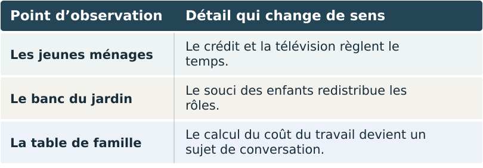

# Annie Ernaux et Les Années · Oral de littérature ENS-PSL 2019 · Corrigé guidé

*Corrigé rédigé par IA, non officiel. Signalez toute erreur.*

**Rédaction** · GPT-6.2 Astra Ultra · vitesse non renseignée

## Préparer les vingt minutes

Divisez la longue scène du cinéma en trois temps. La sortie est racontée, le bébé est imaginé pendant la projection, puis le retour est anticipé. Exercez-vous à dire pourquoi ce bref mouvement de la conscience compte autant que les références documentaires des années 1960.

> [!INDICATION]
> Dans le premier paragraphe, rapprochez le nom d’épouse, le pronom « on » et la marque du pluriel. Puis repérez les moments où apparaissent « nous » et « elles ». Quelle place une femme qui a vécu cette histoire peut-elle occuper dans ces pronoms ?

> [!METHODE]
> Pour commenter la dernière phrase longue, cherchez d’abord sa proposition principale. Relisez ensuite tout ce qu’il a fallu faire avant que les invités puissent se parler.

## Commentaire de l’installation des jeunes ménages

Dans cet extrait des *Années* (2008), personne au cinéma ne porte de prénom et l’image du bébé laissé à la maison occupe la pensée davantage que le film. Comment raconter une expérience intime à partir des gestes, des mots et des objets que toute une génération a eus en partage ? Annie Ernaux suit des jeunes couples depuis l’ouverture de leur compte en banque jusqu’à la discussion de famille sur l’emploi des femmes. Le montage des scènes fait apparaître dans leurs choix familiers une organisation sociale qui, sur le moment, leur échappait.

### Devenir adulte par les objets et par l’horaire

L’emploi stable acquis, les opérations bancaires et les appareils à acheter s’enchaînent avec une aisance que dément l’étonnement des ménages. Se marier fait découvrir ensemble le prix des choses et leur prétendue nécessité. Le réfrigérateur apparaît jusque dans le détail de son compartiment, comme dans une description commerciale. Le manque se crée au moment où l’objet entre dans l’horizon du couple. La formule de la « grâce du mariage » applique à cette découverte de la pauvreté un mot qui promettait un bienfait.

Aux « jeunes ménages » succède le pronom « on », avec des accords qui laissent entendre la pluralité de celles et ceux qui se souviennent. Pourtant, dans l’expérience d’être appelée « madame », l’accord au féminin fait affleurer un point de vue singulier. Le nom social donné avec le mariage paraît à la fois flatteur et étranger. Ce décalage exprimé en peu de mots évite de fondre tout à fait les deux membres d’un couple dans la même histoire.

Les noms de magasins dessinent une carte neuve de la ville, celle du ravitaillement. Au cinéma, la pensée s’attache aux poings fermés du bébé bien plus qu’à l’écran. L’imagination anticipe le retour vers le berceau. Ce détail tendre mesure aussi ce qu’est devenue une soirée à deux. Le titre du film de Varda, *Le Bonheur*, interroge discrètement le bonheur familial que le passage essaie de nommer. Un simple « donc » rattache à cette sortie difficile la décision d’acheter une télévision. Dans le salon, le dimanche des séries et l’heure d’une émission enfantine s’emboîtent avec le travail, la crèche et les courses. Le « bonheur d’ordre » devient une sensation effectivement éprouvée. Sa contrepartie, un projet personnel qui s’éloigne, reste audible dans les infinitifs consacrés aux activités créatrices, dont écrire.

### Un « nous » qui se surprend en train de prendre sa place

Au sein des « cellules étanches », les couples se visitent entre semblables. La brève apparition de « nous » engage celle qui écrit dans l’étonnement partagé. Le jugement qui attribue aux célibataires une sorte d’immaturité révèle les critères au nom desquels on mesure à présent une vie adulte. Connaître les traites, la nourriture pour bébé et le pédiatre réputé devient presque un titre de compétence. La liberté qui subsiste chez d’autres semble vaguement offensante à ceux qui viennent de la perdre.

L’élection présidentielle de 1965 pourrait donner une date et un sens politique à ces existences. Rétrospectivement, le nom de Mitterrand porte aussi l’histoire du conflit algérien, rappelée par la note du sujet. Dans le souvenir de l’électeur d’alors, le nom éveille une association confuse et le vote apporte surtout le plaisir de s’opposer à de Gaulle. La phrase sur l’insignifiance de l’Histoire rapporte ainsi une expérience que le livre, en la datant, fait déjà entrer dans l’histoire. De même, plus la vie paraît correspondre à ce que les discours appellent la réalité, plus elle peut être vécue comme irréelle. La construction parallèle donne une mesure au malaise sans lui inventer de cause consciente sur le moment.

### Sur le banc, puis autour de la table

Le point de vue se rapproche ensuite d’un groupe de jeunes femmes. Le jardin public pourrait rappeler les conversations de l’adolescence, mais surveiller les enfants change les sujets de parole et jusqu’à la façon de rester ensemble. Trois ans suffisent à rendre leur vie précédente invraisemblable. Le mot « Souci », avec sa majuscule, donne aux tâches répétées du linge, de la nourriture et des maladies la dimension d’un état durable. La transmission maternelle que les jeunes couples accueillaient au premier paragraphe se lit désormais comme la relève prise par les filles.

La pensée de Beauvoir et le slogan de Moulinex se trouvent coordonnés dans la même phrase. Une lecture interroge le rôle assigné aux femmes. Une publicité promet de les libérer par un appareil dont elle leur réserve toujours l’usage. Les filles disposent simultanément de ces deux discours. La désinvolture acquise par les filles a sa réalité, de même que l’obligation qui survit à leur moindre estime du travail ménager. La phrase finale du paragraphe tient ensemble ces deux états de conscience.

À table, les discours se fabriquent sous les yeux du lecteur. Il faut d’abord inviter, montrer, faire toucher, faire écouter, trouver une place pour chacun et servir un plat dont la recette circule dans *Elle*. L’accumulation diffère grammaticalement le commencement de la conversation et rend sensible tout le travail exigé par le spectacle d’un ménage bien installé. L’incise sur les verres manquants fait entendre l’anxiété sous la démonstration de goût. Après les voitures, les vedettes et les chansons, la discussion apparemment inévitable porte sur la rentabilité du travail féminin. Ce calcul répond au compte bancaire du début. Il évalue désormais la place de la femme autour d’une table dont la préparation vient de rendre visible le travail habituellement oublié.

## Après l’exposé

**Que peut rendre le « on » qu’un récit strictement individuel rendrait autrement ?** Il laisse entendre une manière de vivre partagée tout en accueillant des détails intimes, du nom d’épouse à la peur pour l’enfant. La pointe du féminin et la brève première personne du pluriel situent celle qui participe à ce « on ».

**Pourquoi les détails de marques méritent-ils d’être commentés ?** Les enseignes installent de nouvelles habitudes dans l’espace, les programmes règlent la semaine et le nom de Moulinex porte un discours sur les femmes. Les noms propres ont des fonctions distinctes selon leur place dans la phrase.

> [!PIEGE]
> La phrase sur l’Histoire rapporte la manière dont on vivait alors le rapport aux événements. L’organisation rétrospective du passage permet justement d’apercevoir les effets collectifs à l’œuvre dans les existences privées.

**Bilan.** Expliquez à voix haute le trajet qui va du crédit du ménage à la question du travail féminin. Le changement d’objet du calcul permet de relier la forme de l’extrait à son interrogation sur l’autonomie.
