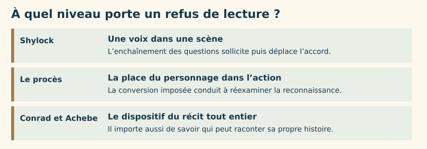

# ENS-PSL · Sélection internationale Lettres — Littérature — Beauvoir et la liberté du lecteur 2019 · Corrigé brut

*Corrigé rédigé par IA, non officiel. Signalez toute erreur.*

**Rédaction** · GPT-6.2 Astra Ultra · vitesse non renseignée

**Relecture** · GPT-6.2 Astra Ultra · vitesse non renseignée · 26 novembre 2026

**Autocontrôle** · GPT-6.2 Astra Ultra · vitesse non renseignée

La feuille cite Tout compte fait de Simone de Beauvoir et demande d’analyser et commenter sa réflexion avec des œuvres françaises et étrangères, des textes de critique et des expériences de lecture.

## Peut-on lire une œuvre qui nous refuse une place ?

Un lecteur du *Marchand de Venise* peut être saisi par la manière dont Shylock réclame, à l’acte III, la reconnaissance d’une humanité commune et se trouver profondément mal à l’aise devant l’issue que la comédie lui réserve. Ces deux expériences peuvent appartenir à une seule lecture. La première demande d’écouter une voix exposée au mépris. La seconde fait demander si le monde que construit la pièce ne retire pas lui-même à cette voix une part de ce qu’elle vient d’affirmer. Dans *Tout compte fait*, Simone de Beauvoir soutient que lire réclame un engagement de la liberté, mais que cet engagement lui devient impossible devant certaines valeurs ou certaines visions du monde. Qu’est-ce qui se ferme dans cette épreuve et existe-t-il une façon de poursuivre qui n’effacerait ni la voix étrangère ni la réticence du lecteur ?

## Accueillir une voix est une activité

La métaphore de Beauvoir ne présente pas le sens comme une marchandise qui voyagerait intacte d’une conscience à une autre. Il faut « faire le silence en soi », formule qui semble demander de renoncer momentanément aux motifs pour lesquels on approuve, on déteste ou on attend telle conclusion. Or créer ce silence exige une décision et une attention. Lire la réplique de Shylock en ne cherchant qu’un signe qui confirme le portrait du personnage avare reviendrait à reproduire le jugement dont il se plaint. Les questions qu’il enchaîne à l’acte III font passer des atteintes du corps à la similitude des réactions et enfin à la logique de la vengeance. La fin du mouvement complique l’adhésion que le début a obtenue. Le spectateur doit consentir à parcourir cet enchaînement avant de décider ce qu’il lui accorde.

Cette activité n’oblige pas à confondre le personnage et l’auteur. Les circonstances du procès à l’acte IV, la condition de conversion imposée à Shylock et le retour de la comédie au monde de Belmont déterminent aussi notre réception du discours. On peut entendre la force d’une protestation sans en conclure que tous les effets de la pièce la servent. Une lecture critique examine jusqu’au dénouement la place faite aux différentes voix. « Installer » la voix étrangère en soi ne veut donc pas dire choisir la première voix à laquelle on s’identifie et l’élever au rang de vérité de l’œuvre.

Chez Montesquieu, la dernière lettre de Roxane dans les *Lettres persanes* impose de même une révision, mais d’un autre ordre. Le lecteur a pu partager avec Usbek l’exercice de décentrement que suscite le voyage. Roxane lui fait entendre ce qu’il en est de la liberté lorsque c’est lui qui prétend l’administrer chez les autres. Le livre ne donne pas au lecteur un point de vue hospitalier une fois pour toutes. Il l’oblige à remettre en jeu le crédit qu’il avait accordé à une voix pour qu’une autre devienne audible.

## Quand c’est le dispositif qui fait obstacle

Beauvoir passe d’une condition générale, pour qu’un texte prenne sens il faut y engager sa liberté, à un aveu personnel, cela peut lui devenir impossible. Le seuil porte sur des valeurs qu’elle juge manifestement fausses ou sur une manière de voir qu’elle ne pourrait accueillir sans se contraindre elle-même. On peut refuser la prétention d’une œuvre à nous émouvoir tout en comprenant très bien ce qu’elle cherche à obtenir. Ce serait donc une erreur de réduire cette impossibilité à l’incapacité de décoder un vocabulaire ou de résumer une intrigue. Elle désigne notamment la perte du crédit que nous avions commencé par faire au texte.

Dans « An Image of Africa », publié en 1977, Chinua Achebe examine une difficulté de cet ordre dans Heart of Darkness, de Joseph Conrad. Dans le récit de Conrad, l’histoire de Marlow racontée à d’autres auditeurs n’est pas un rapport direct qui reproduirait les jugements de l’auteur sans distance. Le récit met puissamment en cause les prétentions civilisatrices de l’entreprise européenne. Achebe invite pourtant à regarder ce qui arrive lorsque l’Afrique et ses habitants servent au voyage moral du narrateur européen. Qui a la possibilité de raconter sa propre histoire ? À qui sont accordées les inflexions d’une parole individuelle ? Repérer la polyphonie du cadre ne répond pas encore à la question de savoir à quelles voix le dispositif laisse le moins de place. Le refus critique peut alors porter sur la condition même à laquelle le lecteur est invité à entrer dans le livre.

L’objection d’Achebe ne contraint pas chaque lecteur à éprouver exactement la même rupture. Elle transforme les raisons publiquement disponibles pour poursuivre ou interrompre une lecture. Si je me contente de me croire généreux parce que je condamne les violences coloniales montrées par le récit, je risque de ne pas entendre ce qu’engage le fait de les regarder presque toujours depuis une même position. La rencontre avec la critique peut me faire relire autrement un ouvrage dont je croyais connaître la direction morale.

Il importe enfin que Beauvoir distingue ce qui lui paraît puéril de ce qui lui paraît odieux. Dans le premier cas, l’obstacle peut être la pauvreté d’un jugement plutôt que sa violence. Mon évaluation peut aussi avoir été hâtive. Au dernier chapitre d’*Alice au pays des merveilles*, je pourrais prendre les incohérences du procès pour un simple jeu d’enfant. Mais quand la Reine veut faire prononcer la sentence avant le verdict, l’inversion rend saisissable l’absurdité d’une procédure dont l’issue est fixée d’avance. Ce qui paraissait pauvre en idées acquiert une force critique à mesure que je prête attention à l’ordre des paroles. Cette erreur possible n’annule pas la limite personnelle dont parle Beauvoir. Elle invite à identifier ce que je refuse avant de l’imputer à l’œuvre entière.

## Des formes différentes de fidélité et de refus

L’expérience décrite par Beauvoir possède ainsi une portée plus large qu’une liste d’écrivains qu’il faudrait ou non fréquenter. Elle appelle cependant une objection. Le désaccord qui suspend l’identification peut devenir le commencement d’une autre lecture, historique, formelle ou comparative. Je peux étudier comment une comédie distribue la parole sans accepter l’horizon de sa réconciliation finale. En suivant la protestation de Shylock jusqu’au procès, je comprends quelque chose de la coexistence dans une même pièce de la reconnaissance et de l’exclusion. Le sens ainsi produit tient précisément à l’impossibilité de me reposer dans l’accord qui m’est proposé.

Cette possibilité ne supprime pas le droit de s’arrêter. La critique peut demander qu’une œuvre soit accessible à la discussion sans exiger de n’importe quelle personne qu’elle prête sa voix à des énoncés qui la blessent ou la nient. En revanche, la facilité du rejet mérite elle aussi un examen. Il est tentant de qualifier d’odieuse une œuvre parce qu’un personnage expose un préjugé que l’ensemble du récit nous apprend à discerner. Contrôler qui parle, à qui, et avec quels effets sur la fin de l’histoire permet de distinguer une impatience du lecteur et une objection portant sur la vision de l’œuvre.

Je retiens donc de Beauvoir une conception exigeante de l’hospitalité littéraire. L’attention doit pouvoir suspendre un premier verdict pour laisser l’œuvre faire sa preuve. Cette suspension demeure un acte libre et n’oblige ni à l’assentiment final ni à la poursuite indéfinie. Parfois l’on dépose le livre. Parfois l’on y revient avec des questions qu’il n’avait pas prévu d’accueillir. Dans les deux cas, la qualité du jugement se mesure à la précision avec laquelle le lecteur peut dire à quelle voix il a fait place et pour quelle raison le crédit accordé à cette voix s’est transformé.

[Feuille de l’écrit](https://www.ens.psl.eu/sites/default/files/litterature-ecrit-sil2019.pdf) · [Folger Shakespeare Library, The Merchant of Venice, III, 1](https://www.folger.edu/explore/shakespeares-works/the-merchant-of-venice/read/3/1/) · [Folger Shakespeare Library, texte de la pièce](https://www.folger.edu/explore/shakespeares-works/the-merchant-of-venice/read/) · [Chinua Achebe, « An Image of Africa », The Massachusetts Review, 1977](https://www.jstor.org/stable/25088813) · [Lewis Carroll, dernier chapitre d’Alice](https://en.wikisource.org/wiki/Alice%27s_Adventures_in_Wonderland_%28Rackham%29/Chapter_12)
