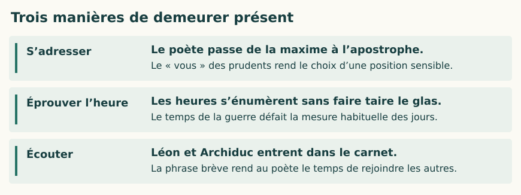

# Littérature — René Char et les Feuillets d’Hypnos · Oral PSL 2019 · Corrigé guidé

*Corrigé rédigé par IA, non officiel. Signalez toute erreur.*

**Rédaction** · GPT-6.2 Astra Ultra · vitesse non renseignée

## Préparer l’explication

Conservez les treize numéros sur votre brouillon. En regard de chacun, inscrivez une opération de parole, par exemple prescrire, songer, apostropher, souhaiter, compter ou écouter. Les variations empêchent d’enchaîner treize paraphrases isolées. Faites ensuite se répondre 19 et 31, 20 et 24, 25 et 26, 27 et 30.

Pour la lecture, distinguez l’apostrophe du numéro 22 et le ton de la confidence au numéro 30. Si le jury vous demande comment relier forme et histoire, appuyez-vous sur l’expression « Je ne puis guère m’absenter longtemps ». Elle explique matériellement une forme brève avant de devenir une exigence poétique.

## Commentaire des fragments 19 à 31

Une suite de notes numérotées peut à première vue ressembler au décompte régulier d’un journal. Dans les treize fragments des *Feuillets d’Hypnos* donnés à commenter, les horloges ont pourtant cessé de seconder le temps. René Char écrit en 1943 et 1944, dans la Résistance, puis publie son carnet en 1946. Entre les numéros 19 et 31, la voix change souvent de longueur, de personne et de destinataire. Comment entendre dans ces interruptions le travail suivi d’un poète ? Les deux notes qui encadrent le passage donnent un point de départ. La première demande au poète de descendre de la « stratosphère du Verbe ». La dernière dit pourquoi celui qui écrit ne peut s’absenter longtemps. Entre les deux, il faut regarder qui ou quoi réclame sa présence.

### Prendre pied dans une parole qui s’adresse

La note 19 ressemble à une maxime par son sujet générique, « le poète », et par le verbe de devoir. L’image qu’elle propose n’a rien d’une définition immobile. Il faut quitter une altitude presque irrespirable, se « lover » dans des larmes et avancer. Le corps se replie avant de reprendre son élan. Le verbe garde ainsi une puissance de métamorphose au moment même où il refuse de se satisfaire de son autonomie. Il faut à la parole poétique un rapport aux souffrances neuves de son temps. La brièveté de la note en fait éprouver l’urgence sans prétendre en avoir donné le programme complet.

Dès le numéro 20, un « je » prend la relève du sujet général. Il songe à l’avenir politique du pays et à la possibilité que des hommes tentés par la dictature retrouvent demain le pouvoir. Le mot « peut-être » interdit d’y lire la prophétie assurée d’un vainqueur. Ceux qui verront cet avenir seront ceux qui auront survécu. À la difficulté historique de prévoir répond au numéro 21 une brève formule recommencée, « Amer avenir ». La presque identité des sons transforme le futur en une saveur déjà présente. Le « bal » et les « rosiers », auxquels le fragment n’assigne aucune explication, introduisent une beauté assez incertaine pour inquiéter la reprise. Une formule imagée prolonge ici une pensée politique que le raisonnement ne pouvait clore.

L’apostrophe aux « prudents » de la note 22 change encore la situation. La neige et la maison chauffée, le « nous » pourchassé et le « vous » à l’abri distribuent des conditions de vie et des responsabilités. Le feu du foyer, d’abord signe possible d’hospitalité, est ramené au rôle d’un garde-malade. Sous la protection de ceux qui espèrent se tenir à l’écart, le langage de la maladie découvre un mal qui a déjà pris la parole. La sécheresse de « Trop tard » tranche le mouvement de l’accusation. Le numéro 23 réduit tout un jugement historique à deux mots, « Présent crénelé ». Le créneau dessine un relief découpé et une position défensive. Placé entre l’apostrophe et la prochaine inquiétude politique, le fragment donne presque à voir le contour heurté de la page.

### Faire entendre un temps qui se défait

Au numéro 24, la France prend la forme d’une épave. L’image aurait pu annoncer la simple nécessité d’une réparation. Mais l’épave fait la sieste, les ouvriers qui s’affairent pourraient devenir des naufrageurs, et une phrase de souhait interroge jusqu’à ceux dont on attend le secours. La langue dérange elle-même le tableau qu’elle vient de construire. Le pays ne se laisse pas réduire à la distribution confortable des victimes, des sauveurs et des coupables.

Les numéros 25 et 26 éprouvent ce changement à l’échelle de l’heure. Midi et minuit devraient être des repères communs, capables de distribuer les activités du jour et de la nuit. Char les décrit à travers des mots de séparation. Même les heures que l’on entend compter n’arrivent plus à faire taire le glas. La lente énumération des nombres donne à l’oreille l’illusion d’une avancée que la phrase, suspendue, dément. Au fragment suivant, les aiguilles d’un cadran se retournent les unes contre les autres. Le verbe « seconder » porte un écho de l’unité de mesure tout en signifiant aider. L’horloge a cessé d’orienter l’homme. À la figure réglée du cadran succède l’image du chiendent, plante obstinée qui prolifère, et dont l’homme lui-même menacerait de n’être que le principe d’une nouvelle extension. Les notes restent pourtant numérotées. Tenir ce carnet, c’est inscrire des différences précises à l’intérieur d’un présent qui menace de les engloutir toutes.

### Recevoir les mots d’autrui et régler la longueur des siens

Le numéro 27 introduit une autre ressource par un nom, Léon. Son jugement paradoxal sur la beauté des chiens enragés est suivi d’un assentiment extrêmement bref. Nous n’avons pas de scène explicative. Nous entendons successivement la parole rapportée d’un compagnon et la réponse de celui qui lui fait crédit. À côté de cette possibilité d’accord, le portrait presque proverbial de la note 28 et l’interrogation de la note 29 dénoncent une société dont la désorganisation favorise les canailles. Une même « mécanique » peut se défaire, mais le poète demande si elle détruira en se brisant ceux qu’elle a favorisés. Il s’interdit encore de faire du cours de l’histoire la garantie automatique d’une justice.

Le mouvement prend une autre ampleur avec la confidence d’Archiduc, au numéro 30. Au temps révolu du soupçon et de la tristesse succède une série de verbes au présent. Aimer, se dépenser, s’engager, se rendre vulnérable, provoquer sont les facettes successives d’une existence dont la cohérence se découvre en agissant. Le verbe « épouser », appliqué à la Résistance, donne à un choix historique l’intensité d’une relation. Char conclut par son appréciation de l’« alchimiste ». Ce nom fait de son camarade celui qui a transformé les matières mêmes de sa vie. Il ne lui retire pas sa voix en le réduisant à l’illustration d’un mot d’ordre.

La note 31 revient à la première personne pour fixer une règle de composition. La mesure d’une phrase dépend du temps pendant lequel celui qui écrit peut s’absenter de ceux parmi lesquels il agit. S’attarder risquerait de nourrir une obsession, tandis que la référence finale à l’adoration des bergers congédie une posture de contemplation. C’est à cet endroit qu’on peut revenir à la note 19. Descendre au milieu des hommes n’a pas uniformisé la poésie de Char en un discours de circonstance. Elle a trouvé dans le fragment la forme qui lui permet d’écouter un compagnon, d’interrompre une certitude et de revenir assez tôt auprès des autres.

## Deux relances pour l’entretien

**Une note comme le numéro 23 est-elle inachevée ?** La phrase nominale et les points de suspension suspendent une explication. Les mots forment cependant une image précise, dont la découpe se prolonge dans les blancs autour du fragment. Sa place entre deux notes politiques donne au lecteur de quoi l’éprouver.

**Pourquoi préciser que Léon et Archiduc sont des résistants ?** Les notes du sujet permettent d’entendre leurs propos comme la parole de compagnons réels de l’écriture et de l’action. Leurs différences de ton, l’assentiment laconique au numéro 27 et le portrait développé au numéro 30, empêchent de les confondre en une voix collective indifférenciée.

[Énoncé](https://www.ens.psl.eu/sites/default/files/litterature-oral-sil2019-2.pdf)
