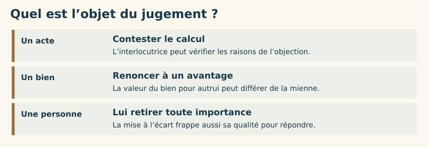

# ENS-PSL · Sélection internationale Lettres — Philosophie — le mépris 2019 · Corrigé brut

*Corrigé rédigé par IA, non officiel. Signalez toute erreur.*

**Rédaction** · GPT-6.2 Astra Ultra · vitesse non renseignée

**Autocontrôle** · GPT-6.2 Astra Ultra · vitesse non renseignée

**Révision (tour 1)** · GPT-6.2 Astra Ultra · vitesse non renseignée

La consigne demande de développer et commenter la notion « Le mépris ».

## Retirer à quelqu’un le droit de compter

Lors d’une réunion, je montre à une collègue que son calcul comporte une erreur. Si je lui tends la feuille pour qu’elle puisse contrôler le résultat, je soutiens une proposition qu’elle a, comme moi, qualité pour examiner. Si je détourne la tête et poursuis en annonçant que son avis ne compte de toute façon jamais, la relation a changé avant même que nous ayons établi le résultat. Le mépris semble faire plus que juger défavorablement. Il retire à son objet le rang qui lui permettrait de revendiquer notre attention. Pourtant, on peut admirer celui qui sait mépriser un avantage injustement obtenu et blâmer le mépris adressé à une personne. S’agit-il dans les deux cas de la même liberté de ne pas accorder de valeur, ou d’un glissement entre le pouvoir de juger et celui de rabaisser ?

## Une évaluation qui règle une distance

Un danger m’intéresse par la nécessité de m’en protéger. Un adversaire que je redoute peut recevoir de ma part une attention constante. Dans le mépris, au contraire, je tiens quelque chose ou quelqu’un pour indigne de l’importance qu’on voudrait me voir lui accorder. Dans le livre II de sa *Rhétorique*, Aristote examine comment l’impression d’avoir été traité comme négligeable peut susciter la colère. Une remarque peut blesser même si elle ne prive matériellement de rien. Elle manifeste la place qui est attribuée à celui à qui on s’adresse. C’est un caractère du mépris que de pouvoir agir par une omission, une façon d’interrompre ou le refus même de répondre.

Le distinguer de l’indifférence devient alors possible. Je ne connais pas la plupart des voyageurs de la gare et ne puis prêter une attention particulière à chacun. Cela n’implique aucun classement de leur valeur. Le mépris apparaît lorsque mon absence d’attention exprime qu’une personne en serait indigne. Il comporte une évaluation, même si je ne l’énonce jamais. Il diffère aussi du blâme. Blâmer mon interlocutrice d’avoir falsifié un chiffre suppose qu’elle puisse répondre de ses actes et que des raisons publiquement discutables s’appliquent à ce qu’elle a fait. La tenir pour incapable par nature de toute intervention digne d’examen peut la priver jusqu’à la possibilité d’entendre le blâme et d’en contester les raisons.

Cette distinction n’oblige pas à identifier le mépris à une posture toujours calme. Il peut se faire bruyant, chercher des témoins ou se mêler à la colère. Le ton calme d’un jugement ne permet donc pas de savoir, à lui seul, si quelqu’un a été traité avec mépris. Il faut demander si le geste retire une prétention déterminée à l’estime ou s’il refuse à la personne la qualité même d’interlocutrice.

## La mise à distance paraît pourtant nécessaire au jugement

On félicite parfois quelqu’un d’avoir tenu pour négligeable l’avantage qu’on lui proposait pour qu’il renonce à une exigence de justice. Dans cet usage, le mépris marque une indépendance envers une échelle de biens imposée par autrui. Une récompense que chacun paraît désirer cesse de conférer à son distributeur le pouvoir d’ordonner. Pouvoir juger qu’un prix, un titre ou la flatterie d’un public importe peu est alors une forme de liberté morale. Tout accorder indistinctement à l’estime la viderait de sa portée.

Mais l’indépendance à l’égard des récompenses se retourne facilement en supériorité à l’égard de ceux qui en ont besoin. Il m’est aisé de dédaigner la petite prime qui pourrait payer le transport d’une autre personne si je dispose déjà d’un revenu confortable. Mon désintéressement individuel ne suffit pas à établir la bassesse de qui accepte. Le passage de la valeur d’un bien pour moi à la valeur de celui qui le désire constitue une inférence injustifiée. Il révèle à quel point un sentiment présenté comme libre de toute comparaison dépend parfois de l’avantage qui permet de regarder les autres de haut.

Le problème s’accentue lorsque le jugement gagne le groupe. Si, au fil des réunions, seules les interventions des personnes dont l’accent est familier reçoivent une réponse, le mépris peut organiser une répartition de la parole sans qu’une insulte soit jamais prononcée. Ce qui est socialement efficace dans le geste n’est pas seulement la peine qu’il cause. C’est le fait que le reste du groupe apprend quelles objections il est permis de ne pas examiner. La différence entre une méprise et un mépris devient alors contrôlable en observant la réponse à la correction. Quelqu’un qui s’est trompé sur la pertinence d’un avis peut revenir à ses raisons. Un groupe qui tient par avance la personne pour négligeable risque de prendre chacune de ses protestations pour un motif supplémentaire de l’écarter.

## Une limite au retrait d’estime

Dans la *Doctrine de la vertu*, Kant distingue le peu d’estime mérité par certaines conduites et le respect qu’on ne peut entièrement retirer à une personne, même lorsqu’on réprouve ses actes. Respecter n’oblige ni à admirer ni à confier une responsabilité à qui a abusé de la sienne. Cela oblige à maintenir la possibilité d’imputer un acte à son auteur, d’en donner les raisons et de lui laisser la qualité de répondre. Si je confonds cette limite avec un devoir de bien penser de tout le monde, je rends incompréhensible la sévérité justifiée de certains jugements. Si je renonce à la limite, je me donne le droit de ne plus rien entendre de la personne à laquelle le jugement s’applique.

La distinction devient plus difficile lorsque le mépris se retourne contre soi. Si je reconnais avoir falsifié un calcul, je peux retirer ma confiance à mon propre travail, reprendre les opérations et dire ce que j’ai fait aux personnes qui l’utilisent. Si je conclus que je suis indigne de toute parole, y compris de l’aveu ou de la réparation, mon jugement ferme les possibilités que la reconnaissance de ma faute venait d’ouvrir. Personne d’autre n’a ici besoin de me regarder de haut pour que s’installe cette relation. Ce cas donne une limite à une définition du mépris par un geste extérieur de supériorité. Le retrait d’estime devient mépris lorsque le verdict sur la valeur d’une personne précède et annule ce qu’elle pourra encore dire ou faire.

On peut objecter que le refus de discuter à nouveau avec un interlocuteur de mauvaise foi peut être indispensable pour préserver une conversation commune. Un temps de parole ne saurait être illimité. Mais le refus peut porter sur une conduite identifiée et rester révisable selon une règle qui s’applique à tous. Il se distingue alors du décret qui ferait de l’interlocuteur un être sans valeur, quoi qu’il dise ou devienne. Le critère ne réside pas dans la douceur extérieure du geste. Il réside dans la possibilité de spécifier ce que l’on refuse, pour quelles raisons et jusqu’où porte le refus.

Le mépris révèle ainsi une ambiguïté de notre pouvoir d’évaluer. Nous devons pouvoir tenir peu de compte d’avantages vains et retirer notre estime à des actes condamnables. Quand cette mise à distance atteint la capacité d’une personne à compter comme sujet de raisons, elle confère à celui qui méprise un pouvoir que son jugement ne peut justifier. La distinction décisive porte donc sur l’objet et la portée de l’évaluation, ainsi que sur la relation qu’elle laisse ou non subsister.

[Feuille de l’écrit](https://www.ens.psl.eu/sites/default/files/philosophie-ecrit-sil2019.pdf) · [Aristote, Rhétorique II, 2](https://fr.wikisource.org/wiki/Rh%C3%A9torique_%28trad._Ruelle%29/Livre_II/Chapitre_2) · [Kant, Doctrine de la vertu, paragraphe 39](https://fr.wikisource.org/wiki/Doctrine_de_la_vertu_%28trad._Barni%29/%C3%89l%C3%A9ments_m%C3%A9taphysiques/Partie_2/Chapitre_1/S2/%2439)
