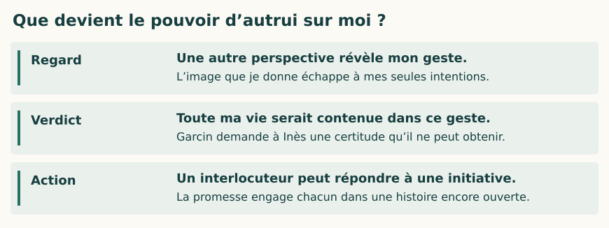

# Philosophie — Les autres, est-ce l’enfer · Oral PSL 2019 · Corrigé brut

*Corrigé rédigé par IA, non officiel. Signalez toute erreur.*

**Rédaction** · GPT-6.2 Astra Ultra · vitesse non renseignée

## Exposé

Il arrive qu’un mot maladroit adressé à un ami survive obstinément dans son souvenir. J’ai changé depuis ce jour. Lui garde la possibilité de me reconnaître dans ce geste et de me le rappeler. Quelqu’un d’autre possède donc sur moi un pouvoir qui se nourrit de ce que j’ai réellement fait et qui échappe à ce que je veux être. Faut-il y voir le principe de tout rapport à autrui ? La question fait entendre une réplique de *Huis clos*. Remarquons le changement qu’elle lui impose. Là où Garcin arrive à une exclamation au terme d’une situation singulière, le sujet demande si le sort des personnages décrit aussi le nôtre. Pour passer de sa réplique à une réponse, il faut savoir en quoi consiste leur enfer et déterminer ce qui peut nous en faire sortir.

### Être vu, ou rencontrer un aspect de soi qu’on ne maîtrise pas

Dans *L’Être et le Néant*, Sartre imagine quelqu’un penché vers une porte, occupé à regarder par le trou de la serrure. Qu’il entende un bruit de pas et la scène bascule. Un instant plus tôt, il n’y avait pour lui qu’un spectacle à saisir et des précautions à prendre. Maintenant il a honte d’être ce qu’un autre peut voir, un indiscret tapi dans le couloir. Il n’est même pas nécessaire que quelqu’un l’ait effectivement surpris. La possibilité d’une autre perspective suffit à révéler une dimension qu’il ne s’était pas donnée par réflexion. Se voir soi-même dans un miroir n’aurait pas exactement le même effet. Celui qui pourrait le voir est libre de le juger autrement qu’il ne le souhaite.

Cette possibilité de perdre la maîtrise de son image est ordinaire. Mon geste généreux pourra paraître calculé. Ma peur pourra témoigner à mes yeux d’une prudence légitime et sembler à un témoin la preuve de ma lâcheté. Je ne déciderai pas seul de son sens public. Mais il serait précipité de faire du témoin un bourreau dès qu’il prend sur moi un point de vue indépendant. S’il suffisait d’être regardé pour être damné, comment expliquer la différence entre le regard d’un témoin qui rend justice à mon geste et celui qui s’obstine à le défigurer ?

### Quand l’existence se réduit au verdict

La situation construite par le théâtre donne à la difficulté une forme extrême. Mort, Garcin ne peut plus revenir dans le monde où son départ a passé pour une fuite. Il voudrait qu’Inès, justement parce qu’elle le juge sévèrement, lui donne l’assurance qu’il est courageux. Les marques de confiance d’Estelle offrent trop peu de résistance pour le convaincre. Le juge capable de lui fournir une absolution qui vaille à ses yeux est précisément celui qu’il ne peut contraindre. La porte peut s’ouvrir sans qu’il en profite. Partir n’empêcherait pas Inès de penser ce qu’elle pense. Il faudrait emporter l’assentiment de celle à laquelle il cherche à échapper.

Voilà pourquoi la cohabitation sans répit est plus qu’un désagrément. Chacun demande à une autre liberté de le fixer dans la bonne définition, puis lui reproche de pouvoir se dérober. On comprend le mot enfer si l’on songe à la répétition indéfinie de cette demande. Une politique qui enferme des personnes dans une réputation, une origine ou un dossier peut produire parmi les vivants une telle immobilisation. Même si celles-ci entreprennent autre chose, tout nouveau geste est interprété à travers la première étiquette. Leur demander simplement de se libérer du regard d’autrui ajouterait une injustice dès lors que ce regard décide de leur accès à la parole ou à l’emploi.

### Être plusieurs pour que l’histoire puisse continuer

La pièce isole aussi ce qui manque à ses personnages. Ils ne partagent plus un monde où des initiatives pourraient transformer leur situation et susciter des réponses imprévues. Quelqu’un à qui j’ai menti pourrait attendre de moi une réparation déterminée. Je ne suis pas maître de son pardon, mais je peux m’engager devant lui, tenir parole dans la durée et lui donner des raisons nouvelles de me juger. Si autrui était seulement celui qui me fige dans mon dernier acte, on ne comprendrait pas qu’il puisse être celui qui en accueille un autre. Cette ouverture est une possibilité pratique, jamais une garantie d’être absous.

Arendt donne une portée politique à cette différence dans *Condition de l’homme moderne*. Une action révèle qui en prend l’initiative à des acteurs et à des spectateurs dont aucun n’en commande toutes les conséquences. Promettre et pardonner répondent à cette fragilité des affaires humaines. Une promesse établit un point sur lequel compter à plusieurs. Le pardon peut libérer l’agent de l’enchaînement indéfini à la faute. Loin de se soustraire à tout jugement, le sujet a besoin d’interlocuteurs capables de répondre à l’inédit. On peut leur demander de maintenir cette possibilité sans exiger d’eux un verdict favorable.

Les autres peuvent donc bien devenir l’enfer. Leur pouvoir sur mon existence est d’autant plus grand que je leur demande de décider une fois pour toutes de ce que je suis ou qu’une institution leur en donne les moyens. Le même écart entre leur liberté et la mienne rend toutefois possibles la contradiction, le crédit accordé à une promesse et la reprise d’une histoire. Garcin voudrait supprimer cet écart pour obtenir une certitude. Vivre ensemble exige d’apprendre à agir alors qu’il demeure.

## Pour l’entretien

**Une personne seule peut-elle vivre cet enfer ?** Un jugement intériorisé peut gouverner sa conduite en l’absence de ceux qui l’ont porté. La solitude physique ne supprime donc pas le rapport à leur liberté réelle ou imaginée. Elle peut aussi être un temps où l’on retrouve la capacité de reprendre la parole.

**Suffit-il qu’autrui me juge justement pour que la difficulté disparaisse ?** Un jugement exact sur un acte passé devient trompeur si l’on prétend y lire tout ce dont quelqu’un sera jamais capable. Il faut distinguer la vérité d’un témoignage et le pouvoir qu’on lui donne de clore une histoire.

[Énoncé](https://www.ens.psl.eu/sites/default/files/philo.pdf)
