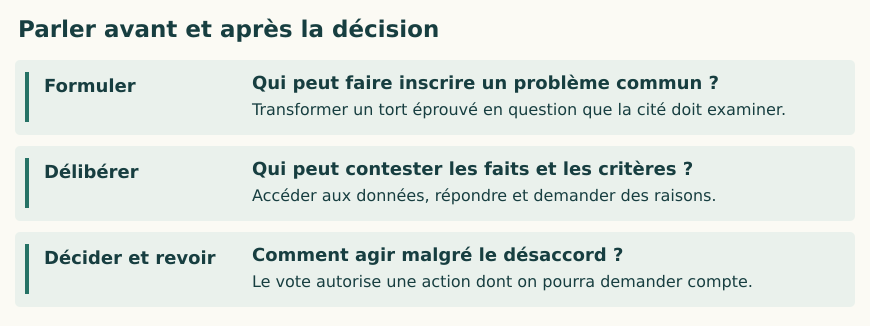

# Philosophie — Quelle est la place de la parole en démocratie ? · Oral PSL 2019 · Corrigé guidé

*Corrigé rédigé par IA, non officiel. Signalez toute erreur.*

**Rédaction** · GPT-6.2 Astra Ultra · vitesse non renseignée

**Révision (tour 1)** · GPT-6.2 Astra Ultra · vitesse non renseignée

Sur le feuillet commun de 2019, le jury attribue cette question au candidat 3. Les trois autres candidats reçoivent chacun un sujet différent.

## Préparer l’exposé

Dessinez une ligne allant de la mise à l’ordre du jour à la révision d’une décision. Placez-y une pétition, une audition d’expert, une intervention d’usager, un scrutin secret et un recours public. À chaque moment, demandez qui a qualité pour intervenir et quelle suite quelqu’un est tenu de donner à l’intervention.

Entraînez-vous à justifier le choix du scrutin secret devant un interlocuteur qui assimilerait la démocratie à la publicité de toute conviction. Sa protection explique pourquoi une institution démocratique de parole a aussi besoin d’un espace où personne n’est tenu de parler.

**Mettre à l’épreuve une institution.** Dans le cas de la rue, supposez qu’une pétition ait été remise avant le vote et que l’élu ne l’ait pas lue à la tribune. Que faudrait-il savoir pour juger si la parole des signataires a compté ? Distinguez l’inscription de leur proposition, l’examen de ses raisons et la publicité de la réponse. Le rejet de la proposition n’établit pas, à lui seul, qu’elle a été ignorée.

## Exposé

Une assemblée municipale écoute successivement des habitants qui se disputent l’aménagement de leur rue. Tout le monde a pu prendre la parole. Mais qui a formulé la question ? Qui décidera si l’objection d’une habitante mérite de modifier le projet ? Selon les réponses, la même succession de discours témoigne d’une délibération collective ou d’une consultation dont l’issue était décidée d’avance. La place de la parole se mesure mal à la quantité de mots prononcés dans un régime. Elle touche au pouvoir de définir ce dont on discute, à celui de contredire ceux qui gouvernent et au passage de la discussion à une décision obligatoire. Comment la démocratie fait-elle de la parole un pouvoir commun alors que les capacités d’être entendu demeurent inégales et qu’il faut parfois arrêter de parler pour agir ?

### De la plainte individuelle à une affaire commune

Dans la *Politique*, Aristote distingue la voix par laquelle un vivant exprime plaisir ou peine et la parole par laquelle des hommes peuvent se manifester ce qui leur paraît avantageux ou nuisible, juste ou injuste. Une habitante peut crier qu’elle a peur en traversant une rue. Lorsqu’elle demande pourquoi la sécurité de ceux qui la traversent compte moins que le temps des automobilistes, elle soumet à d’autres une certaine manière de distribuer avantages et risques. On peut lui répondre en contestant les faits, en proposant un critère plus juste ou en précisant ceux dont la situation a été omise. La parole ouvre ainsi entre les personnes un objet dont aucune n’est seule juge.

Aristote caractérise ici la cité et non la seule démocratie. Un conseil aristocratique peut lui aussi délibérer. La différence démocratique tient à la qualité reconnue à chaque membre du corps politique pour intervenir dans l’élaboration d’une affaire commune. L’égalité de parole entre citoyens à l’assemblée athénienne, l’isègoria, a donné une forme historique à ce principe. La cité en excluait notamment les femmes, les esclaves et les étrangers résidents. Ces exclusions montrent l’importance de la question préalable. Avant d’évaluer un discours, il faut avoir compté son auteur parmi ceux qui peuvent parler de justice. Une institution peut traiter comme un bruit importun ce que les intéressés ont pourtant formulé comme une raison.

### Le droit de parler et le pouvoir de se faire entendre

L’égalité d’un temps de parole suffirait-elle ? Songeons à la personne qui ne peut quitter son travail à l’heure de la réunion ou à celle qui a besoin d’un interprète. Même présente, une nouvelle venue doit parfois employer, pour faire comprendre une difficulté précise, des mots que les spécialistes tiennent pour imprécis. Un dispositif qui oblige l’administration à rendre ses données accessibles ou à répondre publiquement à une objection modifie davantage la place de cette parole que la simple permission de s’inscrire sur une liste. L’égalité politique doit faire porter l’attention sur les conditions de réception des arguments.

Platon, dans le *Gorgias*, met en scène une autre difficulté. L’orateur peut persuader un auditoire sur une question qu’il connaît moins bien que l’homme de l’art. La faculté de susciter une croyance se distingue de celle de donner un savoir. Une démocratie qui s’en remettrait à l’applaudissement risquerait de donner les décisions à ceux qui maîtrisent le mieux les effets du discours. Mais confier la décision aux seuls experts ne résoudrait pas toute la question. Un ingénieur peut calculer l’efficacité de deux aménagements à vitesse donnée. La part de l’espace public qu’il paraît juste d’attribuer à chaque usage demeure à débattre. La publicité des données et la possibilité d’entendre un avis contradictoire aident à distinguer les deux demandes de compétence.

### Décider, puis pouvoir reprendre la discussion

Parler en démocratie engage aussi ceux qui détiennent un mandat. Une promesse publique donne aux électeurs un engagement précis auquel comparer une décision future. Une explication de vote expose des raisons qu’on pourra comparer à leurs actes. Cependant il arrive qu’un désaccord persiste après que chacun a pu expliquer ses raisons. Si le dernier à demander la parole pouvait toujours empêcher une décision, un droit égal se transformerait en privilège de blocage. Une règle de clôture et de vote fait passer de raisons rivales à une action commune sans que chaque citoyen soit réputé approuver le résultat. La majorité autorise ici une décision déterminée. Elle ne transforme pas l’opinion victorieuse en vérité.

Dans une assemblée élue, la parole ne circule pas seulement entre les citoyens présents dans la salle. Une personne qui travaille le soir peut confier une observation à un représentant. Celui-ci choisit ses mots et peut en déplacer le sens. Si le compte rendu de séance garde trace de l’objection et de la réponse, l’habitante pourra vérifier ce qui a été dit en son nom. La représentation autorise une voix absente à entrer dans la discussion. Elle crée aussi une obligation nouvelle, rendre compte de la manière dont cette voix a été entendue.

Le secret de l’isoloir éclaire cette limite au primat de la parole. Un électeur doit pouvoir s’y décider sans livrer à son employeur ou à ses proches un discours qui l’expose à une sanction. Le bulletin muet garantit alors une liberté sans laquelle les débats en amont perdraient une part de leur portée. Après le vote, la faculté de réunir des faits nouveaux, de critiquer les effets de la mesure et de demander son abrogation conserve à la minorité sa place dans le gouvernement de la cité. La contestation peut même porter, entre deux scrutins, sur les questions que l’ordre du jour avait écartées.

La parole occupe ainsi plusieurs places articulées. Elle constitue une affaire en question commune, soumet les prétentions au pouvoir à la contradiction et permet de demander compte de décisions déjà prises. Son efficacité démocratique tient à des institutions qui protègent le locuteur, obligent les responsables à écouter et permettent une décision révisable. Dans notre rue, il s’agit donc de savoir ce que les habitants pouvaient mettre en discussion avant la décision et ce qu’ils pourront encore en dire après avoir vécu avec elle.

## Questions d’entraînement pour l’entretien

**Une manifestation silencieuse a-t-elle une place dans cette analyse ?** Le silence collectif, les noms portés sur une pancarte ou le parcours choisi rendent une revendication publique. Leur sens s’interprète dans une situation où d’autres peuvent demander ce que les manifestants réclament. Le politique mobilise plusieurs formes d’expression, dont la prise de parole articulée.

**L’égalité de parole oblige-t-elle à tenir toutes les assertions pour également crédibles ?** Elle garantit à chacun le droit d’intervenir et de demander des justifications. Une donnée produite par une enquête vérifiable et un chiffre inventé ne disposent pas pour autant du même crédit. La question démocratique est aussi de savoir qui peut demander cette vérification et sous quelles garanties.

[Énoncé](https://www.ens.psl.eu/sites/default/files/philo.pdf)
