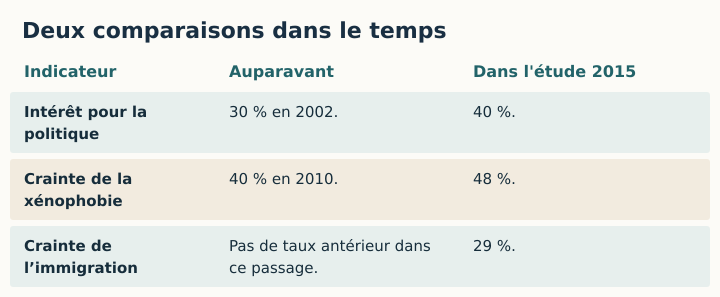

# ENS Rennes · D1 · Allemand 2019 — Corrigé guidé

*Corrigé rédigé par IA, non officiel. Signalez toute erreur.*

**Rédaction** · GPT-6.2 Astra Ultra · vitesse non renseignée

Épreuve écrite de l’École normale supérieure de Rennes. D’après la 17e étude Shell sur la jeunesse, octobre 2015.

## Version française

**Une jeunesse indifférente ?**

De plus en plus de jeunes Allemands s’intéressent à la politique. En 2015, 40 % se disent « intéressés par la politique », contre 30 % en 2002. Cet intérêt va de pair avec une disposition à s’engager personnellement dans des activités politiques. Les partis établis n’en profitent pourtant pas ; la désaffection envers la politique reste forte. Les jeunes accordent peu de confiance aux partis, tout comme aux grandes entreprises, aux Églises et aux banques. Ceux qui recueillent le plus leur confiance sont la police, les tribunaux ainsi que les associations de défense des droits humains et de l’environnement.

Près de six jeunes sur dix ont déjà participé au moins une fois à une ou plusieurs activités politiques. Le boycottage de produits pour des raisons politiques, par exemple ceux des ateliers où l’on exploite la main-d’œuvre, ainsi que la signature de pétitions viennent en tête. Les pétitions en ligne ont plus de succès que les listes de signatures sur papier. Un jeune sur quatre a déjà participé à une manifestation et 10 % s’investissent dans une initiative citoyenne.

Seuls 29 % des jeunes Allemands redoutent l’immigration, mais 48 % craignent la xénophobie, contre 40 % en 2010. En revanche, les jeunes se montrent désormais plus ouverts à l’immigration.

On peut conclure de ces chiffres que la jeunesse allemande n’est pas aussi indifférente qu’on le prétend souvent. Les nouveaux médias et les réseaux sociaux contribuent eux aussi à cette évolution favorable.

## Expression en allemand

Caractériser sa propre attitude à l’égard de la politique et des questions de société. 100 mots à 10 % près.

Politische Fragen interessieren mich besonders dann, wenn ich sehen kann, wie eine Entscheidung den Alltag verändert. Als über die Öffnungszeiten unserer Bibliothek diskutiert wurde, habe ich zuerst die Vorschläge gelesen und dann mit anderen Nutzern gesprochen. Dabei wurde mir klar, dass dieselbe Regel für Berufstätige und Schüler sehr unterschiedliche Folgen haben kann. Eine Unterschrift ist für mich manchmal ein sinnvoller Anfang, aber ich möchte auch wissen, wer anschließend über die Forderung entscheidet. Deshalb versuche ich, lokale Debatten länger zu verfolgen. Mein gesellschaftliches Interesse zeigt sich weniger in einer festen Parteibindung als in der Bereitschaft, zuzuhören und gelegentlich selbst eine Aufgabe zu übernehmen.

*102 mots, comptés par espaces.*

## Comment construire la réponse

**Comparer la même question à deux dates.** L’intérêt politique déclaré passe de 30 % en 2002 à 40 % en 2015, soit dix points de pourcentage. Les 40 % de 2010 concernent une autre réponse, la crainte de la xénophobie. Le jury relève *Politikverdrossenheit*. Il s’agit d’une lassitude envers la vie politique, compatible dans le texte avec une participation à des activités précises.

**Ne pas additionner les groupes.** Un jeune peut avoir signé une pétition et participé à une manifestation. Le nombre d’expériences individuelles ne se déduit donc pas d’une somme des pourcentages. Il faut aussi garder l’opposition lexicale entre *Zuwanderung*, l’immigration, et *Ausländerfeindlichkeit*, l’hostilité envers les étrangers.

**Donner une réponse personnelle.** Le rapport demande de dépasser la paraphrase. Suivre une seule décision, ici les horaires d’une bibliothèque, permet de dire ce qui motive l’intérêt, comment il s’exerce et ce qu’il change dans la façon d’écouter les autres.

[Feuillet original, p. 2](https://www.ens-rennes.fr/medias/fichier/sujets-e-preuve-e-crite-langues-vivantes-d1-2019_1574761210232-pdf#page=2) · [Rapport du jury, partie écrite](https://www.ens-rennes.fr/medias/fichier/rapport-de-jury-allemand-e-crit-d1-2019_1571846241605-pdf#page=1)
