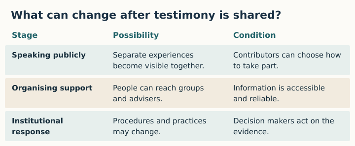

# ENS Rennes · D1 · Anglais 2019 — Corrigé brut

*Corrigé rédigé par IA, non officiel. Signalez toute erreur.*

**Rédaction** · GPT-6.2 Astra Ultra · vitesse non renseignée

Épreuve écrite de l’École normale supérieure de Rennes. Adapté de The Economist, 29 septembre 2018.

## Version française

Il y a un an, le comportement de prédateur sexuel de Harvey Weinstein a été révélé au grand jour. Jusque-là, la manière dont il traitait les femmes était un secret de Polichinelle pour certains attachés de presse, avocats et journalistes du milieu du cinéma. Une conviction tacite l’avait protégé : dans certaines circonstances, les hommes de pouvoir pouvaient fixer leurs propres règles. Au cours de l’année écoulée, cette conviction s’est heureusement effondrée très vite. Dans tous les milieux, des hommes influents ont été contraints de quitter leurs fonctions, et pas seulement aux États-Unis. Aujourd’hui, Brett Kavanaugh pourrait se voir refuser un siège à la plus haute juridiction américaine à la suite de plusieurs accusations d’agressions sexuelles qu’il aurait commises des décennies plus tôt, alors qu’il était étudiant. Ce qui avait commencé sur le canapé des auditions est arrivé jusque sur les bancs de la Cour suprême.

Grâce à #MeToo, la parole des femmes est enfin prise davantage au sérieux. Pendant trop longtemps, lorsqu’une femme prenait la parole pour mettre un homme en cause, les soupçons se retournaient contre elle.

Les violences commises par des hommes sont, elles aussi, prises plus au sérieux. Harvey Weinstein aurait commis des dizaines d’agressions sexuelles, dont des viols. Le contraste entre sa brutalité et son impunité a tiré le monde de sa complaisance. Cette semaine, Bill Cosby, qui fut l’acteur le mieux payé des États-Unis, a été incarcéré pour des violences sexuelles, la justice l’ayant qualifié de prédateur sexuel violent.

## Expression en anglais

To what extent can social media support the feminist movement? 100 mots à 10 % près.

Social media can help feminism by making patterns visible. Someone describing discrimination at work may reach colleagues who had thought their own experiences isolated. A shared campaign can then direct people towards a union, a legal service or a public meeting. Yet visibility is distributed unevenly: an account with many followers may overshadow voices that also deserve attention. Public testimony can also expose its author to harassment. For online support to last, organisers need ways to protect contributors and turn attention into action. A widely shared story can open a discussion; fair procedures and sustained organising can change an institution.

*100 mots, comptés par espaces.*

[Feuillet original, p. 3](https://www.ens-rennes.fr/medias/fichier/sujets-e-preuve-e-crite-langues-vivantes-d1-2019_1574761210232-pdf#page=3) · [Rapport du jury, partie écrite](https://www.ens-rennes.fr/medias/fichier/rapport-de-jury-anglais-e-crit-d1-2019_1571846267418-pdf#page=1)
