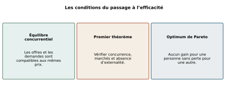
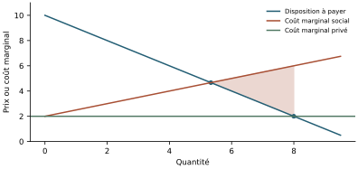

# ENS Rennes D1 — Composition d’ordre économique 2019 · Corrigé brut

*Corrigé rédigé par IA, non officiel.*

**Rédaction** · GPT-6.2 Astra Ultra · vitesse non renseignée

## Équilibre et optimum

### Introduction

Un marché peut fonctionner chaque jour avec un prix accepté par les vendeurs et les acheteurs, alors que les riverains de la production supportent un dommage dont personne ne les indemnise. Un résultat peut donc être cohérent avec les décisions prises sans être le meilleur résultat accessible selon un critère explicite. L’équilibre désigne la compatibilité de décisions ou de plans sous des règles données. L’optimum suppose un ensemble de possibilités et un critère permettant d’en comparer les éléments. Confondre les deux notions ferait passer l’issue d’un mécanisme particulier pour une prescription collective.

À quelles conditions l’équilibre des décisions privées peut-il constituer un optimum, et quel sens conserve cette comparaison lorsque ces conditions manquent ? Le lien précis établi par l’économie du bien-être fournira un point de départ. Ses limites diront ensuite quelle intervention peut améliorer un résultat jugé insuffisant et pourquoi le critère de jugement importe autant que l’ajustement des prix.

### I. La compatibilité des décisions n’assure l’efficacité que dans un cadre défini

#### A. Un point fixe des décisions et un critère de classement répondent à deux questions

En équilibre partiel concurrentiel, un prix rend compatibles les quantités que vendeurs et acheteurs souhaitent échanger sur un marché, toutes les autres conditions maintenues. L’équilibre général requiert simultanément la compatibilité des décisions sur tous les marchés et le respect des contraintes de ressources. Un équilibre de Nash est encore différent. Aucune partie ne veut changer seule sa stratégie, les autres conservant les leurs. Dans tous les cas, il faut demander qui choisit, avec quelle information, suivant quelles règles et dans quel délai. L’existence d’un équilibre ne garantit ni son unicité ni sa stabilité après un choc.

Une allocation réalisable est efficace au sens de Pareto si aucune autre ne permet d’améliorer la situation d’au moins une personne sans détériorer celle de quiconque. Plusieurs allocations incompatibles peuvent satisfaire cette définition. Dans une économie d’un seul bien convoité par deux personnes, toute répartition intégrale peut être efficace si chacune préfère davantage et si toutes les ressources sont employées. Elle peut néanmoins laisser une personne avec presque rien. Une fonction de bien-être social peut classer deux répartitions Pareto-efficaces, mais ce classement dépend alors du poids accordé à chacun. La maximisation du profit d’une seule firme fournit pour sa part un optimum privé, qui ne vaut pas par construction optimum social.

#### B. Des prix communs peuvent décentraliser une allocation efficace

Un consommateur preneur de prix arbitre entre deux biens jusqu’à égaliser son taux marginal de substitution au rapport des prix, lorsque les choix sont intérieurs. Confrontés aux mêmes prix, deux consommateurs n’ont plus de possibilité de gain mutuel à la marge par simple réallocation. Du côté des producteurs, les coûts marginaux d’une unité et sa valeur pour l’acheteur s’alignent en concurrence. Cet ajustement donne un contenu économique au premier théorème du bien-être. Sous les hypothèses appropriées, notamment des marchés complets, des comportements preneurs de prix, la non-satiété locale et l’absence d’effets non tarifés, tout équilibre concurrentiel est Pareto-efficace. Il n’affirme pas que l’équilibre existe toujours ni qu’il est juste.

La réciproque dépend de conditions supplémentaires. Le second théorème permet, avec notamment des ensembles convexes et les conditions de soutien appropriées, de décentraliser une allocation efficace choisie en redistribuant d’abord les dotations de manière forfaitaire, puis en laissant fonctionner les échanges concurrentiels. Une redistribution forfaitaire est indépendante de la décision marginale. En pratique, pour aider en fonction du besoin, l’autorité doit souvent utiliser le revenu observé, dont une partie dépend des choix d’activité. La séparation théorique entre distribution initiale et efficacité de l’échange rencontre donc une contrainte d’information. On doit préciser les instruments réellement disponibles avant d’invoquer un optimum de premier rang.

### II. Les écarts à l’optimum peuvent être expliqués et parfois réduits

#### A. Défaillances du marché et interactions stratégiques rompent le lien

Considérons une demande inverse $P=10-Q$ et un coût marginal privé constant de 2. Un secteur concurrentiel offre $Q=8$ au prix 2. Si le dommage marginal infligé à des tiers vaut $Q/2$, le coût marginal social est $2+Q/2$. Dans un modèle de surplus monétaire à utilités quasi linéaires, le surplus net est maximal pour $10-Q=2+Q/2$, soit $Q^*=16/3$. Une taxe unitaire égale au dommage marginal à cette quantité, $8/3$, incite vendeurs et acheteurs à la choisir. L’aire de la perte de surplus pour les unités entre $16/3$ et 8 est $\tfrac12(8-16/3)\times4=16/3$. Il ne s’ensuit pas que chacun gagne spontanément à la taxe. La destination de la recette et la compensation des perdants déterminent le bilan distributif.

En présence d’un monopole sans dommage externe, la firme compare recette marginale et coût marginal. Dans le même exemple la recette marginale est $10-2Q$, d’où $Q=4$ et $P=6$. Des unités valorisées entre 2 et 6 restent invendues. L’optimum privé de la firme et l’équilibre de marché ainsi obtenu n’épuisent pas les gains d’échange. Un jeu de contribution à un bien collectif offre une autre logique. Si chacun bénéficie d’une contribution des autres sans payer son coût, des meilleures réponses individuelles peuvent conduire à trop peu de financement, même si un accord collectif améliorerait la situation de tous. À chaque exemple correspond une règle d’interaction propre, de sorte qu’un même instrument correcteur ne convient pas à toutes les inefficacités.

#### B. La correction est un problème de choix collectif sous contraintes

L’intervention peut fixer un prix au dommage mesurable, financer un bien collectif ou organiser l’accès à une infrastructure de monopole naturel. Elle doit tenir compte du coût de l’information et des comportements qu’elle déclenche. Une taxe estimée à partir du dommage moyen peut différer du dommage marginal pertinent. L’incapacité à corriger une distorsion peut modifier le meilleur traitement d’une autre, ce qui définit le problème du second rang. La recherche du maximum pertinent se fait alors sur l’ensemble effectivement réalisable. Une autorité chargée de réguler peut elle-même disposer d’informations imparfaites ou favoriser certains intérêts. La comparaison raisonnable oppose des dispositifs concrets, chacun avec ses coûts.

À l’échelle macroéconomique, une demande anticipée insuffisante peut entretenir une situation de sous-emploi. Les entreprises n’embauchent pas faute de commandes, et le chômage limite les revenus et les commandes. Une compatibilité des projets à ce niveau d’activité ne démontre pas que des ressources bien employées ne permettraient aucune amélioration. Inversement, augmenter la dépense à pleine capacité ne garantit pas un gain réel. Pour parler d’optimum macroéconomique, il faut rendre explicites les critères, emploi, stabilité des prix ou distribution, et les arbitrages intertemporels. La fonction collective retenue peut valoriser une réduction d’inégalité même lorsqu’elle n’est pas une amélioration de Pareto au sens strict.

### Conclusion

L’équilibre explique comment des décisions se tiennent ensemble. L’optimum les apprécie à l’aune d’un ensemble réalisable et d’un critère. Leur coïncidence sous les hypothèses concurrentielles éclaire le rôle possible des prix. Les contre-exemples indiquent exactement où ce mécanisme échoue. Le choix de la distribution et la comparaison des remèdes appellent une évaluation que la seule observation d’un équilibre ne permet pas de mener.

[Sujet distribué](https://www.ens-rennes.fr/medias/fichier/sujet-e-conomie-d1-2019_1574759844675-pdf) · [Rapport du jury](https://www.ens-rennes.fr/medias/fichier/rapport-de-jury-econonomie-e-crit-d1-2019_1574159523834-pdf)
