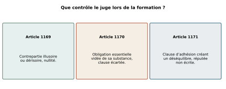
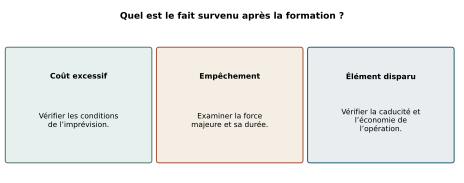

# ENS Rennes D1 — Droit civil 2019 · Corrigé guidé

*Corrigé rédigé par IA, non officiel.*

**Rédaction** · GPT-6.2 Astra Ultra · vitesse non renseignée

## L’équilibre contractuel

### Introduction

> [!INDICATION]
> Distinguer prix jugé inégal, absence de vraie contrepartie et risque assumé.

Deux parties peuvent convenir d’un loyer élevé pour un local rare et rester satisfaites de l’accord. Une clause permettant au seul bailleur de supprimer à volonté l’accès promis soulève une question très différente. Dans le premier cas, l’écart éventuel entre prix et valeur relève en principe de la liberté de négocier. Dans le second, c’est la consistance même du droit obtenu en contrepartie du paiement qui est menacée. L’équilibre contractuel peut donc désigner une équivalence économique, une réciprocité effective des droits ou la possibilité que l’accord conserve dans le temps sa fonction initiale.

Le Code réformé ne confie pas au juge une mission générale de rendre toutes les affaires également avantageuses. Les articles 1102, 1103 et 1104 articulent liberté contractuelle, force obligatoire et bonne foi. Pour un contrat postérieur à la réforme, vérifier aussi la loi de ratification du 20 avril 2018, dont certaines dispositions s’appliquent aux actes conclus à compter du 1er octobre 2018. Comment le droit garantit-il une relation contractuelle soutenable sans substituer systématiquement son propre prix à celui des parties ? Il protège les conditions et la consistance de l’échange à la formation, puis ménage une combinaison de stabilité et d’ajustement pendant son exécution.

### I. À la formation, l’équilibre tient d’abord à la liberté réelle de consentir et au contenu utile de l’échange

#### A. La volonté fixe les équivalences, sous la protection des règles de formation

> [!INDICATION]
> Rechercher le fondement précis avant de déduire une nullité de la différence de valeur.

L’article 1168 écarte en principe la nullité du contrat synallagmatique pour défaut d’équivalence des prestations, sauf si la loi en dispose autrement. Chaque partie peut préférer la certitude d’une vente rapide à la recherche d’un meilleur prix. L’exception de lésion du vendeur d’un immeuble de plus de sept douzièmes (art. 1674) répond à des conditions précises. Elle ne s’étend pas à une simple vente mobilière désavantageuse. Le déséquilibre économique n’a de portée juridique qu’au regard de la règle qui le sanctionne.

Le consentement doit être éclairé et libre (art. 1128 et 1130). Le devoir précontractuel d’information protège la partie qui ignore légitimement une information déterminante connue de l’autre, sous réserve du champ de l’article 1112-1. Il ne s’étend pas à l’estimation de la valeur. Un dol ou l’abus d’une dépendance accompagné d’un avantage manifestement excessif (art. 1143) peuvent expliquer pourquoi l’équivalence affichée a été acceptée sans véritable liberté. Il faut vérifier si, sans le vice, la victime aurait refusé ou demandé des conditions substantiellement différentes. Une annulation relative protège alors la partie dont le consentement a été vicié, avec les restitutions correspondantes. La règle restaure la liberté de choisir et ne garantit pas à toute partie un meilleur marché.

#### B. Le droit empêche certains engagements de vider l’échange de sa substance

> [!INDICATION]
> Comparer le contrat entier et la seule clause qui compromet sa substance.

L’article 1169 frappe de nullité le contrat à titre onéreux si la contrepartie convenue au profit de celui qui s’engage est illusoire ou dérisoire dès la formation. Une faible contrepartie peut s’expliquer par un risque ou une autre prestation utile. Il faut considérer l’économie entière de l’opération. L’article 1170 atteint seulement la clause qui prive de sa substance l’obligation essentielle du débiteur. Une limitation de réparation n’est pas écartée par son nom. Il faut établir ce qu’elle laisse effectivement de la prestation promise et de son efficacité.

L’article 1171 complète ce contrôle dans un contrat d’adhésion. Pour les actes relevant de la rédaction issue de la ratification, la clause visée est non négociable et déterminée à l’avance par une partie. Un déséquilibre significatif entre les droits et obligations permet de la réputer non écrite. L’examen ne porte ni sur l’objet principal ni sur l’adéquation du prix à la prestation. Un changement unilatéral de modalités accessoires, sans faculté équivalente pour l’autre partie, appelle donc une analyse de ses conditions et justifications. Les contrôles spéciaux, notamment en matière de consommation, doivent être articulés avec le droit commun. Lorsque la clause est réputée non écrite, l’article 1184 commande en principe le maintien du contrat. Invalider la clause, le contrat ou un simple effet excessif ne sont pas trois remèdes interchangeables.

### II. En cours d’exécution, l’équilibre est celui d’un risque réparti et d’une adaptation encadrée

#### A. La stabilité de l’accord peut elle-même être une protection

> [!INDICATION]
> Lire la clause de répartition du risque et déterminer l’étendue du pouvoir de fixation.

Aux termes de l’article 1193, le contrat se modifie ou se révoque par consentement mutuel ou pour les causes autorisées par la loi. Une hausse des prix ne donne donc pas au fournisseur un droit général de réclamer une révision. Le client peut avoir payé un prix initial supérieur en contrepartie de cette protection contre le risque. Réévaluer tout contrat à chaque mouvement de marché détruirait précisément l’équilibre choisi au départ.

Les parties peuvent prévoir une clause d’indexation licite, un partage des surcoûts ou une clause de renégociation définissant déclenchement, justificatifs et issue d’un échec. En cas de discordance entre conditions générales et conditions particulières, celles-ci l’emportent (art. 1119). Dans un contrat-cadre, le prix peut être fixé unilatéralement dans les conditions de l’article 1164. En cas de contestation, son auteur doit motiver le montant et un abus peut justifier dommages-intérêts ou, le cas échéant, résolution. La bonne foi interdit un détournement de la prérogative. Elle ne permet pas par principe au juge de fixer après coup le prix qu’il aurait préféré. Une clause pénale manifestement excessive ou dérisoire relève pour sa part du pouvoir spécifique de modulation prévu à l’article 1231-5.

#### B. Le bouleversement et la disparition d’un élément essentiel commandent des réponses distinctes

> [!INDICATION]
> Séparer onérosité, impossibilité et disparition d’un élément essentiel.

L’article 1195 admet l’imprévision si un changement imprévisible à la conclusion rend la prestation excessivement onéreuse à exécuter pour une partie qui n’avait pas accepté le risque. Une fabrication qui reste possible mais dont un intrant connaît un renchérissement exceptionnel peut, selon les clauses et les faits, entrer dans ce cadre. Il faut établir les coûts réels, la portion de risque normalement assumée et l’absence de solution raisonnable évitant le bouleversement allégué. Le rapport de la session rapproche cette situation d’une impossibilité. Le critère du texte est bien l’excessive onérosité. Une impossibilité empêchant l’exécution relève d’un examen distinct de la force majeure (art. 1218).

La partie demande une renégociation tout en continuant à exécuter. L’échec permet une résolution convenue ou une saisine conjointe du juge aux fins d’adaptation, puis, faute d’accord dans un délai raisonnable, une demande unilatérale de révision ou de fin du contrat. En revanche la disparition d’un élément essentiel d’un contrat valablement formé peut entraîner sa caducité (art. 1186). Ainsi, dans une opération d’ensemble, la disparition d’un contrat peut rendre un autre inexécutable ou affecter un engagement pour lequel l’exécution du premier était déterminante, sous la condition de connaissance de l’opération prévue par le texte. L’inexécution ordinaire conduit encore à d’autres sanctions, telle la réduction proportionnelle du prix dans les conditions de l’article 1223. Le choix du remède dépend donc du fait générateur et de la place qu’il occupait dans l’accord initial.

### Conclusion

> [!INDICATION]
> Indiquer ce qui justifie la stabilité avant de rappeler les possibilités de correction.

L’équilibre contractuel ne dessine pas un prix objectivement équitable que le juge imposerait en toutes circonstances. Il désigne des intérêts juridiquement protégés selon le moment considéré. La liberté de consentir et la réalité de la prestation fondent l’accord, la stabilité de la répartition des risques en permet l’usage, et des mécanismes ciblés répondent à un abus ou à son bouleversement. Un raisonnement juridique doit désigner l’intérêt atteint, la condition établie et l’effet exact demandé.

[Sujet distribué](https://www.ens-rennes.fr/medias/fichier/sujet-droit-civil-d1-2019_1574759854165-pdf) · [Rapport du jury](https://www.ens-rennes.fr/medias/fichier/rapport-de-jury-droit-civil-2019_1571846299202-pdf)

[Code civil au 1er avril de la session](https://www.legifrance.gouv.fr/codes/texte_lc/LEGITEXT000006070721/2019-04-01/) · [Loi de ratification du 20 avril 2018](https://www.legifrance.gouv.fr/jorf/id/JORFTEXT000036825602)
