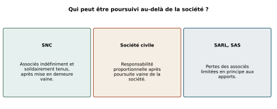
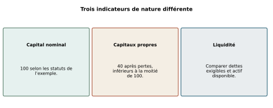

# ENS Rennes D1 — Droit commercial 2019 · Corrigé brut

*Corrigé rédigé par IA, non officiel.*

**Rédaction** · GPT-6.2 Astra Ultra · vitesse non renseignée

## Capital social et formes sociales

### Introduction

Deux entreprises peuvent afficher le même capital de 10 000 euros. Si l’une a perdu la totalité de ses actifs et l’autre dispose d’un immeuble et de liquidités, leurs créanciers n’ont manifestement pas la même perspective de paiement. Le capital social est une valeur statutaire attachée aux apports qui concourent à sa formation. Le patrimoine social réunit les droits et obligations de la personne morale et évolue avec l’activité. Le gage commun des créanciers comprend les biens du débiteur (art. 2284 et 2285 du Code civil). Il ne consiste pas en une somme égale au capital déposée intacte pour toute la vie sociale.

Le sujet demande comment la responsabilité des associés, l’organisation du pouvoir et la nature des titres modifient le rôle attribué au capital. Une présentation forme par forme manquerait ce qui les relie. Un montant légal minimum peut disparaître tandis que les fonctions de financement, de distribution des droits et de protection des tiers subsistent dans des proportions différentes. Il faut donc examiner la variation des garanties, puis la persistance d’un instrument d’organisation.

### I. L’importance du capital comme protection varie avec les recours ouverts aux créanciers

#### A. La responsabilité des associés peut compléter substantiellement le gage social

La société en nom collectif illustre cette relation. Tous les associés ont la qualité de commerçant et répondent indéfiniment et solidairement des dettes sociales, le créancier devant auparavant mettre vainement la société en demeure dans les conditions légales (art. L. 221-1 du Code de commerce). La solvabilité personnelle des associés a donc pour lui une valeur que le seul capital nominal ne révèle pas. Dans une société civile, les associés répondent en principe indéfiniment des dettes à proportion de leur part, et les créanciers doivent avoir préalablement et vainement poursuivi la personne morale (art. 1857 et 1858 du Code civil). La différence entre solidarité et division de la dette est décisive lorsque l’un des associés est insolvable.

Les commandites combinent deux situations. Les commandités ont le statut des associés en nom collectif. Les commanditaires ne supportent les pertes qu’à concurrence de leurs apports, sous réserve notamment des conséquences attachées à l’immixtion prohibée dans la gestion externe. La commandite simple n’a pas le minimum de capital que la commandite par actions emprunte au régime des sociétés par actions. La responsabilité personnelle d’une catégorie d’associés ne suffit donc pas à expliquer à elle seule la réglementation du capital. Le mode de représentation des titres et la protection des investisseurs comptent aussi.

#### B. La responsabilité limitée n’emporte plus partout un minimum significatif

La SARL et la SAS limitent la participation aux pertes en principe aux apports et laissent fixer le capital par les statuts. La faculté de constituer une société avec un montant symbolique ne devrait pas être présentée comme une garantie monétaire offerte aux créanciers. Un capital très faible peut être consommé dès les premières dépenses. Les prêteurs peuvent examiner flux futurs et actifs, stipuler des sûretés ou demander la caution du dirigeant. Les créanciers qui ne négocient pas de garanties préalables restent plus exposés. Les apports en numéraire ne deviennent pas une réserve indisponible après l’immatriculation. Ils peuvent servir l’objet social.

La société anonyme reste soumise en principe à un minimum légal de 37 000 euros (art. L. 224-2). Le même principe concerne la société en commandite par actions. La SAS est dispensée de ce minimum. Les contraintes de souscription, de libération d’une fraction des apports en numéraire et d’évaluation des apports en nature visent la réalité de la valeur annoncée. Pour la SA, les actions de numéraire sont libérées d’au moins la moitié à la souscription, le solde dans les cinq ans dans les conditions de l’article L. 225-3. Pour une SARL, un cinquième des apports en numéraire est exigé à la constitution, puis le solde dans le délai prévu (art. L. 223-7). Souscrire une somme et l’avoir déjà versée sont donc deux notions distinctes.

### II. Le capital organise les droits et discipline certaines décisions, y compris lorsqu’il est librement fixé

#### A. Apports, bénéfices et pouvoirs ne se superposent pas entièrement

Les apports en numéraire et en nature forment le capital. L’apport en industrie n’y concourt pas mais peut donner des droits sociaux lorsque la forme l’autorise (art. 1843-2 du Code civil). La SA ne peut émettre des actions représentant de tels apports. La SARL et la SAS disposent de règles propres permettant de les organiser. Un compte courant d’associé demeure en principe une créance contre la société et n’ajoute pas au capital tant qu’une opération régulière ne le convertit pas. Un même apport de liquidités peut donc procurer soit un droit d’associé exposé aux pertes, soit un droit au remboursement comme créancier.

La fraction des apports donne une clé de répartition de principe des bénéfices et des pertes, sous réserve des stipulations autorisées et de l’interdiction des clauses léonines (art. 1844-1). Les pouvoirs n’en sont pas toujours le décalque. En SARL, chaque associé dispose en principe d’un nombre de voix égal à celui des parts sociales qu’il possède. Dans une SAS, la liberté statutaire et d’éventuelles actions de préférence, sous réserve des règles impératives, peuvent dissocier pouvoir de décision et contribution financière. Dans la SNC, de nombreuses décisions supposent l’accord des personnes plutôt qu’une majorité de capital. Dans la SCA, les prérogatives des commandités ne se mesurent pas à la seule valeur des actions qu’ils détiennent. Il faut donc lire ensemble le montant, la nature des titres et le statut des titulaires.

#### B. La discipline du capital ne remplace ni la gestion de la solvabilité ni la protection des associés

Le capital ne peut être augmenté ou réduit par une simple écriture de caisse. Une modification statutaire, les décisions des organes compétents et, selon le cas, une procédure de protection des créanciers sont requises. Une augmentation ouverte à un investisseur peut diluer les associés existants. L’effet dépend de la valeur d’émission et des droits attachés aux titres, notamment du droit préférentiel de souscription lorsqu’il existe. Une réduction motivée par des pertes assainit la présentation des capitaux propres sans verser d’argent aux associés, alors qu’une réduction non motivée par des pertes peut intéresser directement les créanciers et leurs droits d’opposition.

Prenons une SARL dont le capital reste fixé à 100 et dont les pertes ont ramené les capitaux propres à 40. Le capital nominal est toujours 100, mais les capitaux propres sont inférieurs à sa moitié. Dans le droit applicable à la session de 2019, l’article L. 223-42 organise une décision des associés sur la dissolution dans les quatre mois suivant l’approbation des comptes ayant fait apparaître la perte et, si l’activité continue, une régularisation au plus tard à la clôture du deuxième exercice suivant celui de la constatation des pertes, selon le régime alors applicable. Le mécanisme analogue de l’article L. 225-248 concerne les sociétés auxquelles il est applicable. Ces règles déclenchent une information et une réaction collectives. Elles n’assurent pas que la trésorerie suffira aux échéances et ne se confondent pas avec la cessation des paiements. Les contraintes d’une société de capitaux n’ont donc de sens que rapprochées de la situation réelle du débiteur.

### Conclusion

Le capital change de fonction selon la forme sociale sans se réduire partout à un symbole. Là où les associés garantissent personnellement les dettes, le lien de confiance personnel prend une place particulière. Là où les investisseurs disposent de titres et limitent leur risque, souscription, information et protection des tiers sont renforcées ou autrement organisées. Dans tous les cas, le juriste doit distinguer trois questions concrètes, quels biens peuvent payer la dette, quels associés peuvent être poursuivis et qui décide de l’affectation des ressources.

[Sujet distribué](https://www.ens-rennes.fr/medias/fichier/sujets-e-preuve-a-option-d1-2019_1574759864908-pdf) · [Rapport du jury](https://www.ens-rennes.fr/medias/fichier/rapport-de-jury-droit-commercial-2019_1571846309998-pdf)

[Code de commerce à la date de la session](https://www.legifrance.gouv.fr/codes/texte_lc/LEGITEXT000005634379/2019-04-01/) · [Code civil à la date de la session](https://www.legifrance.gouv.fr/codes/texte_lc/LEGITEXT000006070721/2019-04-01/)
