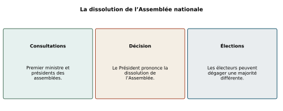
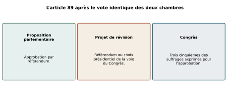

# ENS Rennes D1 — Droit public 2019 · Corrigé guidé

*Corrigé rédigé par IA, non officiel.*

**Rédaction** · GPT-6.2 Astra Ultra · vitesse non renseignée

## Le Président et le Parlement

### Introduction

> [!INDICATION]
> Délimiter la Ve République en rappelant ce que le dispositif de 1958 transforme.

La dissolution de 1997 conduit à une majorité d’orientation opposée au président qui l’a décidée. Un pouvoir constitutionnel dont il a seul la décision finale peut ainsi modifier la composition de l’Assemblée sans lui assurer son soutien. Sous les IIIe et IVe Républiques, l’effacement pratique du chef de l’État et le poids des assemblées avaient nourri la critique de l’instabilité gouvernementale. La Constitution de 1958 renforce l’exécutif et rationalise les rapports avec le Parlement. Elle ne soumet pas le gouvernement au seul président et ne permet pas non plus aux chambres de censurer le chef de l’État comme un premier ministre.

Le Président est ici celui de la Ve République. Le Parlement réunit l’Assemblée nationale et le Sénat, dont les pouvoirs ne sont pas identiques. Comment le texte ménage-t-il entre eux à la fois séparation, capacité d’action mutuelle et contrepoids, alors que la majorité électorale peut modifier leur équilibre pratique ? Il faut examiner les voies constitutionnelles d’interaction, puis les limites et les variations de la prééminence présidentielle observée.

### I. L’autonomie des légitimités n’exclut ni le dialogue ni les moyens d’action réciproques

#### A. Les deux institutions tiennent leur autorité de procédures et de fonctions distinctes

> [!INDICATION]
> Identifier qui élit, qui nomme, qui prend l’initiative de la loi et qui est politiquement responsable.

Le Président, élu au suffrage universel direct depuis la réforme de 1962, veille au respect de la Constitution et assure par son arbitrage le fonctionnement régulier des pouvoirs publics (art. 5). Le Parlement vote la loi, contrôle l’action du Gouvernement et évalue les politiques publiques (art. 24). Les députés sont élus directement, les sénateurs au suffrage indirect et assurent la représentation des collectivités territoriales. Ces mandats n’expriment pas exactement au même moment ni selon le même mode la volonté des électeurs. Aucune institution ne peut s’approprier seule la souveraineté, que le peuple exerce par ses représentants et par la voie du référendum (art. 3).

Le Président nomme le premier ministre (art. 8). Il ne peut ignorer durablement qu’un gouvernement doit échapper à la censure de l’Assemblée nationale. Le Gouvernement détermine et conduit la politique de la nation (art. 20), et le premier ministre dirige son action (art. 21). L’initiative des lois appartient au premier ministre et aux membres du Parlement (art. 39). Le programme présidentiel n’est donc pas à lui seul un acte législatif. Le conseil des ministres, le Gouvernement, l’inscription à l’ordre du jour et les votes contribuent à sa traduction en droit. Les pouvoirs dispensés de contreseing sont limitativement visés à l’article 19.

#### B. Certaines procédures associent directement le Président aux assemblées

> [!INDICATION]
> Pour chaque moyen d’action, nommer l’auteur, les consultations et ses limites.

Le Président promulgue la loi dans les quinze jours suivant la transmission de la loi définitivement adoptée au Gouvernement. Avant l’expiration de ce délai, il peut demander une nouvelle délibération que le Parlement ne peut refuser (art. 10). Il n’a pas de veto définitif. Il peut aussi saisir le Conseil constitutionnel avant promulgation (art. 61), possibilité également ouverte notamment à soixante députés ou soixante sénateurs. Le résultat relève alors du juge constitutionnel. Une nouvelle délibération, une saisine juridictionnelle et la promulgation n’ont ni le même objet ni le même effet.

Le droit de dissolution ne porte que sur l’Assemblée nationale. Le Président consulte le premier ministre et les présidents des assemblées, sans être lié par leurs avis (art. 12). Après les élections consécutives à une dissolution, aucune nouvelle dissolution n’est possible pendant un an. Les citoyens arbitrent, parfois à l’encontre des attentes du chef de l’État. Le droit de message prévu à l’article 18 permet en outre de communiquer avec les chambres. Depuis 2008, le Président peut prendre la parole devant le Parlement réuni en Congrès. Sa déclaration peut donner lieu hors de sa présence à un débat sans vote. Il s’agit d’une prise de parole politique, non d’une question de confiance.

### II. Les contrepoids constitutionnels et les majorités électorales déterminent la portée réelle des pouvoirs

#### A. Le Parlement conserve des moyens de contrôle à la mesure d’une responsabilité présidentielle particulière

> [!INDICATION]
> Distinguer censure, destitution et opposition à une nomination selon leurs seuils.

Le contrôle ordinaire s’exerce sur le Gouvernement. Questions, commissions d’enquête, examen des projets financiers et motion de censure visent des objets et des autorités déterminés. Une censure adoptée selon l’article 49 engage le Gouvernement et commande sa démission dans les conditions de l’article 50. Elle n’écourte pas le mandat présidentiel. Le Président bénéficie du régime de responsabilité des articles 67 et 68. Le Parlement constitué en Haute Cour peut le destituer pour un manquement à ses devoirs manifestement incompatible avec l’exercice de son mandat. Les votes requis sont à la majorité des deux tiers des membres composant l’assemblée concernée ou la Haute Cour. Ce mécanisme exceptionnel ne constitue pas une sanction ordinaire d’un désaccord sur une politique publique.

Le contrôle touche aussi certaines nominations présidentielles. Pour les emplois ou fonctions visés au dernier alinéa de l’article 13, les commissions permanentes compétentes de chaque chambre donnent un avis public. L’addition des votes négatifs atteignant au moins les trois cinquièmes des suffrages exprimés au sein des deux commissions empêche la nomination. Il ne faut ni étendre ce contrôle à toutes les nominations ni le transformer en exigence d’un vote positif des trois cinquièmes du Parlement. La limitation d’un pouvoir de nomination agit avant la décision et sur un objet beaucoup plus circonscrit que la mise en jeu d’une responsabilité politique.

#### B. Révision constitutionnelle et fait majoritaire révèlent interdépendance et limites

> [!INDICATION]
> Comparer la voie du projet et celle de la proposition de révision avant d’intégrer l’effet des majorités.

L’article 89 partage l’initiative de révision entre le Président sur proposition du premier ministre et les membres du Parlement. Les deux chambres doivent adopter le même texte. Le Sénat peut donc empêcher la poursuite de la procédure. Le référendum approuve en principe la révision. Pour un projet d’initiative exécutive, le Président peut choisir le Congrès, qui doit approuver à la majorité des trois cinquièmes des suffrages exprimés. Cette voie ne s’ouvre pas à une proposition parlementaire. L’article 11 relève d’une autre procédure. Son utilisation en 1962 pour réviser le mode d’élection présidentiel a précisément suscité une controverse. La participation du Parlement ne disparaît pas derrière la seule légitimité populaire du Président.

Lorsque les majorités présidentielle et parlementaire coïncident, la discipline majoritaire permet au chef de l’État d’orienter étroitement la politique menée. Le quinquennat instauré en 2000 et le calendrier électoral appliqué à partir de 2002 ont renforcé la probabilité d’une telle concordance. Il s’agit d’une probabilité politique, non d’une règle juridique. Dans les cohabitations de 1986–1988, 1993–1995 et 1997–2002, la majorité de l’Assemblée a imposé la possibilité d’un gouvernement capable d’y demeurer, sans faire disparaître les pouvoirs propres du Président. Dissolution, référendum dans les limites matérielles de l’article 11 et nomination du premier ministre conservent leur texte, mais le coût et les effets de leur utilisation varient. La permanence des compétences et l’évolution de la pratique doivent ainsi être analysées ensemble.

### Conclusion

> [!INDICATION]
> Rapprocher une compétence stable d’un épisode où les électeurs en changent les effets.

Sous la Ve République, ni le Président ni le Parlement ne dépend de l’investiture permanente de l’autre. Pourtant la mise en œuvre d’un programme, la nomination à certaines fonctions et la révision de la Constitution exigent plusieurs accords ou la possibilité d’y faire obstacle. L’exemple des cohabitations montre que le rapport entre les deux institutions ne peut être réduit au sens de l’élection présidentielle. La Constitution délimite les pouvoirs, tandis que les majorités et l’arbitrage des électeurs déterminent leurs conditions effectives d’exercice.

[Sujet distribué](https://www.ens-rennes.fr/medias/fichier/sujets-e-preuve-a-option-d1-2019_1574759864908-pdf) · [Rapport du jury](https://www.ens-rennes.fr/medias/fichier/rapport-de-jury-droit-public-d1-2019_1571846320215-pdf)

[Constitution du 4 octobre 1958 à la session](https://www.legifrance.gouv.fr/loda/id/JORFTEXT000000571356/2019-04-01/)
