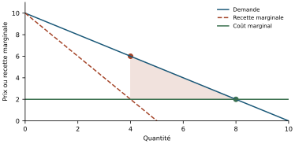
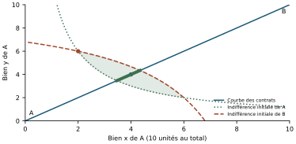
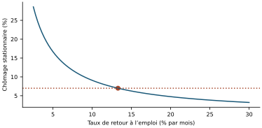

# ENS Rennes D1 — Économie (oral) 2019 · Corrigé brut

*Corrigé rédigé par IA, non officiel.*

**Rédaction** · GPT-6.2 Astra Ultra · vitesse non renseignée

Le jury donne 9 exemples de sujets tirés à la page 3 de son rapport. La feuille exhaustive des tirages manque. Les numéros ci-dessous suivent l’ordre des puces imprimées. Après trente minutes de préparation, le jury a observé 10 minutes d’exposé, puis 10 à 15 minutes de questions portant sur le sujet et le reste du programme.

## Exemple 1 — Valeur et prix.

**I. Mesurer ce qu’un bien vaut pour qui.** Pour l’acheteur, la disposition à payer la dernière unité dépend de son utilité marginale, de son revenu et des substituts. Pour le producteur, la disposition à vendre dépend du coût d’opportunité de mobiliser du travail, de l’énergie ou du capital. L’eau peut ainsi être vitale et une unité supplémentaire peu chère là où elle abonde. Les approches classiques de la valeur étudiaient davantage les conditions de reproduction et de répartition entre salaires, profits et rentes. Avant de demander si un prix est juste, il faut donc préciser le sens donné à la valeur.

**II. Le prix résulte aussi des règles de l’échange.** Sur un marché concurrentiel, un prix commun rend compatibles offres et demandes. Avec une demande inverse $p=10-q$ et un coût marginal de 2, la concurrence donne $q=8$, $p=2$. Un monopole fixe au contraire sa recette marginale $10-2q$ égale à 2, soit $q=4$, $p=6$. Le même coût et les mêmes goûts conduisent à deux prix. Une pollution sans prix ou un service gratuit aux usagers peut enfin avoir une valeur sociale élevée que la transaction ne révèle pas.

**Relance.** Qui gagne à une baisse de prix de 6 à 2 dans l’exemple ?

L’acheteur initial gagne 4 par unité achetée, et de nouveaux acheteurs entrent. Le surplus des consommateurs passe du triangle de surface 8 à celui de surface 32. Le profit d’exploitation du monopole, ici 16 en l’absence de coûts fixes, disparaît ; le gain net de surplus vaut 8.

## Exemple 2 — Produit Intérieur Brut et richesse d’une nation.

**I. Un flux de production possède une définition comptable précise.** Le PIB mesure la valeur ajoutée produite sur un territoire pendant une période, augmentée des impôts sur les produits et diminuée des subventions sur les produits. Ajouter le prix du blé, de la farine et du pain compterait plusieurs fois les mêmes consommations intermédiaires. Le PIB réel corrige l’effet des prix. Le PIB par habitant partage conventionnellement le flux entre résidents, sans décrire les revenus effectivement perçus ni leur répartition.

**II. Une nation hérite aussi d’actifs et d’engagements.** Sa richesse nette à une date comprend ses actifs non financiers et sa position financière nette vis-à-vis du reste du monde. L’épargne et les investissements, la consommation de capital fixe, les découvertes ou destructions et les réévaluations peuvent la modifier. Une reconstruction après catastrophe contribue au PIB alors que la destruction a appauvri la collectivité. Le patrimoine naturel, la santé, le loisir ou le travail domestique restent imparfaitement saisis par ces deux agrégats. Un diagnostic peut associer flux net, patrimoine par habitant, indicateurs sociaux et répartition.

**Relance.** Une hausse du prix des logements existants est-elle une hausse du PIB ?

Une plus-value sur les logements existants réévalue le patrimoine. La construction neuve et les services effectivement produits, tels les services d’agence, entrent dans le PIB. La hausse de prix peut redistribuer les possibilités d’achat entre propriétaires et nouveaux acquéreurs.

## Exemple 3 — Limiter la flexibilité des prix, est-ce réduire le risque d’instabilité ?

**I. La flexibilité rétablit certains équilibres.** Après une mauvaise récolte, une hausse du prix limite des emplois du produit et attire une offre supplémentaire. Un prix plafond contraignant peut entraîner rationnement et files d’attente. La stabilisation du prix observé rend alors moins visible une instabilité de quantité. Lorsque l’offre répond avec un délai, même des prix parfaitement flexibles peuvent osciller si les producteurs extrapolent le dernier prix et que leur offre réagit plus que la demande.

**II. Certains ajustements nominaux propagent les chocs.** En présence de dettes nominales, une baisse générale des prix majore le poids réel du remboursement. Des débiteurs réduisent leurs dépenses ou vendent des actifs, ce qui peut nourrir la contraction. Les salaires nominaux rigides peuvent stabiliser certains revenus mais ralentir un rééquilibrage des prix relatifs. Une assurance temporaire contre un choc de prix et une politique monétaire crédible n’ont donc pas le même effet qu’un gel uniforme. L’instrument dépend du marché, des contrats, et de l’horizon considéré.

**Relance.** Que devient une dette de 100 euros si le niveau général des prix baisse de 10 % ?

Mesurée en paniers de la période initiale, elle vaut désormais 100/0,9, soit 111,11. L’effort réel augmente d’environ 11,1 % si le revenu réel n’a pas changé et si la dette n’est pas indexée.

## Exemple 4 — Le rôle des banques dans la création et la politique monétaires.

**I. Le crédit bancaire crée un moyen de paiement.** Lorsqu’une banque accorde un prêt de 100 et crédite un dépôt de 100, son bilan s’allonge des deux côtés. Le remboursement du principal à partir d’un dépôt détruit de la monnaie bancaire. Un transfert vers une autre banque exige un règlement en monnaie centrale. Il redistribue les dépôts dans le système et crée un besoin éventuel de refinancement pour l’établissement de départ. Risque, rentabilité, fonds propres, liquidité et demande solvable limitent le crédit.

**II. Les banques transmettent et parfois amortissent les décisions monétaires.** Le taux directeur, les opérations de refinancement et les achats de titres influencent le coût de financement, le prix des actifs et les anticipations. Une banque fragile peut chercher à réduire son risque même lorsque les taux baissent. Une entreprise peu confiante peut renoncer à emprunter. L’impact sur investissement, production et prix dépend donc des bilans, de la concurrence bancaire, de la maturité des prêts et de la demande de crédit.

**Relance.** Un paiement entre deux clients de banques différentes détruit-il de la monnaie ?

Il débite le dépôt du payeur et crédite celui du bénéficiaire. Les banques règlent entre elles en réserves ; à système bancaire inchangé, le total des dépôts reste identique.

## Exemple 5 — Etre rationnel-le, est-ce ne jamais se tromper ?

**I. Une décision peut être cohérente et échouer.** Dans un problème de choix, on spécifie les préférences, les contraintes et l’information disponible au moment d’agir. Une assurance peut être rationnelle pour une personne averse au risque, même si aucun sinistre n’arrive. Une prévision rationnelle conditionnelle à l’information disponible peut s’écarter de la réalisation à la suite d’une nouvelle imprévisible. Le bon critère est l’absence de gain systématique accessible en utilisant mieux cette information, sous les hypothèses du modèle.

**II. La rationalité elle-même a plusieurs exigences.** Recueillir et traiter l’information coûte. Une règle simple peut être adaptée à ces coûts, comme le souligne la rationalité limitée de Simon. À l’inverse, des choix régulièrement renversés selon la présentation du même résultat, ou une négligence systématique des fréquences de base, peuvent contredire un modèle déterminé. Une expérience doit distinguer biais, coût de décision et préférences effectives. L’erreur ex post ne suffit pas à trancher entre ces explications.

**Relance.** Le pari offrant 110 ou 90 euros à chances égales vaut-il exactement 100 pour tout le monde ?

Son espérance monétaire est de 100. Une personne à utilité strictement concave préfère avec certitude 100 à cette loterie, même si elle connaît parfaitement les probabilités.

## Exemple 6 — Croissance et innovation.

**I. L’innovation peut déplacer les possibilités de production.** Une innovation de procédé réduit les intrants nécessaires, une innovation de produit peut satisfaire un usage nouveau. Dans une décomposition de la croissance, le progrès de productivité se distingue de l’accumulation de travail et de capital. Le résidu statistique comprend toutefois aussi des erreurs de mesure, des variations d’utilisation des capacités et d’autres changements d’efficacité. Il ne donne pas directement la quantité d’innovations.

**II. Les gains dépendent des incitations et de la diffusion.** Les dépenses de recherche sont risquées et créent des connaissances en partie non rivales. Une protection temporaire peut rémunérer l’invention, tandis qu’une protection trop large gêne les améliorations ultérieures. Dans un processus de destruction créatrice, les emplois, équipements et qualifications anciens ne rejoignent pas instantanément les activités nouvelles. La concurrence, le financement, la formation et les réseaux de diffusion influencent le passage d’une découverte au gain de productivité agrégé.

**Relance.** Plus de brevets prouvent-ils une croissance accélérée ?

Un brevet a une valeur très variable. La propension à breveter varie selon le secteur et les règles de dépôt. Il faut aussi examiner adoption, investissements complémentaires et productivité, en tenant compte du délai et de la sélection des entreprises innovantes.

## Exemple 7 — Préférences individuelles et choix social.

**I. L’agrégation des choix soulève une difficulté propre.** Trois électeurs classent respectivement A>B>C, B>C>A et C>A>B. À la majorité, A bat B, B bat C et C bat A. Chaque individu est cohérent, mais le vainqueur collectif dépend de l’ordre des votes. Arrow généralise cette difficulté pour au moins trois possibilités et des préférences ordinales de domaine non restreint : on ne peut satisfaire simultanément rationalité collective, unanimité, indépendance des alternatives non pertinentes et absence de dictateur.

**II. Choisir une règle revient à choisir ses exigences.** Sur un axe unique, avec préférences à sommet unique, la position de l’électeur médian peut être gagnante contre toute autre à la majorité. Une fonction de bien-être peut aussi accorder un poids explicite aux utilités, au prix d’hypothèses de mesure et de comparaison interpersonnelle. Le critère de Pareto valide une amélioration unanime mais laisse indécidée la plupart des redistributions qui font des gagnants et des perdants. Procédure de vote et jugement distributif répondent à des questions différentes.

**Relance.** Que se passe-t-il si l’on fait d’abord voter entre A et B, puis entre le gagnant et C ?

A élimine B à deux voix contre une. C élimine ensuite A à deux voix contre une. En commençant par B contre C, B l’emporte au premier tour et A l’emporte au second.

## Exemple 8 — La courbe des contrats.

**I. Représenter tous les échanges réalisables.** Dans une boîte d’Edgeworth de 10 unités de chaque bien, la position de A est $(x,y)$ et celle de B est $(10-x,10-y)$. Prenons les utilités $xy$ et $(10-x)(10-y)$. À l’intérieur, les pentes d’indifférence en valeur absolue sont $y/x$ et $(10-y)/(10-x)$. Tant qu’elles diffèrent, un taux d’échange intermédiaire permet un gain mutuel. Leur égalité donne ici $y=x$, la courbe des contrats, extrémités comprises en vérifiant les cas de bord.

**II. Distinguer efficacité, participation et sélection.** Le point initial $(2,6)$ donne à A une utilité de 12 et à B une utilité de 32. Sur la diagonale, les deux peuvent accepter $(t,t)$ si $t^2\ge12$ et $(10-t)^2\ge32$, donc environ $3,46\le t\le4,34$. La courbe entière indique l’efficacité, ce segment les gains compatibles avec les dotations. Avec les mêmes préférences et un équilibre concurrentiel intérieur, les quantités agrégées égales impliquent des prix relatifs égaux. Le budget de A vaut alors 8 et il consomme $(4,4)$.

**Relance.** Tous les points de la courbe des contrats sont-ils équitables ?

Un point peut attribuer presque tous les biens à A et rester efficace, aucune amélioration de B n’étant possible sans sacrifier A. Un verdict sur l’équité ajoute un critère distributif.

## Exemple 9 — 7% de chômage en France : une utopie ?

**I. Un taux cible requiert une définition et un mécanisme.** Le taux de chômage au sens du BIT est le nombre de personnes sans emploi, disponibles et en recherche active ou ayant trouvé un emploi qui commence prochainement, rapporté à la population active. Avec 30 millions d’actifs, 7 % signifie 2,1 millions de chômeurs. Une expansion de la demande peut relever l’emploi sous capacités inutilisées. Les frictions de recherche et l’inadéquation des qualifications ou des lieux de travail imposent d’autres leviers. Le chiffre de 7 % est l’hypothèse du sujet de 2019.

**II. Examiner les transitions et la qualité de l’emploi.** Avec des actifs constants et deux états, un taux mensuel de séparation $s$ et un taux de retour à l’emploi $f$, le chômage stationnaire vaut $s/(s+f)$. Pour $s=1$ %, atteindre 7 % suppose $f$ proche de 13,3 % par mois. Accompagnement, formation et mobilité peuvent améliorer l’appariement ; en récession, des offres insuffisantes limitent leur effet. Enfin une sortie vers l’inactivité peut réduire le taux sans créer un emploi. Taux d’emploi, durée du chômage et sous-emploi complètent le diagnostic.

**Relance.** Pourquoi le nombre d’emplois créés ne donne-t-il pas seul l’évolution du chômage ?

Quand des personnes jusque-là inactives entrent sur le marché, la population active augmente. Si l’emploi et la population active gagnent chacun 100 000 personnes, le nombre de chômeurs est inchangé, mais sa part dans la population active diminue.

[Rapport officiel du jury](https://www.ens-rennes.fr/medias/fichier/rapport-de-jury-oral-sujet-e-conomique-et-social-d1-2019_1571908242976-pdf)
