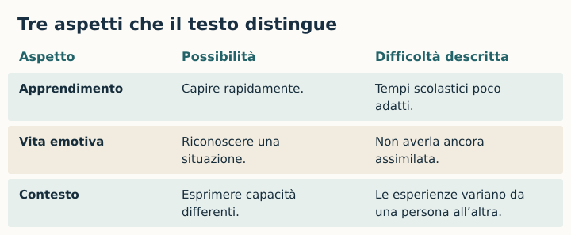

# ENS Rennes · D1 · Italien 2019 — Corrigé guidé

*Corrigé rédigé par IA, non officiel. Signalez toute erreur.*

**Rédaction** · GPT-6.2 Astra Ultra · vitesse non renseignée

Épreuve écrite de l’École normale supérieure de Rennes. D’après Anna Maria Roncoroni, Focus, 21 décembre 2012.

## Version française

**Votre enfant est-il un génie ?**

Que peut penser un parent quand son enfant parle à sept mois, se passionne pour les chiffres et les lettres à deux ans et, à quatre ans, sait lire ou peut-être même jouer du piano ? Qu’il a devant lui un enfant génial ! Selon les spécialistes, 5 à 8 % des élèves entrent dans cette catégorie. Ces enfants aux capacités exceptionnelles sont, comme tous les individus, des personnes uniques, originales, dont le caractère, la personnalité et le mode de raisonnement diffèrent d’un enfant à l’autre. Ils présentent aussi quelques traits particuliers qui se manifestent plus ou moins selon le milieu et le contexte dans lesquels ils vivent.

Leur particularité tient avant tout à leurs facultés intellectuelles. Ils ont un esprit vif et réceptif qui leur permet d’apprendre bien plus vite que leurs camarades de classe. C’est précisément pourquoi les enfants à haut potentiel ont parfois du mal à s’adapter au rythme habituel de l’école. Ils aimeraient pouvoir approfondir certaines matières ou se consacrer à d’autres sujets.

Un autre trait qui les caractérise est le décalage entre leur développement affectif et leur développement intellectuel. Il peut être source d’un grand malaise, car l’enfant est capable de comprendre rationnellement des faits ou des situations qu’il ne peut pas encore assimiler sur le plan affectif. Ces enfants font parfois preuve d’une sensibilité particulièrement vive. Leur perception intense des situations ou des événements de la vie peut entraîner un repli sur soi, un rejet ou des conduites qui s’écartent des normes, et, de ce fait, des difficultés d’adaptation sociale.

## Expression en italien

Quali vantaggi e quali svantaggi presenta, secondo te, la vita di un bambino plus-dotato? 100 mots à 10 % près.

Un bambino che impara rapidamente può provare il piacere di formulare domande originali e di seguire un interesse molto a fondo. Se la classe studia le piante, per esempio, potrebbe confrontare due semi e chiedersi perché crescano a velocità diverse. La stessa curiosità può però trasformarsi in noia se ogni esercizio gli impone di ripetere ciò che ha già capito. Inoltre, saper spiegare un fenomeno non significa sentirsi pronto a gestire una delusione o a risolvere un litigio. Credo che la scuola debba offrire attività stimolanti senza isolare il bambino dai compagni, ascoltando sia le sue idee sia le sue emozioni.

*101 mots, comptés par espaces.*

## Comment construire la réponse

**Partir des exemples, puis moduler.** L’ouverture enchaîne des âges précis, introduit la réaction admirative d’un parent, puis passe à l’analyse des spécialistes. La fourchette annoncée se rapporte aux élèves. *A seconda dell’ambiente* rappelle dans le texte que l’expression des traits varie avec le milieu.

**Garder la possibilité au lieu d’annoncer un destin.** *A volte*, *può creare* et *può portarli* limitent la portée du passage sur les difficultés. Dans *sono in grado di*, il est question de capacité ; devant *a livello emotivo*, *elaborare* signifie intégrer ou assimiler une expérience. Le contraste entre cognition et émotion ne suppose aucun jugement de valeur sur la personne.

**Répondre aux deux volets.** Une même curiosité aide l’enfant à explorer et peut lui rendre les exercices répétitifs pénibles. Cet exemple commun relie avantages et difficultés. Une proposition pédagogique finale répond concrètement aux besoins décrits sans supposer que tous les enfants vivent la même situation.

[Feuillet original, p. 5](https://www.ens-rennes.fr/medias/fichier/sujets-e-preuve-e-crite-langues-vivantes-d1-2019_1574761210232-pdf#page=5)
