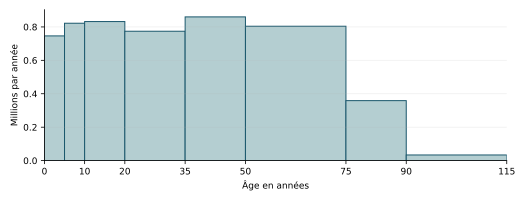
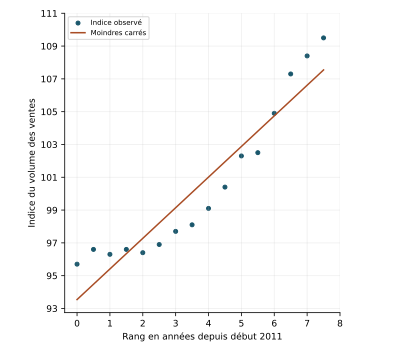
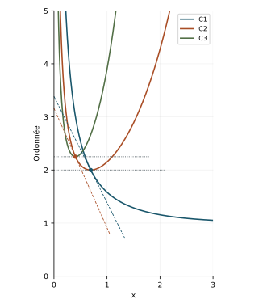

# ENS Rennes D1 — Mathématiques appliquées et statistiques 2019 · Corrigé guidé

*Corrigé rédigé par IA, non officiel. Signalez toute erreur.*

**Rédaction** · GPT-6.2 Astra Ultra · vitesse non renseignée

**Révision (tour 1)** · GPT-6.2 Astra Ultra · vitesse non renseignée · 26 novembre 2026

Épreuve de quatre heures, pages physiques 3 à 9 du fascicule d’options. Le rapport de jury souligne l’intérêt de justifier les encadrements, les régressions et les probabilités conditionnelles. Les numéros suivent les trois exercices imprimés.

## Exercice 1. Âges en France et indice des ventes

### Question 1.1.a

> [!INDICATION]
> Identifier la variable individuelle avant son regroupement.

#### Solution

L’individu est une personne et le caractère est son âge, quantitatif continu, regroupé en classes de largeurs inégales. Les $x_i$ sont les effectifs de ces classes, exprimés en millions.

### Question 1.1.b

> [!INDICATION]
> Pour des classes inégales, faire représenter chaque effectif par une aire.

#### Solution

Sur papier, un centimètre représente cinq ans en abscisse. Pour les huit classes, les hauteurs en millions de personnes par année sont les quotients de l’effectif par la largeur, soit, par ordre d’âge, $0{,}746$ ; $0{,}822$ ; $0{,}832$ ; $0{,}774$ ; $0{,}860$ ; $0{,}804$ ; $0{,}359$ ; $0{,}0336$. Les aires redonnent les effectifs.

### Question 1.1.c

> [!INDICATION]
> Comparer les densités et non les effectifs bruts.

#### Solution

La hauteur maximale est $12{,}9/15=0{,}860$ million par an. La seule classe modale est celle des 35 à moins de 50 ans.

### Question 1.1.d

> [!INDICATION]
> Pondérer chaque pourcentage par l’effectif de sa classe.

#### Solution

Si $w_i=x_i p_i$ avec $p_i$ la proportion féminine, la somme des $w_i$ vaut $34{,}58584$ millions, sur $66{,}99$ millions au total. Le pourcentage global est donc $100\times34{,}58584/66{,}99\simeq51{,}628\,\%$.

### Question 1.1.e

> [!INDICATION]
> Placer successivement toutes les femmes de chaque classe à sa borne basse puis près de sa borne haute.

#### Solution

Pour les classes $[l_i,u_i[$, $\sum_iw_il_i/\sum_iw_i\le\bar a_F<\sum_iw_iu_i/\sum_iw_i$. Les deux bornes numériques valent environ $35{,}13258$ et $51{,}64170$ ans. La borne basse peut être atteinte et la borne haute approchée arbitrairement ; le tableau regroupé ne permet pas de resserrer cet encadrement. On traite l’âge comme une grandeur continue.

### Question 1.1.f

> [!INDICATION]
> Effectuer le même encadrement pour les hommes et comparer les scénarios extrêmes.

#### Solution

Les poids masculins sont $x_i-w_i$ et totalisent $32{,}40416$ millions. Les bornes analogues valent environ $32{,}60261$ et $48{,}75079$ ans. Placer les femmes aux débuts de classe et les hommes près des fins rend la moyenne féminine inférieure ; inverser ces placements la rend supérieure. Les deux configurations respectent le tableau : les moyennes regroupées ne permettent donc pas de les ordonner. Les âges moyens par sexe dans chaque classe, s’ils étaient connus, permettraient de conclure.

### Question 1.2.a

> [!INDICATION]
> Associer le rang zéro au premier semestre 2011.

#### Solution

On place les seize couples du tableau dans l’ordre croissant des rangs $0,0{,}5,\ldots,7{,}5$. Par exemple les points extrêmes sont $(0;95{,}7)$ et $(7{,}5;109{,}5)$. À l’échelle demandée, une unité de rang représente 2 cm et un point d’indice 1 cm. La droite ajoutée est calculée en 1.2.d.

### Question 1.2.b

> [!INDICATION]
> Utiliser le diviseur seize pour la variance descriptive.

#### Solution

$\bar y=\sum_i y_i/16=100{,}54375$. La variance empirique de la série est $V_y=\sum_i y_i^2/16-\bar y^2=20{,}79121$ points d’indice au carré.

### Question 1.2.c

> [!INDICATION]
> Rapporter la covariance aux deux écarts types.

#### Solution

On a $\bar x=3{,}75$, $V_x=5{,}3125$, $C_{xy}=16^{-1}\sum_i(x_i-\bar x)(y_i-\bar y)=9{,}9203125$. Alors $r=C_{xy}/\sqrt{V_xV_y}\simeq0{,}94392$. Une droite décrit raisonnablement la tendance croissante observée, avec une courbure visible dans le nuage.

### Question 1.2.d

> [!INDICATION]
> Utiliser la pente des moindres carrés et le point moyen.

#### Solution

Pour la régression de $y$ sur $x$, $a=C_{xy}/V_x=1{,}86735$ et $b=\bar y-a\bar x=93{,}54118$. La droite $\widehat y=1{,}86735x+93{,}54118$ est tracée avec le nuage en 1.2.a.

### Question 1.2.e

> [!INDICATION]
> Convertir l’année demandée en rang.

#### Solution

Le premier semestre 2020 a pour rang $9$. La droite prévoit $\widehat y=110{,}34735$, soit environ $110{,}35$ points d’indice.

### Question 1.2.f

> [!INDICATION]
> Prendre le logarithme naturel de chaque indice, sans arrondir les valeurs utilisées ensuite.

#### Solution

La transformation conserve les rangs semestriels. Les logarithmes ci-dessous sont arrondis à cinq décimales.

| $x$ | $z=\ln y$ | $x$ | $z=\ln y$ |
|---:|---:|---:|---:|
| 0,0 | 4,56122 | 4,0 | 4,59613 |
| 0,5 | 4,57058 | 4,5 | 4,60916 |
| 1,0 | 4,56747 | 5,0 | 4,62791 |
| 1,5 | 4,57058 | 5,5 | 4,62986 |
| 2,0 | 4,56851 | 6,0 | 4,65301 |
| 2,5 | 4,57368 | 6,5 | 4,67563 |
| 3,0 | 4,58190 | 7,0 | 4,68583 |
| 3,5 | 4,58599 | 7,5 | 4,69592 |

### Question 1.2.g

> [!INDICATION]
> Calculer le coefficient de Pearson avec les logarithmes.

#### Solution

$\bar z\simeq4{,}609586$, $V_z\simeq0{,}00199369$ et $C_{xz}\simeq0{,}09754733$. Ainsi $r_{xz}\simeq0{,}94784$ : l’ajustement affine est justifié comme description du nuage transformé.

### Question 1.2.h

> [!INDICATION]
> Reprendre les coefficients des moindres carrés dans la variable transformée.

#### Solution

La pente vaut $a_z=C_{xz}/V_x\simeq0{,}01836185$ ; l’ordonnée à l’origine est $b_z=\bar z-a_z\bar x\simeq4{,}54072879$. Donc $\widehat z=0{,}01836185x+4{,}54072879$.

### Question 1.2.i

> [!INDICATION]
> Transformer le seuil en un rang puis distinguer date interpolée et observation semestrielle.

#### Solution

$\widehat y=e^{b_z}e^{a_zx}\simeq93{,}7591e^{0{,}01836185x}$. La cible $1{,}10\times109{,}5=120{,}45$ est atteinte pour $x=[\ln(120{,}45)-b_z]/a_z\simeq13{,}643$. En temps continu, le franchissement tombe dans la seconde moitié de 2024. Sur les rangs semestriels effectivement observables, le premier rang supérieur est $14$, premier semestre 2025. La projection dépasse nettement le dernier rang $7{,}5$ et dépend du maintien de la tendance estimée.

## Exercice 2. Étude de la famille de fonctions

### Question 2.I.1

> [!INDICATION]
> Comparer le quotient à un.

#### Solution

Pour $n\ge2$, $n/(n-1)>1$ et le logarithme strictement croissant vaut zéro en un. Donc $a_n>0$.

### Question 2.I.2

> [!INDICATION]
> Résoudre l’équation d’annulation du facteur.

#### Solution

Pour $n=1$, l’expression vaut $-1$. Pour $n\ge2$, $(n-1)e^x-n$ est strictement croissante et s’annule en $a_n=\ln(n/(n-1))$ : son signe est négatif avant, positif après.

### Question 2.I.3

> [!INDICATION]
> Différencier le quotient en conservant le facteur exponentiel commun.

#### Solution

Pour $f_n=e^{nx}/[n(e^x-1)]$, la règle du quotient donne $f_n'(x)=e^{nx}[n(e^x-1)-e^x]/[n(e^x-1)^2]=e^{nx}[(n-1)e^x-n]/[n(e^x-1)^2]$.

### Question 2.I.4

> [!INDICATION]
> Relier le signe du facteur à celui de la dérivée.

#### Solution

La dérivée a le signe de 2.I.2. Sur $(0,+\infty)$, $f_1$ décroît strictement de $+\infty$ vers $1$. Pour $n\ge2$, $f_n$ décroît de $+\infty$ à $f_n(a_n)$ sur $(0,a_n]$, puis croît de cette valeur vers $+\infty$ sur $[a_n,+\infty)$.

Pour $n=1$,

| $x$ | $0^+$ | $(0,+\infty)$ | $+\infty$ |
|---|---|---|---|
| $f'_1(x)$ | | $-$ | |
| $f_1(x)$ | $+\infty$ | $\searrow$ | $1$ |

Pour $n\ge2$,

| $x$ | $0^+$ | $(0,a_n)$ | $a_n$ | $(a_n,+\infty)$ | $+\infty$ |
|---|---|---|---|---|---|
| $f'_n(x)$ | | $-$ | $0$ | $+$ | |
| $f_n(x)$ | $+\infty$ | $\searrow$ | $f_n(a_n)$ | $\nearrow$ | $+\infty$ |

### Question 2.I.5

> [!INDICATION]
> Lire le changement de sens de variation.

#### Solution

Pour $n\ge2$, $f_n$ admet son unique minimum global en $x=a_n$, point où sa dérivée passe du signe négatif au signe positif.

### Question 2.I.6

> [!INDICATION]
> Évaluer simultanément le numérateur et le dénominateur.

#### Solution

Comme $e^{a_n}=n/(n-1)$, $n(e^{a_n}-1)=n/(n-1)$. D’où $f_n(a_n)=(n/(n-1))^{n-1}$.

### Question 2.I.7

> [!INDICATION]
> Comparer le quotient de deux fonctions strictement positives.

#### Solution

$f_{n+1}(x)/f_n(x)=ne^x/(n+1)$. Donc $C_{n+1}$ est en dessous de $C_n$ pour $0<x<a_{n+1}=\ln((n+1)/n)$, la rencontre en cette unique abscisse et est au-dessus pour $x>a_{n+1}$.

### Question 2.I.8

> [!INDICATION]
> Combiner l’intersection et la valeur du minimum de la courbe suivante.

#### Solution

$f_n(a_{n+1})=f_{n+1}(a_{n+1})=((n+1)/n)^n$ par 2.I.6–7.

### Question 2.I.9

> [!INDICATION]
> Calculer la dérivée logarithmique et vérifier le facteur annoncé.

#### Solution

$f_n'/f_n=n-e^x/(e^x-1)$. En $a_{n+1}$, $e^x=(n+1)/n$, donc le quotient vaut $n-(n+1)=-1$. Ainsi $f_n'(a_{n+1})=-((n+1)/n)^n$. Le facteur supplémentaire $1/n$ figurant dans la question n’est pas compatible avec la dérivée de 2.I.3. Pour $n=2$ la pente est $-9/4$.

On peut tester l’égalité directement à partir de $f_2(x)=e^{2x}/[2(e^x-1)]$. En $x=\ln(3/2)$, la formule du quotient donne
$$f'_2(x)=\frac{(3/2)^2[(3/2)-2]}{2[(3/2)-1]^2}=-\frac94.$$
La formule imprimée donnerait $-9/8$ en ce point. La tangente à $C_2$ de la question suivante utilise donc la pente $-9/4$.

### Question 2.I.10

> [!INDICATION]
> Placer les points de rencontre avant de tracer les tangentes.

#### Solution

Dans le repère orthonormé (5 cm par unité sur papier), les minima de $C_2,C_3$ sont $(\ln2,2)$ et $(\ln(3/2),9/4)$. Leurs tangentes horizontales sont $y=2$ et $y=9/4$. Les tangentes obliques sont $y=2-2(x-\ln2)$ sur $C_1$ et $y=\tfrac94-\tfrac94(x-\ln(3/2))$ sur $C_2$. La droite $y=1$ est asymptote de $C_1$ à droite.

### Question 2.II.1

> [!INDICATION]
> Reconnaître la dérivée du logarithme du dénominateur.

#### Solution

$f_1(x)=e^x/(e^x-1)$ a pour primitive $\ln(e^x-1)$ sur le domaine. Ainsi $I_1=\ln 2-\ln(e-1)=\ln(2/(e-1))$.

### Question 2.II.2

> [!INDICATION]
> Mettre les deux termes sur le même dénominateur.

#### Solution

$(n+1)f_{n+1}-nf_n=(e^{(n+1)x}-e^{nx})/(e^x-1)=e^{nx}$.

### Question 2.II.3

> [!INDICATION]
> Intégrer entre les deux bornes du sujet.

#### Solution

Par linéarité, $(n+1)I_{n+1}-nI_n=[e^{nx}/n]_1^{\ln3}=(3^n-e^n)/n$.

### Question 2.III.1

> [!INDICATION]
> Comparer la fonction à sa valeur en un.

#### Solution

$\phi'(x)=1/x-1\le0$ pour $x\ge1$, strictement négative pour $x>1$. La fonction passe de $\phi(1)=0$ vers $-\infty$. Donc $\ln x\le x-1$ sur cet intervalle.

### Question 2.III.2

> [!INDICATION]
> Substituer le quotient définissant le point minimal.

#### Solution

Avec $x=n/(n-1)$ dans 2.III.1, on obtient $a_n\le n/(n-1)-1=1/(n-1)$.

### Question 2.III.3

> [!INDICATION]
> Prendre le logarithme de la valeur du minimum.

#### Solution

$\ln f_n(a_n)=(n-1)a_n$ est strictement positif et au plus un. En exponentiant, $1<f_n(a_n)\le e$.

## Exercice 3. Probabilités et coût de la pêche

### Question 3.I.1

> [!INDICATION]
> Distinguer les probabilités d’espèce et les probabilités de vente conditionnelles.

#### Solution

$P(A)=1/2$, $P(B)=1/6$, $P(R)=1/3$. Parmi les ablettes $P(G\mid A)=1/6$, et parmi les brochets $P(G\mid B)=1/2$.

### Question 3.I.2

> [!INDICATION]
> Multiplier la probabilité du brochet par sa probabilité de vente.

#### Solution

$P(B\cap G)=(1/6)(1/2)=1/12$.

### Question 3.I.3

> [!INDICATION]
> Suivre la branche de l’ablette.

#### Solution

$P(A\cap G)=(1/2)(1/6)=1/12$.

### Question 3.I.4

> [!INDICATION]
> Additionner les deux événements disjoints de vente.

#### Solution

$R,A,B$ forment une partition. Comme $P(G\mid R)=0$, la formule des probabilités totales donne $P(G)=0+1/12+1/12=1/6$.

### Question 3.I.5

> [!INDICATION]
> Comparer la probabilité d’intersection au produit.

#### Solution

$P(A)P(G)=(1/2)(1/6)=1/12=P(A\cap G)$. Les événements $A$ et $G$ sont donc indépendants.

### Question 3.I.6

> [!INDICATION]
> Conditionner parmi les seules prises vendables.

#### Solution

$P(B\mid G)=P(B\cap G)/P(G)=(1/12)/(1/6)=1/2$.

### Question 3.I.7

> [!INDICATION]
> Évaluer le tarif moyen parmi les gros poissons.

#### Solution

Les deux espèces sont équiprobables parmi les ventes : le tarif antérieur moyen est $(7+1)/2=4$ euros par gros poisson. Trois euros représentent une perte moyenne de un euro par vente, soit $1/6$ euro par journée de pêche. Le marché diminue la recette espérée ; il supprime toutefois l’incertitude sur le tarif d’une prise vendable.

Pour comparer les recettes sur une même base, l’ancien tarif rapportait par jour $7P(B\cap G)+P(A\cap G)=8/12$ euro. Avec le prix unique, l’espérance quotidienne tombe à $3P(G)=1/2$ euro. Leur différence est bien $1/6$ euro par jour.

### Question 3.I.8

> [!INDICATION]
> Associer une recette à chaque événement disjoint.

#### Solution

$P(S=0)=5/6$, $P(S=1)=1/12$, $P(S=7)=1/12$. Alors $\mathbb ES=8/12=2/3$ euro, $\mathbb ES^2=50/12=25/6$ et $\operatorname{Var}S=25/6-4/9=67/18$ euros carrés.

### Question 3.I.9

> [!INDICATION]
> Remarquer que rentrer sans rien implique l’absence de vente.

#### Solution

$R\subset\bar G$, donc $P(R\mid\bar G)=(1/3)/(5/6)=2/5$.

### Question 3.II.1

> [!INDICATION]
> Identifier le nombre d’essais et la probabilité de succès.

#### Solution

Les 24 journées sont indépendantes et chacune fournit une vente avec probabilité $1/6$. Donc $X\sim\operatorname{Bin}(24,1/6)$.

### Question 3.II.2

> [!INDICATION]
> Appliquer les formules des moments binomiaux.

#### Solution

$\mathbb EX=24/6=4$ et $\operatorname{Var}X=24(1/6)(5/6)=10/3\simeq3{,}3333$.

### Question 3.II.3

> [!INDICATION]
> Retrancher les cas de zéro et d’une seule vente.

#### Solution

$P(X\ge2)=1-(5/6)^{24}-24(1/6)(5/6)^{23}\simeq0{,}9270$.

### Question 3.II.4

> [!INDICATION]
> Soustraire les frais fixes des recettes.

#### Solution

$Y=3X-8$ euros. Donc $\mathbb EY=3\cdot4-8=4$ euros et $\operatorname{Var}Y=9(10/3)=30$ euros carrés.

### Question 3.II.5

> [!INDICATION]
> Exprimer la perte en un seuil entier de ventes.

#### Solution

$3X-8<0$ équivaut à $X\le2$. La probabilité cherchée est $\sum_{k=0}^2\binom{24}{k}(1/6)^k(5/6)^{24-k}\simeq0{,}2118$.

### Question 3.III.1

> [!INDICATION]
> Lire le paramètre de la loi de Poisson.

#### Solution

Pour $Z$ de loi de Poisson de paramètre cinq, $\mathbb EZ=\operatorname{Var}Z=5$.

### Question 3.III.2

> [!INDICATION]
> Évaluer la masse en quatre.

#### Solution

$P(Z=4)=e^{-5}5^4/4!\simeq0{,}1755$.

### Question 3.III.3

> [!INDICATION]
> Conditionner sur un nombre strictement positif de poissons.

#### Solution

Comme $\{Z=4\}\subset\{Z\ge1\}$, la probabilité vaut $e^{-5}5^4/[4!(1-e^{-5})]\simeq0{,}1767$.

### Question 3.IV.1

> [!INDICATION]
> Centrer et réduire la longueur en centimètres.

#### Solution

Pour $\Phi$ la fonction de répartition normale standard, $P(L>15)=1-\Phi((15-20)/8)=\Phi(0{,}625)\simeq0{,}7340$.

### Question 3.IV.2

> [!INDICATION]
> Standardiser les deux bornes.

#### Solution

$P(16\le L\le24)=\Phi(0{,}5)-\Phi(-0{,}5)=2\Phi(0{,}5)-1\simeq0{,}3829$.

### Question 3.IV.3

> [!INDICATION]
> Convertir la probabilité de dépassement en quantile inférieur.

#### Solution

$\Phi((30-\mu)/10)=0{,}66$. Donc $\mu=30-10\Phi^{-1}(0{,}66)\simeq25{,}8754$ cm, cohérent avec une probabilité de dépassement de 30 cm inférieure à une moitié.
