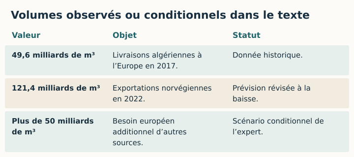

# ENS Rennes · D1 · Russe 2019 — Corrigé brut

*Corrigé rédigé par IA, non officiel. Signalez toute erreur.*

**Rédaction** · GPT-6.2 Astra Ultra · vitesse non renseignée

Épreuve écrite de l’École normale supérieure de Rennes. Texte sur le marché européen du gaz, données de 2017 et déclaration d’octobre 2018 ; auteur de l’extrait non indiqué sur le feuillet.

## Version française

Au cours des cinq prochaines années, la Russie pourrait accroître considérablement ses livraisons de gaz à l’Europe et augmenter sa part du marché européen. Ces perspectives s’expliquent par le recul des approvisionnements par plusieurs autres voies et par la hausse des besoins en gaz.

Ces perspectives s’expliquent par le recul des approvisionnements par plusieurs autres voies et par la hausse des besoins en gaz. En 2017, l’Algérie a livré à l’Europe 49,6 milliards de mètres cubes de gaz par gazoduc et sous forme de gaz naturel liquéfié (GNL). Toutefois, du fait de l’augmentation de sa consommation, elle pourrait renoncer à ses exportations dès 2022.

Aux Pays-Bas, les autorités régionales et des particuliers ont déposé 26 recours pour obtenir l’arrêt anticipé de l’extraction dans le grand gisement de Groningue, le plus important, d’où provient la moitié du gaz néerlandais. On souhaite fermer ce gisement parce que son exploitation provoque de fortes secousses sismiques. La Direction norvégienne du pétrole (NPD) a revu à la baisse ses prévisions d’exportation de gaz pour 2022, les ramenant à 121,4 milliards de mètres cubes.

Si l’exploitation de Groningue et les livraisons algériennes s’arrêtent et que la Norvège ne parvient pas à découvrir de nouveaux gisements importants, les besoins de l’Europe en gaz importé d’autres sources augmenteront de plus de 50 milliards de mètres cubes, soit le quart des livraisons russes actuelles, estime l’expert Dmitri Marintchenko.

D’après les estimations d’Eurostat, les besoins de l’Europe en gaz importé ont augmenté de 8,3 % en 2017 pour atteindre 312,1 milliards de mètres cubes. Gazprom s’attend à ce que la demande progresse encore de 19 % à l’horizon 2025 et de 25 % à l’horizon 2030.

En octobre 2018, le vice-président du directoire de Gazprom a déclaré que les projets Nord Stream 2 et TurkStream étaient indispensables pour répondre à cette demande supplémentaire.

## Expression en russe

Expliquer la part du gaz russe et les conséquences économiques et géopolitiques possibles. Environ 100 mots.

Согласно тексту, доля российского газа может увеличиться, если европейский спрос продолжит расти, а другие поставщики сократят экспорт. В Алжире больше газа требуется внутреннему рынку, в Нидерландах добыча вызывает опасения из-за землетрясений. При таких условиях дополнительные поставки из России могли бы помочь европейским потребителям и принести новые доходы российскому экспортёру. Однако зависимость от одного крупного поставщика ослабляет позиции покупателя на переговорах и делает перебои более ощутимыми. Кроме того, выбор маршрута газопровода затрагивает интересы транзитных стран. Поэтому экономическая выгода для одной стороны может сочетаться с политическими рисками для другой. Всё зависит от спроса, условий контрактов и наличия альтернативных источников газа.

*98 mots, comptés par espaces.*

[Feuillet original, p. 6](https://www.ens-rennes.fr/medias/fichier/sujets-e-preuve-e-crite-langues-vivantes-d1-2019_1574761210232-pdf#page=6)
