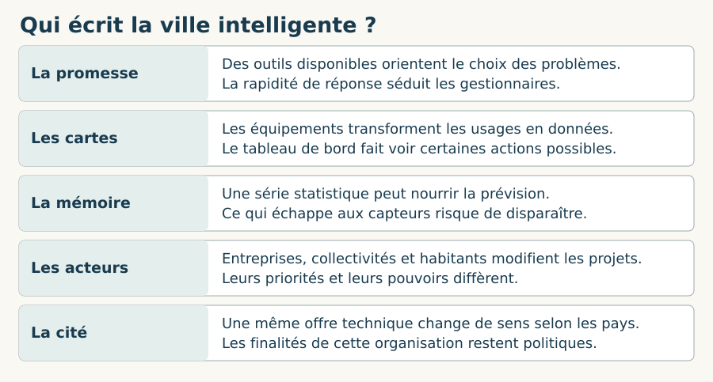
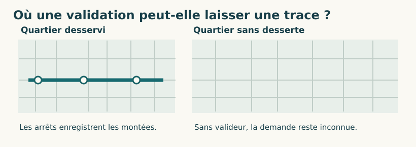

# ENS · Cycle master mathématiques — Français et culture générale 2019 · Corrigé brut

*Corrigé rédigé par IA, non officiel. Signalez toute erreur.*

**Rédaction** · GPT-6.2 Astra Ultra · vitesse non renseignée

**Autocontrôle** · GPT-6.2 Astra Ultra · vitesse non renseignée

**Révision (tour 1)** · GPT-6.2 Astra Ultra · vitesse non renseignée · 26 novembre 2026

## Sujet et consignes

La garde 2C9123 porte les noms de l’École normale supérieure Paris-Saclay et de l’École normale supérieure de Rennes. Durée de l’épreuve, trois heures.

Marc Chopplet, « Smart City : quelle intelligence pour quelle action ? Les concepts de John Dewey, scalpels de la ville intelligente », Quaderni, 2018/2, n° 96, p. 71–86. Le feuillet précise que l’article est reproduit en partie.

Résumer le texte en 360 mots (avec une marge de tolérance de + ou – 10%). Le nombre exact de mots utilisés sera indiqué en fin de résumé. Le résumé vaut dix points. La marge autorisée va de 324 à 396 mots.

La question 2 vaut dix points. Les deux réflexions sont reproduites et traitées sous leurs lettres respectives.

Sous forme d’un développement construit, commenter, au choix, l’une des deux réflexions suivantes de l’auteur :

- Option a — «…. après la ville à la fois connectée techniquement et déconnectée là où il n’existe pas (encore ?) de données, les « big data » dessinent une ville sans mémoire autre que statistique. »
- Option b — « Mais parle-t-on encore de cité ? »

## 1. Résumé

La ville intelligente se présente comme une réponse aux difficultés des métropoles. Les anciennes villes idéales proposaient un projet à réaliser. Ici, les technologies disponibles sélectionnent les problèmes auxquels elles peuvent répondre. Les pouvoirs et les libertés que cette approche réserve aux citoyens restent en question. Intelligence désigne une faculté de connaître, tandis que le terme anglais smart suggère surtout une réponse rapide, adaptée aux circonstances et séduisante pour autrui.

Certains promoteurs prédisent une singularité technologique lorsque des machines traiteront simultanément assez de données pour atteindre une intelligence nouvelle. Plus concrètement, les concentrations urbaines et les limites administratives semblent appeler des partenariats entre collectivités et entreprises. La ville devient un ensemble à piloter en temps réel. Téléphones, bâtiments et véhicules connectés alimentent ces réseaux en données parfois personnelles. Toutefois, la cité vivante peut disparaître derrière son double cartographique. Les données superposées sur la carte représentent surtout les actions possibles là où des capteurs existent.

Cette profusion de discours techniques dissimule les intérêts en jeu. Des modèles publics et privés concurrents promettent de mieux gérer les mêmes ressources et conçoivent de nouvelles manières de facturer les services. Certains y cherchent aussi des occasions de créer. Pour les grandes entreprises, la bonne santé urbaine se mesure à la fluidité des personnes, des marchandises et des informations. Les données renouvelées sans cesse servent à prévoir la demande suivante. La mémoire se réduit aux séries disponibles, laissant dans une relative obscurité les situations mal enregistrées.

La vision plus imaginative des concepteurs promet une vie écologique et collaborative, mais privilégie les lieux de transit et de consommation, au détriment des populations pauvres. Les idéaux de participation et de durabilité risquent de devenir des instruments pour modeler les conduites. La possibilité même de faire cité devient douteuse. Son projet demeure cependant disputé. Les entreprises écrivent leurs programmes, les institutions, les artistes et les habitants en modifient le sens. Cet horizon est donc surtout politique. Dans le contexte américain, la puissance des entreprises numériques accompagne un retrait recherché de la puissance publique. En France, les collectivités peuvent y chercher une autre manière de servir le public. Ailleurs, une architecture spectaculaire doit affirmer le pouvoir de ses commanditaires.

**360 mots.**

## 2a. Une ville « sans mémoire autre que statistique » ?

«…. après la ville à la fois connectée techniquement et déconnectée là où il n’existe pas (encore ?) de données, les « big data » dessinent une ville sans mémoire autre que statistique. »

Un service de transports dispose de millions de validations aux arrêts de ses lignes. Cette archive peut lui dire combien de voyageurs sont montés un certain soir. Elle ignore combien auraient souhaité se rendre dans un quartier où aucun bus ne passe. Marc Chopplet relève le paradoxe d’une ville suréquipée en connexions qui devient « déconnectée là où il n’existe pas (encore ?) de données ». Quand les mesures s’accumulent, que retient une ville de ce qu’elle est devenue ? L’archive chiffrée enrichit la mémoire urbaine, mais les conditions de son usage peuvent faire disparaître les traces les plus nécessaires au jugement collectif.

Une série enregistrée permet d’abord de retrouver ce qu’aucun témoin ne peut reconstituer à lui seul. Des relevés de température distribués sur plusieurs quartiers montrent que des épisodes caniculaires touchent inégalement les rues minérales et les zones arborées. Ils peuvent contredire l’impression qu’une même température officielle convient à toute l’agglomération. Toutefois une mesure placée à l’ombre dans une cour et une mesure prise sur un toit ne renseignent pas directement sur l’exposition d’une personne qui attend le bus en plein soleil. Sans la mémoire du dispositif, de son déplacement et de la méthode d’enregistrement, l’abondance des valeurs donne une fausse continuité à la série.

La parenthèse « encore ? » laisse ouvertes deux explications de la zone blanche. Des validations peuvent arriver demain, pour une ligne aujourd’hui en panne. Mais une rue sans desserte ne produira jamais de validations, quel que soit le temps d’attente. Dans ce second cas, le problème est de savoir comment recueillir une trace d’un déplacement souhaité. Une enquête auprès des habitants change ce que la ville pourra se rappeler au moment de décider du prochain itinéraire.

Un second effacement concerne les événements qui ne prennent pas la forme d’une occurrence répétable. Le nom d’une place peut rappeler une usine démolie et les luttes ouvrières dont elle fut le lieu. Un compteur de fréquentation enregistrera les passants qui la traversent, sans rien apprendre de cette histoire ni du sens d’un rassemblement exceptionnel. Même stockée indéfiniment, une série employée à prévoir le trafic des dix prochaines minutes traite le passé surtout comme réservoir de régularités. Ici se précise l’alerte de Chopplet. Un système peut tout enregistrer dans son domaine de compétence et cependant oublier les raisons pour lesquelles une trace importait.

La mémoire urbaine demande donc des institutions qui sachent tenir ensemble les moyens de preuve. Une décision sur le déplacement d’un marché peut confronter les passages mesurés aux récits des vendeurs, aux plans successifs et aux usages de personnes dépourvues de téléphone. Un témoignage doit lui aussi pouvoir être situé et discuté. L’enjeu est de conserver des traces dont nul ne connaît à l’avance tout l’usage et d’accepter que leur interprétation soit contestée. La statistique contribue alors à la mémoire d’une cité dont les habitants continuent de dire ce qui vaut la peine d’être transmis.

## 2b. « Mais parle-t-on encore de cité ? »

« Mais parle-t-on encore de cité ? »

Deux personnes peuvent emprunter un bus ponctuel et, grâce à leur téléphone, connaître exactement le même temps de trajet. La première a participé à la décision de maintenir cette desserte peu rentable. La seconde n’a jamais eu d’autre possibilité que de choisir parmi des trajets proposés par une plateforme. Le service rendu est comparable, la place faite à chacune dans la décision ne l’est guère. En demandant « Mais parle-t-on encore de cité ? », Chopplet distingue la commodité de l’équipement urbain et le pouvoir de se donner collectivement des règles. Quelles conditions font d’une ville organisée pour ses usagers une cité gouvernée aussi par eux ?

L’efficacité des services rend bien possible une vie partagée. Un compteur qui révèle une fuite dans une conduite publique permet de protéger une ressource commune. Un tableau indiquant les ascenseurs de stations en panne aide les personnes qui ont besoin d’un parcours accessible. Dans ces deux cas, des informations rapidement actualisées corrigent des inégalités concrètes dans l’accès à la ville. On comprend la séduction du mot « intelligent » pour celui qui pouvait hier encore rester bloqué au dernier escalier.

Mais aucune optimisation ne décide seule de la destination collective. Dans un quartier, rendre les voitures plus fluides peut augmenter la vitesse de traversée tout en isolant les deux côtés d’une rue pour les enfants qui se rendent à l’école. Une solution satisfaisante pour le transit ne répondra pas forcément à ceux qui habitent sur place. Si le propriétaire du dispositif choisit les données, les termes du problème et la définition du succès, le citoyen peut exprimer sa satisfaction devant l’application sans avoir prise sur la règle qui lui est appliquée. Une cité perd sa substance politique quand l’expression d’une préférence commerciale tient lieu d’arbitrage entre des droits.

Le « mais » de Chopplet prend ainsi tout son sens. Après avoir suivi la promesse d’une ville sensible à tout événement, demandons ce qui arrive à celui qui refuse le trajet jugé optimal. Peut-il contester en public le critère de choix et faire rouvrir la décision ? Si sa seule réponse possible est de cliquer sur une autre offre, la pluralité des services peut coexister avec la fermeture du débat. Ce pouvoir de révision donne un contenu actuel au mot « cité ».

Le dossier de Chopplet invite pourtant à voir la ville comme une écriture sans cesse reprise. Des habitants peuvent faire apparaître sur une carte des passages dangereux qu’aucun accident déclaré n’avait encore signalés. Le service municipal doit alors publier ses critères, examiner ces observations en assemblée et expliquer les choix budgétaires qui en résultent. Une concertation qui exclurait les personnes peu équipées reconduirait l’angle mort initial. Une cité subsiste là où les conditions de participation, de contestation et de révision restent ouvertes. Le numérique peut améliorer ces conditions dès lors que les résidents conservent effectivement le pouvoir de déterminer ce qui doit compter.

[Sujet officiel](https://ens-paris-saclay.fr/sites/default/files/CONCOURS/ANNALES_2C/2C_Math/2019_SE2C_MATHS_Francais_V2.pdf) · [Rapport du jury](https://ens-paris-saclay.fr/sites/default/files/CONCOURS/ANNALES_2C/2C_Math/2019_RE_2C_MATHS_Francais.pdf)
