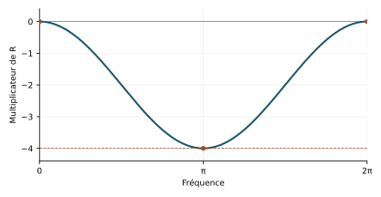

# ENS Paris-Saclay et Rennes — Cycle master, mathématiques 1 de 2019 · Corrigé brut

*Corrigé rédigé par IA, non officiel. Signalez toute erreur.*

**Rédaction** · GPT-6.2 Astra Ultra · vitesse non renseignée

**Mathématiques générales.** Les produits hermitiens sont antilinéaires en première variable. On écrit $D(T)$ pour le domaine et $C_c^\infty$ pour les fonctions lisses à support compact. La transformée de Fourier utilise le facteur $e^{-ix\xi}$ du sujet.

## A.1. Graphes fermés

### Question 1

La somme des deux produits hermitiens est antilinéaire à gauche, linéaire à droite et hermitienne. Sa diagonale vaut $\|u\|^2+\|Tu\|^2\ge0$, nulle seulement pour $u=0$. C’est donc un produit scalaire sur $D(T)$, de norme $\|u\|_T=(\|u\|^2+\|Tu\|^2)^{1/2}$.

### Question 2

Le graphe est l’image de l’isométrie bijective $u\mapsto(u,Tu)$ de $(D(T),\|\cdot\|_T)$ sur $\Gamma(T)$. Un sous-espace d’un espace de Hilbert est complet pour la norme induite exactement lorsqu’il est fermé. Ainsi $T$ est fermé si et seulement si son domaine en norme du graphe est complet.

## A.2. Adjoint et double adjoint

### Question 3

Le vecteur nul convient. Si $u,v\in D^*$ admettent des constantes $C_u,C_v$, alors $|\langle au+bv,T\phi\rangle|\le(|a|C_u+|b|C_v)\|\phi\|$ pour tout $\phi\in D(T)$. On peut augmenter la constante si besoin pour la rendre positive. Donc $D^*$ est un sous-espace.

### Question 4

Pour $T:H\to H$ continu, $|\langle \psi,T\phi\rangle|\le\|\psi\|\,\|T\|\,\|\phi\|$ pour tout $\psi,\phi\in H$. Ainsi $D^*=H$.

### Question 5

La forme continue $x\mapsto\langle a-b,x\rangle$ s’annule sur une partie dense, donc partout. Tester en $x=a-b$ donne $\|a-b\|^2=0$, d’où $a=b$.

### Question 6

Pour $\psi\in D^*$, la forme $\phi\mapsto\langle\psi,T\phi\rangle$ sur $D(T)$ est linéaire en $\phi$ et bornée pour la norme de $H$. La densité prolonge cette forme de façon unique à $H$. Par représentation de Riesz il existe un unique $u_\psi\in H$ tel que la forme soit $\phi\mapsto\langle u_\psi,\phi\rangle$. L’unicité sur le seul domaine découle aussi de 5.

### Question 7

Pour tout $\phi\in D(T)$, $\langle au_\psi+bu_\eta,\phi\rangle=\bar a\langle\psi,T\phi\rangle+\bar b\langle\eta,T\phi\rangle=\langle a\psi+b\eta,T\phi\rangle$. L’unicité de 6 donne $u_{a\psi+b\eta}=au_\psi+bu_\eta$. Ainsi $T^*:\psi\mapsto u_\psi$ est un opérateur linéaire sur $D^*$.

### Question 8

Le couple $(a,b)$ est orthogonal à $\Gamma(T)$ exactement si $\langle b,T\phi\rangle=\langle-a,\phi\rangle$ pour tout $\phi\in D(T)$. Cette égalité implique $b\in D(T^*)$ et $T^*b=-a$, par 6, et ces deux conditions impliquent en retour l’orthogonalité. Ainsi $(a,b)=(-T^*b,b)=J(b,T^*b)$, d’où $\Gamma(T)^\perp=J\Gamma(T^*)$.

### Question 9

Par 8, $\Gamma(T^*)=J^{-1}(\Gamma(T)^\perp)$. L’orthogonal est fermé et $J$ est une isométrie continue, donc ce graphe est fermé.

### Question 10.a

Soit $b\perp D(T^*)$. Le couple $(0,b)$ est orthogonal à chaque $(-T^*u,u)$, donc à $\Gamma(T)^\perp$ par 8. Comme $T$ est fermé, $\Gamma(T)^{\perp\perp}=\Gamma(T)$ ; ainsi $(0,b)=(0,T0)$ et $b=0$. Le domaine adjoint, sous-espace de complément orthogonal nul, est dense.

### Question 10.b

L’identité $\langle Jx,Jy\rangle=\langle x,y\rangle$ entraîne $(JA)^\perp=J(A^\perp)$. Comme $J^2=-I$, $J^{-1}=-J$ ; or $A^\perp$ est un sous-espace stable par le signe. D’où $J^{-1}(A^\perp)=J(A^\perp)=(JA)^\perp$, même si $A$ est une simple partie.

### Question 10.c

Par 10.a, $T^{**}$ est défini. En appliquant 8 à $T^*$ puis 10.b à $A=\Gamma(T^*)$, on trouve
$$\Gamma(T^{**})=J^{-1}(\Gamma(T^*)^\perp)=(J\Gamma(T^*))^\perp=\Gamma(T)^{\perp\perp}=\Gamma(T).$$
L’égalité des graphes comprend celle des domaines et des actions, donc $T^{**}=T$.

## A.3. Différence seconde discrète

### Question 11

Sur $\ell^2(\mathbb Z)$, le décalage $(Uu)_n=u_{n+1}$ et son inverse sont des isométries par changement d’indice. Ainsi $R=U+U^{-1}-2I$ est linéaire sur l’espace entier et $\|Ru\|_2\le4\|u\|_2$. Il est continu, donc fermé. La formule utilise des indices dans $\mathbb Z$, y compris négatifs.

### Question 12

Le changement d’indice dans le produit de $\ell^2$ (série absolument convergente par Cauchy–Schwarz) donne $U^*=U^{-1}$. Ainsi $R^*=U^{-1}+U-2I=R$, sur tout $\ell^2(\mathbb Z)$.

## B.1. Régularisation dans L²

### Question 13

Si $\operatorname{supp}f\subset[-R,R]$, $f$ est uniformément continue sur $[-R-1,R+1]$ par Heine–Cantor. Pour deux points à distance inférieure à 1, si l’un appartient au support ils sont tous deux dans ce grand segment ; si aucun n’appartient au support les deux valeurs sont nulles. On obtient l’uniforme continuité sur $\mathbb R$.

### Question 14

$\rho_n*f(x)=\int\rho_n(y)f(x-y)dy$ est absolument convergente, majorée par $\|f\|_\infty\|\rho_n\|_1=\|f\|_\infty$. Un terme non nul requiert $|y|\le1/n$ et $x-y\in[a,b]$, donc $x\in[a-1/n,b+1/n]$. Ce fermé contient le support.

### Question 15

Avec $\omega_f(h)=\sup_{|x-y|\le h}|f(x)-f(y)|$, $|\rho_n*f(x)-f(x)|\le\int\rho_n(y)|f(x-y)-f(x)|dy\le\omega_f(1/n)$. Par 13, ce majorant indépendant de $x$ tend vers 0.

### Question 16

Pour chaque $x$, $\rho_n(x-\cdot)$ appartient à $L^2$, donc sa multiplication par $f$ est intégrable par Cauchy–Schwarz. Sur un voisinage compact de $x$, les noyaux translatés et toutes leurs dérivées restent bornés, avec supports dans un compact commun ; $f$ y est intégrable. La dérivation sous l’intégrale, répétée à tout ordre, donne $(\rho_n*f)^{(m)}=\rho_n^{(m)}*f$. Ainsi $\rho_n*f\in C^\infty$.

### Question 17

Comme $\rho_n\ge0$ et $\int\rho_n=1$, $|\rho_n*f(x)|^2\le\int\rho_n(y)|f(x-y)|^2dy$. En intégrant et en appliquant Tonelli puis l’invariance de la mesure par translation, $\|\rho_n*f\|_2^2\le\|f\|_2^2$.

### Question 18

Pour $g\in C_c^0$ proche de $f$ en $L^2$, $\|\rho_n*f-f\|_2\le2\|f-g\|_2+\|\rho_n*g-g\|_2$ par 17. Le dernier terme tend vers 0 par 14–15, car les supports restent dans un compact fixe. La densité donne $\rho_n*f\to f$ en $L^2$. Ensuite
$$\|\chi_n(\rho_n*f)-f\|_2\le\|\chi\|_\infty\|\rho_n*f-f\|_2+\|(\chi_n-1)f\|_2.$$
Le dernier terme tend vers 0 par convergence dominée, puisque $\chi_n(x)\to1$ pour tout $x$.

### Question 19

Par 16 et la coupure lisse compacte, $\chi_n(\rho_n*f)\in C_c^\infty$. Par 18 elles tendent vers chaque $f\in L^2$ dans cette norme. Ainsi $C_c^\infty(\mathbb R)$ est dense dans $L^2(\mathbb R)$.

## B.2. Dérivée faible et caractérisation de Fourier

### Question 20

Si $u,v$ conviennent, $\int (u-v)\phi=0$ pour tout $\phi\in C_c^\infty$. En conjugant le choix du test, $u-v$ est orthogonal à $C_c^\infty$, dense dans $L^2$ par 19. Donc $u=v$ comme classes de $L^2$. L’existence de la dérivée faible implique son unicité.

### Question 21

Pour $\psi\in\mathcal S$, $\psi$ et $\psi'$ sont dans $L^2$ par décroissance rapide. L’intégration par parties classique donne $\int\psi\phi'=-\int\psi'\phi$ pour $\phi\in C_c^\infty$. Donc $\psi\in H^1$ et $d_\psi=\psi'$.

### Question 22

La dérivation faible est linéaire par 20, donc la formule proposée est un produit scalaire (comme en 1). Si $(\psi_j)$ est de Cauchy en norme $H^1$, alors $\psi_j\to\psi$ et $d_{\psi_j}\to v$ dans $L^2$ pour certains $\psi,v$. Les tests $\phi,\phi'$ sont dans $L^2$, donc Cauchy–Schwarz permet de passer à la limite dans $\int\psi_j\phi'=-\int d_{\psi_j}\phi$. On obtient $\psi\in H^1$ avec $d_\psi=v$ et convergence en norme $H^1$. L’espace est complet.

### Question 23.a

Pour $\psi\in\mathcal S$, $\chi_n\psi$ est lisse à support compact et tend vers $\psi$ en $L^2$ par domination. Sa dérivée est $\chi_n\psi'+n^{-1}\chi'(\cdot/n)\psi$. Le premier terme tend vers $\psi'$ comme précédemment et la norme du second est au plus $n^{-1}\|\chi'\|_\infty\|\psi\|_2$. Ainsi l’approximation a lieu en norme $H^1$.

### Question 23.b

Fixons $R>0$ et une coupure lisse compacte $\eta$ valant 1 sur $[-R,R]$. Alors $\eta(u-v)\in L^2$ car $u$ est localement de carré intégrable. Elle s’annule contre tous les tests (tester initialement par $\eta\phi$) et vaut donc zéro presque partout par 19. Ainsi $u=v$ presque partout sur $[-R,R]$ pour tout entier $R\ge1$. Une réunion dénombrable donne l’égalité presque partout sur la droite et $u\in L^2$.

### Question 23.c

Écrivons $\widehat f=\mathcal Ff$. La relation faible équivaut, en prenant les conjugués des tests, à $\langle v,\phi\rangle=-\langle\psi,\phi'\rangle$. Si $v=d_\psi$, 23.a permet de l’étendre à chaque $\phi\in\mathcal S$. Comme $\widehat{\phi'}=i\xi\widehat\phi$ par intégration par parties et que Plancherel multiplie le produit par $2\pi$, on obtient
$$\int\overline{\widehat v}\,\widehat\phi=\int\overline{i\xi\widehat\psi}\,\widehat\phi.$$
L’automorphisme de Schwartz fait parcourir tous les tests de Schwartz à $\widehat\phi$. Or $i\xi\widehat\psi$ est localement dans $L^2$. Par 23.b cette fonction est égale presque partout à $\widehat v$, donc dans $L^2$. Réciproquement, si $i\xi\widehat\psi\in L^2$, posons $v=\mathcal F^{-1}(i\xi\widehat\psi)$. En remontant les égalités sur les tests compacts, on retrouve $v=d_\psi$. Ainsi $\psi\in H^1$ exactement lorsque $\xi\widehat\psi\in L^2$, et $\widehat{d_\psi}=i\xi\widehat\psi$.

### Question 23.d

Par Cauchy–Schwarz,
$$\|\widehat\psi\|_1\le\left(\int\frac{d\xi}{1+\xi^2}\right)^{1/2}\left(\int(1+\xi^2)|\widehat\psi|^2d\xi\right)^{1/2}=\sqrt\pi\sqrt{2\pi}\,\|\psi\|_{H^1}.$$
On utilise ici 23.c et Plancherel. Le membre droit est fini.

### Question 23.e

L’inversion du rappel donne un représentant $\psi(x)=(2\pi)^{-1}\int e^{ix\xi}\widehat\psi(\xi)d\xi$. Il est continu par convergence dominée grâce à 23.d, et $|\psi(x)|\le(2\pi)^{-1}\|\widehat\psi\|_1\le\|\psi\|_{H^1}/\sqrt2$.

### Question 24.a

Pour chaque $x$, le test $y\mapsto\rho_n(x-y)$ a dérivée $-\rho_n'(x-y)$. La définition de $d_f$ donne $(\rho_n'*f)(x)=(\rho_n*d_f)(x)$. Par 16 le membre de gauche est $(\rho_n*f)'(x)$. Par 17 la fonction régularisée et sa dérivée classique appartiennent à $L^2$. L’intégration par parties contre les tests prouve que cette dérivée est aussi la dérivée faible.

### Question 24.b

Pour $f\in H^1$, posons $u_n=\chi_n(\rho_n*f)\in C_c^\infty$. On a $u_n\to f$ en $L^2$ par 18. Par 24.a, $u_n'=\chi_n(\rho_n*d_f)+n^{-1}\chi'(\cdot/n)(\rho_n*f)$. Le premier terme tend vers $d_f$ par 18 et le second a norme au plus $n^{-1}\|\chi'\|_\infty\|f\|_2$ par 17. On obtient bien la densité en norme $H^1$.

### Question 24.c

Pour $u\in C_c^\infty$ et $x<y$, $|u(y)-u(x)|\le\int_x^y|u'|\le\|u'\|_2\sqrt{y-x}$. Prenons les approximants de 24.b. Par 23.e la convergence $H^1$ implique la convergence uniforme des représentants continus et $\|u_n'\|_2\to\|d_\psi\|_2$. D’où $|\psi(y)-\psi(x)|\le\|d_\psi\|_2\sqrt{|x-y|}$ pour tous $x,y$.

## B.3. Dérivation et potentiel borné

### Question 25

Posons $A_V f=-i d_f+Vf$ sur $H^1$. Comme $V\in L^\infty$, $\|A_V f\|_2\le\|d_f\|_2+\|V\|_\infty\|f\|_2$ et $\|d_f\|_2\le\|A_V f\|_2+\|V\|_\infty\|f\|_2$. La norme du graphe de $A_V$ est donc équivalente à la norme $H^1$. Le domaine est complet par 22, donc $A_V$ est fermé par 2. D’après 24.b, $C_c^\infty$ est dense dans ce domaine pour la norme du graphe. Par conséquent $\overline{\Gamma(S_V)}=\Gamma(A_V)$. L’inclusion est stricte, par exemple $e^{-x^2}\in H^1\setminus C_c^\infty$. L’opérateur initial $S_V$ n’est pas fermé.

### Question 26

Si $u\in H^1$, une intégration par parties faible contre $\phi\in C_c^\infty$ donne $\langle u,-i\phi'+V\phi\rangle=\langle-i d_u+\overline V u,\phi\rangle$. Donc $u\in D(S_V^*)$ et l’action est $-i d_u+\overline V u$. Réciproquement, si $S_V^*u=h$, la même relation sur les tests s’écrit $-i\int\bar u\phi'=\int(\bar h-V\bar u)\phi$. En conjuguant les tests dans cette identité, on trouve $d_u=i(h-\bar V u)\in L^2$. Ainsi $D(S_V^*)=H^1$ exactement.

## C.1. Propriétés générales du spectre

### Question 27

Le graphe de $T-zI$ est l’image de $\Gamma(T)$ par l’homéomorphisme $(u,v)\mapsto(u,v-zu)$, donc est fermé. Si $T-zI$ est bijectif de $D(T)$ sur $H$, l’échange des coordonnées donne le graphe fermé de $R_z=(T-zI)^{-1}$, vu comme opérateur de $H$ vers $H$. Son domaine est tout $H$, donc le théorème du graphe fermé donne la continuité.

### Question 28

Pour $z$ hors du spectre, $T-wI=(I-(w-z)R_z)(T-zI)$ sur $D(T)$. Si $|w-z|\|R_z\|<1$, la série de Neumann $\sum_{k\ge0}((w-z)R_z)^k$ converge en norme et inverse le premier facteur. Le second est bijectif ; donc $w$ est encore hors du spectre. L’ensemble résolvant est ouvert.

### Question 29

Si $z$ était hors du spectre, 27 imposerait $1=\|u_n\|=\|R_z(T-zI)u_n\|\le\|R_z\|\,\|(T-zI)u_n\|\to0$. Contradiction. Donc $z\in\operatorname{sp}(T)$.

### Question 30.a

Si $T$ est bijectif sur $H$, posons $B=T^{-1}:H\to H$, borné par 27. Pour $y\in H$ et $x\in D(T)$, $\langle B^*y,Tx\rangle=\langle y,BTx\rangle=\langle y,x\rangle$. Donc $B^*y\in D(T^*)$ et $T^*B^*y=y$, ce qui donne la surjectivité. Si $T^*v=0$, $v$ est orthogonal à $T(D(T))=H$, donc $v=0$. Inversement, $T^*$ est fermé, à domaine dense par 9 et 10.a. Le premier sens appliqué à $T^*$ bijectif donne la bijectivité de $T^{**}=T$ par 10.c.

### Question 30.b

L’opérateur fermé $T-zI$ a domaine dense et $(T-zI)^*=T^*-\bar z I$ sur $D(T^*)$ : le terme scalaire est borné et son adjoint conjugue le coefficient. Par 30.a, les deux opérateurs sont simultanément bijectifs. Ainsi $z\in\operatorname{sp}(T)$ si et seulement si $\bar z\in\operatorname{sp}(T^*)$.

## C.2. Spectre de la multiplication par le cosinus

### Question 31

La multiplication par $\cos x$ respecte l’égalité presque partout et $\|Mf\|_2\le\|f\|_2$ pour la mesure $dx/(2\pi)$. Elle est donc définie et continue sur tout $L^2$, ce qui entraîne la fermeture de son graphe.

### Question 32

Si $Mf=zf$, $f$ est nulle presque partout en dehors de $\{x:\cos x=z\}$. Cet ensemble est vide ou fini dans $[0,2\pi]$, donc de mesure nulle. Cela impose $f=0$ dans $L^2$. L’opérateur n’a aucune valeur propre.

### Question 33

Pour $z\notin[-1,1]$, la multiplication par $(\cos x-z)^{-1}$ est bien définie et bornée car $|\cos x-z|\ge\operatorname{dist}(z,[-1,1])>0$. Elle inverse $M-zI$. Pour chaque $a\in[-1,1]$, prenons $E_m=\{x:|\cos x-a|<1/m\}$. Par continuité et parce que le niveau $a$ est atteint, sa mesure normalisée $\mu(E_m)$ est positive, y compris aux extrémités. Avec $f_m=1_{E_m}/\sqrt{\mu(E_m)}$, $\|f_m\|_2=1$ et $\|(M-aI)f_m\|_2\le1/m$. Par 29, $a$ est spectral. Ainsi $\operatorname{sp}(M)=[-1,1]$.

### Question 34

Pour une suite à support fini, changer d’indice montre $J(Uu)=e^{-ix}Ju$, $J(U^{-1}u)=e^{ix}Ju$. Par densité et continuité, $JRJ^{-1}=2M-2I$. La conjugaison unitaire préserve le spectre et $2M-2I-zI=2(M-(z+2)I/2)$. Par 33, $\operatorname{sp}(R)=2[-1,1]-2=[-4,0]$.

## C.3. Spectre de la dérivation sur la droite

### Question 35

Par 26, $S_0^*=-i d$ de domaine $H^1$, fermé par 9. La transformée de Fourier normalisée par $1/\sqrt{2\pi}$ est unitaire et, par 23.c, conjugue cet opérateur à $M_\xi:g\mapsto\xi g$ de domaine $\{g\in L^2:\xi g\in L^2\}$. Pour $z\notin\mathbb R$, le multiplicateur $1/(\xi-z)$ est borné, et $\xi/(\xi-z)=1+z/(\xi-z)$ l’est aussi. Son produit par une fonction $L^2$ appartient donc au domaine et c’est l’inverse de $M_\xi-zI$. Pour $a\in\mathbb R$, les indicatrices normalisées de $[a-1/m,a+1/m]$ sont dans le domaine et leur erreur sous $M_\xi-aI$ est au plus $1/m$. Par 29, tout $a$ est spectral. Finalement $\operatorname{sp}(S_0^*)=\mathbb R$.

### Question 36

L’opérateur $S_0^*$ est fermé et son domaine $H^1$ est dense dans $L^2$, puisqu’il contient les tests lisses compacts. Par 30.b, le spectre de $(S_0^*)^*$ est le conjugué de celui de $S_0^*$. On obtient encore $\mathbb R$.
