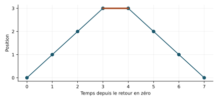
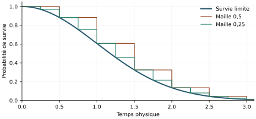

# ENS Paris-Saclay et ENS de Rennes — Cycle master, Mathématiques 2, 2019 · Corrigé guidé

*Corrigé rédigé par IA, non officiel. Signalez toute erreur.*

**Rédaction** · GPT-6.2 Astra Ultra · vitesse non renseignée

**Révision** · GPT-6.2 Astra Ultra · vitesse non renseignée · 26 novembre 2026

Le concours proposait deux sujets au choix. Les réponses P traitent la marche persistante, les réponses N les schémas pour les équations de Hamilton–Jacobi. Les numéros de partie et de question suivent chaque sujet.

## Sujet 1. Simulation de la marche persistante

### Question P.I.1

> [!INDICATION]
> Calculer la probabilité de dépasser un entier positif ou nul.

#### Solution

Pour $k\ge0$, $\lceil\alpha\log A\rceil>k$ équivaut presque sûrement à $A<e^{k/\alpha}$. La survie vaut donc $(e^{1/\alpha})^k$. On obtient la géométrique sur les entiers strictement positifs de paramètre $1-e^{1/\alpha}$. Les valeurs aux extrémités de l’intervalle uniforme sont sans incidence.

### Question P.I.2

> [!INDICATION]
> Au pas refusé, seule la vitesse change.

#### Solution

Jusqu’au premier refus, $(X_k,V_k)=(X_0+kV_0,V_0)$ pour $0\le k<T_1$. Au temps $T_1$, on trouve $(X_0+(T_1-1)V_0,-V_0)$. Le temps est fini presque sûrement. En effet la probabilité de franchir les $k$ premiers pas est au plus $\exp(U(X_0)-U(X_0+kV_0))$, qui tend vers zéro par sommabilité des masses.

### Question P.I.3

> [!INDICATION]
> Compter les essais jusqu’au premier uniforme supérieur au seuil.

#### Solution

Posons $b=e^{-L}$, $p=1-b$. La sommabilité exclut $L=0$. Après une occurrence, une attente de $m\ge1$ impose $m-1$ essais sous le seuil puis un au-dessus. Conditionnellement à toute histoire finissant à l’occurrence courante, cette probabilité est $b^{m-1}p$, par indépendance (sommer sur les valeurs possibles de $S_k$). La loi est $\mathcal G(p)$.

### Question P.I.4

> [!INDICATION]
> Écrire la probabilité de plusieurs durées prescrites.

#### Solution

Pour des durées $m_0,\ldots,m_r\ge1$, l’événement prescrit des échecs puis un succès dans chacun des blocs consécutifs de longueurs $m_i$. Les indices sont alors déterministes et disjoints. Sa probabilité est $\prod_{i=0}^r b^{m_i-1}p$. Ceci donne l’indépendance conjointe des durées, en particulier celle de toute paire.

### Question P.I.5

> [!INDICATION]
> Fixer le dernier succès et placer les précédents.

#### Solution

Pour $S_k=s$, le tirage $s$ est un succès et il y a exactement $k-1$ succès parmi les $s-1$ premiers. Par indépendance la probabilité vaut $\binom{s-1}{k-1}b^{s-k}p^k$ pour $s\ge k$, zéro sinon.

### Question P.I.6

> [!INDICATION]
> Comparer les probabilités de collision à chaque pas avant le premier refus.

#### Solution

Fixons l’état initial. À l’essai $k$, écrivons $\Delta_k=U(X_0+kV_0)-U(X_0+(k-1)V_0)$. La collision d’origine a probabilité $h_k=(1-e^{-\Delta_k})_+$. Comme $h_k\le p$, les deux tests indépendants produisent $p(h_k/p)=h_k$. Un seuil négatif au second test donne bien une probabilité nulle. Les paires de tirages sont indépendantes en $k$, donc les deux durées ont la même survie $\prod_{i=1}^k(1-h_i)$, puis la même loi après intégration sur l’état initial.

### Question P.I.7

> [!INDICATION]
> Sauter directement aux dates auxquelles un refus est possible.

#### Solution

Depuis $(x,v)$, tirer $D=\lceil-L^{-1}\log A\rceil$ avec un uniforme neuf, avancer sans test de $D-1$ unités jusqu’à $y=x+(D-1)v$. Calculer seulement alors $h=(1-e^{U(y)-U(y+v)})_+$. Avec un second uniforme indépendant $B$, prendre $(y,-v)$ si $B\le h/p$, et $(y+v,v)$ sinon. Le bloc dure $D$ pas. Recommencer avec des tirages neufs, en restituant les positions intermédiaires par interpolation entière. Les dates proposées ont exactement les écarts géométriques de I.3 et le test de I.6 restaure la loi de la chaîne.

## Sujet 1. Invariance de la mesure de Gibbs

### Question P.II.1

> [!INDICATION]
> Conditionner par l’état au temps zéro.

#### Solution

Sous $Z_0\sim\nu$, la formule des probabilités totales donne $\mathbb P(Z_1=z)=\sum_{w\in E}\nu(w)q(w,z)$. L’invariance signifie que ce nombre vaut $\nu(z)$ pour chaque $z$.

### Question P.II.2

> [!INDICATION]
> Appliquer la même transition à chaque date.

#### Solution

Si $Z_n\sim\nu$, l’homogénéité et II.1 donnent $Z_{n+1}\sim\nu q=\nu$. L’initialisation est l’hypothèse, d’où la récurrence.

### Question P.II.3

> [!INDICATION]
> Remplacer chaque flux entrant par le flux sortant associé.

#### Solution

La balance détaillée donne $\sum_w\nu(w)q(w,z)=\nu(z)\sum_w q(z,w)=\nu(z)$, puisque la ligne du noyau a masse un. II.1 conclut.

### Question P.II.4

> [!INDICATION]
> Sommer sur l’état intermédiaire.

#### Solution

Conditionner d’abord en $Y_n=z$, puis en $\widetilde Y_n=w$. Cela donne $q_3(z,z')=\sum_wq_1(z,w)q_2(w,z')$, soit $q_3=q_1q_2$ dans cet ordre.

### Question P.II.5

> [!INDICATION]
> Passer successivement par les deux lois intermédiaires.

#### Solution

Si $Y_n\sim\nu$, la première transition donne $\widetilde Y_n\sim\nu q_1=\nu$, puis la seconde $Y_{n+1}\sim\nu q_2=\nu$. Ainsi $\nu q_3=\nu$.

### Question P.II.6

> [!INDICATION]
> Traiter les changements d’état avant de compléter la diagonale.

#### Solution

Sur le support de $\nu$, pour $w\ne z$ on a $q_\nu(z,w)=q(z,w)\min(1,\nu(w)/\nu(z))$. Pour $w=z$, la valeur est $1-\sum_{w\ne z}q_\nu(z,w)$ et inclut propositions identiques et refus. Si $\nu(z)=0$, on peut convenir d’accepter les propositions depuis $z$ ; les lignes correspondantes sont sans effet sur une chaîne stationnaire.

### Question P.II.7

> [!INDICATION]
> Multiplier la formule hors diagonale par la masse initiale.

#### Solution

On obtient $\nu(z)q_\nu(z,w)=q(z,w)\min(\nu(z),\nu(w))$ pour $z\ne w$, y compris aux masses nulles. L’expression est symétrique si $q$ l’est. Sur la diagonale la balance est immédiate.

### Question P.II.8

> [!INDICATION]
> Écrire le noyau du mouvement déterministe.

#### Solution

Avec $J(x,v)=(x+v,-v)$, le noyau est $q(z,w)=\mathbf1_{\{w=J(z)\}}$. Chaque ligne porte une masse unique égale à un.

### Question P.II.9

> [!INDICATION]
> Effectuer deux fois le déplacement.

#### Solution

$J(J(x,v))=(x+v-v,v)=(x,v)$. Ainsi $w=J(z)$ équivaut à $z=J(w)$, ce qui donne $q(z,w)=q(w,z)$.

### Question P.II.10

> [!INDICATION]
> La masse de Gibbs dépend seulement de la position.

#### Solution

Le retournement $I(x,v)=(x,-v)$ est une involution et $\nu(Iz)=\nu(z)$. Si $w=Iz$, les flux dans les deux sens valent $\pi(x)/2$ ; pour toutes les autres paires, les deux sont nuls. C’est la réversibilité.

### Question P.II.11

> [!INDICATION]
> Composer la correction de Metropolis de J avec le retournement I.

#### Solution

À partir de $(x,v)$, accepter $J$ avec probabilité $\min(1,e^{U(x)-U(x+v)})$, puis appliquer $I$ dans tous les cas. Les sorties sont $(x+v,v)$ en cas d’acceptation et $(x,-v)$ en cas de refus. Les deux noyaux successifs préservent $\nu$ par II.3, II.7 et II.10. Leur composition, exactement la marche persistante, la préserve par II.5.

### Question P.II.12

> [!INDICATION]
> Prendre la marginale de position.

#### Solution

À chaque date l’état complet a loi $\nu$ par II.2. En sommant sur les deux vitesses, $\mathbb P(X_n=x)=\pi(x)/2+\pi(x)/2=\pi(x)$.

### Question P.II.13

> [!INDICATION]
> Observer le sens de retour après un déplacement accepté.

#### Solution

La transition $(x,1)\to(x+1,1)$ a probabilité strictement positive et masse initiale positive. De $(x+1,1)$ on peut seulement atteindre $(x+2,1)$ ou $(x+1,-1)$. Le flux inverse est nul, donc la marche n’est pas $\nu$-réversible.

## Sujet 1. Cycles de retour à l’origine

### Question P.III.1

> [!INDICATION]
> Lire la variation du potentiel pendant un retour.

#### Solution

Lorsque $X_nV_n\le0$, tout pas dirigé vers zéro diminue $U$ jusqu’à l’origine. Son acceptation vaut un. Par récurrence, $X_{n+k}=X_n+kV_n$ pour $0\le k\le|X_n|$, avec vitesse constante (pour $X_n=0$ seule $k=0$ intervient).

### Question P.III.2

> [!INDICATION]
> Compter le trajet aller, le refus puis le retour.

#### Solution

Depuis l’origine, $T_n$ pas sont acceptés vers l’extérieur, le pas suivant garde la position et retourne la vitesse. Le trajet inverse dure $T_n$ pas par III.1. Le premier retour strict a donc lieu $2T_n+1$ pas plus tard, y compris si $T_n=0$. Chaque excursion est finie presque sûrement car les probabilités de survivre $k$ pas sortants sont au plus $e^{-rk}$.

### Question P.III.3

> [!INDICATION]
> Chaque cycle a une seule collision.

#### Solution

Le signe de la vitesse change exactement une fois entre $R_k$ et $R_{k+1}$, y compris lors d’un refus à l’origine. Partant de $+1$, on a $V_{R_k}=(-1)^k$.

### Question P.III.4

> [!INDICATION]
> Multiplier les probabilités d’acceptation des k premiers pas.

#### Solution

Pour $k\ge1$, $\mathbb P(T_0\ge k)=\prod_{i=0}^{k-1}e^{U(i)-U(i+1)}=e^{U(0)-U(k)}$. Pour $k=0$ le produit vide vaut un.

### Question P.III.5

> [!INDICATION]
> Utiliser la croissance minimale du potentiel.

#### Solution

Cette survie est au plus $e^{-rk}$. Ainsi $\mathbb E T_0^2=\sum_{k\ge1}(2k-1)\mathbb P(T_0\ge k)<\infty$. Comme $R_1=2T_0+1$, il est de carré intégrable, donc d’espérance et de variance finies.

### Question P.III.6

> [!INDICATION]
> Comparer la somme sur un cycle à sa longueur.

#### Solution

$|Z_0|\le\|f\|_\infty R_1$. La majoration de III.5 entraîne $\mathbb EZ_0^2<\infty$, ce qui donne les deux moments demandés.

### Question P.III.7

> [!INDICATION]
> Compter les visites à chaque niveau avant le retour.

#### Solution

Le niveau zéro est compté une fois. Chaque niveau $1\le k\le T_0$ est compté deux fois, y compris le sommet à cause du refus. Donc $Z_0=f(0)+2\sum_{k\ge1}f(k)\mathbf1_{\{T_0\ge k\}}$. L’échange somme-espérance est justifié par $\|f\|_\infty\mathbb ER_1<\infty$. En utilisant III.4 et les deux parités, $\mathbb EZ_0=\sum_{k\in\mathbb Z} f(k)e^{U(0)-U(k)}=\lambda\sum_k f(k)\pi(k)$, où $\lambda=e^{U(0)}Z$.

### Question P.III.8

> [!INDICATION]
> Choisir une fonction constante.

#### Solution

Pour $f=1$, $Z_n=R_{n+1}-R_n$. Les cycles ont même loi par la propriété admise. III.7 et $\sum\pi=1$ donnent $\mathbb E(R_{n+1}-R_n)=\lambda$.

### Question P.III.9

> [!INDICATION]
> Calculer la variance du temps de n cycles.

#### Solution

Pour $f=1$, les longueurs sont indépendantes, de même variance finie $a^2$. Alors $\mathbb ER_n=n\lambda$ et $\operatorname{Var}R_n=na^2$. Bienaymé–Tchebychev au seuil $\lambda n^{3/4}$ donne $\mathbb P(A_n^c)\le a^2/(\lambda^2\sqrt n)$.

### Question P.III.10

> [!INDICATION]
> Remplacer le dernier instant par un nombre déterministe de cycles.

#### Solution

Posons $k=\lceil n/\lambda\rceil$. Sur $A_k$, $|R_k-n|\le\lambda k^{3/4}+\lambda$. La différence entre $\sum_{i=1}^n f(X_i)$ et $\sum_{\ell=0}^{k-1}Z_\ell=\sum_{i=0}^{R_k-1}f(X_i)$ est au plus $\|f\|_\infty(|R_k-n|+2)$. Divisée par $n$, cette borne tend vers zéro. La loi faible des grands nombres pour les $Z_\ell$ et $k/n\to1/\lambda$ donnent $n^{-1}\sum_{\ell<k}Z_\ell\to\mathbb EZ_0/\lambda=\sum f\pi$ en probabilité. Ainsi $\mathbb P(A_k\cap B_n^\varepsilon)\to0$.

### Question P.III.11

> [!INDICATION]
> Séparer les trajectoires selon le bon événement de III.9.

#### Solution

Avec le même $k$, $\mathbb P(B_n^\varepsilon)\le\mathbb P(A_k^c)+\mathbb P(A_k\cap B_n^\varepsilon)\to0$ pour tout $\varepsilon>0$. La moyenne empirique converge en probabilité vers $\sum_{j\in\mathbb Z} f(j)\pi(j)$.

## Sujet 1. Limite d’échelle et couplage des collisions

### Question P.IV.1

> [!INDICATION]
> Minorer la partie positive par la fonction elle-même.

#### Solution

$\int_0^t(vH'(vs))_+ds\ge H(vt)-H(0)\to+\infty$. De même, pour tout point de départ $y$, le cumul $D_{y,v}(t)=\int_0^t(vH'(y+vs))_+ds$ tend vers l’infini.

### Question P.IV.2

> [!INDICATION]
> Écrire la probabilité d’accepter chacun des k pas.

#### Solution

Notons $\Delta_j=H(\delta x_\delta+(j+1)\delta v)-H(\delta x_\delta+j\delta v)$. L’acceptation au pas $j+1$ vaut $e^{-(\Delta_j)_+}$. Avant toute collision les états visités sont déterministes, d’où $F_\delta(k)=1-\exp(-\sum_{j=0}^{k-1}(\Delta_j)_+)$ pour $k\ge0$. Le terme $k=0$ vaut zéro.

### Question P.IV.3

> [!INDICATION]
> Transformer le cumul discret en une somme de Riemann.

#### Solution

Pour $k=\lfloor t/\delta\rfloor$, chaque incrément division faite par $\delta$ diffère de $vH'(\delta x_\delta+j\delta v)$ d’au plus $\delta\|H''\|_\infty/2$. La partie positive est 1-lipschitzienne. Pour $t$ fixé la somme tend donc vers $D_{x,v}(t)$, car $\delta x_\delta\to x$. La fonction de répartition limite est nulle pour $t<0$ et vaut $F_{x,v}(t)=1-e^{-D_{x,v}(t)}$ pour $t\ge0$. Continue, de limite un par IV.1, elle caractérise la convergence en loi de $\delta T_1^\delta$.

Pour $H(y)=y^2/2$, $x=x_\delta=0$ et $v=1$, chaque incrément est positif. La somme télescope et donne $\mathbb P(T_1^\delta>k)=e^{-(k\delta)^2/2}$. En posant $k=\lfloor t/\delta\rfloor$, on retrouve directement la survie $e^{-t^2/2}$ du premier temps de collision limite, pour $t\ge0$.

### Question P.IV.4

> [!INDICATION]
> Évaluer la position au premier refus.

#### Solution

Par I.2 le couple est $(\delta x_\delta+v(\delta T_1^\delta-\delta),-v)$. Par IV.3 et continuité des applications affines il converge en loi vers $(x+vT_1^*,-v)$.

### Question P.IV.5

> [!INDICATION]
> Comparer le quantile à un nombre réel arbitraire.

#### Solution

Pour $0<u<1$, la croissance et la continuité à droite de $F$ donnent $F^{-1}(u)\le t$ exactement quand $u\le F(t)$. Ainsi $\mathbb P(F^{-1}(A)\le t)=F(t)$.

### Question P.IV.6

> [!INDICATION]
> Utiliser le même uniforme pour toutes les tailles de maille.

#### Solution

Prenons $S_1^\delta=F_\delta^{-1}(A)$ et $S_1^*=F_{x,v}^{-1}(A)$ avec un même uniforme. La fonction de répartition de la durée dilatée converge vers $F_{x,v}$ par IV.3. À tout point de continuité $u$ du quantile limite, les quantiles dilatés convergent : les borner à gauche et à droite par des temps arbitrairement proches du quantile avec valeurs de répartition strictement de part et d’autre de $u$. Les seules valeurs $u$ exceptionnelles, extrémités incluses, forment un ensemble négligeable car un quantile monotone a au plus un nombre dénombrable de discontinuités. D’où la convergence presque sûre, même en présence de paliers.

### Question P.IV.7

> [!INDICATION]
> Contrôler la valeur de la fonction de répartition au temps zéro.

#### Solution

Dans la définition imprimée de $F_{\delta,z,v}$ qui précède cette question, la somme finit à $k$. Il faut lire $k-1$, comme en IV.2. Sinon $F_{\delta,z,v}(0)>0$ dès qu’un premier pas monte, alors qu’une durée entre collisions est au moins un. Avec cette correction, conditionnellement à $(Y_k^\delta,W_k^\delta)=(z,v)$, le quantile donne exactement la loi de la prochaine attente depuis $(z,v)$. La position à la collision suivante est $z+(S_k^\delta-1)v$ et la vitesse $-v$. L’initialisation et la propriété de Markov forte aux collisions donnent par récurrence l’identité en loi de tout le squelette, donc des triplets demandés.

### Question P.IV.8

> [!INDICATION]
> Réutiliser un uniforme neuf à chaque retournement.

#### Solution

Posons $(Y_0^*,W_0^*)=(x,v)$, $S_k^*=F_{Y_k^*,W_k^*}^{-1}(A_k)$ et $(Y_{k+1}^*,W_{k+1}^*)=(Y_k^*+W_k^*S_k^*,-W_k^*)$. Les vitesses coïncident exactement aux indices de collision. Si $\delta Y_k^\delta\to Y_k^*$, la convergence de IV.3 vaut pour cette suite de points de départ, trajectoire par trajectoire. Conditionnellement au passé, $A_k$ évite presque sûrement les discontinuités du quantile correspondant. IV.6 donne $\delta S_k^\delta\to S_k^*$, puis la récurrence discrète donne la convergence de la position suivante. Une intersection finie donne la convergence simultanée demandée.

### Question P.IV.9

> [!INDICATION]
> Examiner le trajet sur la cellule de temps qui contient le demi-entier.

#### Solution

Écrivons $C_n=\sum_{k=0}^{n-1}S_k^\delta$. Pour $n\ge1$ le retournement interpolé est placé à $R_n^\delta=C_n-\tfrac12$ (un seul demi-pas soustrait au total). Sur l’intervalle de $C_n-1$ à $C_n$, on parcourt une demi-unité dans chaque sens, donc le déplacement net est nul et la vitesse finale opposée. Sur tout autre pas entier la vitesse est constante et le déplacement lui est égal. Même pour deux refus consécutifs les demi-entiers sont séparés d’un pas. Aux temps entiers on retrouve la trajectoire associée au squelette de IV.7, donc sa loi.

### Question P.IV.10

> [!INDICATION]
> Écarter les collisions à un temps fixé et les accumulations en temps fini.

#### Solution

Pour chaque $k\ge1$, $\delta R_k^\delta\to R_k^*=\sum_{i<k}S_i^*$ presque sûrement. Conditionnellement au passé, $S_i^*$ a une fonction de répartition continue, donc un instant déterministe n’est presque sûrement aucun $R_k^*$ positif. Sur tout horizon $T$, les positions restent à distance au plus $T$ de $x$. L’intensité $(vH')_+$ y est bornée par $C$. Dans la construction par horloges exponentielles $E_i=-\log(1-A_i)$, chaque collision avant $T$ consomme $E_i$ de risque intégré. Ce risque cumulé ne dépasse pas $CT$, tandis que les sommes des $E_i$ indépendants tendent vers l’infini presque sûrement. Il y a donc un nombre fini de collisions. Pour chaque temps fixé, les deux collisions qui l’encadrent sont alors les mêmes en indice pour toute maille assez fine. Les vitesses convergent et les trajectoires, intégrales de vitesses constantes par morceaux, convergent par convergence des extrémités. Ceci vaut simultanément pour toute la famille finie des $t_i\ge0$.

### Question P.IV.11

> [!INDICATION]
> Comparer un instant à son arrondi sur la grille dilatée.

#### Solution

Le temps physique $\delta\lceil t_i/\delta\rceil$ est à distance au plus $\delta$ de $t_i$. Les positions interpolées diffèrent d’au plus $\delta$. Presque sûrement le temps $t_i>0$ est strictement entre deux collisions limites, et les mêmes deux collisions discrètes encadrent les deux instants pour $\delta$ assez petit ; les vitesses coïncident. À zéro l’état est initial. Par IV.9 et IV.10, le vecteur des états de la chaîne converge en loi vers $((\widetilde X^*_{t_i},\widetilde V^*_{t_i}))_{1\le i\le N}$.

## Sujet 2. Différences finies et transport

### Question N.I.1

> [!INDICATION]
> Développer séparément le pas en temps et les pentes de la grille.

#### Solution

Chaque pente de la fenêtre de calcul est $u_x(t_n,x_j)+O(\Delta x)$ par Taylor, car la fenêtre est de largeur fixée en nombre de nœuds. Le pas de temps donne $u(t_{n+1},x_j)-u(t_n,x_j)=\Delta t(u_t+O(\Delta t))$. La propriété de Lipschitz locale de $g$ donne donc $E_j^n=\Delta t[u_t+g(u_x,\ldots,u_x)+O(\Delta t+\Delta x)]$. Les constantes sont uniformes là où les dérivées secondes sont bornées et les pentes restent dans un compact. Si $g(a,\ldots,a)=H(a)$, l’équation annule le terme principal et les ordres garantis sont un en temps et un en espace. Réciproquement tester la consistance locale sur une solution affine $u=ax-tH(a)$ donne cette identité pour toute pente $a$ ; le test de consistance ne fait intervenir que des valeurs locales.

### Question N.I.2

> [!INDICATION]
> Borner toutes les entrées de g pour un pas fixé.

#### Solution

Pour $B=\|U\|_\infty$, les pentes sont dans le cube de rayon $2B/\Delta x$. La fonction continue $g$ y est bornée par une constante $K_B$ pour ce pas. Ainsi $\|G(U)\|_\infty\le B+\Delta t K_B<\infty$.

### Question N.II.3

> [!INDICATION]
> Identifier le Hamiltonien numérique amont.

#### Solution

La formule donne $g(a,b)=ca$ et $g(a,a)=ca=H(a)$. I.1 assure la consistance d’ordre au moins un dans chaque variable pour une solution régulière.

### Question N.II.4

> [!INDICATION]
> Écrire le pas amont comme une moyenne à deux points.

#### Solution

Posons $\theta=c\Delta t/\Delta x\in[0,1]$. Alors $U_j^{n+1}=(1-\theta)U_j^n+\theta U_{j-1}^n$. L’intervalle fermé compris entre l’infimum et le supremum des données initiales est stable par cette moyenne, d’où l’encadrement par récurrence.

### Question N.II.5

> [!INDICATION]
> Séparer l’erreur locale du transport de l’erreur précédente.

#### Solution

Pour une solution régulière à dérivées secondes bornées, II.3 donne $|E_j^n|\le C\Delta t(\Delta t+\Delta x)$. La moyenne convexe de II.4 transporte les erreurs avec norme au plus un, donc $e_{n+1}\le e_n+C\Delta t(\Delta t+\Delta x)$, où $e_n=\sup_j|u(t_n,x_j)-U_j^n|$. Par sommation $e_n\le CT(\Delta t+\Delta x)$ si $n\Delta t\le T$.

Pour la seule hypothèse lipschitzienne du préambule, la convergence subsiste. L’itération binomiale donne $U_j^n=\mathbb E[u_0(x_j-\Delta x B_n)]$, $B_n\sim\operatorname{Bin}(n,\theta)$, tandis que $u(t_n,x_j)=u_0(x_j-cn\Delta t)$. La différence est au plus $L\Delta x\sqrt{n\theta(1-\theta)}\le L\sqrt{cT\Delta x}$. L’inégalité locale plus fine exige de la régularité : pour $c=1$, $\theta=1/2$, $u_0(x)=\min(|x-1|,1)$ et $\Delta x=(m+1/2)^{-1}$, au nœud $x_{m+1}=1+\Delta x/2$ après un pas, la valeur exacte est zéro et la valeur numérique $\Delta x/2$.

### Question N.II.6

> [!INDICATION]
> Lire le coefficient de chaque valeur de grille.

#### Solution

Les coefficients de $U_{j-1},U_j,U_{j+1}$ sont respectivement $\theta,1-\theta,0$, tous positifs ou nuls par la condition de Courant. Le pas est croissant en chacune des valeurs sur tout domaine $d_R$.

## Sujet 2. Stabilité des schémas monotones

### Question N.III.7

> [!INDICATION]
> Comparer les fenêtres ordonnées tout en conservant leurs contraintes sur les pentes.

#### Solution

Fixons une fenêtre de valeurs $a\le b$ et $R=L+1$. Les deux fenêtres sont dans le convexe $d_R$. Pour $0<r<1$, le segment de $ra$ à $rb$ satisfait les contraintes de pente avec marge $(1-r)R$. On peut le subdiviser en pas assez petits pour que le rectangle dont chaque pas forme une diagonale reste dans $d_R$ : une perturbation de chaque coordonnée d’au plus $\eta$ modifie chaque pente d’au plus $2\eta/\Delta x$. Dans chaque rectangle, augmenter une coordonnée après l’autre fait croître $G$. Donc $G(ra)\le G(rb)$. En passant à $r=1$ par continuité on obtient $G(a)\le G(b)$. L’argument s’applique à chaque fenêtre de $U,V$.

### Question N.III.8

> [!INDICATION]
> Observer l’effet d’une constante sur chaque pente.

#### Solution

Les différences de $U+\lambda$ sont celles de $U$, et la suite reste bornée. Dans (2), la seule modification est donc l’ajout de $\lambda$ au terme central, d’où $G(U+\lambda)=G(U)+\lambda$.

### Question N.III.9

> [!INDICATION]
> Encadrer U entre deux translatés de V.

#### Solution

Pour $d=\|U-V\|_\infty$, on a $V-d\le U\le V+d$. Par III.7 et III.8, $G(V)-d\le G(U)\le G(V)+d$. Cela équivaut à la contraction en norme uniforme.

### Question N.III.10

> [!INDICATION]
> Appliquer la contraction à une suite et à son décalage.

#### Solution

La formule est indépendante de $j$, donc $G(\tau_1U)=\tau_1G(U)$. La suite décalée vérifie les mêmes contraintes. Ainsi $\|\Delta_+G(U)\|_\infty=\|G(\tau_1U)-G(U)\|_\infty\le\|\tau_1U-U\|_\infty=\|\Delta_+U\|_\infty$.

### Question N.III.11

> [!INDICATION]
> Diviser l’inégalité précédente par le pas spatial.

#### Solution

I.2 donne la bornitude et III.10 donne $\|\Delta_+G(U)\|_\infty/\Delta x\le L+1$. Ce sont les contraintes de $D_{L+1}$ ; tous les itérés restent donc admissibles.

### Question N.III.12

> [!INDICATION]
> Télescoper les écarts entre deux temps successifs.

#### Solution

Précisons la notation de l’énoncé. Les arguments de $g$ sont les $p+q+1$ pentes d’une fenêtre de $d_{L+1}$. On prend donc $K=\max_{[-L-1,L+1]^{p+q+1}}|g|$, fini par compacité. Par (2) et III.11, chaque itération vérifie $\|G^{i+1}U-G^iU\|_\infty\le\Delta t K$. Sommer pour $i=n,\ldots,n+m-1$ donne la borne $m\Delta t K$.

### Question N.III.13

> [!INDICATION]
> Calculer la trajectoire d’une suite constante.

#### Solution

Par consistance, $G(0)=-\Delta t H(0)$ est constant. III.8 donne $G^n(0)=-n\Delta t H(0)$. Par contraction itérée, $\|G^n(U)-G^n(0)\|_\infty\le\|U\|_\infty$. L’inégalité triangulaire conclut.

## Sujet 2. Maximum pénalisé et erreur de convergence

### Question N.IV.14.a

> [!INDICATION]
> Utiliser les solutions constantes en espace comme barrières.

#### Solution

La borne (8) donne $\inf u_0-tH(0)\le u(t,x)\le\sup u_0-tH(0)$. Pour $0\le t\le T$, cela donne $|u(t,x)|\le M=\|u_0\|_\infty+T|H(0)|$.

### Question N.IV.14.b

> [!INDICATION]
> Appliquer la borne de stabilité à la donnée initiale.

#### Solution

Par III.13, $\|U^n\|_\infty\le\|U^0\|_\infty+n\Delta t|H(0)|\le M$ pour $n\le N$. En particulier, $0<\sigma\le 2M$ et $M>0$ dans l’étude qui suit.

### Question N.IV.15.a

> [!INDICATION]
> Choisir les deux points au même nœud d’espace-temps.

#### Solution

Écrivons $s=\sigma/(4T)$, $A=5M+\sigma/2$, et $b=\beta_\varepsilon$. Sur la diagonale $b(0,0)=1$, $-2st_n\ge-\sigma/2$. En approchant le supremum de $u(t_n,x_j)-U_j^n$, on obtient $\sup\psi\ge5M+\sigma$. Si $b=0$, la différence des deux solutions est au plus $2M$ sur $Q_{T,N}$, et la pénalisation est négative ou nulle. Pour l’extension à tous les temps formulée dans le texte, (10) implique même $H(0)=0$ : pour la maille fixée, $U_j^0\to0$ à l’infini, toutes les pentes d’une fenêtre tendent vers zéro, donc $U_j^1\to-\Delta t g(0,\ldots,0)$ ; (10) avec $N\ge1$ donne une limite nulle. Les bornes de IV.14 valent alors pour tous les temps.

### Question N.IV.15.b

> [!INDICATION]
> Étudier une suite maximisante qui part à l’infini en espace.

#### Solution

Une suite approchant le supremum doit avoir $b\ne0$ à partir d’un rang, donc $|x-x_j|\le\varepsilon$. Si une des coordonnées spatiales s’échappe, les deux s’échappent et (10) donne $\limsup\psi\le A<5M+\sigma$, contradiction. Ainsi une suite maximisante est spatialement bornée. Il y a un nombre fini de nœuds discrets dans cette zone, les temps et positions continus restent dans un compact et $\psi$ y est continue à nœud fixé. Une sous-suite donne un maximum.

### Question N.IV.15.c

> [!INDICATION]
> Encadrer les termes qui accompagnent la pénalisation.

#### Solution

Au maximum, $5M+\sigma\le2M+A b_*$ avec $b_*=b(t_0-t_{n_0},x_0-x_{j_0})$. D’où $b_*\ge(3M+\sigma)/(5M+\sigma/2)\ge3/5$.

### Question N.IV.15.d

> [!INDICATION]
> Localiser le point dans la partie explicitement quadratique de la bosse.

#### Solution

Comme $b_*>1/2$, le rayon réduit est dans la zone quadratique. Notons $d_t=t_0-t_{n_0}$, $d_x=x_0-x_{j_0}$. On a $(d_t^2+d_x^2)/\varepsilon^2=1-b_*\le2/5$. En ce point $b_t=-2d_t/\varepsilon^2$, $b_x=-2d_x/\varepsilon^2$.

### Question N.IV.16.a

> [!INDICATION]
> Figer les trois coordonnées autres que la position continue.

#### Solution

La maximalité de $\psi$ en ses quatre coordonnées entraîne celle de $u(t_0,x)+A b(d_t,x-x_{j_0})$ en $x_0$. Pour $h$ positif ou négatif, $A[b(d_t,d_x+h)-b_*]\le u(t_0,x_0)-u(t_0,x_0+h)\le L|h|$. En prenant les quotients des deux côtés on trouve $A|b_x|\le L$.

### Question N.IV.16.b

> [!INDICATION]
> Comparer au temps continu immédiatement antérieur.

#### Solution

Pour $0<h<t_0$, la maximalité donne $s h-A[b_*-b(d_t-h,d_x)]\le u(t_0,x_0)-u(t_0-h,x_0)\le L_1h$, où $L_1=\max_{|p|\le L}|H(p)|$. À la limite, $-A b_t\le L_1-s$.

### Question N.IV.16.c

> [!INDICATION]
> Comparer également au temps continu immédiatement postérieur.

#### Solution

Pour $0<t_0<T$, à droite on obtient $A[b(d_t+h,d_x)-b_*]-sh\le L_1h$, donc $A b_t\le L_1+s$. Avec IV.16.b, $|A b_t|\le L_1+s$.

### Question N.IV.16.d

> [!INDICATION]
> Remplacer les dérivées par les écarts calculés en IV.15.d.

#### Solution

On en tire $|d_x|\le\varepsilon^2L/(2A)$. Si $t_0=T$ alors $d_t\ge0$ et IV.16.b donne $|d_t|\le\varepsilon^2(L_1-s)/(2A)$. Pour $0<t_0<T$, IV.16.c donne $|d_t|\le\varepsilon^2(L_1+s)/(2A)$. Ici $2A=10M+\sigma$.

### Question N.IV.17.a

> [!INDICATION]
> Conserver seulement les variables continues dans le maximum.

#### Solution

À nœud $(n_0,j_0)$ fixé, les termes $-U_{j_0}^{n_0}-st_{n_0}$ sont constants. Dès lors $(t_0,x_0)$ maximise $u(t,x)-st+A b(t-t_{n_0},x-x_{j_0})$ sur $Q_T$.

### Question N.IV.17.b

> [!INDICATION]
> Écrire la fonction test avec le signe correspondant à un maximum.

#### Solution

Posons $\phi(t,x)=st-A b(t-t_{n_0},x-x_{j_0})$. Le maximum de $u-\phi$ vérifie $t_0>0$. La propriété (6), également au bord temporel final dans la formulation donnée, impose $s-A b_t+H(-A b_x)\le0$.

### Question N.IV.18.a

> [!INDICATION]
> Fixer le point continu et ne déplacer que le nœud discret.

#### Solution

Notons $U_*=U_{j_0}^{n_0}$ et $b_{n,j}=b(t_0-t_n,x_0-x_j)$. L’inégalité $\psi(t_0,x_0,t_n,x_j)\le\psi(t_0,x_0,t_{n_0},x_{j_0})$ donne directement $U_j^n\ge U_*+s(n_0-n)\Delta t+A(b_{n,j}-b_*)$.

### Question N.IV.18.b

> [!INDICATION]
> Comparer chaque pente de la bosse à sa dérivée au point maximal.

#### Solution

Pour $k=-p,\ldots,q$, posons $D_k=A(b_{n_0-1,j_0+k+1}-b_{n_0-1,j_0+k})/\Delta x$. Le théorème des accroissements finis donne $D_k=-A b_x(d_t+\Delta t,d_x-(k+\theta_k)\Delta x)$, $0<\theta_k<1$. Les dérivées secondes de $b$ sont bornées par $C/\varepsilon^2$ et $A\le6M$. On obtient $|D_k+A b_x(d_t,d_x)|\le C_1(\Delta t+\Delta x)/\varepsilon^2$. Par IV.16.a, $|D_k|\le L+C_1(\Delta t+\Delta x)/\varepsilon^2$. Avec $\varepsilon=(\Delta t+\Delta x)^{1/4}$ et rapport des pas fixé, cette borne est au plus $L+1$ pour un pas assez petit.

### Question N.IV.18.c

> [!INDICATION]
> Appliquer le schéma à la fenêtre minorante du temps précédent.

#### Solution

Au temps $n_0-1$, considérons la fenêtre $V_j=U_*+s\Delta t+A(b_{n_0-1,j}-b_*)$. Elle minore la fenêtre réelle par IV.18.a et ses pentes $D_k$ sont admissibles par IV.18.b. La comparaison locale de III.7 donne $U_*=G(U^{n_0-1})_{j_0}\ge V_{j_0}-\Delta t g(D_{-p},\ldots,D_q)$. En remplaçant $V_{j_0}$, c’est $U_*\ge U_*+s\Delta t+A(b_{n_0-1,j_0}-b_*)-\Delta t g(D_{-p},\ldots,D_q)$.

### Question N.IV.18.d

> [!INDICATION]
> Développer le quotient temporel et ramener les pentes sur la diagonale de g.

#### Solution

Le quotient $(b_{n_0-1,j_0}-b_*)/\Delta t$ vaut $b_t+O(\Delta t/\varepsilon^2)$. Par IV.18.b et Lipschitzianité de $g$ sur le compact des pentes, $g(D_{-p},\ldots,D_q)=H(-A b_x)+O((\Delta t+\Delta x)/\varepsilon^2)$ grâce à la consistance. Après simplification de IV.18.c, $s\le-A b_t+H(-A b_x)+C_2(\Delta t+\Delta x)/\varepsilon^2$, avec constante indépendante de la maille.

### Question N.IV.18.e

> [!INDICATION]
> Éliminer le terme hamiltonien à l’aide de la sous-solution.

#### Solution

IV.17.b donne $-A b_t+H(-A b_x)\le-s$. Alors $2s\le C_2(\Delta t+\Delta x)/\varepsilon^2=C_2\sqrt{\Delta t+\Delta x}$. Comme $\sigma=4Ts$ et $\Delta x=\Delta t/\Lambda$, on obtient $\sigma\le C_3\sqrt{\Delta t}$.

### Question N.IV.19.a

> [!INDICATION]
> Utiliser la donnée initiale au nœud du maximum.

#### Solution

Ici $U_{j_0}^0=u(0,x_{j_0})$. La borne inférieure $5M+\sigma$ du maximum, $-st_0\le0$ et l’insertion de $u(t_0,x_{j_0})$ donnent $5M+\sigma\le|u(t_0,x_0)-u(t_0,x_{j_0})|+|u(t_0,x_{j_0})-u(0,x_{j_0})|+A b_*$.

### Question N.IV.19.b

> [!INDICATION]
> Contrôler les deux écarts à l’aide des constantes de Lipschitz.

#### Solution

Comme $b_*\le1$, IV.19.a donne $\sigma/2\le L|d_x|+L_1 t_0$. Le premier terme est $O(\varepsilon^2)$ par IV.16.d. Si $t_0=0$ le second s’annule, et sinon $d_t=t_0$ est $O(\varepsilon^2)$, y compris à $T$, par IV.16.d. Les constantes sont bornées indépendamment des pas car $5M\le A\le6M$ et $s\le M/(2T)$. On obtient $\sigma\le C_4\sqrt{\Delta t}$.

### Question N.IV.20.a

> [!INDICATION]
> Insérer la valeur initiale au même site discret.

#### Solution

Pour $t_0=0$, $u(0,x_0)-U_{j_0}^{n_0}\le L|d_x|+\|U^0-G^{n_0}(U^0)\|_\infty$. En ajoutant au plus $A$ pour la bosse, on obtient la première inégalité. Par III.12 le terme temporel est au plus $Kt_{n_0}$, donc $\sigma\le2L|d_x|+2Kt_{n_0}$.

### Question N.IV.20.b

> [!INDICATION]
> Comparer la valeur maximale à celle du nœud immédiatement précédent.

#### Solution

Au même site, la maximalité impose $-U_*-st_{n_0}+A b(-t_{n_0},d_x)\ge-U_{j_0}^{n_0-1}-s(t_{n_0}-\Delta t)+A b(\Delta t-t_{n_0},d_x)$. Le rayon réduit au maximum est au plus $\sqrt{2/5}$ par IV.15.d ; comme $\Delta t/\varepsilon\to0$, les deux points sont dans la partie quadratique pour un pas assez petit. Par III.12 et $s\ge0$, on obtient $A[t_{n_0}^2-(t_{n_0}-\Delta t)^2]/\varepsilon^2\le K\Delta t$.

### Question N.IV.20.c

> [!INDICATION]
> Diviser le dernier écart de carrés par le pas temporel.

#### Solution

Il vient $t_{n_0}\le\Delta t/2+K\varepsilon^2/(2A)$. Avec IV.16.d et IV.20.a, $\sigma=O(\varepsilon^2+\Delta t)=O(\sqrt{\Delta t})$ à $\Lambda$ fixé.

### Question N.IV.21

> [!INDICATION]
> Comparer la régularité nécessaire aux deux estimations.

#### Solution

L’ordre de consistance est un en temps et en espace sur les tests réguliers. Le théorème de convergence garantit un ordre $1/2$ à rapport des pas fixé pour des données seulement lipschitziennes et une solution de viscosité qui peut avoir des angles. Les deux estimations portent sur des objets et des régularités différents, et une solution plus régulière peut avoir une erreur moindre.

La démonstration sur le maximum de $u-U$ fournit une borne dans un sens. Pour l’autre sens, poser $w=-u$, $W=-U$, $\widetilde H(p)=-H(-p)$ et $\widetilde g(a_1,\ldots,a_d)=-g(-a_1,\ldots,-a_d)$. La négation échange les tests de sous-solution et de sursolution. Le pas $\widetilde G(W)=-G(-W)$ reste croissant puisque les deux changements de signe renversent l’ordre. La consistance et les constantes de Lipschitz sont conservées. La même estimation sur $w-W=U-u$ complète la borne en valeur absolue.

## Sujet 2. Choix du Hamiltonien numérique

### Question N.V.22.a

> [!INDICATION]
> Vérifier les deux dérivées partielles du schéma amont.

#### Solution

Pour $a=(U_j-U_{j-1})/\Delta x$, les coefficients différentiels selon $U_{j-1},U_j$ sont $\Lambda H'(a)$ et $1-\Lambda H'(a)$. Ils sont positifs ou nuls sous $C\Lambda\le1$ avec $C=\max_{|a|\le L+1}H'(a)$. Consistance diagonale et propriété de Lipschitz locale suivent de $H\in C^1$. Le théorème 3 assure la convergence.

### Question N.V.22.b

> [!INDICATION]
> Utiliser la pente du côté droit pour un Hamiltonien décroissant.

#### Solution

Avec $a=(U_{j+1}-U_j)/\Delta x$, les coefficients sur $U_j,U_{j+1}$ sont $1+\Lambda H'(a)$ et $-\Lambda H'(a)$. Ils sont positifs ou nuls si $\Lambda\max_{|a|\le L+1}|H'(a)|\le1$. Le Hamiltonien numérique coïncide sur la diagonale avec $H$, localement lipschitzien. Le théorème 3 s’applique.

### Question N.V.22.c

> [!INDICATION]
> Ajouter une diffusion qui rend le schéma monotone pour les deux signes de pente.

#### Solution

Un choix est le flux de Lax–Friedrichs $g(a,b)=(a^2+b^2)/2-\alpha(b-a)/2$ avec $\alpha=2(L+1)$, appliqué aux pentes arrière $a$ et avant $b$. On a $g(a,a)=a^2$, $g_a=a+\alpha/2\ge0$, $g_b=b-\alpha/2\le0$ sur le cube. Les dérivées de $G$ selon le voisin gauche et le voisin droit sont $\Lambda g_a$ et $-\Lambda g_b$, positives ou nulles. Celle du centre vaut $1-\Lambda(g_a-g_b)=1-\Lambda(a-b+\alpha)$ ; il suffit donc de prendre $\Lambda(\alpha+2(L+1))\le1$. Sous cette condition, le schéma est consistant, monotone et son Hamiltonien est localement lipschitzien ; il converge vers la solution de viscosité.

On peut aussi utiliser le schéma classique à flux centré $g(a,b)=((a+b)/2)^2-\alpha(b-a)/2$ : dans ce cas $g_a-g_b=\alpha$, et la condition $\Lambda\alpha\le1$ suffit.
