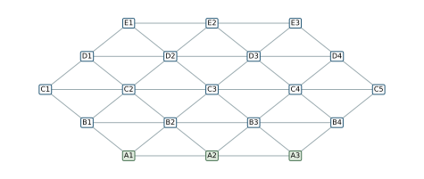
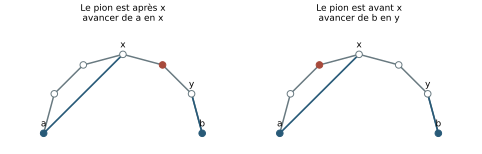
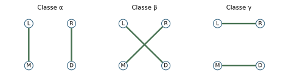

# ENS MP · Informatique-mathématiques 2019 · Corrigé brut

*Corrigé rédigé par IA, non officiel. Signalez toute erreur.*

**Rédaction** · GPT-6.2 Astra Ultra · vitesse non renseignée · 25 novembre 2026

Le sujet étudie le jeu de pions des gendarmes et du voleur sur un graphe fini. On note $N(v)$ le voisinage ouvert, $N[v]=N(v)\cup\{v\}$ le voisinage fermé et $N[R]=\bigcup_{v\in R}N[v]$. On écrit $c(G)$ pour le nombre minimal de gendarmes garantissant une capture.

## I · Listes d’adjacence

### Question 1.1 · Valider une liste d’adjacence

```ocaml
type sommet = int
type graphe = (sommet * sommet list) list

let est_graphe (g : graphe) =
  let rec cles_uniques = function
    | [] -> true
    | (u, _) :: suite ->
        not (List.mem_assoc u suite) && cles_uniques suite
  in
  let incidence u v =
    match List.assoc_opt v g with
    | None -> false
    | Some voisins -> u <> v && List.mem u voisins
  in
  cles_uniques g &&
  List.for_all (fun (u, voisins) ->
    List.for_all (incidence u) voisins) g
```
Chaque clé est comparée à celles qui la suivent. Pour chaque occurrence de $v$ chez $u$, on vérifie que $u\ne v$, que la fiche de $v$ existe et qu’elle contient $u$. Ce sont exactement les deux conditions de l’énoncé. Une liste interne peut répéter un voisin, car la condition porte sur l’appartenance. Le graphe vide passe le test.

### Question 1.2 · Retirer un sommet

```ocaml
let retire_sommet (g : graphe) u =
  List.filter_map (fun (v, voisins) ->
    if v = u then None
    else Some (v, List.filter (fun w -> w <> u) voisins)) g
```
La liste des sommets restants conserve son ordre. Pour $u$ absent d’un graphe valide, aucune liste ne le mentionne et le résultat est égal à $g$. Pour $u$ présent, seules les incidences touchant $u$ disparaissent.

## II · Premiers jeux sur des graphes

### Question 2.1 · Échapper à un pion sur le pentagone

Numérotons le cycle modulo 5. Si le gendarme choisit $i$, le voleur débute en $i+2$. Avant chaque coup du gendarme, la distance est deux. S’il reste à distance deux, le voleur reste aussi. S’il s’approche à distance un, le voleur prend son voisin dans le sens qui l’éloigne. Le cycle a cinq sommets, donc la distance redevient deux. Il n’y a jamais capture.

### Question 2.2 · Compléter la partie sur le graphe de Petersen

Le tableau part de $(A_4,A_1,B_4,B_5)_V$. Chaque ligne donne la position après le choix indiqué. Les trois colonnes de droite gardent l’ordre des gendarmes du sujet.

| Choix du voleur | Position du voleur | $\gamma_1$ | $\gamma_2$ | $\gamma_3$ | Suite |
|---|---|---|---|---|---|
| $A_1$ | $A_1$ | $A_1$ | $B_4$ | $B_5$ | capture immédiate |
| $B_4$ | $B_4$ | $A_1$ | $B_4$ | $B_5$ | capture immédiate |
| reste en $A_4$ | $A_4$ | $A_1$ | $B_4$ | $B_5$ | le second va en $A_4$ et capture |
| va en $A_2$ | $A_2$ | $A_1$ | $B_4$ | $B_5$ | les gendarmes jouent la ligne suivante |
| après ce coup | $A_2$ | $A_1$ | $B_3$ | $A_5$ | au voleur de jouer |

Dans cette dernière position, les quatre possibilités terminent la partie. Si le voleur va en $A_5$, il y a capture immédiate. S’il reste en $A_2$, le troisième y va. S’il va en $A_4$, le premier y va. S’il va en $B_2$, le second y va. Les autres gendarmes peuvent rester sur place. Cette stratégie est optimale au pire cas car aucun des trois gendarmes de la position donnée ne peut atteindre $A_2$ en un seul coup.

### Question 2.3 · Cycle, arbre et maison

(i) Le cycle de huit sommets appartient à $R_1$ et à $C_2$. Contre un gendarme, le voleur commence à l’opposé et copie ses déplacements dans le même sens pour rester à l’opposé après sa réponse. À deux, les gendarmes partent ensemble. L’un reste fixe et l’autre avance dans un sens jusqu’à fermer tout l’intervalle disponible.

(ii) L’arbre appartient à $C_1$, donc à $C_2$. Un gendarme part d’une racine et avance à chaque coup sur l’unique chemin vers le voleur. S’il ne le capture pas, le voleur ne peut revenir derrière lui. Le sous-arbre dans lequel il se trouve devient strictement plus petit.

(iii) La maison appartient à $R_1$ et à $C_2$. Le carré est un rétract en envoyant la pointe du toit sur l’un des deux sommets du haut et en fixant le carré. Le voleur peut donc jouer sur le carré contre l’image du gendarme, en restant à l’opposé à la fin de ses coups. Une rencontre réelle impliquerait une rencontre des images. À deux, placer les gendarmes aux deux sommets supérieurs du carré. Ces sommets sont adjacents à la pointe du toit et chacun couvre le sommet inférieur de son côté. Toute position initiale du voleur donne une capture au plus tard au premier coup des gendarmes.

### Question 2.4 · Plus petit exemple connexe

Le carré $C_4$ a taille $4+4=8$. Le voleur commence à l’opposé et copie le déplacement du gendarme, ce qui maintient leur opposition après chaque coup du voleur. Un graphe connexe à au moins cinq sommets a au moins quatre arêtes, donc taille au moins neuf. Avec quatre sommets et une taille inférieure à huit, il a au plus trois arêtes et c’est un arbre. Sur au plus trois sommets, un graphe connexe est un arbre ou un triangle. Le triangle a un sommet universel, et les arbres se traitent par 2.3. Huit est donc le minimum.

### Question 2.5 · Existence du nombre de capture

Sur un graphe à $m\ge1$ sommets, placer $m$ gendarmes, un par sommet. Tout premier placement du voleur réalise immédiatement une capture. L’ensemble des entiers positifs suffisants est donc non vide et possède un minimum. Le jeu décrit avec placement initial de pions suppose un graphe non vide.

### Question 2.6 · Composantes connexes

Si les composantes sont $G_1,\ldots,G_t$, alors $c(G)=\sum_i c(G_i)$. En plaçant dans chaque composante les $c(G_i)$ gendarmes suivant une position initiale gagnante, la composante choisie est couverte. Avec un total strictement inférieur, il existe une composante où les gendarmes sont en nombre insuffisant. Le voleur la choisit et applique sa stratégie gagnante dans cette composante. Aucun gendarme extérieur ne peut y entrer.

## III · Un gendarme et les sommets dominés

### Question 3.1 · Degré minimal deux dans un graphe biparti

La classe du gendarme initial contient un autre sommet puisque tout voisin du gendarme a degré au moins deux. Le voleur s’y place. Avant chaque coup du gendarme, on maintient une distance au moins deux. Après ce coup, si le gendarme reste non adjacent, le voleur attend. Sinon, parmi les au moins deux voisins du voleur, choisir un sommet différent du gendarme. Ce voisin est dans la classe du gendarme, donc à distance au moins deux de celui-ci. L’invariant est rétabli et donne une partie infinie.

### Question 3.2 · Régularité et maintien de la distance

Dans un graphe $n$-régulier non complet, aucune position initiale $a$ n’est universelle. Choisir $r\notin N[a]$. Supposons avant le coup suivant que $a\notin N[r]$. Si le gendarme joue $b\in N[a]$, alors $b\ne r$ et $a\in N[b]\setminus N[r]$. Les deux voisinages fermés ont $n+1$ sommets. Il existe donc $r'\in N[r]\setminus N[b]$. En s’y plaçant, le voleur rétablit l’invariant. Cela suffit pour tout $n\ge4$ demandé.

### Question 3.3 · Transport de stratégie par rétraction

Soit $p:G\to H$ la rétraction et $\phi$ la stratégie gagnante du voleur sur $H$. Au placement $a$ du gendarme réel, répondre à $p(a)$ selon $\phi$. Après un déplacement à $b$, appliquer $\phi$ à $(r,p(b))_V$. Une arête se projette sur une arête ou sur une attente. La réponse est donc légale dans $H$ et dans $G$. Par récurrence, la partie projetée est compatible avec $\phi$ et ne contient aucune capture. Si $r=b$ dans le jeu réel, alors $r=p(r)=p(b)$ dans le jeu projeté. Cette contradiction prouve $G\in R_1$. En prenant la contraposée et en utilisant la partition $(C_1,R_1)$, $G\in C_1$ implique $H\in C_1$.

### Question 3.4 · Graphe sans écueil

Soit $a$ le sommet initial du gendarme. Il n’est pas universel, car il dominerait alors tout autre sommet. Choisir $r\notin N[a]$. Si le gendarme va en $b\in N[a]$, on a $r\ne b$. Puisque $r$ n’est pas un écueil, $N[r]\not\subseteq N[b]$. Le voleur joue un $r'\in N[r]\setminus N[b]$. En fixant un ordre des sommets, prendre toujours le premier choix possible définit une application des positions. L’invariant se propage indéfiniment contre tous les coups légaux.

### Question 3.5 · Supprimer un sommet dominé

Écrivons $N[e]\subseteq N[d]$ avec $e\ne d$. L’application $p$ qui envoie $e$ sur $d$ et fixe le reste est une rétraction sur $H=G-e$. En effet, tout voisin conservé de $e$ est égal ou adjacent à $d$. Si $G\in C_1$, alors $H\in C_1$ par 3.3.

Réciproquement, le gendarme joue dans $H$ contre la projection du voleur, suivant une stratégie gagnante sur $H$. Le déplacement du voleur y est légal, y compris lorsqu’il devient une attente. En temps fini le gendarme rencontre la projection. S’il manque encore le voleur réel, le gendarme est en $d$ et le voleur en $e$. Si le gendarme joue ensuite, il peut directement aller en $e$. Si c’est au voleur de jouer, toute destination appartient à $N[e]\subseteq N[d]$, donc le gendarme capture au coup suivant. On obtient bien une stratégie gagnante sur $G$.

### Question 3.6 · Caractérisation par démantèlement

Réitérer 3.5. Le nombre de sommets décroît strictement et le dernier sommet ne peut être dominé par un autre. Le graphe final non vide est sans écueil. S’il est réduit à un sommet, il est dans $C_1$. S’il en possède au moins deux, 3.4 le place dans $R_1$. L’équivalence de 3.5 remontée jusqu’au graphe de départ donne les deux implications pour tout ordre de retraits.

### Question 3.7 · Démanteler l’hexagone

Voici les couples « sommet retiré, dominateur » dans l’ordre. À chaque couple $(e,d)$, tous les voisins encore présents de $e$ sont égaux ou adjacents à $d$.

| Rangée | Retraits successifs |
|---|---|
| $A$ | $(A_1,B_2), (A_2,B_3), (A_3,B_3)$ |
| $B$ | $(B_1,C_2), (B_2,C_3), (B_3,C_4), (B_4,C_4)$ |
| $C$ | $(C_1,C_2), (C_2,D_2), (C_3,D_3), (C_4,D_4), (C_5,D_4)$ |
| $D$ | $(D_1,D_2), (D_2,E_2), (D_3,E_3), (D_4,E_3)$ |
| $E$ | $(E_1,E_2), (E_2,E_3)$ |

Par exemple, au premier coup, $N[A_1]=\{A_1,A_2,B_1,B_2\}$ est inclus dans $N[B_2]$. Lorsque $C_1$ est retiré, ses voisins restants sont $C_2$ et $D_1$, adjacents entre eux. À la fin, $E_3$ est seul, donc 3.6 donne $G\in C_1$.



### Question 3.8 · Trouver et retirer un écueil

```ocaml
let retire_ecueil (g : graphe) =
  let est_ecueil (e, voisins_e) =
    List.exists (fun (d, voisins_d) ->
      e <> d &&
      List.for_all (fun u -> u = d || List.mem u voisins_d)
        (e :: voisins_e)) g
  in
  match List.find_opt est_ecueil g with
  | None -> (g, false)
  | Some (e, _) -> (retire_sommet g e, true)
```
La quantification intérieure teste exactement $N[e]\subseteq N[d]$. Les répétitions d’un voisin ne changent aucune inclusion. La fonction retire une seule fiche quand elle trouve une paire et renvoie le booléen qui signale ce retrait.

### Question 3.9 · Décider si un gendarme suffit

```ocaml
let rec is_G1 (g : graphe) =
  match g with
  | [] -> false
  | [_] -> true
  | _ ->
      let reste, retire = retire_ecueil g in
      retire && is_G1 reste
```
Pour tout graphe valide non vide du problème, la correction découle de 3.6. Chaque appel récursif retire un sommet et la conjonction court-circuite en cas de blocage. La première branche traite par convention l’entrée sans sommet, pour laquelle aucun placement initial du gendarme n’existe.

## IV · Graphes planaires extérieurs

### Question 4.1 · Ajouter un sommet universel

Transporter le dessin dans l’hémisphère nord d’une sphère, le cercle devenant l’équateur. Placer le sommet universel au pôle Sud. Relier ce pôle à chaque sommet de l’équateur par le méridien correspondant dans l’hémisphère sud. Les nouveaux arcs ne se rencontrent qu’au pôle et ne coupent aucune ancienne arête. Une projection stéréographique depuis un point hors du dessin donne une représentation planaire.

### Question 4.2 · Trois couleurs grâce au sommet universel

Colorier le graphe augmenté de 4.1 avec au plus quatre couleurs. Tout sommet initial touche le nouveau sommet et prend donc l’une des trois autres couleurs. La restriction fournit la coloration cherchée.

### Question 4.3 · Trouver un sommet de degré au plus deux

Sans corde, un sommet n’a pour voisins éventuels que ses deux voisins circulaires. Sinon, choisir une corde $ab$ de longueur minimale et, entre ses extrémités, l’arc ouvert contenant le plus petit nombre de sommets. Cet arc est non vide. Soit $x$ un sommet intérieur. Une arête joignant $x$ à un sommet strictement de l’autre côté de $ab$ couperait $ab$. Une corde joignant $x$ à un sommet du même arc fermé, extrémités $a,b$ comprises, serait strictement plus courte. Aucune corde ne touche donc $x$. Son degré est au plus deux.

### Question 4.4 · Colorer par récurrence

Le graphe vide est colorié. Sur un graphe non vide, retirer un sommet $x$ de degré au plus deux donné par 4.3. Par récurrence, colorier le graphe restant avec trois couleurs. Les voisins de $x$ utilisent au plus deux couleurs. Affecter à $x$ une couleur libre complète la coloration.

### Question 4.5 · Articulations et blocs de la figure 3

Le cycle n’a aucun point d’articulation et constitue son unique bloc. Dans l’arbre, les points d’articulation sont exactement les sommets qui ne sont pas des feuilles. Retirer un sommet de degré $d\ge2$ sépare ses $d$ branches. Chaque arête et ses deux extrémités constituent un bloc maximal, car ajouter une arête contiguë introduit un sommet d’articulation dans ce sous-arbre. Dans la maison, le pourtour est un cycle passant par les cinq sommets. Retirer un sommet laisse connexe le chemin des autres sommets. La maison entière, avec la barre horizontale du haut, forme un seul bloc.

### Question 4.6 · Biconnexité et arêtes du pourtour

Pour au moins trois sommets, si les arêtes consécutives existent dans une représentation, elles forment un cycle passant par tous les sommets. Après tout retrait, le chemin restant est connexe. Cela prouve en particulier l’implication à partir de la propriété exigée dans toutes les représentations.

Réciproquement, fixons une représentation quelconque du graphe connexe. Supposons que deux sommets successifs $a,b$ ne soient pas adjacents. Numérotons les sommets $a=v_0,b=v_1,v_2,\ldots,v_{m-1}$ sur le cercle. Soit $v_j$ le voisin de $a$ de plus petit indice, donc $j\ge2$. Le groupe $v_1,\ldots,v_{j-1}$ est non vide. Aucune de ses arêtes n’aboutit à $a$ par minimalité de $j$, ni à un $v_k$ avec $k>j$, car elle traverserait $av_j$. Après retrait de $v_j$, ce groupe est donc séparé de $a$. Cela contredit la biconnexité. Un sommet seul vérifie la condition vide sur les paires distinctes, et le graphe connexe à deux sommets est une arête.

### Question 4.7 · Faire grandir la région gardée

Sur un cycle, partir ensemble en un sommet $s$. Un gendarme reste en $s$, l’autre parcourt le cycle dans un sens. À chaque pas le chemin fermé derrière le second devient inaccessible et gagne un sommet. Un sommet ou une arête se traitent immédiatement.

Considérons un graphe biconnexe ayant un sommet de degré au moins trois. Le pourtour est un cycle par 4.6. Les gendarmes peuvent partir ensemble en un sommet $s$ quelconque. Au premier coup, l’un reste en $a=s$, l’autre gagne le voisin consécutif $b$. S’il n’y a pas capture, le voleur est dans l’arc ouvert du reste du pourtour. On maintient deux sommets occupés $a,b$, avec le voleur dans un intervalle ouvert $I=(a,b)$ et sans arête reliant un sommet de $I$ à l’arc extérieur strict. Le complément de $I$ est la région gardée. L’invariant vaut au départ, car l’arc extérieur strict est alors vide.

Ordonnons $I$ de $a$ vers $b$. Soit $x$ le dernier voisin de $a$ dans $I$, et $y$ le premier voisin de $b$ dans $I$. Ils existent par les arêtes du pourtour. On a $x\le y$ dans cet ordre, car $y<x$ entrelacerait les extrémités des arêtes $ax$ et $yb$. Connaissant le sommet $r$ du voleur au début de leur coup, les gendarmes jouent comme suit.

* Si $r=x$ ou $r=y$, le voisin correspondant le capture.
* Si $r>x$, avancer le gendarme de $a$ en $x$. L’intervalle restant est $(x,b)$. Aucun sommet de cet intervalle ne touche $a$, par maximalité de $x$. Une arête allant vers $(a,x)$ couperait $ax$. L’ancien extérieur était déjà inaccessible. Le prochain coup du voleur doit donc rester dans $(x,b)$ sous peine de capture.
* Si $r<x$, alors $r<y$. Avancer de $b$ en $y$. Par le raisonnement symétrique, $(a,y)$ reste le seul intervalle accessible.

À chaque coup sans capture, le complément gardé gagne au moins un sommet. Sa taille est majorée par la taille du graphe, ce qui donne la capture en temps fini contre toute stratégie du voleur. Les choix ci-dessus décrivent une stratégie avec mémoire de la région. Si l’on exige littéralement une application des seules positions comme dans le sujet, considérer l’ensemble des positions d’où la capture peut être forcée sous une borne finie. Pour chacune, choisir un coup réalisant la plus petite borne contre toutes les réponses. La borne décroît après chaque tour complet, donnant une stratégie positionnelle. Cet argument s’applique aussi à 4.8.



### Question 4.8 · Passer des blocs au graphe entier

Raisonnons par récurrence sur le nombre de points d’articulation du graphe connexe. Le cas zéro est 4.7. Rappelons la structure utilisée. Deux blocs distincts se rencontrent au plus en un sommet, qui est alors une articulation. Le graphe d’incidence entre blocs et articulations est un arbre. Il est connexe, puisque tout chemin du graphe traverse des blocs qui se touchent. Un cycle de blocs et d’articulations y donnerait une réunion de blocs sans point de séparation, car après le retrait d’une jonction, on peut contourner celle-ci par le reste du cycle. Cette réunion contredirait la maximalité des blocs.

Dans cet arbre, choisissons un bloc racine puis une articulation $v$ de profondeur maximale. Tous les blocs qui sont ses enfants sont terminaux et se rattachent au reste uniquement en $v$. Effaçons les sommets de ces blocs sauf $v$ et appelons $H$ le graphe restant. L’articulation $v$ ne sépare plus $H$ et aucune nouvelle articulation n’y apparaît. Si le graphe avait $n+1$ articulations, $H$ en a donc au plus $n$.

Les gendarmes jouent la stratégie gagnante de l’hypothèse de récurrence sur $H$. Le voleur est projeté au sommet $v$ lorsqu’il se trouve dans une des branches effacées. Cette projection est une rétraction et fournit toujours un coup légal sur $H$. La capture projetée arrive en temps fini. Si elle ne coïncide pas avec une capture réelle, le voleur est alors dans un bloc terminal $B$ et l’un des gendarmes est en $v$. Il y reste pendant que le second le rejoint. Le voleur ne peut changer de bloc. Appliquons ensuite 4.7 dans $B$ en partant ensemble en $v$. La région gardée contient $v$ dès le début et grandit. Le voleur ne peut donc sortir de $B$ sans capture. Chaque phase est finie, ce qui établit l’hérédité et donc le résultat pour tout GPE connexe.

## V · Graphes de grand nombre de capture

### Question 5.1 · Taille d’un ensemble dominant

Si $R$ est tout l’ensemble des sommets, alors $|R|\ge d(G)$. Sinon prendre $u\notin R$. Comme $R$ domine le graphe, $N(u)\subseteq N[R]$. La proposition donne $|R\setminus N(u)|\ge|N(u)\setminus R|$. En ajoutant $|N(u)\cap R|$, on trouve $|R|\ge|N(u)|\ge d(G)$.

### Question 5.2 · Trouver une destination libre

Soient $|R|<d(G)$ et $v\notin R$. Si $N(v)\subseteq N[R]$, la proposition suivie de l’addition de $|N(v)\cap R|$ donnerait $|R|\ge|N(v)|\ge d(G)$. Il existe donc même un voisin $v'\in N(v)$ extérieur à $N[R]$, ce qui implique l’énoncé pour le voisinage fermé.

### Question 5.3 · Minorer le nombre de capture

Avec $k<d(G)$, les sommets $R_0$ du placement initial ne dominent pas le graphe par 5.1. Choisir $v\notin N[R_0]$. Si, avant un coup des gendarmes, $v\notin N[R]$, aucune de leurs nouvelles positions $R'$ n’est $v$. Par 5.2 le voleur peut jouer un $v'\in N[v]\setminus N[R']$. Ce choix rétablit l’invariant. Un ordre fixé des sommets départage les destinations possibles et définit une stratégie gagnante. Ainsi $c(G)\ge d(G)$.

### Question 5.4 · Les sept droites du plan de Fano

Les trois côtés sont $\{A,C',B\}$, $\{A,B',C\}$ et $\{B,A',C\}$. Les trois droites passant par le centre sont $\{A,O,A'\}$, $\{B,O,B'\}$ et $\{C,O,C'\}$. La dernière est $\{A',B',C'\}$. Chaque ligne comporte trois points et chaque point figure trois fois. Avec $q=2$, on a $q+1=3$ et $q^2+q+1=7$, ce qui vérifie les quatre assertions de (A).

### Question 5.5 · Graphe d’incidence d’un plan projectif

Pour toute puissance de premier $q$, (B) fournit un plan projectif d’ordre $q$. Former un graphe biparti de classes « points » et « droites » avec une arête pour chaque incidence. Par (A), chaque sommet a $q+1$ voisins. Sa bipartition exclut les triangles. Un carré fournirait deux points distincts incidents à deux droites distinctes communes, en contradiction avec (P1). Le graphe est connexe. Deux points se rejoignent par leur droite, deux droites par leur point commun et tout point se relie ainsi à toute droite. Par 5.3, $c(G)\ge q+1$. En prenant, par exemple, $q=2^j$, ces bornes sont arbitrairement grandes.

### Question 5.6 · Colorier le pentagone

Les couleurs $0,1,0,1,2$ dans l’ordre cyclique conviennent. Chaque sommet possède deux voisins. À partir d’une première arête, tout cycle sans réutilisation d’arête impose le sens de parcours jusqu’au retour au point de départ, donc a longueur cinq.

### Question 5.7 · Lire les quatre pentagones de la figure 7

Nommons les copies $L$ (gauche), $R$ (droite), $M$ (milieu) et $D$ (dessous). Dans un pentagone, la classe $\alpha$ réunit le sommet du haut et celui du bas à gauche, $\beta$ les deux voisins immédiats du sommet du haut, et $\gamma$ le sommet du bas à droite. Ces classes sont indépendantes à l’intérieur du pentagone. Les arêtes longues joignent deux positions homologues. Les paires de copies reliées et les couleurs affichées sur la figure sont données ci-dessous.

| Classe de position | Paires de copies | Couleurs en $L,R,M,D$ |
|---|---|---|
| $\alpha$ | $LM, RD$ | $2,0,1,1$ |
| $\beta$ | $LD, RM$ | $0,1,0,2$ |
| $\gamma$ | $LR, MD$ | $1,2,2,0$ |

Chaque sommet a exactement une arête externe. Un cycle simple en arêtes ne peut donc en utiliser deux consécutivement. En longueur au plus quatre, un cycle contenu dans une copie est impossible. Avec des arêtes externes, il en faut au moins deux pour revenir à la copie initiale. Il en faut donc exactement deux, séparées par une arête interne de chaque côté, ce qui forcerait un carré entre les mêmes deux copies. Les positions où l’on change de copie appartiendraient à la même classe du tableau, puisqu’une paire de copies n’apparaît qu’une fois. Or elles devraient être adjacentes à l’intérieur d’un pentagone. Cette contradiction exclut les carrés, et l’alternance exclut aussi les triangles.



### Question 5.8 · Augmenter le degré sans créer de petit cycle

Pour les degrés zéro et un, prendre un sommet isolé et une arête. Pour le degré deux, prendre $C_5$. Supposons construit un graphe simple $n$-régulier, sans triangles ni carrés, avec une coloration dont les classes sont $\alpha,\beta,\gamma$. Le copier quatre fois. Pour chaque sommet de classe $t$, relier ses quatre copies homologues par les deux arêtes du couplage de la ligne $t$ du tableau de 5.7. Chaque sommet gagne exactement un voisin, donc le nouveau graphe est $(n+1)$-régulier. Le raisonnement de 5.7 s’applique à l’identique. Dans un éventuel carré entre copies, les deux positions de passage devraient être adjacentes dans la même classe de l’ancienne coloration.

Pour itérer, il reste à colorier le nouveau graphe. Affecter à chaque classe dans chaque copie le nombre de la colonne correspondante du tableau de 5.7. Dans une même copie, les trois classes reçoivent trois couleurs distinctes. Sur chaque arête externe, les deux nombres aux extrémités de la paire prescrite diffèrent. On conserve donc la 3-colorabilité. Si nécessaire, prendre une composante connexe du nouveau graphe, qui conserve régularité, coloration et absence de petits cycles. La récurrence est établie pour tout entier $n$. Par 5.3 ces graphes ont un nombre de capture au moins $n$.
