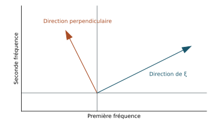

# ENS · MP · Mathématiques C 2019 · Corrigé brut

*Corrigé rédigé par IA, non officiel. Signalez toute erreur.*

**Rédaction** · GPT-6.2 Astra Ultra · vitesse non renseignée

**Révision** · GPT-6.2 Astra Ultra · vitesse non renseignée · 26 novembre 2026

Le problème part de la convergence faible pour démontrer le théorème de Rellich puis le lemme div-rot sur le plan. [Sujet officiel](https://www.ens.psl.eu/sites/default/files/19_mpi_mathc_sujet.pdf) · [Rapport du jury](https://banques-ecoles.fr/cms/wp-content/uploads/2019/10/19_MP_rap_eMathC.pdf)

## I. Convergence faible dans un espace préhilbertien réel

### Question I.1

Si $v_n\rightharpoonup v$ et $v_n\rightharpoonup w$, alors $\langle v-w,z\rangle=0$ pour tout $z\in H$ par unicité de la limite réelle. En prenant $z=v-w$, on obtient $\|v-w\|^2=0$, d’où $v=w$.

### Question I.2

Si $\|v_n-v\|\to0$, alors $|\langle v_n-v,z\rangle|\le\|v_n-v\|\,\|z\|\to0$ pour tout $z$. C’est la convergence faible.

### Question I.3

On a $\|v_n-v\|^2=\|v_n\|^2-2\langle v_n,v\rangle+\|v\|^2$. La première hypothèse donne $\langle v_n,v\rangle\to\|v\|^2$, la seconde $\|v_n\|^2\to\|v\|^2$. Ainsi $v_n\to v$ fortement.

### Question I.4

Dans une base orthonormée $(e_j)_{1\le j\le m}$, chaque coordonnée $\langle v_n-v,e_j\rangle$ tend vers zéro sous convergence faible. La somme finie de leurs carrés, $\|v_n-v\|^2$, tend donc vers zéro. La réciproque est I.2.

### Question I.5

Écrivons $\langle v_n,w_n\rangle-\langle v,w\rangle=\langle v_n,w_n-w\rangle+\langle v_n-v,w\rangle$. Le second terme tend vers zéro par convergence faible. Le premier est majoré en module par $(\sup_n\|v_n\|)\|w_n-w\|\to0$.

### Question I.6a

La norme est $\|c_n\|_2\le1$. Pour $z\in C^1([0,1])$ et $n\ge1$, $\int_0^1z(t)\cos(nt)dt=[z(t)\sin(nt)/n]_0^1-n^{-1}\int_0^1z'(t)\sin(nt)dt$. La borne $(|z(1)|+\|z'\|_\infty)/n$ tend vers zéro. Cela donne $c_n\rightharpoonup0$.

### Question I.6b

Pour $n\ge1$, $\langle c_n,c_n\rangle=\int_0^1(1+\cos(2nt))/2\,dt=1/2+\sin(2n)/(4n)\to1/2$. Les deux facteurs peuvent donc converger faiblement vers zéro tandis que leur produit scalaire reste loin de zéro.

## II. Décroissance rapide et espace de Schwartz

### Question II.1

À $s=a$ fixé, les dérivées de la tranche $t\mapsto f(t,a)$ sont $(\partial_1^k f)(t,a)$. Pour tout polynôme $P(t)$, $P(t)\partial_1^k f(t,s)$ est borné sur le plan en considérant $P(t)$ comme polynôme de $(t,s)$. La tranche est donc dans $\mathcal S(\mathbb R)$. Fixer $t$ et échanger les variables donne l’autre assertion.

### Question II.2

La fonction $\gamma(t)=e^{-t^2}$ est partout strictement positive. Par récurrence, $\gamma^{(n)}=P_n\gamma$ avec $P_0=1$ et $P_{n+1}=P_n'-2tP_n$. Pour tout polynôme $Q$, $QP_ne^{-t^2}$ tend vers zéro aux deux infinis et est borné sur chaque compact par continuité. Toutes les dérivées sont donc à décroissance rapide.

### Question II.3

La dérivée d’ordre $(a,b)$ de $f\otimes g$ est $f^{(a)}(t)g^{(b)}(s)$. Multipliée par $t^ks^\ell$, elle est le produit de deux fonctions bornées, l’une de $t$, l’autre de $s$. Tout polynôme en deux variables est une combinaison linéaire finie de ces monômes. D’où $f\otimes g\in\mathcal S(\mathbb R^2)$.

### Question II.4

Pour $f\in V$ et tout multi-indice $\alpha$, $\partial^\alpha f\in V$ par stabilité. Ensuite $M_1^kM_2^\ell\partial^\alpha f\in V$ est bornée pour tout $k,\ell$. Par structure vectorielle, il en va de même pour $P\partial^\alpha f$ pour tout polynôme $P$, combinaison finie de monômes. Ainsi $f\in\mathcal S$.

### Question II.5

Le produit $hf$ est lisse. Pour tout $P$ polynomial, chaque terme de $P\partial^\alpha(hf)$ est un multiple de $P(\partial^\beta h)(\partial^{\alpha-\beta}f)$. Il existe un polynôme $Q$ sans zéro et $C>0$ tels que $|\partial^\beta h|\le C|Q|$. Le terme est donc dominé par une constante fois $|PQ\partial^{\alpha-\beta}f|$, bornée puisque $f\in\mathcal S$. La somme de Leibniz est finie.

### Question II.6

La décroissance de $g$ donne $|g(t,s)|\le C/((1+t^2)(1+s^2))$. Pour chaque $t$, la convergence dominée en $s$ implique $F_n(t)=\int f_n(t,s)ds\to0$. Les $F_n$ sont continues (domination en $s$ et continuité de $f_n$) et $|F_n(t)|\le C\pi/(1+t^2)$. La convergence dominée en $t$ donne $\int F_n\to0$. La formule de Fubini du sujet identifie ce résultat à $\int_{\mathbb R^2} f_n\to0$.

## III. Opérateurs qui commutent aux dérivations et aux multiplications

### Question III.1a

Si $f(a)=0$, la formule intégrale des accroissements finis donne $f(s)=(s-a)g(s)$ avec $g(s)=\int_0^1 f'(a+t(s-a))dt$. Sur tout compact en $s$, dériver sous l’intégrale est licite à tout ordre puisque $t\in[0,1]$ et les dérivées sont uniformément bornées localement. Ainsi $g$ est lisse, même en $a$. Pour $|s-a|\ge1$, $g=f/(s-a)$. Chaque dérivée du facteur $(s-a)^{-1}$ y est bornée. La formule de Leibniz donne la décroissance rapide de $g^{(k)}$ à l’infini pour tout $k$. Sur le compact restant, les produits par un polynôme sont bornés par continuité.

### Question III.1b

Par 1a, $f=(M-aI)g$. Comme $L$ est linéaire et commute avec $M$, $L(f)=(M-aI)L(g)$. L’évaluation en $a$ donne donc $L(f)(a)=0$.

### Question III.1c

La fonction $f(a)g-g(a)f$ est dans $\mathcal S$ et s’annule en $a$. Par 1b son image par $L$ s’y annule aussi. La linéarité donne $f(a)L(g)(a)=g(a)L(f)(a)$.

### Question III.1d

Avec $g=\gamma$ de II.2, posons $\psi=L(\gamma)/\gamma$. Le numérateur est lisse et le dénominateur ne s’annule jamais, donc $\psi$ est lisse. La relation 1c donne $L(f)(a)=\psi(a)f(a)$ pour tout $a$ et tout $f$.

### Question III.1e

De $D L(f)=L(Df)$ et $L(f)=\psi f$ on déduit $\psi'f+\psi f'=\psi f'$. Prendre $f=\gamma$, partout non nulle, impose $\psi'=0$. Ainsi $\psi$ est constante et $L$ une homothétie complexe.

### Question III.2a

La linéarité est immédiate et II.1 assure que la tranche est dans $\mathcal S(\mathbb R)$. Pour $h\in\mathcal S(\mathbb R)$, prenons $f(t,s)=h(t)\gamma(s)/\gamma(a)$, dans $\mathcal S(\mathbb R^2)$ par II.3. Alors $\mu_a f=h$, d’où la surjectivité.

### Question III.2b

Si $\mu_a(f)=\mu_a(g)$, l’égalité admise donne $f-g=(M_2-aI)q$. Comme $T$ commute avec $M_2-aI$, $T(f)-T(g)=(M_2-aI)T(q)\in\ker\mu_a$. D’où $\mu_aT(f)=\mu_aT(g)$ sur chaque fibre.

### Question III.2c

L’identité $L_a\mu_a=\mu_aT$ et la surjectivité de $\mu_a$ donnent la linéarité de $L_a$ (prendre des antécédents et leurs combinaisons). Ses valeurs sont dans $\mathcal S(\mathbb R)$. On a $D\mu_a=\mu_a\partial_1$ et $M\mu_a=\mu_aM_1$. Par commutation de $T$ avec $\partial_1,M_1$, on obtient $DL_a\mu_a=L_aD\mu_a$ et $ML_a\mu_a=L_aM\mu_a$, donc les deux commutations par surjectivité.

### Question III.2d

Par III.1e, $L_a=\beta(a)I$, donc $T(f)(t,a)=\beta(a)f(t,a)$. Appliquons cela à $g=\gamma\otimes\gamma$. Le quotient $T(g)(0,a)/g(0,a)$ donne une expression lisse de $\beta$. En commutant $T$ avec $\partial_2$ sur $g$, on trouve $\beta'(a)g(t,a)=0$. Comme $g$ ne s’annule jamais, $\beta$ est constante. Ainsi $T$ est une homothétie.

## IV. Transformée de Fourier dans le plan

### Question IV.1a

Comme $(1+s^2)f(t,s)$ est bornée, $|e^{-isz}f(t,s)|\le C/(1+s^2)$ pour tous $z,t,s$. L’intégrale est absolument convergente. L’intégrande est continue en $(z,t)$ à $s$ fixé et la domination indépendante des paramètres donne la continuité conjointe de $\Gamma(f)$.

### Question IV.1b

Les dérivées en $z$ et $t$ de l’intégrande sont $e^{-isz}(-is)f(t,s)$ et $e^{-isz}\partial_1 f(t,s)$. Chacune est uniformément dominée en module par $C/(1+s^2)$, car $M_2 f,\partial_1 f$ sont de Schwartz. La dérivation sous l’intégrale et 1a donnent les dérivées continues $\partial_1\Gamma(f)=\Gamma(-iM_2f)$ et $\partial_2\Gamma(f)=\Gamma(\partial_1 f)$.

### Question IV.1c

Par stabilité de $\mathcal S$ et par récurrence à partir de 1b, pour $\alpha=(a,b)$, $\partial^\alpha\Gamma(f)=\Gamma((-iM_2)^a\partial_1^b f)$. Les opérateurs agissent sur des variables différentes et commutent. La fonction intérieure est dans $\mathcal S$ et 1a assure la continuité de toutes ces dérivées. D’où $\Gamma(f)\in C^\infty$.

### Question IV.2

L’espace vectoriel $V=\Gamma(\mathcal S)$ est constitué de fonctions lisses bornées par la domination de 1a. Il est stable par les deux dérivations d’après 1b. Par définition $M_2\Gamma(f)=\Gamma(M_1 f)$. Une intégration par parties en $s$, le terme au bord étant nul par décroissance rapide, donne $\Gamma(\partial_2f)=iz\,\Gamma(f)$, donc $M_1\Gamma(f)=\Gamma(-i\partial_2f)$. Les deux multiplications préservent donc $V$. Par II.4, $V\subset\mathcal S$.

### Question IV.3

Pour $\xi$ réel, $|e_\xi|=1$ et $\partial^\alpha e_\xi=(-i\xi_1)^{\alpha_1}(-i\xi_2)^{\alpha_2}e_\xi$ est bornée pour toute $\alpha$. Ainsi $e_\xi\in\mathcal O$ et II.5 donne $e_\xi f\in\mathcal S$.

### Question IV.4

Pour $(z,t)\in\mathbb R^2$,
$$\Gamma^2(f)(z,t)=\int_{\mathbb R}e^{-isz}\left(\int_{\mathbb R}e^{-irt}f(s,r)dr\right)ds=\widehat f(z,t).$$
Fubini s’applique par 3 et décroissance rapide. La question 2 appliquée deux fois donne $\widehat f\in\mathcal S$.

### Question IV.5

Notons $\mathcal F$ la transformée et $R f(x)=f(-x)$. Les relations admises $\partial_k\mathcal F=-i\mathcal F M_k$ et $M_k\mathcal F=-i\mathcal F\partial_k$ entraînent que $\mathcal F^2$ anticommute avec $\partial_k$ et $M_k$. La réflexion $R$ préserve $\mathcal S$ et anticommute avec ces mêmes opérateurs. Donc $R\mathcal F^2$ commute avec les quatre, et III.2d donne $R\mathcal F^2=\alpha I$. Comme $R^2=I$, on obtient $\widehat{\widehat f}=\alpha Rf$.

### Question IV.6a

À $t$ fixé, l’intégrande $g(z,t)e^{-isz}f(t,s)$ en $(z,s)$ est continue et à décroissance rapide, car les deux tranches sont de Schwartz et l’exponentielle a module un. Fubini autorise l’échange de $z,s$. Après intégration en $z$, le facteur de $f(t,s)$ est $\int e^{-izs}g(z,t)dz=\Gamma(g^\star)(s,t)$. En intégrant en $t$ on obtient $\int g\Gamma(f)=\int (\Gamma(g^\star))^\star f$. Les intégrales globales sont absolument convergentes, par exemple le produit initial est majoré par $C(1+t^2)^{-2}(1+z^2)^{-1}(1+s^2)^{-1}$.

### Question IV.6b

Notons $Sg=g^\star$ et $B(f,g)=\int fg$ sans conjugaison. La question 6a donne $B(g,\Gamma f)=B(S\Gamma Sg,f)$. Deux applications et $S^2=I$ donnent $B(g,\mathcal Ff)=B(S\mathcal F Sg,f)$. Or $S\mathcal F=\mathcal F S$ par échange des coordonnées dans l’intégrale de Fourier, justifié par Fubini. Ainsi $\int g\widehat f=\int\widehat g f$.

### Question IV.7

On a $\overline{\widehat g}=\mathcal F(R\bar g)$ par changement $x\mapsto-x$ dans l’intégrale. Avec 6b et 5,
$$\int\widehat f\,\overline{\widehat g}=\int f\,\mathcal F^2(R\bar g)=\alpha\int f\bar g.$$
Pour $f=g=\gamma\otimes\gamma$, l’intégrale $\int|f|^2$ est strictement positive et $\widehat f(0)=\int f>0$. La continuité de $\widehat f$ implique $\int|\widehat f|^2>0$. Le quotient de ces deux réels strictement positifs est donc $\alpha>0$.

On peut calculer cette constante avec $f(x)=e^{-|x|^2/2}$. En dimension un, la transformée $h$ de $e^{-s^2/2}$ vérifie $h'(t)=-t h(t)$ par dérivation puis intégration par parties. Comme $h(0)=\sqrt{2\pi}$, on obtient $h(t)=\sqrt{2\pi}e^{-t^2/2}$. Par produit en dimension deux, $\widehat f=2\pi f$. Le rapport des intégrales des carrés donne donc $\alpha=4\pi^2$ avec la convention du sujet.

## V. Compacité par compensation

### Question V.1a

Pour chaque $\xi$, $\widehat{\theta g_n}(\xi)=\int g_n\theta\cos(x\cdot\xi)-i\int g_n\theta\sin(x\cdot\xi)$. Les deux tests réels sont de Schwartz par IV.3 et séparation des parties réelle et imaginaire. Donc ces intégrales tendent vers zéro par convergence faible. Cauchy-Schwarz donne $|\widehat{\theta g_n}(\xi)|\le\|g_n\|_2\|\theta\|_2$, indépendamment de $\xi,n$. Même preuve pour $f_n$.

### Question V.1b

Choisissons $L$ tel que $K\subset[-L,L]^2$ et posons $\varphi_n=\theta_L f_n$, $\psi_n=\theta_L g_n$. Comme $g_n$ est nulle hors de $K$ et $\theta_L=1$ sur $K$, les produits $\varphi_n\psi_n$ et $f_ng_n$ sont égaux. Les assertions de convergence ponctuelle et de bornes uniformes sont V.1a. Par Leibniz, $|\theta_L|\le1$ et $|\partial_j\theta_L|\le1$ donnent $\|\partial_1\varphi_n\|_2\le\|f_n\|_2+\|\partial_1 f_n\|_2$ et $\|\partial_2\psi_n\|_2\le\|g_n\|_2+\|\partial_2g_n\|_2$.

### Question V.1c

Écrivons $a_n=\widehat\varphi_n$, $b_n=\widehat\psi_n$. Par IV.7 le produit scalaire cherché est $\alpha^{-1}\operatorname{Re}\int a_n\bar b_n$. À $N$ fixé, l’intégrale avec le facteur $\theta_N$ tend vers zéro par II.6 : l’intégrande tend ponctuellement vers zéro et est dominée par une constante fois la fonction de Schwartz $\theta_N$. Pour le complément, $0\le1-\theta_N(\xi)\le(|\xi_1|+|\xi_2|)/N$ car il est nul sur le carré et vaut au plus un ailleurs. Par Cauchy-Schwarz, la queue est majorée par
$$N^{-1}\bigl(\|\xi_1a_n\|_2\|b_n\|_2+\|a_n\|_2\|\xi_2b_n\|_2\bigr).$$
Ces quatre normes sont bornées indépendamment de $n$ par IV.7, les identités de dérivation de Fourier et V.1b. La limite supérieure du module est au plus $C/N$ pour tout $N$, d’où la convergence vers zéro.

### Question V.2

Soit $h$ la limite faible dans $\mathcal S(\mathbb R^2;\mathbb R)$. Pour $\theta_L=1$ sur $K$, le test $(1-\theta_L)^2h$ est de Schwartz et donne zéro contre chaque $h_n$. Par passage à la limite $\int|(1-\theta_L)h|^2=0$, donc $(1-\theta_L)h=0$ partout par continuité. Ainsi $h$ est nulle hors du carré support de $\theta_L$. Les $w_n=h_n-h$ ont un support compact commun, convergent faiblement vers zéro, et leurs deux dérivées sont bornées en norme $L^2$. Prenons $f_n=g_n=w_n$ en V.1c. On obtient $\|h_n-h\|_2^2\to0$.

### Question V.3

Par un test portant sur une seule composante, chaque composante converge faiblement. Comme en V.2, $G$ a un support compact, en testant ses composantes contre $(1-\theta_L)^2g_j$. Soustrayons $F,G$. Les deux termes croisés avec un facteur limite fixe convergent vers zéro par convergence faible. Il suffit donc de traiter le cas de limites nulles. Prenons une coupure $\theta$ identiquement un sur le support compact commun des champs de la seconde suite et remplaçons les champs par $U_n=\theta F_n$, $V_n=\theta G_n$. Le produit scalaire est conservé. Les normes $L^2$ de $U_n,V_n,\operatorname{div}U_n,\operatorname{rot}V_n$ sont bornées : la règle de Leibniz ajoute seulement des termes où les champs initiaux sont multipliés par une dérivée bornée de $\theta$.

Écrivons $A=\widehat U_n$, $B=\widehat V_n$ composante par composante. Par V.1a, chaque composante tend vers zéro ponctuellement et est uniformément bornée. Par IV.7, il suffit de contrôler l’intégrale du produit hermitien $A\cdot\bar B$. Sur les basses fréquences, $\int\theta_N A\cdot\bar B\to0$ comme en V.1c. Aux fréquences $\xi\ne0$, décomposons le produit dans la base orthonormée réelle constituée de $\xi/|\xi|$ et $\xi^\perp/|\xi|$, où $\xi^\perp=(\xi_2,-\xi_1)$. Cela donne
$$|A\cdot\bar B|\le\frac{|\xi\cdot A|\,|B|+|A|\,|\xi^\perp\cdot B|}{|\xi|}.$$
Hors du carré $[-N,N]^2$, $|\xi|\ge N$. L’intégrale avec $1-\theta_N$ est donc au plus
$$\frac1N\bigl(\|\xi\cdot A\|_2\|B\|_2+\|A\|_2\|\xi^\perp\cdot B\|_2\bigr).$$
Or $i\xi\cdot A=\widehat{\operatorname{div}U_n}$ et $i\xi^\perp\cdot B=\widehat{\operatorname{rot}V_n}$ avec le signe du sujet. La borne est donc $C/N$ uniformément en $n$. En faisant d’abord tendre $n$ puis $N$ vers l’infini, le produit des suites centrées tend vers zéro. En rétablissant les limites, on obtient $\langle\!\langle F_n,G_n\rangle\!\rangle\to\langle\!\langle F,G\rangle\!\rangle$.

