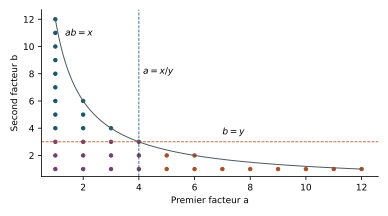

# ENS · MP · Mathématiques D 2019 · Corrigé guidé

*Corrigé rédigé par IA, non officiel. Signalez toute erreur.*

**Rédaction** · GPT-6.2 Astra Ultra · vitesse non renseignée

**Révision (tour 1)** · GPT-6.2 Astra Ultra · vitesse non renseignée · 26 novembre 2026

Le problème étudie les séries de Dirichlet pondérées par le nombre de décompositions multiplicatives. Les valeurs en un se ramènent à des sommes de cotangentes et au déterminant d’une matrice. [Sujet officiel](https://www.ens.psl.eu/sites/default/files/19_mpi_mathd_sujet.pdf) · [Rapport du jury](https://www.ens.psl.eu/sites/default/files/19_mp_rap_emathd_u.pdf)

## I. Séries de Dirichlet et formules de sommation

### Question I.1

> [!INDICATION]
> Renverser les classes modulo p dans la somme.

#### Solution

L’imparité entraîne $f(0)=0$. La substitution $a\mapsto-a$ permute les classes modulo $p$, donc $\mu_p(f)=\sum_{a\bmod p}f(-a)=-\mu_p(f)$ et la somme vaut zéro. Cet argument couvre $p=2$.

### Question I.2

> [!INDICATION]
> Intégrer les contributions de chaque saut de la fonction sommatoire.

#### Solution

Avec l’hypothèse $g\in C^1$ rétablie par le jury, intégrons $S_h(t)=\sum_{n\le x}h(n)\mathbf1_{[n,x]}(t)$ contre $g'(t)$ sur $[1,x]$. La somme est finie et chaque intégrale vaut $g(x)-g(n)$. Ainsi
$$\sum_{n\le x}h(n)g(n)=S_h(x)g(x)-\int_1^x S_h(t)g'(t)\,dt.$$

### Question I.3

> [!INDICATION]
> Compter les couples de facteurs et retirer leur rectangle commun.

#### Solution

La somme $S_{f*g}(x)$ porte le poids $f(a)g(b)$ sur les couples $ab\le x$. Chacun vérifie $b\le y$ ou $a\le x/y$. Dans l’intersection, les deux inégalités garantissent déjà $ab\le x$. L’inclusion-exclusion donne donc
$$S_{f*g}(x)=\sum_{b\le y}g(b)S_f(x/b)+\sum_{a\le x/y}f(a)S_g(x/a)-S_f(x/y)S_g(y).$$

### Question I.4a

> [!INDICATION]
> Comparer les modules à la série de Riemann.

#### Solution

Pour $s>1$, $\sum_{n\ge1}|f(n)|n^{-s}\le\|f\|_\infty\sum n^{-s}<\infty$.

### Question I.4b

> [!INDICATION]
> Calculer la somme des valeurs absolues avant le regroupement par produit.

#### Solution

La série double des $|f(a)g(b)|(ab)^{-s}$ a pour somme le produit des deux sommes de modules, fini d’après les hypothèses. Le regroupement par $ab=n$ est licite et donne à la fois la convergence absolue pour $f*g$ et $L(s,f*g)=L(s,f)L(s,g)$.

### Question I.4c

> [!INDICATION]
> Commencer par un ensemble fini de nombres premiers.

#### Solution

Comme le précise le rapport, il faut supposer la convergence absolue de $L(s,f)$ au point considéré. Il faut également la normalisation $f(1)=1$, automatique dès que $f$ n’est pas identiquement nulle. Pour chaque premier $\ell$, la sous-série des puissances de $\ell$ impose $|f(\ell)|/\ell^s<1$. En développant un produit fini de séries géométriques,
$$\prod_{\ell\le Y\ {\rm premier}}(1-f(\ell)/\ell^s)^{-1}
=\sum_{n:\,P^+(n)\le Y}f(n)n^{-s},$$
où la somme porte sur les entiers dont le plus grand facteur premier $P^+(n)$ est au plus $Y$, avec $P^+(1)=1$. Cette égalité utilise l’unicité de la décomposition en primes et la multiplicativité complète. L’erreur par rapport à $L(s,f)$ est au plus $\sum_{n>Y}|f(n)|n^{-s}\to0$. La seule multiplicativité ne suffit pas, par exemple $f(n)=n^2$ au point $s=2$.

### Question I.5a

> [!INDICATION]
> Appliquer la formule d’Abel à la puissance négative puis estimer le terme de bord.

#### Solution

Pour $g(t)=t^{-s}$, I.2 donne $S_f(x)x^{-s}+s\int_1^x S_f(t)t^{-s-1}\,dt$. Le premier terme est $O(x^{\alpha-s})=o(1)$ et l’intégrale converge absolument par comparaison à $Mt^{\alpha-s-1}$. La série converge donc vers $s\int_1^\infty S_f(t)t^{-s-1}dt$.

### Question I.5b

> [!INDICATION]
> Travailler sur un segment compact strictement à droite de l’exposant de croissance.

#### Solution

Sur $[a,b]\subset(\alpha,\infty)$, l’intégrande est continue en $s$, continue par morceaux en $t$ et vérifie $|s S_f(t)t^{-s-1}|\le bMt^{\alpha-a-1}$. Le majorant est intégrable. La convergence dominée fournit la continuité recherchée sur chaque segment.

### Question I.5c

> [!INDICATION]
> Séparer les périodes complètes du reste.

#### Solution

Les périodes complètes ont une somme nulle par I.1. Les sommes restantes prennent au plus $p$ valeurs, donc $S_f$ est bornée. Pour tout $\alpha>0$ elle vérifie ainsi la majoration de I.5a sur $[1,\infty)$. Les intervalles $(\alpha,\infty)$ recouvrent $(0,\infty)$, où la série converge et sa somme est continue.

### Question I.5d

> [!INDICATION]
> Encadrer la différence entre la partie entière et sa variable.

#### Solution

La série de Riemann converge pour $s>1$. Comme $S_{\bf1}(t)=\lfloor t\rfloor=t-\{t\}$, I.5a donne $\zeta(s)=s/(s-1)-s\int_1^\infty\{t\}t^{-s-1}dt$. Le terme intégral avec son facteur est entre zéro et un. Ainsi $(s-1)\zeta(s)\to1$ lorsque $s\downarrow1$.

## II. Caractères modulo un nombre premier

### Question II.6a

> [!INDICATION]
> Étudier séparément les facteurs inversibles et les multiples de p.

#### Solution

Si $p\mid ab$, l’un des facteurs est multiple de $p$ et les deux membres de $\chi(ab)=\chi(a)\chi(b)$ sont nuls. Sinon c’est la loi du morphisme sur le groupe des unités. La preuve vaut pour tous entiers et donne en particulier la multiplicativité complète sur $\mathbb N^*$.

### Question II.6b

> [!INDICATION]
> Évaluer en un puis décomposer moins n en deux facteurs.

#### Solution

Un caractère vaut $1$ en $1$. S’il est impair, $\chi(-1)=-1$. Réciproquement cette égalité donne $\chi(-n)=\chi(-1)\chi(n)=-\chi(n)$ pour tout $n$ par II.6a.

### Question II.6c

> [!INDICATION]
> Utiliser la même valeur du caractère sur toutes les factorisations du même entier.

#### Solution

Pour $ab=n$, $\chi(a)\chi(b)=\chi(n)$. Par conséquent $(\chi*(\chi\tau_k))(n)=\chi(n)\sum_{ab=n}\tau_k(b)=\chi(n)\tau_{k+1}(n)$.

### Question II.7a

> [!INDICATION]
> Étudier l’intersection des deux sous-groupes cycliques.

#### Solution

Leur intersection est triviale, l’ordre de chacun de ses éléments divisant $s$ et $t$. Si $(xy)^n=1$, la commutativité donne $x^n=y^{-n}$ dans l’intersection, donc $s\mid n$ et $t\mid n$, d’où $st\mid n$. Comme $(xy)^{st}=1$, le produit $xy$ est d’ordre $st$.

### Question II.7b

> [!INDICATION]
> Extraire, premier par premier, la plus forte puissance dans les deux ordres.

#### Solution

Le rapport retire ici l’hypothèse de coprimalité répétée à l’impression. Pour chaque premier $\ell\mid st$, prenons $u=x$ ou $y$ dont l’ordre $d$ contient la puissance maximale $\ell^e$ présente dans $s,t$. L’élément $u^{d/\ell^e}$ est d’ordre $\ell^e$. Ces ordres étant deux à deux premiers entre eux, II.7a itérée donne à leur produit l’ordre $\prod_\ell\ell^e=\operatorname{ppcm}(s,t)$.

### Question II.7c

> [!INDICATION]
> Comparer le plus petit commun multiple à l’ordre maximal.

#### Solution

Si $h$ est d’ordre maximal $m$ et $x$ d’ordre $d$, II.7b réalise l’ordre $\operatorname{ppcm}(d,m)$. Celui-ci est au plus $m$ et multiple de $m$, donc égal à $m$. Ainsi $d\mid m$.

### Question II.7d

> [!INDICATION]
> Compter les racines d’un polynôme dans le corps fini.

#### Solution

Pour un élément $h$ d’ordre maximal $m$, tous les $p-1$ éléments de $G$ annulent $X^m-1$ par II.7c. Ce polynôme non nul sur $\mathbb F_p$ a au plus $m$ racines. Or $m\le|G|=p-1$. Donc $m=p-1$ et $h$ engendre $G$.

### Question II.8a

> [!INDICATION]
> Prescrire librement la valeur du morphisme sur un générateur.

#### Solution

Si $a$ engendre $G$, l’évaluation $\chi\mapsto\chi(a)$ est un isomorphisme de $\widehat G$ sur les racines $(p-1)$-ièmes de l’unité. En effet, chacune de ces racines $z$ définit le morphisme $a^j\mapsto z^j$. Le groupe dual est donc cyclique de cardinal $p-1$.

### Question II.8b

> [!INDICATION]
> Multiplier les classes par une unité dont le caractère diffère de un.

#### Solution

Pour $\chi\ne\chi_0$, choisissons $u$ tel que $\chi(u)\ne1$. Les multiples par $u$ permutent les classes et donnent $\mu_p(\chi)=\chi(u)\mu_p(\chi)$. La somme est donc nulle.

### Question II.8c

> [!INDICATION]
> Écrire la somme comme une somme géométrique sur les caractères.

#### Solution

Si $p\mid n$, toutes les valeurs en $n$ sont nulles. Sinon $\chi(n)\overline{\chi(c)}=\chi(nc^{-1})$. Pour $nc^{-1}=a^j$, la somme sur les caractères est $\sum_{h=0}^{p-2}e^{2\pi ihj/(p-1)}$. Elle vaut $p-1$ si $n\equiv c\bmod p$, zéro sinon.

### Question II.9a

> [!INDICATION]
> Partager le budget de croissance entre le nombre de diviseurs et la fonction précédente.

#### Solution

L’hypothèse sur $\tau_2$ vaut pour tout exposant positif, comme le précise le jury. Si $\tau_k(d)\le C_{k,\varepsilon/2}d^{\varepsilon/2}$, alors $\tau_{k+1}(n)=\sum_{d\mid n}\tau_k(d)\le C_{k,\varepsilon/2}n^{\varepsilon/2}\tau_2(n)\le C_{k,\varepsilon/2}T_{2,\varepsilon/2}n^\varepsilon$. La récurrence établit le résultat pour tout $k$.

### Question II.9b

> [!INDICATION]
> Dans la formule de l’hyperbole, équilibrer la somme courte contre le terme contenant une somme de caractère bornée.

#### Solution

À $k=1$, les sommes partielles de $\chi$ sont bornées par périodicité et II.8b. Supposons l’estimation établie pour $k$ et tout exposant d’erreur. Fixons $0<\delta<\min(\varepsilon,1/k)$. Dans I.3 prenons $g=\chi$, $f=\chi\tau_k$, $y=x^{1/(k+1)}$ pour $x\ge1$. La première somme est en module au plus
$$C x^{1-1/k+\delta}\sum_{b\le y}b^{-(1-1/k+\delta)}
\le C' x^{1-1/k+\delta}y^{1/k-\delta}.$$
La comparaison intégrale est permise puisque $1-1/k+\delta<1$. La seconde somme est $O((x/y)^{1+\delta})$ par II.9a et la borne sur $S_\chi$. Le produit d’intersection est $O((x/y)^{1-1/k+\delta})$. Avec ce choix de $y$, les deux premiers exposants en $x$ valent $1-1/(k+1)+k\delta/(k+1)$. Par II.6c on obtient le résultat au rang $k+1$. Pour $0\le x<1$ la somme est vide.

### Question II.10

> [!INDICATION]
> Établir l’identité de produit en convergence absolue avant de tendre vers un.

#### Solution

Pour $s>1-1/k$, choisissons $\varepsilon>0$ tel que $1-1/k+\varepsilon<s$. I.5a–b et II.9b donnent la convergence et la continuité sur l’intervalle annoncé. Pour $s>1$ la série de $\chi$ converge absolument. I.4b et II.6c donnent $D_k(s,\chi)=L(s,\chi)^k$ par itération. Les deux membres étant continus en $1$, la limite à droite donne $D_k(1,\chi)=L(1,\chi)^k$.

## III. Calcul de la valeur en un

### Question III.11

> [!INDICATION]
> Changer le signe d’un seul facteur dans chaque k-uplet.

#### Solution

La classe de $r$ détermine l’ensemble de sommation. Remplacer $m_1$ par $p-m_1$ envoie bijectivement les produits de classe $r$ vers ceux de classe $-r$. Une seule cotangente change de signe, donc $x_k(-r;p)=-x_k(r;p)$. Sur la classe nulle la somme est vide.

### Question III.12

> [!INDICATION]
> Faire intervenir les caractères avant le passage à la limite des sommes symétriques.

#### Solution

Appelons $T_N(r)$ la somme signée imprimée. En changeant $n$ en $-n$ dans la partie négative, elle devient
$$\sum_{n=1}^N\frac{\tau_k(n)}n\bigl(\mathbf1_{n\equiv r}-\mathbf1_{n\equiv-r}\bigr)
=\frac1{p-1}\sum_\chi\bar\chi(r)(1-\chi(-1))\sum_{n=1}^N\frac{\tau_k(n)\chi(n)}n.$$
Ici $\chi(-1)=\pm1$ et II.8c s’applique puisque $r$ est une unité. Le coefficient principal est nul pour tout $N$. Toutes les autres sommes ont une limite par II.10, donc $\lim T_N(r)=(p-1)^{-1}\sum_{\chi\ne\chi_0}\bar\chi(r)(1-\chi(-1))L(1,\chi)^k$.

### Question III.13

> [!INDICATION]
> Différencier le polynôme géométrique avant de l’évaluer en une racine de l’unité.

#### Solution

Posons $z=e(m/p)\ne1$. Pour $F(X)=(1-X^p)/(1-X)$, $zF'(z)=-p/(1-z)$. Puisque $\sum_{a=1}^{p-1}z^a=-1$ et $B(a/p)=a/p-1/2$, on trouve
$$\sigma_p(m)=-\frac1{1-z}+\frac12=-\frac{1+z}{2(1-z)}=-\frac i2\cot(\pi m/p).$$

### Question III.14a

> [!INDICATION]
> Changer de variable dans les unités et traiter le multiple de p à part.

#### Solution

Sous l’hypothèse imprimée $\chi\ne\chi_0$, pour $p\mid n$ la somme est $\mu_p(\chi)=0=\bar\chi(n)\tau(\chi)$. Pour $p\nmid n$, le remplacement de $m$ par $u=mn\bmod p$ donne $\chi(m)=\bar\chi(n)\chi(u)$, donc $\tau(\chi,n)=\bar\chi(n)\tau(\chi)$.

### Question III.14b

> [!INDICATION]
> Appliquer deux fois l’orthogonalité à la somme carrée.

#### Solution

D’après III.14a, $\sum_{n=1}^p|\tau(\chi,n)|^2=(p-1)|\tau(\chi)|^2$. En développant, la somme intérieure sur $n$ est $\sum_ne(n(a-b)/p)=p\mathbf1_{a=b}$ pour $1\le a,b\le p$. On obtient $p\sum_a|\chi(a)|^2=p(p-1)$. D’où $|\tau(\chi)|^2=p$.

### Question III.14c

> [!INDICATION]
> Appliquer les sommes de Gauss à chaque somme finie de la série de Fourier de Bernoulli.

#### Solution

Le rapport ajoute l’hypothèse que $\chi$ est impair. Dans ce cas $\sum_a\bar\chi(a)\sin(2\pi na/p)=\chi(n)\tau(\bar\chi)/i$ par III.14a appliquée à $n$ et $-n$. Multiplier la série de Fourier $B(t)=-\pi^{-1}\sum_{n\ge1}\sin(2\pi nt)/n$ par $\bar\chi(a)$ et sommer sur le nombre fini de classes donne
$$\sum_a\bar\chi(a)B(a/p)=\frac{i\tau(\bar\chi)}{\pi}L(1,\chi).$$
Le changement $a\mapsto-a$ donne $\overline{\tau(\chi)}=\chi(-1)\tau(\bar\chi)$. III.14b implique alors $\tau(\chi)\tau(\bar\chi)=-p$. Ainsi $L(1,\chi)=(\pi i\tau(\chi)/p)\sum_a\bar\chi(a)B(a/p)$.

### Question III.15

> [!INDICATION]
> Exprimer la transformée finie de Bernoulli dans deux ordres de sommation.

#### Solution

Par III.14a, $\sum_{m=1}^{p-1}\chi(m)\sigma_p(m)=\tau(\chi)\sum_{a=1}^{p-1}\bar\chi(a)B(a/p)$. III.14c puis III.13 entraînent
$$L(1,\chi)=\frac{\pi}{2p}\sum_{m=1}^{p-1}\chi(m)\cot(\pi m/p).$$
L’extrémité $m=p$ de la somme imprimée se supprime avant toute évaluation de la cotangente, indéfinie en $\pi$.

Pour vérifier le facteur $1/2$ et le signe, prenons $p=3$ et le caractère non principal $\chi(1)=1$, $\chi(2)=-1$. On obtient
$$L(1,\chi)=\frac{\pi}{6}\big(\cot(\pi/3)-\cot(2\pi/3)\big)
=\frac{\pi}{3\sqrt3}.$$
Cette valeur est aussi la somme de $\sum_{n\ge0}[(3n+1)^{-1}-(3n+2)^{-1}]$. En intégrant $\sum_{n\ge0}t^{3n}(1-t)=1/(1+t+t^2)$ de 0 à 1, on trouve la même valeur. L’échange somme-intégrale est permis par positivité des termes.

### Question III.16

> [!INDICATION]
> Transformer la somme de cotangentes par les caractères et utiliser la symétrie des classes.

#### Solution

En multipliant les $k$ sommes finies, on obtient
$$\sum_{r\in G}\chi(r)x_k(r;p)=\left(\frac1p\sum_{m=1}^{p-1}\chi(m)\cot(\pi m/p)\right)^k.$$
Cette expression est nulle pour un caractère pair par symétrie et vaut $(2/\pi)^kL(1,\chi)^k$ pour un impair par III.15. Inversions de II.8c et III.12 donnent donc $x_k(r;p)=\tfrac12(2/\pi)^k\lim_N T_N(r)$. Pour $f$ impaire on a $f(0)=0$. Dans la somme partielle de $\tau_k(n)f(n)/n$, regrouper les classes $r,-r$ donne $\sum_{1\le r\le(p-1)/2}f(r)T_N(r)$. La limite est
$$D_k(1,f)=2(\pi/2)^k\sum_{1\le r\le(p-1)/2} f(r)x_k(r;p).$$
Si $p=2$, $f$ et tous les $x_k$ sont nuls, ce qui donne la même conclusion.

### Question III.17

> [!INDICATION]
> Soustraire les entiers premiers à p de la somme totale.

#### Solution

Pour $s>1$ les séries sont absolument convergentes, par II.9a avec $\varepsilon<s-1$ (ou directement par le produit de séries positives). I.4b et II.6c donnent $L(s,\tau_k)=\zeta(s)^k$ et $D_k(s,\chi_0)=L(s,\chi_0)^k$. Leur différence est exactement la sous-série des multiples de $p$. Enfin $L(s,\chi_0)=\sum_{p\nmid n}n^{-s}=(1-p^{-s})\zeta(s)$, d’où sa puissance $k$ demandée.

### Question III.18

> [!INDICATION]
> Isoler le coefficient de la puissance de zêta et examiner ses deux premiers termes en un.

#### Solution

Notons $b=f(0)$, $A=(p-1)^{-1}\sum_{r=1}^{p-1}f(r)$ et $c_\chi(f)=\sum_{r=1}^pf(r)\bar\chi(r)$. Par II.8c sur les unités et III.17 sur les multiples de $p$, pour $s>1$,
$$D_k(s,f)=\zeta(s)^k H(s)+\frac1{p-1}\sum_{\chi\ne\chi_0}c_\chi(f)L(s,\chi)^k,\qquad H(s)=b+(A-b)(1-p^{-s})^k.$$
La somme finie converge en $1$ par II.10. Puisque $\zeta(s)\sim(s-1)^{-1}$, une limite finie impose $H(s)=O((s-1)^k)$. Pour $k\ge2$, cela impose $H(1)=H'(1)=0$. Or $H'(1)=(A-b)k(1-1/p)^{k-1}(\log p)/p$. D’où $A=b$ puis $b=0$, ce qui équivaut à $f(0)=\mu_p(f)=0$. Réciproquement ces deux conditions annulent $H$ identiquement et la limite est $(p-1)^{-1}\sum_{\chi\ne\chi_0}c_\chi(f)L(1,\chi)^k$.

Le rôle de $k\ge2$ se voit sur la fonction qui vaut $1$ en zéro modulo $p$ et $-1/(p-1)$ sur les autres classes. Alors $b=1$ et $A=-1/(p-1)$. Pour $k=1$, $H(1)=0$ mais $H'(1)=-\ln(p)/(p-1)\ne0$. Le produit $\zeta(s)H(s)$ a tout de même une limite finie. C’est la présence d’un pôle d’ordre au moins deux qui contraint la dérivée à s’annuler dans le sujet.

## IV. Automorphismes cyclotomiques et déterminant

### Question IV.19a

> [!INDICATION]
> Réduire les représentants polynomiaux par division euclidienne.

#### Solution

L’image de l’évaluation linéaire $P\mapsto P(\alpha)$ est un espace vectoriel. Si $d=\deg\pi_\alpha$, la division par $\pi_\alpha$ donne un représentant de degré inférieur à $d$ pour toute valeur. Les $1,\alpha,\ldots,\alpha^{d-1}$ engendrent donc. Une relation non triviale les reliant contredirait le degré minimal. Cette base a $d$ éléments.

### Question IV.19b

> [!INDICATION]
> Utiliser la dimension finie et l’absence de diviseurs de zéro.

#### Solution

Le produit de deux valeurs polynomiales est la valeur du produit de leurs polynômes, donc la multiplication par $x$ est bien un endomorphisme linéaire de $\mathbb Q[\alpha]$. Pour $x\ne0$, cet endomorphisme est injectif dans $\mathbb C$, donc surjectif en dimension finie. Un antécédent de $1$ fournit l’inverse.

### Question IV.19c

> [!INDICATION]
> Traiter séparément le numérateur et l’inverse du dénominateur.

#### Solution

Tout $Q(\alpha)/R(\alpha)$ à dénominateur non nul est dans $\mathbb Q[\alpha]$ par IV.19b et stabilité par produit. L’autre inclusion résulte du dénominateur $1$. Ainsi $\mathbb Q[\alpha]=\mathbb Q(\alpha)$.

### Question IV.20a

> [!INDICATION]
> Développer le polynôme géométrique après translation.

#### Solution

On a $P_p(1+X)=((1+X)^p-1)/X=\sum_{j=1}^p\binom pj X^{j-1}$. Le coefficient dominant vaut $1$, tous les autres sont divisibles par $p$ et le terme constant $p$ n’est pas divisible par $p^2$. Le critère donné s’applique. La translation étant un automorphisme de $\mathbb Q[X]$, $P_p$ est irréductible.

### Question IV.20b

> [!INDICATION]
> Retirer de la liste des racines p-ièmes la racine un.

#### Solution

L’identité $(X-1)P_p(X)=X^p-1$ donne $P_p(\xi_p^c)=0$ pour toutes les classes $c$ non nulles, puisque $\xi_p^c\ne1$. En particulier $P_p$, irréductible unitaire annulant $\xi_p$, est son polynôme minimal.

### Question IV.20c

> [!INDICATION]
> Vérifier d’abord l’indépendance du représentant polynomial.

#### Solution

Si $P(\xi_p)=Q(\xi_p)$, le polynôme $P-Q$ est divisible par le polynôme minimal $P_p$. Par IV.20b il s’annule donc aussi en $\xi_p^c$. La règle $\sigma_c(P(\xi_p))=P(\xi_p^c)$ est bien définie. Elle respecte les sommes, les produits et $1$, par évaluation. Pour $d$ inverse de $c$ modulo $p$, les compositions $\sigma_c\sigma_d$ et $\sigma_d\sigma_c$ fixent $\xi_p$ et chaque rationnel, donc sont l’identité. C’est un automorphisme de corps.

### Question IV.20d

> [!INDICATION]
> Appliquer le morphisme au produit d’un dénominateur par son inverse.

#### Solution

L’injectivité donne $R(\xi_p^c)\ne0$. Comme $\sigma_c$ conserve $1$ et les produits, il envoie l’inverse de $R(\xi_p)$ sur $1/R(\xi_p^c)$. Le quotient demandé devient donc $Q(\xi_p^c)/R(\xi_p^c)$.

### Question IV.21a

> [!INDICATION]
> Récrire chaque cotangente accompagnée du facteur i dans le corps cyclotomique.

#### Solution

Pour $p\nmid m$, $i\cot(\pi m/p)=(1+\xi_p^m)/(1-\xi_p^m)\in\mathbb Q(\xi_p)$. Ainsi $i^kx_k(r;p)$ est une somme de produits de $k$ de ces fractions, divisée par $p^k$, donc appartient au corps.

### Question IV.21b

> [!INDICATION]
> Suivre le changement de chacune des k classes dans le produit.

#### Solution

IV.20d envoie chaque fraction de IV.21a sur celle d’indice $cm$. La multiplication par $c$ permute les unités et envoie les $k$-uplets de produit $r$ bijectivement sur ceux de produit $c^kr$. Il vient $\sigma_c(i^kx_k(r;p))=i^kx_k(c^kr;p)$.

### Question IV.22a

> [!INDICATION]
> Faire agir les automorphismes avant de regrouper les indices opposés.

#### Solution

Écrivons $m=(p-1)/2$, si bien que $a^m=-1$ dans $G$ car c’est l’unique élément d’ordre deux. Le produit $f(r)x_k(r;p)$ est pair en $r$. Par III.16 et $D_k(1,f)=0$, la somme $\sum_{j=0}^{2m-1} f(a^j)x_k(a^j;p)$ est nulle. Multiplions par $i^k$ et appliquons $\sigma_c$. Les $f(a^j)$ étant rationnels, ils restent fixes. Par IV.21b, le nouvel argument est $c^ka^j$. Puisque $\gcd(k,2m)=1$, pour tout $\ell$ on peut choisir $c=a^t$ avec $kt\equiv\ell\bmod 2m$. On obtient la somme décalée de l’énoncé. Les termes d’indices $j$ et $j+m$ coïncident, les deux facteurs changeant de signe. La somme des $m$ premiers est donc nulle.

### Question IV.22b

> [!INDICATION]
> Interpréter le décalage dans la somme comme l’indice de ligne.

#### Solution

Posons $x_j=x_k(a^j;p)$ et $y_j=f(a^j)$ pour $0\le j<m$. Prolongeons $x$ par $x_{j+m}=-x_j$, ce que donne $a^m=-1$. La matrice imprimée est $A_m(x)_{ij}=x_{i+j}$ pour $0\le i,j<m$, avec cette convention de signe. L’égalité d’indice $\ell=i$ dans IV.22a est exactement $(A_m(x)y)_i=0$.

### Question IV.23a

> [!INDICATION]
> Décrire l’action de la matrice sur les vecteurs de base.

#### Solution

Notons $e=(1,0,\ldots,0)$ comme dans le texte et $J=A_m(e)$. Cette matrice fixe le premier vecteur. Sur les $m-1$ autres, elle renverse l’ordre des vecteurs et les multiplie par $-1$. Son déterminant est $(-1)^{(m-1)(m-2)/2+m-1}=(-1)^{m(m-1)/2}$. Selon $m\bmod4$, cette valeur coïncide avec $\epsilon_m=\cos(\pi m/2)+\sin(\pi m/2)$. Chaque facteur du produit demandé vaut $1$ pour $v=e$.

### Question IV.23b

> [!INDICATION]
> Utiliser le prolongement antiperiodique pour absorber les changements de signe.

#### Solution

Prolongeons $v_j$ par $v_{j+m}=-v_j$ pour tout entier $j$. Avec les indices de base $0,\ldots,m-1$, les colonnes de $J$ sont $e_0$ puis $-e_{m-j}$ pour $1\le j<m$. La colonne zéro de $A_m(v)J$ est donc $(v_i)_i$ et la colonne $j>0$ est $(-v_{i+m-j})_i=(v_{i-j})_i$. Ce sont précisément les entrées de $C_m(v)$ imprimé.

### Question IV.23c

> [!INDICATION]
> Insérer une racine de moins un dans l’expression des coordonnées.

#### Solution

Pour $\ell$ impair, $z=\xi_{2m}^\ell$ vérifie $z^m=-1$ et $(c_\ell)_j=z^{m-j}$. Le terme d’indice $j$ de $(Cc_\ell)_i$ vaut $z^{m-i}v_{i-j}z^{i-j}$. Or $v_rz^r$ est $m$-périodique par compensation des deux signes. Lorsque $j$ parcourt un système de résidus, la somme est donc $z^{m-i}\sum_{r=0}^{m-1}v_r z^r$. La valeur propre est $\sum_{r=0}^{m-1}v_r\xi_{2m}^{r\ell}$.

### Question IV.23d

> [!INDICATION]
> Reconnaître une matrice de Vandermonde sur les racines distinctes.

#### Solution

Les $m$ nombres $z=\xi_{2m}^\ell$ pour $1\le\ell<2m$ impair sont distincts et non nuls. En renversant les lignes puis en divisant chaque colonne $c_\ell$ par $z$, on obtient les colonnes $(1,z,\ldots,z^{m-1})^t$. Le déterminant de Vandermonde est non nul, donc ces vecteurs forment une base. Le déterminant de $C$ est le produit des valeurs propres de IV.23c. Comme $C=A_m(v)J$ et $\det J=\epsilon_m=\pm1$,
$$\det A_m(v)=\epsilon_m\prod_{\substack{1\le\ell<2m\\\ell\ {\rm impair}}}\left(\sum_{j=0}^{m-1}v_j\xi_{2m}^{j\ell}\right).$$

### Question IV.24a

> [!INDICATION]
> Doubler chaque somme sur les puissances du générateur et appliquer la transformée calculée en III.16.

#### Solution

Choisissons $\chi_*(a)=\xi_{2m}$, où $2m=p-1$. Pour $\ell$ impair, les termes $j$ et $j+m$ du produit $x_k(a^j;p)\chi_*^\ell(a^j)$ sont égaux. Par III.16,
$$\sum_{j=0}^{m-1} x_k(a^j;p)\xi_{2m}^{j\ell}=\tfrac12(2/\pi)^kL(1,\chi_*^\ell)^k.$$
Le produit comporte $m$ facteurs. IV.23d donne ainsi $\det A_m(x)=\epsilon_m\,2^{(k-1)m}\pi^{-km}\prod_{\ell\ {\rm impair},\,1\le\ell<2m}L(1,\chi_*^\ell)^k$. Un autre générateur du dual permute les caractères impairs.

### Question IV.24b

> [!INDICATION]
> Préciser l’hypothèse sur k qui autorise à transmettre toutes les relations par les automorphismes.

#### Solution

Sous l’hypothèse $\gcd(k,p-1)=1$ de IV.22, toute $f$ du noyau fournit $A_m(x)y=0$. Le déterminant de IV.24a est non nul si tous les $L(1,\chi)$ impairs le sont. Ainsi $y=0$. L’imparité et la périodicité forcent $f=0$ sur toutes les classes. Le noyau a dimension zéro.

L’hypothèse sur $k$ doit être conservée. Par exemple, pour $p=5$, $k=2$, posons $u=\cot(\pi/5)$, $v=\cot(2\pi/5)$. On a $u/v=1+1/\cos(2\pi/5)=2+\sqrt5$, donc $u^2-v^2=4uv$. L’énumération des quatre couples dans chaque classe donne $25x_2(1)=2(u^2-v^2)=8uv$ et $25x_2(2)=4uv$. La fonction impaire de valeurs $f(1)=1$, $f(2)=-2$ a donc $D_2(1,f)=0$ par III.16. Pourtant les deux caractères impairs donnent $L(1,\chi)=\pi(u\pm iv)/5\ne0$ par III.15.

### Question IV.25

> [!INDICATION]
> Réduire modulo deux le numérateur entier de la somme de Bernoulli.

#### Solution

Le caractère réel impair est non principal et prend les valeurs $\pm1$ sur $1,\ldots,p-1$. Sa somme est nulle. Ainsi $\sum_a\chi(a)B(a/p)=p^{-1}\sum_{a=1}^{p-1}a\chi(a)$. L’entier au numérateur est congru à $\sum_{a=1}^{p-1}a=p(p-1)/2$ modulo deux, donc impair puisque $p\equiv3\bmod4$. Il ne peut s’annuler. Le facteur $\pi i\tau(\chi)/p$ est non nul d’après III.14b, d’où $L(1,\chi)\ne0$ par III.14c.
