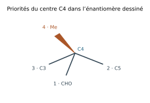
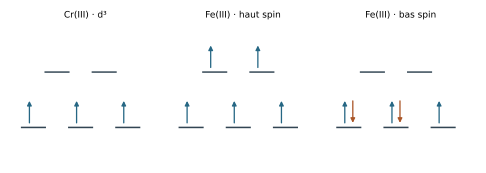
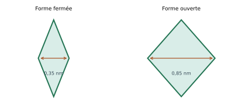
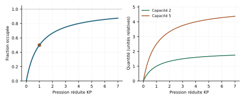
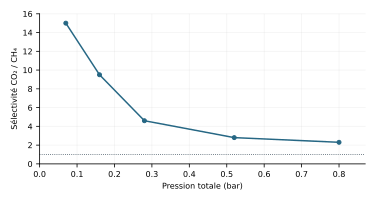
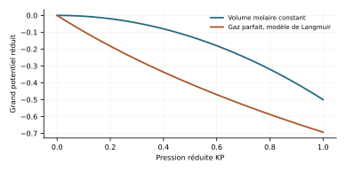
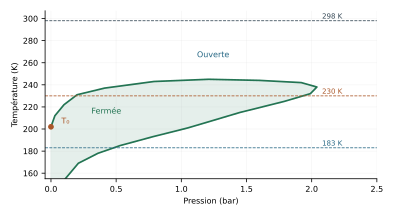

# ENS Ulm — PC, Chimie B 2019 · Corrigé guidé

*Corrigé rédigé par IA, non officiel.*

**Rédaction (tour 1)** · GPT-6.2 Astra Ultra · vitesse non renseignée

Les deux éditions traitent intégralement 59 des 78 questions, dont toute la seconde partie sur les solides hybrides poreux (Q38 à Q78). Dans la première partie, Q7 identifie la famille et la structure électronique générale de l’ylure et Q8 donne le nom et le bilan fonctionnel de l’oléfination. Les deux structures substituées demandées à ces endroits et les 17 questions hors couverture sont signalées. Les réponses s’appuient sur le fascicule officiel, ses schémas et le rapport de chimie B d’Ulm.

## 1.1 · Carbone stéréogène et cycloaddition

### Question 1 — Centres stéréogènes d’un système ponté

> [!INDICATION]
> Parcourez chaque carbone saturé en comparant les deux parcours de cycle. Pour C4, le carbone du formyle compte deux oxygènes selon CIP.

#### Solution

Les centres asymétriques sont **C4, C5, C8, C9, C12, C14 et C15**. C8 est un centre quaternaire, les quatre parcours y sont différents. C17 est un méthylène vinylique et les deux carbones de la double liaison C1=C10 sont trigonaux. En C4, les priorités sont C19 (voisins O,O,H), C5 (C,C,C), C3 (C,H,H), puis le méthyle C18 (H,H,H). Dans le dessin, C18 est vers l’observateur. Le parcours des trois premiers est antihoraire dans le plan et doit être inversé, d’où **4R** pour l’énantiomère *dessiné*. La synthèse mentionnée dans le texte donne le racémique.

### Question 2 — Cycloaddition intramoléculaire

> [!INDICATION]
> Repérez deux doubles liaisons conjuguées et la double liaison de l’ester insaturé. Combien d’électrons changent d’appariement ?

#### Solution

C’est une Diels–Alder intramoléculaire, cycloaddition concertée $[4+2]$ à six électrons. Numérotons $d_1,d_2,d_3,d_4$ le diène successivement, et $e_1,e_2$ le diénophile, dans l’orientation qui forme les cycles du dessin. Le déplacement cyclique est $\pi(d_1,d_2)\to(d_1,e_1)$, $\pi(e_1,e_2)\to(e_2,d_4)$, $\pi(d_3,d_4)\to(d_3,d_2)$. Les deux liaisons simples nouvelles ferment le cycle, la double liaison subsiste entre les carbones centraux du diène, et l’approche est suprafaciale sur chaque partenaire.

### Question 3 — Préférence pour la jonction cis

> [!INDICATION]
> Comparez les faces indiquées par les H de jonction et la position du groupement carbonyle dans l’approche.

#### Solution

Dans 2a les deux H de jonction sont représentés du même côté, dans 2b de côtés opposés. Le repliement endo du diénophile conjugué au carbonyle rapproche ses orbitales $\pi$ de celles du diène et peut stabiliser l’état de transition par interactions orbitalaires secondaires. Avec la géométrie de la chaîne donnée, cette approche favorise 2a à jonction cis, observé à 92 %. Le rapport exprime une préférence diastéréofaciale.

### Question 4 — Pureté d’un diastéréoisomère isolé

> [!INDICATION]
> Une séparation qui distingue cis et trans distingue-t-elle les deux images miroir de cis ?

#### Solution

Les réactifs et le milieu sont achiraux. Les deux trajectoires images miroir qui forment la jonction cis ont donc la même énergie. Pour ce produit dissymétrique, 2a isolé après séparation de 2b reste un mélange équimolaire d’énantiomères en l’absence de résolution chirale.

## 1.2 · Structure et réactivité dans le cœur pentacyclique

*Question 5 hors couverture.*

### Question 6 — Réactivité du tert-butanolate

> [!INDICATION]
> Regardez la charge de l’oxygène et l’encombrement autour du site chargé.

#### Solution

L’oxygène négatif porte des doublets et le tert-butanolate se comporte ici comme une base de Brønsted forte. Il peut agir comme nucléophile, mais son encombrement défavorise les attaques sur des centres peu accessibles. La protonation conduit au tert-butanol.

### Question 7 — Identifier la famille de l’intermédiaire

> [!INDICATION]
> Quel nom donne-t-on à une espèce avec un phosphore positif et un carbone voisin porteur d’un doublet ?

#### Solution

L’intermédiaire est un **ylure de phosphore**. L’écriture limite $\mathrm{R_3P^+{-}C^-RR'}$ met en évidence le carbanion adjacent au phosphonium, et une autre écriture usuelle porte une liaison P=C. Cette réponse identifie la famille et sa structure électronique générale. La structure substituée particulière reste hors couverture.

### Question 8 — Nom de l’oléfination

> [!INDICATION]
> Quel type de réaction met en présence un ylure de phosphore et un aldéhyde ?

#### Solution

Il s’agit de la **réaction de Wittig**, qui transforme une liaison carbonyle en liaison C=C. Le nom et la transformation fonctionnelle sont traités ici. Le dessin de l’intermédiaire 5 et son intégration au parcours préparatif restent hors couverture.

*Question 9 hors couverture.*

*Question 10 hors couverture.*

*Question 11 hors couverture.*

### Question 12 — Identifier la transformation par le PIDA

> [!INDICATION]
> Comparez la fonction phénolique dans 9 à la cyclohexadiénone de 10.

#### Solution

Le dérivé d’iode hypervalent est un oxydant. La transformation est une désaromatisation oxydante du phénol accompagnée d’une capture nucléophile, comme le montrent le carbonyle formé et les substituants oxygénés de 10.

### Question 13 — Chiralité du composé 10

> [!INDICATION]
> Le carbone portant deux méthoxyles porte-t-il quatre substituants différents ?

#### Solution

Le carbone tétraédrique de la cyclohexadiénone porte deux groupes méthoxy identiques. Les autres carbones du noyau sont trigonaux. Les groupes de la chaîne ne créent ni centre de configuration, ni axe chiral stable. Le composé 10 est achiral, même si certaines conformations instantanées peuvent être dissymétriques.

### Question 14 — Configurations dans la série de 11

> [!INDICATION]
> La cyclisation part d’une molécule achirale et ne donne qu’une configuration relative détectée.

#### Solution

Les approches en miroir sur les deux faces énantiotopiques de 10 conduisent à deux produits images miroir. La structure pontée représentée dans 11 est chirale. Dans la série correspondant à l’unique diastéréoisomère observé, on attend donc **deux énantiomères**, en proportions égales dans ces conditions achirales.

### Question 15 — Protection d’un carbonyle en acétal cyclique

> [!INDICATION]
> Suivez les doublets libres des deux oxygènes du diol et les transferts de proton à chaque étape.

#### Solution

En catalyse acide, un doublet de l’oxygène du carbonyle capte un proton. Un doublet du premier oxygène du glycol attaque le carbone carbonylé et les électrons $\pi$ rejoignent l’oxygène. Une déprotonation donne l’hémiacétal $\mathrm{R(R')C(OH)(OCH_2CH_2OH)}$. Protoner le OH porté par ce carbone permet le départ d’eau, donnant un oxocarbenium dont la charge se délocalise entre C et l’oxygène restant. Le doublet du second OH attaque alors intramoléculairement le centre électrophile, fermant un cycle à cinq chaînons. Une déprotonation rend le proton catalytique et fournit le 1,3-dioxolane. Les étapes sont réversibles.

*Question 16 hors couverture.*

### Question 17 — Acidité électronique d’un centre aluminium

> [!INDICATION]
> Combien d’électrons trois liaisons simples apportent-elles autour de l’aluminium du modèle monomère ?

#### Solution

Dans l’écriture monomère demandée, Al est relié par trois liaisons simples à trois méthyles. Il est entouré d’un sextet électronique et possède une orbitale vacante sur le centre Al. C’est un acide de Lewis. La coordination à l’oxygène du carbonyle polarise davantage la liaison C=O et facilite l’attaque sur le carbone. Le dessin de Lewis représente le motif local accepteur.

*Question 18 hors couverture.*

### Question 19 — Hydrogènes les plus acides de la 1,3-dione

> [!INDICATION]
> Comparez le nombre de carbonyles qui stabilisent la base conjuguée de chaque méthylène.

#### Solution

Le carbone 2 est encadré par les carbonyles C1 et C3. Après déprotonation, l’anion se délocalise sur C2 et sur chacun des deux oxygènes. Aux méthylènes voisins d’un seul carbonyle, l’énolate ne bénéficie que d’un seul groupe carbonyle. Les H de C2 sont donc les plus acides.

### Question 20 — Quel carbonyle forme préférentiellement un iminium ?

> [!INDICATION]
> Comparez l’encombrement d’un aldéhyde à celui d’une cétone et l’effet mésomère du soufre d’un thioester.

#### Solution

L’aldéhyde terminal de 15 est le site le plus réactif envers l’amine. Il est moins encombré et généralement plus électrophile qu’une cétone. Le thioester possède un substituant soufré et une réactivité d’acyle distincte. La 1,3-dione est aussi fortement énolisable, ce qui favorise son intervention comme partenaire nucléophile après activation de l’aldéhyde.

*Question 21 hors couverture.*

### Question 22 — Pourquoi une dihydropyridine cède un hydrure

> [!INDICATION]
> Quelle stabilisation particulière obtient-on en rétablissant le système cyclique conjugué ?

#### Solution

La dihydropyridine est formellement oxydée en un noyau de pyridine aromatique. Le gain de conjugaison à six électrons favorise le transfert d’un équivalent d’hydrure depuis le carbone C4. Le sous-produit neutre conserve les deux esters en 3,5 et les deux méthyles en 2,6 sur une pyridine aromatique. Le groupe N–H de l’ester de Hantzsch constitue le donneur net de proton, éventuellement par relais acido-basique.

### Question 23 — Approche de deux carbones d’un cycle

> [!INDICATION]
> Regardez la distance en trois dimensions de C9 à C10 sur les deux projections de la figure 9.

#### Solution

La conformation **bateau B** rapproche C9 et C10 sur le haut du dessin et rend possible leur rencontre. Dans la chaise A le groupement portant C10 pointe du côté opposé. L’exigence géométrique porte sur la proximité des centres et l’orientation des orbitales.

### Question 24 — Stabilité conformationnelle

> [!INDICATION]
> Distinguez la proximité favorable à une réaction de l’énergie de la conformation isolée.

#### Solution

La chaise A est a priori la plus stable. Elle minimise les interactions éclipsées sur le cycle et évite les contacts entre positions de proue et de poupe du bateau. La conformation qui réagit le plus facilement peut donc être minoritaire dans l’équilibre initial.

*Question 25 hors couverture.*

## 1.3 · Étude de la fin de la synthèse

*Question 26 hors couverture.*

*Question 27 hors couverture.*

*Question 28 hors couverture.*

### Question 29 — Lewis du trifluorure de bore

> [!INDICATION]
> Complétez d’abord les octets des fluor et comptez les électrons entourant le bore.

#### Solution

B forme trois liaisons simples B–F dans une géométrie trigonale plane. Chaque F porte trois doublets libres, B ne possède pas de doublet libre et est entouré de six électrons. Son orbitale vacante peut accepter un doublet d’un partenaire. Il s’agit d’un acide de Lewis.

*Question 30 hors couverture.*

*Question 31 hors couverture.*

*Question 32 hors couverture.*

*Question 33 hors couverture.*

*Question 34 hors couverture.*

*Question 35 hors couverture.*

### Question 36 — Séparer deux diastéréoisomères

> [!INDICATION]
> Quels types d’isomères peuvent avoir des constantes physiques différentes avec une phase stationnaire achirale ?

#### Solution

Des diastéréoisomères peuvent présenter des différences de polarité ou de solubilité. Une chromatographie sur phase achirale, après vérification que les deux taches ont des mobilités différentes, peut les séparer. Si l’écart de solubilité est suffisant, une cristallisation fractionnée constitue également une possibilité.

### Question 37 — Attribuer les signaux en gras du spectre final

> [!INDICATION]
> Repérez le formyle, le méthylène exocyclique, l’alcène interne, le seul méthyle et le proton échangeable.

#### Solution

À **9,66 ppm**, le singulet correspond au formyle H19, adjacent au centre quaternaire C4. Le triplet à **5,60 ppm** est H1, proton de C1=C10 couplé aux protons du méthylène C2 avec des constantes proches. Les deux doublets à **5,15 et 5,05 ppm**, de même $J=2,8$ Hz, sont les deux protons non équivalents du méthylène exocyclique C17, couplés entre eux. À **4,14 ppm**, le singulet correspond au proton OH porté par l’oxygène de C15. L’attribution d’un échangeable peut être vérifiée par échange isotopique. Le singulet à **1,03 ppm** intègre trois H, ceux du méthyle C18 sur C4 dépourvu de proton.

## 2.1 · Structure et caractérisation des solides poreux

### Question 38 — Solubilité de l’acide téréphtalique

> [!INDICATION]
> Convertissez les grammes par litre en concentration, puis examinez l’effet de la dissociation d’un acide sur sa solubilité apparente.

#### Solution

À 20 °C la solubilité est 0,019 g/L. Avec $M=166$ g/mol, cela représente environ $1,1\times10^{-4}$ mol/L. Une solution aqueuse de l’acide libre apporte donc très peu de ligand à température ambiante. La solubilité totale augmente en formant des espèces carboxylate par déprotonation. Un chauffage peut également accroître la dissolution, sous réserve de la dépendance propre au solide. Le pH doit rester compatible avec l’ion métallique.

### Question 39 — Fenêtre de coexistence avec le fer(III)

> [!INDICATION]
> Superposez mentalement les pKa du diacide et la limite verticale du domaine Fe(III) soluble sur la figure 21.

#### Solution

Le premier pKa vaut 3,54 et le second 4,46. À pH 3,0 le rapport $[\mathrm{HL^-}]/[\mathrm{H_2L}]$ vaut déjà $10^{3,0-3,54}\simeq0,29$ et il approche 1 près de 3,5. Le diagramme E–pH du fer place la limite entre Fe(III) aqueux et la phase ferrique hydratée vers pH 3,5 dans le domaine de potentiel approprié. Un compromis se trouve donc en milieu acide, **vers pH 3 à 3,5**, côté soluble, avec un potentiel compatible avec Fe(III). Une basification jusqu’à la prédominance du dianion ferait perdre du fer dissous. La complexation peut déplacer ces limites.

### Question 40 — Configurations d’ions trivalents

> [!INDICATION]
> Retirez d’abord l’électron ou les électrons 4s aux configurations des atomes neutres.

#### Solution

Le chrome neutre est $[\mathrm{Ar}]3d^54s^1$, puis $\mathrm{Cr^{3+}}$ est $[\mathrm{Ar}]3d^3$. Le fer neutre est $[\mathrm{Ar}]3d^64s^2$, puis $\mathrm{Fe^{3+}}$ est $[\mathrm{Ar}]3d^5$.

### Question 41 — Peuplement du complexe de chrome

> [!INDICATION]
> Les six ligands donnent douze électrons pour les six orbitales liantes du bas de la figure 14.

#### Solution

Les orbitales numérotées 1 à 6 reçoivent chacune un doublet. Les trois électrons $d$ du chrome occupent ensuite séparément, à spins parallèles, les trois orbitales 7, 8 et 9. Les orbitales 10 à 15 restent vacantes. Le complexe possède donc trois électrons célibataires dans cette description.

### Question 42 — Haut spin et bas spin du fer(III)

> [!INDICATION]
> Comparez le coût du passage dans le niveau supérieur au coût d’appariement dans le niveau inférieur.

#### Solution

Le peuplement observé est $t_{2g}^3e_g^2$ à cinq électrons célibataires, un dans chacune des orbitales 7 à 11. L’autre possibilité est $t_{2g}^5e_g^0$, deux orbitales de 7 à 9 doublées et la dernière occupée par un électron. Avec l’eau comme ligand, le coût de deux appariements dépasse le gain obtenu en gardant tous les électrons dans le triplet inférieur. Le haut spin est favorisé.

### Question 43 — Population antiliante et labilité

> [!INDICATION]
> À quelle étape la liaison métal–eau se rompt-elle ? Comparez les deux constantes en s⁻¹.

#### Solution

Les orbitales 10 et 11 sont antiliantes pour les liaisons métal–ligand. Occupées dans le complexe ferrique à haut spin, elles affaiblissent ces liaisons et facilitent le départ de l’eau dans l’étape dissociative. Le chrome $d^3$ les laisse vides. Le tableau donne $1,6\times10^2/(2,4\times10^{-6})\simeq6,7\times10^7$ pour le rapport des constantes Fe/Cr. La différence exprime une labilité cinétique et ne détermine pas seule la constante d’équilibre.

### Question 44 — Comparer les conditions du tableau 2

> [!INDICATION]
> Reliez le sens de l’écart de température et de temps à la labilité des aquocomplexes.

#### Solution

La préparation du solide au chrome est présentée à température plus élevée et sur une durée plus longue que celle du solide au fer. Cette différence est cohérente avec l’échange d’eau bien plus lent pour Cr(III). Les constantes de dissociation du tableau 1, mesurées à 293 K, expliquent le sens de cette différence sans fournir à elles seules la durée de cristallisation.

### Question 45 — Déterminer une structure cristalline

> [!INDICATION]
> Quelle technique donne les distances interréticulaires et l’organisation périodique d’un cristal ?

#### Solution

La diffraction des rayons X sur monocristal donne les paramètres de maille et, par analyse des intensités, les positions atomiques de la structure. Une diffraction sur poudre permet aussi d’identifier les deux phases et d’affiner un modèle de maille, notamment lorsque les cristaux individuels sont trop petits.

### Question 46 — Masse volumique des deux formes

> [!INDICATION]
> Même formule par maille, deux volumes. Convertissez systématiquement le nanomètre cube.

#### Solution

Les formules par maille imprimées donnent $M=4(52)+4(16)+4[8(12)+4(1)+4(16)]=928$ g/mol de mailles. On utilise $\rho=M/(N_AV)$, avec $1\ \mathrm{nm^3}=10^{-21}\ \mathrm{cm^3}$. La forme fermée de volume 1,010 nm³ donne **1,53 g/cm³**, et l’ouverte de volume 1,490 nm³ **1,03 g/cm³**. L’écart vient du changement de volume à masse égale.

### Question 47 — Paramètres d’équilibre de la forme ouverte

> [!INDICATION]
> Quelles variables modifient le coût du volume ou l’interaction avec les pores ?

#### Solution

Température, pression mécanique, nature du gaz ou du liquide invité et son potentiel chimique modifient les énergies libres relatives. Une adsorption plus favorable dans une forme peut compenser le coût de sa déformation. À pression hydrostatique identique, le terme de volume tend à défavoriser la forme la plus volumineuse.

### Question 48 — Substituer le ligand organique

> [!INDICATION]
> Opposez encombrement géométrique et stabilisation par interactions entre parois.

#### Solution

Un groupe méthyle ou amine occupe du volume dans le pore. L’encombrement peut gêner la forme fermée et favoriser l’ouverte. Un groupe amine peut aussi former des liaisons hydrogène avec des parois voisines ou des molécules adsorbées. Un contact attractif entre parois peut au contraire stabiliser la forme resserrée. Le sens net dépend de la géométrie et du gaz invité.

### Question 49 — Rapport de volumes poreux

> [!INDICATION]
> La longueur du canal est la même pour les deux formes. Quelle puissance du diamètre reste dans le rapport ?

#### Solution

Avec le modèle cylindrique, $V_{\rm pore}=\pi d^2c/4$ et la longueur $c=0,68$ nm est commune. Le rapport ouvert/fermé vaut $(0,85/0,35)^2\simeq5,9$. Les 0,390 nm³ par maille de la forme ouverte correspondent alors à environ 0,066 nm³ pour la forme fermée, sous cette approximation.

### Question 50 — Tamisage géométrique

> [!INDICATION]
> Comparez les diamètres cinétiques en picomètres aux deux ouvertures exprimées dans la même unité.

#### Solution

Le pore fermé d’environ 350 pm peut géométriquement laisser entrer $\mathrm{CO_2}$ (330 pm) et Ar (340 pm). $\mathrm{N_2}$ (364 pm), $\mathrm{CH_4}$ (380 pm) et le benzène (585 pm) dépassent cette dimension. Le pore ouvert de 850 pm peut accueillir géométriquement les cinq espèces. Forme moléculaire, souplesse du réseau et affinité de surface interviennent aussi dans une mesure d’adsorption.

### Question 51 — Nombre maximal de molécules par maille

> [!INDICATION]
> Comparez le volume libre à celui d’une sphère dont le diamètre est le diamètre cinétique.

#### Solution

Une sphère de diamètre 0,330 nm occupe $\pi d^3/6\simeq0,0188$ nm³. Le quotient $0,390/0,0188\simeq21$ fournit une **borne volumique approximative** pour la maille ouverte. Le remplissage par des sphères laisse du vide et le canal est de taille finie. En outre le dioxyde de carbone est linéaire et son diamètre cinétique ne définit pas un volume moléculaire sphérique exact. Une capacité expérimentale nettement inférieure est plausible.

## 2.2 · Isothermes et sélectivité

### Question 52 — Flux d’adsorption et de désorption

> [!INDICATION]
> Un événement d’adsorption exige une molécule gazeuse et un site vide. Le départ exige un site occupé.

#### Solution

Les lois élémentaires du modèle sont $v_{\rm ads}=k_{\rm ads}P_A[S]$ et $v_{\rm des}=k_{\rm des}[A_{\rm ads}]$. Les densités de sites s’expriment ici en sites par aire et ces flux en événements par aire et par temps. L’unité de $k_{\rm ads}$ dépend de l’unité de pression retenue.

### Question 53 — Fraction occupée

> [!INDICATION]
> Écrivez la conservation du nombre de sites par unité de surface.

#### Solution

Avec un site par molécule adsorbée, $[S]_0=[S]+[A_{\rm ads}]$. La couverture vaut $\theta=[A_{\rm ads}]/([S]+[A_{\rm ads}])$. En particulier, $1-\theta=[S]/[S]_0$.

### Question 54 — Isotherme de Langmuir

> [!INDICATION]
> Égalisez les deux flux et remplacez les densités par les fractions du total.

#### Solution

À l’équilibre, $k_{\rm ads}P_A(1-\theta)=k_{\rm des}\theta$. Posons $K=k_{\rm ads}/k_{\rm des}$, d’unité inverse de pression pour cette écriture. On obtient $\theta=KP_A/(1+KP_A)$. Le produit $KP_A$ est sans dimension.

### Question 55 — Lire une isotherme

> [!INDICATION]
> Déterminez la pente à l’origine, le plateau et la pression de demi-remplissage.

#### Solution

La courbe croît dès l’origine avec pente $K$, reste concave et tend vers 1. Le demi-remplissage est obtenu pour $P_{1/2}=1/K$. Sur l’isotherme de quantité adsorbée, le plateau donne $N_{\max}$ et sa hauteur est attendue plus grande pour la forme ouverte. Une courbe de **fraction normalisée** a le même plateau unité dans les deux formes. Elle n’est décalée horizontalement que si les affinités $K$ diffèrent.

### Question 56 — Adsorption exothermique et température

> [!INDICATION]
> Quel déplacement de l’équilibre s’oppose à un échauffement ?

#### Solution

Pour une adsorption exothermique, une hausse de température favorise la désorption et diminue $K$. À pression fixée la couverture d’une même phase diminue. Pour retrouver la même couverture, il faut une pression plus élevée, ce qui déplace la courbe vers la droite.

### Question 57 — Mesurer l’enthalpie d’adsorption

> [!INDICATION]
> Extrayez la même constante d’affinité de plusieurs courbes, en conservant la même phase solide.

#### Solution

Mesurer les isothermes d’équilibre à plusieurs températures, par exemple pour le dioxyde de carbone, et relever $P_{1/2}$ ou ajuster Langmuir. Pour chaque température calculer la constante thermodynamique sans dimension $K^\circ=P^\circ/P_{1/2}$. À enthalpie approximativement constante, la pente du graphe $\ln K^\circ$ en fonction de $1/T$ vaut $-\Delta_{\rm ads}H^\circ/R$. Une transition de phase imposerait d’ajuster séparément les branches concernées.

### Question 58 — Effet du métal et de l’amine sur le dioxyde de carbone

> [!INDICATION]
> Comparez d’abord les solides ayant le même ligand, puis ceux ayant le même métal.

#### Solution

Avec le téréphtalate, les enthalpies sont voisines, $-20,1$ kJ/mol pour Al et $-21,0$ pour Cr. À métal Al fixé, l’amine porte la valeur à $-38,4$ kJ/mol, soit environ 18 kJ/mol de stabilisation supplémentaire. Le doublet de l’azote peut interagir avec le carbone électrophile de $\mathrm{CO_2}$ et des interactions polaires sont possibles. Ces seules enthalpies ne démontrent pas une structure chimique unique de l’espèce adsorbée.

### Question 59 — Deux espèces en compétition

> [!INDICATION]
> Les deux équilibres partagent la même population de sites vides.

#### Solution

Avec $\theta=\theta_A+\theta_B$, les vitesses d’adsorption de chaque espèce sont proportionnelles à $P_i(1-\theta)$ et celles de désorption à $\theta_i$. L’égalité de chaque paire de flux donne $\theta_A=K_AP_A(1-\theta)$ et $\theta_B=K_BP_B(1-\theta)$.

### Question 60 — Couverture totale du mélange

> [!INDICATION]
> Additionnez les deux bilans avant de résoudre pour la somme des fractions occupées.

#### Solution

En posant $L=K_AP_A+K_BP_B$, on a $\theta=L(1-\theta)$ et donc $\theta=L/(1+L)$. Les couvertures individuelles sont $\theta_i=K_iP_i/(1+L)$. Une espèce réduit le nombre de sites accessibles à l’autre.

### Question 61 — Sélectivité idéale

> [!INDICATION]
> Prenez le rapport des couvertures pour éliminer le nombre de sites vacants.

#### Solution

Sur les sites occupés, $x_A/x_B=\theta_A/\theta_B=K_AP_A/(K_BP_B)$. Pour un gaz idéal, $P_A/P_B=y_A/y_B$. Ainsi $\alpha=x_Ay_B/(x_By_A)=K_A/K_B$. Ce modèle prédit une sélectivité indépendante de la pression totale à température fixée.

### Question 62 — Sens physique de la sélectivité

> [!INDICATION]
> Comparez le rapport A/B adsorbé au rapport A/B dans le gaz.

#### Solution

Si $\alpha>1$, A est enrichi parmi les molécules adsorbées par rapport au gaz. Si $\alpha=1$ le mélange conserve son rapport et si $\alpha<1$, B est enrichi. La sélectivité quantifie une préférence relative, dont l’effet sur les quantités séparées dépend aussi de la capacité.

### Question 63 — Comparer les quatre mélanges

> [!INDICATION]
> Utilisez à la fois les diamètres, les polarisabilités et l’existence d’un quadrupôle pour CO₂.

#### Solution

Le tableau donne 13,1 pour $\mathrm{CO_2/Ar}$ et 10,1 pour $\mathrm{CO_2/N_2}$. Le $\mathrm{CO_2}$ est petit, polarisable et possède un quadrupôle qui favorise ses interactions avec les parois. $\mathrm{CH_4/N_2}=2,7$ montre que le méthane, pourtant plus grand, peut être préféré grâce à ses interactions dispersives plus fortes. $\mathrm{N_2/Ar}=1,3$ indique une préférence faible, cohérente avec des polarisabilités proches. Une règle de diamètre seule ne classe pas les quatre mélanges.

### Question 64 — Application d’une adsorption sélective

> [!INDICATION]
> Choisissez une paire de gaz dont le rapport d’affinités est élevé dans le tableau.

#### Solution

Un solide qui adsorbe préférentiellement le dioxyde de carbone pourrait enrichir un flux d’azote en retenant le $\mathrm{CO_2}$, par exemple lors de l’épuration d’un effluent. La sélectivité mesurée à basse pression motive cette application. Une évaluation industrielle demanderait aussi capacité, réversibilité et tenue aux autres constituants.

### Question 65 — Sélectivité variable avec la pression

> [!INDICATION]
> Lisez d’abord les ordonnées de la figure 17, puis confrontez-les à la prédiction de la question 61.

#### Solution

La sélectivité $\mathrm{CO_2/CH_4}$ tombe d’environ 15 sous 0,1 bar à environ 5 vers 0,3 bar, puis se rapproche de 2 à 0,8 bar. Le dioxyde de carbone reste préféré. La saturation progressive des sites les plus affins, l’accès à des sites différents ou une variation de forme du réseau peuvent réduire l’avantage relatif. Cette dépendance montre les limites du seul modèle de sites identiques avec $K_A/K_B$ constant.

## 2.2 · Thermodynamique d’un réseau flexible

### Question 66 — Différentielle de Gibbs d’un système ouvert

> [!INDICATION]
> Partez de la relation fondamentale pour U puis passez à G par transformation de Legendre.

#### Solution

Pour une seule espèce échangeable, $\mathrm dU=T\mathrm dS-P\mathrm dV+\mu\,\mathrm dn$. Avec $G=U+PV-TS$, les termes en $\mathrm dS$ et $\mathrm dV$ se compensent et $\mathrm dG=-S\mathrm dT+V\mathrm dP+\mu\,\mathrm dn$. On emploie ici la quantité en moles avec $\mu$ molaire. Dans la notation du sujet, on peut écrire $N_{\rm ads}$ à la place de $n$ si toutes les grandeurs partielles sont ramenées à une molécule.

### Question 67 — Différentielle du potentiel chimique

> [!INDICATION]
> Pour un corps pur, divisez G par la quantité de matière et identifiez le volume molaire partiel.

#### Solution

À composition constante, pour une mole de gaz pur, $\mathrm dG_m=-S_m\mathrm dT+V_m\mathrm dP$. Comme $G_m=\mu$, à température constante $\mathrm d\mu=V_m\mathrm dP$. On peut aussi l’obtenir de Gibbs–Duhem $n\mathrm d\mu=-S\mathrm dT+V\mathrm dP$. Pour un gaz parfait, $V_m=RT/P$ et $\mathrm d\mu=RT\mathrm dP/P$.

### Question 68 — Différentielle du grand potentiel

> [!INDICATION]
> Différenciez les deux produits PV et μn avant d’imposer les conditions expérimentales.

#### Solution

De $\Omega=G-PV-\mu n$ on tire $\mathrm d\Omega=\mathrm dG-P\mathrm dV-V\mathrm dP-\mu\mathrm dn-n\mathrm d\mu$. En utilisant le résultat de 66, on obtient $\mathrm d\Omega=-S\mathrm dT-P\mathrm dV-n\mathrm d\mu$. Le volume et la température étant fixés, $\mathrm d\Omega=-n_{\rm ads}\mathrm d\mu$ le long de la transformation réversible.

### Question 69 — Pente du grand potentiel

> [!INDICATION]
> Composez la dérivée par rapport au potentiel chimique avec celle du potentiel chimique par rapport à P.

#### Solution

À température fixée et en gardant des unités molaires, $\mathrm d\Omega/\mathrm dP=-n_{\rm ads}V_m=-N_{\max}V_m(P)KP/(1+KP)$. Ici $N_{\max}$ est exprimé en moles pour aller avec le volume molaire. Si l’on emploie un nombre de molécules, le facteur correspondant est le volume par molécule. La pente est négative pour $P>0$.

### Question 70 — Intégration à faible pression et portée du résultat demandé

> [!INDICATION]
> L’approximation KP petit porte sur l’isotherme. Examinez séparément l’éventuelle dépendance de Vₘ en pression.

#### Solution

À $KP\ll1$, $\Omega(P)\simeq-KN_{\max}\int_0^P V_m(p)p\,\mathrm dp$. **Si l’on traite $V_m$ comme constant**, on obtient la formule annoncée $\Omega(P)\simeq-KN_{\max}V_mP^2/2$. L’approximation sur Langmuir ne suffit donc pas toute seule.

Si $V_m$ est effectivement le volume molaire du **gaz parfait** de la question 67, il vaut $RT/p$. L’intégration exacte donne alors $\Omega(P)=-N_{\max}RT\ln(1+KP)$ avec la référence imposée à zéro. À faible pression, $\Omega\simeq-N_{\max}RTKP$. Ces deux dépendances correspondent à deux hypothèses différentes sur le volume intervenant dans $\mathrm d\mu$.

### Question 71 — Différence ouverte moins fermée

> [!INDICATION]
> Gardez le signe de la soustraction et comparez les capacités, à K commun.

#### Solution

Posons $\Delta N=N_{\max}^{\rm ouvert}-N_{\max}^{\rm fermé}>0$. Pour le modèle à $V_m$ constant demandé, $\Delta\Omega=-KV_m\Delta N P^2/2$. La contribution adsorptive diminue donc plus rapidement le potentiel de la forme ouverte. Dans l’écriture du gaz parfait, $\Delta\Omega=-\Delta NRT\ln(1+KP)$, de même signe. La différence de potentiels osmotiques inclut encore $\Delta G_{\rm matériau}$.

### Question 72 — Croisement des potentiels osmotiques

> [!INDICATION]
> La phase stable minimise le potentiel. Quel signe doit avoir l’écart du matériau vide pour que l’adsorption puisse en inverser l’ordre ?

#### Solution

Si $\Delta G_{\rm matériau}>0$, la phase fermée est la plus stable à pression nulle. L’écart $\Delta\Omega_{\rm os}=\Delta G_{\rm matériau}+\Delta\Omega$ peut devenir négatif à pression croissante et la phase ouverte devenir stable. Pour la forme quadratique et un écart du solide supposé constant, la pression de croisement serait $P_c=[2\Delta G_{\rm matériau}/(KV_m\Delta N)]^{1/2}$, à condition de rester dans le domaine de validité. Si $\Delta G_{\rm matériau}<0$ dès l’origine, ce seul terme, toujours négatif, ne produit pas de croisement.

### Question 73 — Deux isothermes à 298 K

> [!INDICATION]
> Cherchez des branches qui ressemblent à Langmuir et des ruptures qui signalent un changement de structure.

#### Solution

Le méthane de la figure 18 s’adsorbe de façon progressive, d’environ zéro à deux molécules par maille vers 5,5 bar, sans saut visible. Pour le dioxyde de carbone, une première branche atteint environ 2 à 3 molécules, puis un saut près de 1,5 à 2 bar ouvre l’accès à une branche de plus grande capacité, proche de 9 à 10 molécules. Une forme de Langmuir peut décrire chaque phase. Le saut nécessite en plus un changement de stabilité du réseau ou une ouverture coopérative.

### Question 74 — Capacité massique et température

> [!INDICATION]
> Comparez les valeurs à pression commune, par exemple dans le haut de la figure 19.

#### Solution

À pression donnée, la quantité de méthane adsorbée augmente globalement quand la température baisse. Vers 5 bar on lit environ 4 % massiques à 298 K et près de 19 % à 183 K. Le sens concorde avec une adsorption exothermique. Les paliers et écarts entre branches superposent à cette tendance les changements d’état du réseau.

### Question 75 — Suivre les isothermes dans le diagramme de phases

> [!INDICATION]
> Sur un graphe avec T en ordonnée, suivez une horizontale vers les pressions croissantes.

#### Solution

À 183 K, le départ à pression nulle se situe dans le domaine fermé de la figure 20. L’horizontale quitte ce domaine en traversant sa limite basse vers un demi-bar, à la précision du graphe. L’ouverture fait apparaître le fort saut de la courbe à 183 K, puis l’adsorption se poursuit dans la forme ouverte. À 298 K l’horizontale reste entièrement dans le domaine ouvert, au-dessus du lobe. L’isotherme croît alors régulièrement.

### Question 76 — Prévoir le comportement à 230 K

> [!INDICATION]
> Combien de fois l’horizontale 230 K rencontre-t-elle les frontières du lobe fermé ?

#### Solution

À 230 K le diagramme prévoit une succession **ouverte, fermée, ouverte**. L’horizontale coupe le côté gauche vers 0,2–0,3 bar puis la limite droite vers 1,9–2 bar. On attend trois portions d’isotherme avec changement de pente ou marche à chaque transition. L’ouverture finale rend disponible une capacité plus grande. Le signe et la hauteur d’un changement de charge au premier passage demandent les isothermes propres aux phases. Une adsorption d’équilibre à température fixée est globalement non décroissante en potentiel chimique.

### Question 77 — Transition du solide vide

> [!INDICATION]
> À quelle pression et à quelle température les deux phases ont-elles la même stabilité sur le bord gauche ?

#### Solution

Le point $T_0$ se situe vers 200 K à pression gazeuse nulle. Les deux formes du solide vide y sont en équilibre et $\Delta G_{\rm matériau}(T_0)=0$. Donc $\Delta H_{\rm matériau}(T_0)=T_0\Delta S_{\rm matériau}(T_0)$. La mesure de $T_0$ donne le rapport enthalpie sur entropie de transition. Il faut une grandeur indépendante, par exemple une chaleur de transition calorimétrique, pour obtenir les deux valeurs séparément.

### Question 78 — Hystérésis structurale

> [!INDICATION]
> Pourquoi les pressions de transition pourraient-elles dépendre de l’histoire de la mesure ?

#### Solution

La transformation nécessite la nucléation d’un domaine de la nouvelle phase et une réorganisation coopérative des parois. Des barrières de déformation ou de nucléation maintiennent une phase métastable lorsque la pression varie. Les passages à l’ouverture et à la fermeture se produisent alors à des pressions différentes. Cette hystérésis est cohérente avec les branches d’adsorption et de désorption distinctes de la figure 19.
