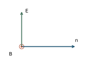
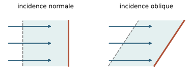
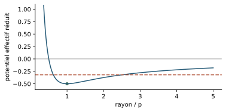
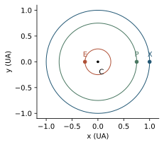
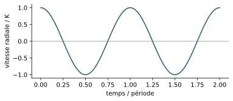
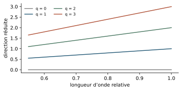
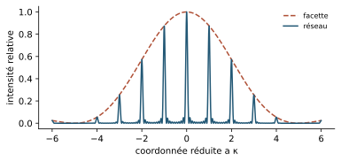
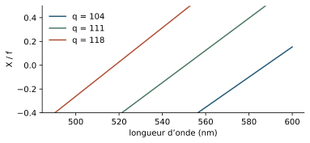
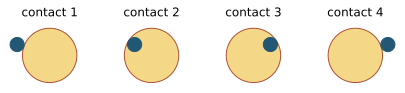
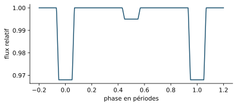

# ENS Ulm PC 2019 — Physique C · Corrigé guidé

*Corrigé rédigé par IA, non officiel. Signalez toute erreur.*

**Lecture du rapport du jury** · GPT-6.2 Astra Ultra · vitesse non renseignée

**Rédaction** · GPT-6.2 Astra Ultra · vitesse non renseignée

## Détection et caractérisation des exoplanètes

## Rayonnement et grandeurs spectrales

### Question 1 — Trièdre de l’onde

**Indication.** Appliquer la règle de la main droite au produit de la direction de propagation par le champ électrique.

À un instant et un point fixés, choisir par exemple $\mathbf n=\mathbf e_x$ et $\mathbf E=E\mathbf e_y$. Alors $\mathbf B=(E/c)\mathbf e_z$. Les trois directions sont orthogonales et $\mathbf E\times\mathbf B$ est orienté dans le sens de propagation. Au cours du temps les deux champs peuvent changer de signe ensemble.

### Question 2 — Bilan d’énergie électromagnétique

**Indication.** Introduire les deux équations de rotationnel dans l’identité de divergence du formulaire.

L’identité $\nabla\cdot(\mathbf E\times\mathbf B)=\mathbf B\cdot(\nabla\times\mathbf E)-\mathbf E\cdot(\nabla\times\mathbf B)$ et les équations de Maxwell donnent $-\mathbf B\cdot\partial_t\mathbf B-\epsilon_0\mu_0\mathbf E\cdot\partial_t\mathbf E$. Après division par $\mu_0$, il vient $\partial_tu+\nabla\cdot\boldsymbol\Pi=0$ avec $u=(\epsilon_0 E^2+B^2/\mu_0)/2$ et $\boldsymbol\Pi=\mathbf E\times\mathbf B/\mu_0$. Sur un volume fixe, l’énergie diminue du flux sortant.

### Question 3 — Norme du vecteur de Poynting

**Indication.** Développer le double produit vectoriel en utilisant la transversalité.

L’onde est transverse. Ainsi $\mathbf E\times(\mathbf n\times\mathbf E)=E^2\mathbf n$ et $\boldsymbol\Pi=E^2\mathbf n/(\mu_0c)$. Comme $B=E/c$ et $\epsilon_0\mu_0c^2=1$, les deux contributions à la densité énergétique sont égales et $\Pi=cu$.

### Question 4 — Surface éclairée

**Indication.** Regarder la surface depuis la direction des rayons.

Pendant $dt$, le rayonnement parcourt $c\,dt$. À incidence normale, les photons qui traversent la surface proviennent d’un cylindre de base $dS$ et de longueur $c\,dt$, donc $dE=uc\,dt\,dS$. À incidence oblique, le même flux traverse la projection $dS\cos\theta$ perpendiculaire aux rayons. Il vient $dE=uc\,dt\,dS\cos\theta$, avec $\theta$ entre direction et normale.

### Question 5 — Énergie spectrale

**Indication.** Multiplier un nombre par unité de volume par l’énergie correspondant à sa longueur d’onde.

Dans l’intervalle $d\lambda$, le nombre de photons par volume est $n_\lambda d\lambda$ et leur énergie individuelle est $hc/\lambda$. Ainsi $u_\lambda=(hc/\lambda)n_\lambda$ et $u=\int_0^\infty hc\,n_\lambda\,d\lambda/\lambda$ pour l’ensemble du spectre.

### Question 6 — Énergie reçue dans une bande

**Indication.** Limiter le bilan du volume éclairé aux photons de la bande considérée.

Le bilan de Q4 appliqué à la densité spectrale donne $dE_\lambda=cu_\lambda d\lambda\,dS\cos\theta\,dt$. Remplacer $u_\lambda$ conduit à $dE_\lambda=(hc^2/\lambda)n_\lambda dS\cos\theta\,dt\,d\lambda$.

### Question 7 — Sphère des directions

**Indication.** Intégrer avec le jacobien sphérique de l’angle solide.

L’intégrale vaut $\int_0^{2\pi}d\varphi\int_0^\pi\sin\theta\,d\theta=2\pi[-\cos\theta]_0^\pi=4\pi\,\mathrm{sr}$. Un hémisphère couvre donc $2\pi\,\mathrm{sr}$.

### Question 8 — Intensité spécifique

**Indication.** Identifier le coefficient de l’aire projetée et des intervalles de temps, direction et longueur d’onde.

Dans le faisceau limité à $d\Omega$, remplacer $n_\lambda$ par $N_\lambda(\theta,\varphi)d\Omega$ en Q6. L’identification avec l’équation (6) donne $I_\lambda=(hc^2/\lambda)N_\lambda$. C’est une puissance par aire projetée, longueur d’onde et angle solide.

### Question 9 — Flux sur toutes les directions

**Indication.** Conserver distincts le cosinus d’incidence et le sinus de l’élément d’angle solide.

Le flux spectral net vaut $F_\lambda=\int_0^{2\pi}\int_0^\pi I_\lambda(\theta,\varphi)\cos\theta\sin\theta\,d\theta\,d\varphi$. Le cosinus projetant l’aire est négatif pour les rayons entrants, qui soustraient du flux net.

### Question 10 — Corps noir et loi de Stefan

**Indication.** Intégrer successivement sur le demi-espace et sur les longueurs d’onde.

Sur l’hémisphère sortant $I_\lambda=B_\lambda(T)$ est constant en direction, donc $F_\lambda^+=2\pi B_\lambda\int_0^{\pi/2}\sin\theta\cos\theta\,d\theta=\pi B_\lambda$. Avec $x=hc/(\lambda kT)$, l’intégrale sur $\lambda$ donne $F=[2\pi k^4T^4/(h^3c^2)]\int_0^\infty x^3/(e^x-1)\,dx$. Ainsi $F=\sigma T^4$, $\sigma=2\pi^5k^4/(15h^3c^2)\simeq5{,}7\times10^{-8}\,\mathrm{W\,m^{-2}K^{-4}}$.

### Question 11 — Luminosité d’une étoile

**Indication.** Distinguer la surface émettrice de l’aire apparente du disque.

Une sphère de température uniforme émet sur sa surface $4\pi R^2$. D’où $L=4\pi R^2\sigma T^4$ et $L_\lambda=4\pi^2R^2 B_\lambda(T)$. L’intégration de la seconde expression sur tout le spectre redonne la première.

### Question 12 — Puissance au détecteur

**Indication.** Calculer la fraction de la sphère centrée sur l’étoile interceptée par le détecteur.

L’émission isotrope distribue $L$ sur une sphère d’aire $4\pi D^2$. Un petit détecteur perpendiculaire reçoit $W=SL/(4\pi D^2)=S(R/D)^2\sigma T^4$. Spectralement $W_\lambda=SL_\lambda/(4\pi D^2)=\pi S(R/D)^2B_\lambda(T)$.

## Mécanique du système étoile–planète

### Question 13 — Forces mutuelles

**Indication.** Fixer le sens du vecteur relatif avant d’écrire les signes.

Avec $\mathbf r=\mathbf R_P-\mathbf R_E$ de l’étoile vers la planète, $M\ddot{\mathbf R}_E=+GMm\mathbf r/r^3$ et $m\ddot{\mathbf R}_P=-GMm\mathbf r/r^3$. L’attraction sur chaque corps pointe vers l’autre.

### Question 14 — Barycentre

**Indication.** Équilibrer les moments des masses autour de leur barycentre.

La définition $M(\mathbf R_E-\mathbf R_C)+m(\mathbf R_P-\mathbf R_C)=0$ donne $\mathbf R_C=(M\mathbf R_E+m\mathbf R_P)/(M+m)$. Le centre de masse est plus proche de l’astre le plus massif.

### Question 15 — Mouvement du centre de masse

**Indication.** Suivre la quantité de mouvement totale du système isolé.

En sommant les deux équations de Q13, les forces internes s’annulent. On obtient $(M+m)\ddot{\mathbf R}_C=0$, donc $\mathbf R_C(t)=\mathbf R_C(0)+\mathbf V_Ct$. La vitesse constante peut être retranchée dans un référentiel galiléen comobile.

### Question 16 — Positions individuelles

**Indication.** Résoudre simultanément la différence des deux positions et leur moyenne pondérée.

Notons $M_t=M+m$. L’algèbre donne $\mathbf R_E=\mathbf R_C-(m/M_t)\mathbf r$, $\mathbf R_P=\mathbf R_C+(M/M_t)\mathbf r$. Les positions barycentriques sont donc $\mathbf r_E=-(m/M_t)\mathbf r$ et $\mathbf r_P=(M/M_t)\mathbf r$. Elles sont de sens opposés.

### Question 17 — Mobile réduit

**Indication.** Soustraire les accélérations après avoir divisé chacune des équations par la masse correspondante.

La différence des accélérations donne $\ddot{\mathbf r}=-GM_t\mathbf r/r^3$. En multipliant par $\mu=Mm/M_t$, on trouve $\mu\ddot{\mathbf r}=\mathbf F=-GMm\mathbf r/r^3$. Un seul problème de force centrale fixe le mouvement relatif. Q16 reconstruit ensuite les deux orbites par homothéties, auxquelles on ajoute le mouvement connu du centre de masse.

### Question 18 — Énergie potentielle

**Indication.** Choisir la constante d’intégration à séparation infinie.

Pour un potentiel central $F_r=-dE_p/dr=-G\mu M_t/r^2$. Avec $E_p(\infty)=0$, l’intégration donne $E_p(r)=-G\mu M_t/r$. Son gradient opposé ramène bien le mobile vers le centre.

### Question 19 — Plan orbital

**Indication.** Évaluer le moment d’une force dont la droite d’action passe par le centre.

La dérivée de $\mathbf L=\mathbf r\times\mu\mathbf v$ est $\mathbf v\times\mu\mathbf v+\mathbf r\times\mathbf F=0$. Pour $\mathbf L\ne0$, la trajectoire reste donc dans le plan fixe passant par le centre et perpendiculaire à $\mathbf L$. Le cas radial de moment nul est rectiligne.

### Question 20 — Constante des aires

**Indication.** Dans le produit vectoriel seule la composante tangentielle de la vitesse subsiste.

Dans le plan $z=0$, $\mathbf v=\dot r\mathbf e_r+r\dot\theta\mathbf e_\theta$, d’où $\mathbf L=\mu r^2\dot\theta\mathbf e_z$. Le scalaire $L$ est constant et la vitesse aréolaire vaut $r^2\dot\theta/2=L/(2\mu)$.

### Question 21 — Potentiel effectif

**Indication.** Éliminer la vitesse angulaire par la constante des aires.

L’énergie conservée vaut $E=\mu(\dot r^2+r^2\dot\theta^2)/2+E_p(r)$. En remplaçant $\dot\theta$ par $L/(\mu r^2)$, on obtient $E=\mu\dot r^2/2+U(r)$ avec $U= L^2/(2\mu r^2)-G\mu M_t/r$. Le premier terme de $U$ est la barrière centrifuge.

### Question 22 — Orbites accessibles

**Indication.** Comparer l’énergie totale aux valeurs du potentiel qui rendent l’énergie radiale positive.

Pour $L\ne0$, $U\to+\infty$ en zéro et $U\to0^-$ à l’infini. Son minimum unique est à $p=L^2/(G\mu^2M_t)$. Pour $E<U_{\min}$ aucune position n’est accessible. À l’égalité l’orbite est circulaire. Pour $U_{\min}<E<0$ le rayon oscille entre deux points de retour et l’orbite est bornée. $E=0$ correspond à l’échappement parabolique et $E>0$ à une orbite hyperbolique.

### Question 23 — Apoastre et périastre

**Indication.** Ne pas inverser l’ordre des deux rayons lors du passage de u à r.

Aux extrémités $\dot r=0$, donc $(L^2/(2\mu))u^2-G\mu M_tu-E=0$ avec $u=1/r$. Les racines sont $(1\pm e)/p$ pour $p=L^2/(G\mu^2M_t)$ et $e=\sqrt{1+2EL^2/(G^2\mu^3M_t^2)}$. La plus grande racine donne $r_{\min}=p/(1+e)$ et la plus petite $r_{\max}=p/(1-e)$. Pour l’orbite liée, $0\le e<1$.

### Question 24 — Équation de Binet

**Indication.** Utiliser les deux conditions au périastre pour fixer les deux constantes d’intégration.

On a $\dot r=-(L/\mu)du/d\theta$. Ainsi $A_0=A_1=L^2/(2\mu)$ et $A_2=-G\mu M_t$. Par dérivation par rapport à $\theta$, $u''+u=1/p$ sur les arcs où $u'\ne0$, puis par continuité partout. La solution est $u=1/p+C\cos\theta+D\sin\theta$. Au périastre $u'(0)=0$ et $u(0)=(1+e)/p$, donc $D=0$ et $C=e/p$. Ainsi $r=p/(1+e\cos\theta)$.

### Question 25 — Orbite circulaire

**Indication.** Distinguer le changement de direction du changement de norme de la vitesse.

Si $e=0$, $r_0=p=L^2/(G\mu^2M_t)$ est constant. La norme de vitesse vaut $v_0=L/(\mu r_0)=G\mu M_t/L$, alors que sa direction tourne. La conservation de $L$ donne $\omega_0=\dot\theta=L/(\mu r_0^2)=G^2\mu^3M_t^2/L^3$ et $\theta=\theta_0+\omega_0t$.

### Question 26 — Troisième loi de Kepler

**Indication.** Appliquer la loi de la gravitation à l’accélération centripète du mobile réduit.

Les conditions d’origine donnent $\theta_0=0$ modulo $2\pi$, donc $x=r_0\cos\omega_0t$ et $y=r_0\sin\omega_0t$. La force centripète impose $\omega_0^2r_0^3=GM_t$, soit $T^2/r_0^3=4\pi^2/(GM_t)$. C’est la troisième loi de Kepler.

### Question 27 — Trajectoires des deux astres

**Indication.** Appliquer aux deux composantes du cercle relatif les facteurs barycentriques de Q16.

Posons $\mathbf u(t)=(\cos\omega_0t,\sin\omega_0t)$. Les couples de coordonnées sont $(x_P,y_P)=r_0\mathbf u/(1+\beta)$ et $(x_E,y_E)=-\beta r_0\mathbf u/(1+\beta)$. Les deux cercles ont le même centre et la même période, et les deux astres sont en opposition.

### Question 28 — Exemple de rapport de masses

**Indication.** Placer d’abord le centre de masse, puis l’étoile de l’autre côté de la planète.

Pour $r_0=1\,\mathrm{UA}$ et $\beta=1/3$, les rayons de X, P et E valent respectivement $1$, $0{,}75$ et $0{,}25\,\mathrm{UA}$. À $t=0$, sur l’axe des $x$, leurs abscisses sont $+1,+0{,}75,-0{,}25\,\mathrm{UA}$. La séparation E–P reste bien égale au rayon du mouvement relatif.

## Vitesses radiales et spectroscopie

### Question 29 — Projection de la vitesse stellaire

**Indication.** Lire la direction de visée dans le plan formé par y et z sur le schéma de droite.

Pour la figure 3, $\mathbf n\cdot\mathbf e_x=0$ et $\mathbf n\cdot\mathbf e_y=-\sin i$. Puisque $v_{E,y}=-(m/M_t)r_0\omega_0\cos\omega_0t$, $v_\parallel=(m/M_t)r_0\omega_0\sin i\cos\omega_0t$. Changer le nœud orbital ou l’origine de phase change la phase du signal, sans changer sa semi-amplitude.

### Question 30 — Fonction de masse

**Indication.** Éliminer le rayon de l’orbite au moyen de la troisième loi de Kepler.

La courbe est une sinusoïde de période $T=2\pi/\omega_0$ et de semi-amplitude $K=(m/M_t)r_0\omega_0|\sin i|$. En élevant au cube et en utilisant $r_0^3\omega_0^2=GM_t$, on obtient $K^3T/(2\pi G)=m^3|\sin i|^3/M_t^2$. C’est la valeur absolue de la fonction de masse pour un angle signé. Si $M$ et $|i|$ sont connus, le membre droit croît avec $m$, ce qui fixe sa valeur.

### Question 31 — Masse minimale

**Indication.** Isoler la combinaison que la projection sur la ligne de visée laisse observable.

Pour $m\ll M$, la mesure détermine $m|\sin i|\simeq K[M^2T/(2\pi G)]^{1/3}$. Comme $|\sin i|\le1$, cette quantité est la masse minimale, atteinte pour une orbite vue par la tranche. À planète et période données, le signal augmente lorsque $M$ diminue et que $|i|$ approche $\pi/2$.

### Question 32 — Proxima Centauri b

**Indication.** Mesurer la demi-amplitude de la courbe ajustée, pas l’écart entre les observations extrêmes.

La courbe ajustée de la figure 4 retrouve son minimum après environ 11 jours. Son amplitude crête à crête est proche de $2{,}8\,\mathrm{m/s}$, donc $K\simeq1{,}4\,\mathrm{m/s}$. Avec $M=2{,}4\times10^{29}\,\mathrm{kg}$ et $T\simeq9{,}6\times10^5\,\mathrm s$, Q31 donne $m_{\min}\simeq7\times10^{24}\,\mathrm{kg}$, environ $1{,}2$ masse terrestre. Il convient de lire l’ajustement au milieu de la dispersion des points individuels.

### Question 33 — Décalage Doppler faible

**Indication.** Développer les deux facteurs de la racine au même ordre.

Pour $w=v_\parallel/c$, $\sqrt{(1+w)/(1-w)}\simeq(1+w/2)(1+w/2)=1+w$. D’où $\delta\lambda/\lambda\simeq v_\parallel/c$. Avec la convention du sujet, un éloignement décale la raie vers le rouge.

### Question 34 — Analogie acoustique

**Indication.** Comparer les intervalles d’arrivée de deux crêtes successives.

Lorsqu’un véhicule émettant une note constante passe devant un observateur, la fréquence perçue est plus élevée à l’approche puis plus basse à l’éloignement. Le rapprochement des fronts sonores successifs produit cet effet Doppler acoustique.

### Question 35 — Résolution spectrale élémentaire

**Indication.** Comparer la translation d’une raie au critère de séparation adopté dans la question.

Dans le critère simplifié du sujet, il faut $\lambda K/c\ge\Delta\lambda=\lambda/\mathcal R$, donc $K\ge c/\mathcal R$. En insérant Q31, $\mathcal R\ge(c/m_{\min})[M^2T/(2\pi G)]^{1/3}$, soit environ $2\times10^8$ pour distinguer directement un déplacement de $1{,}4\,\mathrm{m/s}$ par une largeur de résolution. En pratique, la position de nombreuses raies peut se mesurer à une petite fraction d’un élément spectral.

## Réseau en réflexion et spectrographe échelle

### Question 36 — Phase incidente entre éléments

**Indication.** Projeter le vecteur d’onde incident sur l’axe qui porte les éléments du réseau.

Les centres sont $\mathbf r_p=pa\mathbf e_z$. Avec l’incidence signée de la figure 5, $\mathbf k_i\cdot\mathbf e_z=k\sin\theta_i$. Il vient $E_i(\mathbf r_p,t)=E_i e^{ip\varphi_i-i\omega t}$ avec $\varphi_i=ka\sin\theta_i$.

### Question 37 — Phase de propagation réfléchie

**Indication.** Prendre en compte la différence de chemin depuis chaque centre jusqu’au même point d’observation.

Le trajet de l’élément $p$ à l’observateur ajoute $e^{i\mathbf k_r\cdot\mathbf r}e^{-i\mathbf k_r\cdot\mathbf r_p}$. Ici $\mathbf k_r\cdot\mathbf e_z=-k\sin\theta_r$ avec les angles algébriques choisis. Ainsi $\varphi_r=ka\sin\theta_r$ et $E_r^{(p)}=\rho E_i e^{ip(\varphi_i+\varphi_r)}e^{i(\mathbf k_r\cdot\mathbf r-\omega t)}$.

### Question 38 — Somme du réseau

**Indication.** Isoler le facteur commun avant de sommer la progression géométrique.

Toutes les contributions ont la même porteuse plane réfléchie. Leur amplitude résultante est $E_r=\rho E_i\sum_{p=0}^{N-1}e^{ip\varphi}=\rho E_i(1-e^{iN\varphi})/(1-e^{i\varphi})$. Aux multiples de $2\pi$, la somme vaut directement $N\rho E_i$.

### Question 39 — Ordres de diffraction

**Indication.** Égaler le pas de phase à un nombre entier de tours.

Le déphasage de deux voisins est $\varphi=ka(\sin\theta_i+\sin\theta_r)$. Ils s’ajoutent en phase si $\varphi=2\pi q$, $q\in\mathbb Z$. Puisque $k=2\pi/\lambda$, $a(\sin\theta_i+\sin\theta_r)=q\lambda$. Cette condition vaut pour toute la suite d’éléments.

### Question 40 — Intensité angulaire

**Indication.** Réécrire la différence de deux exponentielles comme un sinus multiplié par une phase.

On écrit la somme comme $e^{i(N-1)\varphi/2}\sin(N\varphi/2)/\sin(\varphi/2)$. Sa phase globale disparaît dans l’intensité. Avec $\kappa=(\sin\theta_i+\sin\theta_r)/\lambda$, $I=I_0N^2[\sin(N\pi\kappa a)/(N\sin(\pi\kappa a))]^2$. $I_0$ est l’intensité d’un élément ponctuel seul dans cette normalisation.

### Question 41 — Écart et largeur des pics

**Indication.** Repérer les zéros du numérateur qui ne sont pas aussi des zéros du dénominateur.

Les maxima principaux sont à $\kappa_q=q/a$, d’où $\Delta\kappa=1/a$. Les premiers zéros autour de celui-ci se trouvent à $\kappa_q\pm1/(Na)$ pour $N>1$. La largeur de zéro à zéro est donc $\delta\kappa=2/(Na)$. À pas donné, augmenter $N$ affine chaque ordre.

### Question 42 — Ordre zéro

**Indication.** Inspecter le coefficient de la longueur d’onde dans la relation de réseau.

Pour $q=0$, $\sin\theta_r=-\sin\theta_i$ indépendamment de $\lambda$. Toutes les couleurs sortent dans la même direction spéculaire et le spectre n’est pas dispersé dans cet ordre.

### Question 43 — Chevauchement des ordres

**Indication.** Comparer le bord rouge de l’ordre inférieur au bord bleu du suivant.

$y_q(\lambda)=q\lambda/a-\sin\theta_i$ est affine. L’ordre zéro est horizontal, puis la pente est multipliée par l’ordre. Les intervalles angulaires des ordres positifs $q,q+1$ se recouvrent si $q\lambda_r>(q+1)\lambda_b$, soit $q/(q+1)>\lambda_b/\lambda_r$. Pour HARPS, $378/691\simeq0{,}547$ se situe entre $1/2$ et $2/3$. Les premiers ordres qui se recouvrent sont donc 2 et 3.

### Question 44 — Critère de Rayleigh

**Indication.** Employer une demi-largeur de zéro à maximum plutôt que la largeur totale du pic.

Au maximum de $\lambda$, $(\sin\theta_i+\sin\theta_r)=q\lambda/a$. Pour que la longueur d’onde voisine y présente son premier zéro, l’écart correspondant en variable $\kappa$ doit valoir $1/(Na)$. Il vaut au premier ordre $|q|\Delta\lambda/(a\lambda)$. On en tire $\mathcal R=\lambda/\Delta\lambda=|q|N$. Les ordres élevés sont donc favorables à la séparation de raies proches.

### Question 45 — Largeur d’une facette

**Indication.** Traiter la facette comme une distribution continue de sources élémentaires de même poids.

Un point situé au décalage $\xi$ autour du centre du motif a la même phase que l’élément fictif d’indice $p+\xi/a$. Si l’éclairement est uniforme, son poids est $d\xi/\epsilon$. La contribution de l’élément s’obtient en multipliant l’amplitude de Q37 par $\int_{-\epsilon/2}^{\epsilon/2}e^{i\xi\varphi/a}d\xi/\epsilon$. La normalisation restitue le modèle ponctuel lorsque la largeur tend vers zéro.

### Question 46 — Enveloppe de diffraction

**Indication.** Multiplier la figure du réseau par l’intensité diffractée par un seul motif.

L’intégrale vaut $\operatorname{sinc}(\pi\kappa\epsilon)$, avec $\operatorname{sinc}u=\sin u/u$. L’intensité devient $I=I_0N^2\operatorname{sinc}^2(\pi\kappa\epsilon)R(\kappa)$. Pour $\epsilon=a/5$, l’enveloppe s’annule aux ordres $q=\pm5,\pm10,\dots$ et le maximum est l’ordre zéro, $\theta_r=-\theta_i$. C’est la réflexion spéculaire de l’optique géométrique avec la convention de la garde.

### Question 47 — Compromis entre résolution et lumière

**Indication.** Comparer les ordres favorisés par les critères de résolution et de flux.

Le pouvoir séparateur augmente avec $|q|$ tandis que l’enveloppe d’une facette plane concentre la lumière près de $q=0$. Aux ordres élevés le faible flux rend les mesures plus bruitées. Il faut en outre distinguer les ordres qui se chevauchent spectralement.

### Question 48 — Angle de blaze

**Indication.** Appliquer la loi du miroir en prenant la normale de la facette pour référence.

La normale à la facette est inclinée de $\gamma$ par rapport à celle du réseau. Les angles par rapport à cette nouvelle normale satisfont la réflexion spéculaire, soit $\theta_{r,\max}-\gamma=-(\theta_i-\gamma)$. D’où $\theta_{r,\max}=2\gamma-\theta_i$.

### Question 49 — Configuration de Littrow

**Indication.** Insérer les deux angles égaux dans la formule de réseau en réflexion.

À incidence normale à la facette, $\theta_i=\gamma$, donc $\theta_{r,\max}=\gamma$ et le faisceau revient sur sa direction incidente. Au maximum, la loi de réseau donne $q_{\max}(\lambda)\simeq2a\sin\gamma/\lambda$, l’ordre retenu étant l’entier voisin physiquement accessible. Inversement, $\lambda_{\max}(q)=2a\sin\gamma/q$.

### Question 50 — Ordres utiles de HARPS

**Indication.** Convertir les longueurs dans la même unité après avoir inversé la densité de traits.

Le pas est $a=(31{,}6\,\mathrm{mm^{-1}})^{-1}=31{,}6\,\mu\mathrm m$. Avec $\sin75^\circ\simeq0{,}966$, $2a\sin\gamma\simeq61{,}1\,\mu\mathrm m$. On obtient $q_r\simeq88$ à 691 nm et $q_b\simeq162$ à 378 nm. Le bleu correspond aux ordres les plus élevés.

### Question 51 — Lentille et détecteur

**Indication.** Suivre le rayon passant par le centre de la lentille jusqu’au plan focal.

Une onde plane inclinée de $\delta\theta$ par rapport à l’axe choisi est focalisée à la coordonnée $X=f\tan\delta\theta$. Dans l’orientation du sujet et pour $|\delta\theta|\ll1$, $X\simeq f\delta\theta$ avec l’angle en radians.

### Question 52 — Carte des longueurs d’onde

**Indication.** Développer le sinus autour de la direction de Littrow et utiliser la distance focale.

À l’ordre un, $\sin(\gamma+\delta\theta)=\sin\gamma+\delta\theta\cos\gamma$. La loi de réseau avec $\theta_i=\gamma$ donne donc $X=(f/\cos\gamma)(q\lambda/a-2\sin\gamma)$. Pour chaque ordre, c’est un segment de droite de pente $fq/(a\cos\gamma)$ qui traverse $X=0$ à $\lambda_{\max}(q)$. Des ordres distincts peuvent placer des longueurs d’onde différentes au même pixel, d’où la dispersion croisée.

## Géométrie des transits

### Question 53 — Séparation angulaire

**Indication.** Projeter la séparation sur le ciel et la comparer à la distance de l’observateur.

À la quadrature, la séparation physique projetée peut atteindre $r_0$. Pour un objet lointain, le triangle à cette position donne $\tan\delta\simeq r_0/D$ et, comme $D\gg r_0$, $\delta_{\max}\simeq r_0/D$ radians au premier ordre. Les différences de distance à l’observateur au cours de l’orbite ne changent pas cet ordre dominant.

### Question 54 — Condition de transit

**Indication.** Comparer la séparation minimale des centres à la somme des deux rayons apparents.

À la conjonction, les centres projetés sont séparés de $b=r_0|\cos i|$. Les disques se recouvrent si $r_0|\cos i|< R+a$, l’égalité correspondant au contact rasant. Pour $a\ll R$, cela exige $|\cos i|\lesssim R/r_0$. La planète peut être tout entière devant l’étoile seulement si $b\le R-a$.

### Question 55 — Probabilité sous la loi imposée

**Indication.** Calculer la longueur de chacun des deux intervalles favorables dans l’espace des inclinaisons.

Posons $s=(R+a)/r_0<1$. Pour une inclinaison uniforme sur $[-\pi/2,\pi/2]$, les deux fenêtres favorables ont chacune la largeur $\pi/2-\arccos s=\arcsin s$. Ainsi $P_{\rm tr}=2\arcsin s/\pi\simeq2(R+a)/(\pi r_0)$. Ce résultat utilise expressément la distribution uniforme en angle spécifiée, et non la distribution des normales isotropes, qui donnerait $s$.

### Question 56 — Quatre contacts

**Indication.** Repérer sur la courbe les transitions entre niveau normal, pente et fond de transit.

Au premier contact les bords extérieurs se touchent et la lumière commence à baisser. Au deuxième contact la planète est entièrement devant le disque. Au troisième débute sa sortie, au quatrième les disques se séparent et la lumière retrouve son niveau hors transit. Les contacts 1 et 4 ont une distance des centres $R+a$, les contacts 2 et 3, $R-a$.

### Question 57 — Surface occultée

**Indication.** Additionner les brillances sur les aires visibles projetées.

D’après Q12, $W_{\lambda,0}=S B_\lambda(T_\star)\pi R^2/D^2$. Au milieu d’un transit non rasant, la planète opaque et sombre soustrait une aire projetée $\pi a^2$ d’un disque de brillance uniforme. Il reste $W_\lambda=\pi S B_\lambda(T_\star)(R^2-a^2)/D^2$.

### Question 58 — Rayon photométrique

**Indication.** Lire une perte relative de flux, puis prendre sa racine pour obtenir un rapport de rayons.

La profondeur relative $d=(W_{\lambda,0}-W_\lambda)/W_{\lambda,0}=(a/R)^2$, donc $a=R\sqrt d$. Pour Jupiter devant le Soleil, $d=10^{-2}$. Pour la Terre $d\simeq8{,}4\times10^{-5}$, environ 84 parties par million. Sur la figure 10, le fond est près de 0,975 à 0,976, donc $a/R\simeq0{,}155$. Avec $R=0{,}8R_\odot$, $a\simeq8{,}7\times10^7\,\mathrm m$, soit environ $1{,}2$ rayon de Jupiter.

### Question 59 — Trajet local quasi rectiligne

**Indication.** Comparer la durée du transit à la période orbitale.

Une orbite circulaire projetée est en général une ellipse. Si $R+a\ll r_0$, l’arc correspondant au transit sous-tend un petit angle orbital et sa courbure locale influe peu sur la corde occultante. Près du minimum de distance projetée la vitesse est dans le plan du ciel et peut être supposée constante sur ce court intervalle.

### Question 60 — Durées entre contacts

**Indication.** Utiliser le théorème de Pythagore aux contacts internes et externes.

Prenons l’axe $s$ le long de la corde avec $s=0$ au milieu du passage. La distance au centre vaut $\sqrt{b^2+s^2}$. Les demi-cordes externes et internes valent donc $\sqrt{(R+a)^2-b^2}$ et $\sqrt{(R-a)^2-b^2}$. Au milieu du transit, la vitesse projetée vaut $2\pi r_0/T$ à l’approximation de Q59. Diviser chaque corde entière par cette vitesse donne $\Delta t_{\rm tot}=T\sqrt{(R+a)^2-b^2}/(\pi r_0)$ et $\Delta t_{\rm full}=T\sqrt{(R-a)^2-b^2}/(\pi r_0)$.

### Question 61 — Paramètre d’impact

**Indication.** Former un rapport de durées afin d’éliminer la vitesse et la normalisation horizontale de la figure.

Posons $q=\Delta t_{\rm full}/\Delta t_{\rm tot}$. La division des deux équations donne $b^2=[(R-a)^2-q^2(R+a)^2]/(1-q^2)=R^2+a^2-2Ra(1+q^2)/(1-q^2)$. Si $a\ll R$, on peut négliger $a^2$ dans cette dernière écriture. Sur la figure 10, les durées relatives correspondent grossièrement à $q\simeq0{,}55$ à $0{,}60$. Avec $a/R\simeq0{,}155$, on en tire $b/R$ de l’ordre de $0{,}6$ à $0{,}7$. Seul le rapport des largeurs de la courbe est utilisé, car son axe de phase est renormalisé.

### Question 62 — Rayon orbital par la durée

**Indication.** Employer la durée totale en secondes et le rapport d’impact obtenu sur la courbe.

Pour $q\simeq0{,}57$ on obtient $b/R\simeq0{,}645$. Avec $T=2{,}2\,\mathrm j\simeq1{,}90\times10^5\,\mathrm s$, $R=5{,}6\times10^8\,\mathrm m$ et $\Delta t_{\rm tot}\simeq6000\,\mathrm s$, la première corde donne $r_0=T\sqrt{(R+a)^2-b^2}/(\pi\Delta t_{\rm tot})\simeq5{,}4\times10^9\,\mathrm m$, environ $0{,}036\,\mathrm{UA}$. La précision est limitée par la lecture des contacts.

### Question 63 — Inclinaison

**Indication.** Projeter le rayon orbital au moment de la conjonction.

Pour une orbite circulaire $b=r_0|\cos i|$. Avec les valeurs précédentes on trouve $|\cos i|\simeq0{,}067$, soit $|i|\simeq1{,}50\,\mathrm{rad}$ ou environ $86^\circ$. Le transit seul conserve l’ambiguïté du signe de l’inclinaison.

### Question 64 — Masse stellaire

**Indication.** Éliminer la vitesse angulaire au profit de la période mesurée.

La troisième loi de Kepler donne $M+m=4\pi^2r_0^3/(GT^2)$. Pour une masse planétaire négligeable et $r_0\simeq5{,}4\times10^9\,\mathrm m$, on trouve $M\sim2{,}6\times10^{30}\,\mathrm{kg}$, de l’ordre de la masse solaire. Une imprécision relative sur le rayon orbital intervient trois fois dans celle de la masse.

## Occultation secondaire et lumière planétaire

### Question 65 — Occultation secondaire

**Indication.** Déterminer quel disque est caché lors du creux le moins profond.

Quand la planète passe derrière l’étoile, son propre rayonnement disparaît de la mesure non résolue tandis que l’étoile reste entièrement visible. La perte est plus petite que lors du transit principal. Entre les deux conjonctions on reçoit les deux disques sans recouvrement.

### Question 66 — Brillances thermiques

**Indication.** Comparer les exposants dans les deux fonctions de Planck à même longueur d’onde.

À $\lambda$ fixée la fonction de Planck augmente avec $T$, car le dénominateur $e^{hc/(\lambda kT)}-1$ diminue. Ainsi $B_\lambda(T_p)<B_\lambda(T_\star)$. Le contraste dépend de la longueur d’onde et peut être particulièrement marqué du côté des courtes longueurs d’onde.

### Question 67 — Trois niveaux photométriques

**Indication.** Comptabiliser les aires visibles des deux surfaces séparément.

En notant $B_s=B_\lambda(T_\star)$, $B_p=B_\lambda(T_p)$ et $\alpha=\pi S/D^2$, la disjonction donne $W_{\lambda,d}=\alpha(R^2 B_s+a^2 B_p)$. Pendant un transit complet, $W_{\lambda,t}=\alpha[(R^2-a^2)B_s+a^2B_p]$. Pendant l’antitransit complet, $W_{\lambda,a}=\alpha R^2B_s$. À chaque fois, seule compte la partie visible de chaque disque.

### Question 68 — Courbe théorique

**Indication.** Dessiner deux diminutions de profondeurs différentes sur la même période.

Loin des contacts la courbe est au niveau $W_d$. Elle baisse de $\alpha a^2B_s$ au transit et de $\alpha a^2B_p$ à l’antitransit, situé à une demi-période pour une orbite circulaire. Les phases d’entrée et de sortie interpolent ces paliers par recouvrement progressif des disques.

### Question 69 — Variation hors occultation

**Indication.** Comparer l’hémisphère visible de la planète avant le transit et avant l’occultation.

Le panneau agrandi de la figure 11 montre une modulation entre les deux creux, avec un niveau plus élevé à l’approche de l’antitransit. Un modèle à température planétaire uniforme et sans réflexion prédit un plateau constant. Si la face éclairée réfléchit de la lumière ou émet plus que la face nocturne, sa fraction visible varie au cours de l’orbite et croît avant l’occultation secondaire. On obtient ainsi la modulation observée.

### Question 70 — Excentricité et phase de l’antitransit

**Indication.** Comparer les aires balayées entre deux passages successifs devant puis derrière l’étoile.

Pour une orbite vue par la tranche dont le grand axe est dans le ciel, les deux conjonctions ont des anomalies vraies séparées de $\pi$. Les secteurs décrits depuis le foyer entre ces directions ont des aires différentes si $e\ne0$. La loi des aires impose donc des durées transit–antitransit et antitransit–transit différentes, mesurables dans la courbe. À orientation connue, leur dissymétrie contraint $e$. Sur la figure, le creux faible intervient près de la moitié des deux transits, compatible avec une faible excentricité. Dans l’orientation générale, ce déphasage seul contraint une projection de l’excentricité.

### Question 71 — Nombre d’orbites à moyenner

**Indication.** Lire les deux profondeurs sur leurs axes respectifs et élever leur rapport au carré.

Pour des orbites de bruits indépendants comparables, le bruit d’une moyenne décroît en $1/\sqrt N$. À même rapport signal sur bruit, $N_a/N_t=(d_t/d_a)^2$. La figure donne une profondeur principale proche de $6$ à $7\times10^{-3}$ et une profondeur secondaire voisine de $1{,}2$ à $1{,}4\times10^{-4}$, à mesurer relativement au niveau local de disjonction. Le rapport des profondeurs est d’environ 50 et il faut de l’ordre de $2{,}5\times10^3 N_t$ orbites, soit quelques milliers de fois plus.
