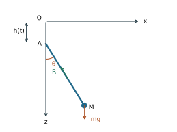
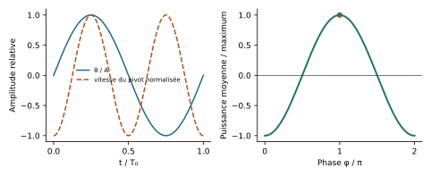
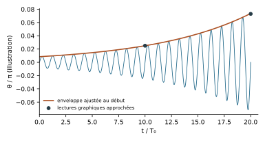
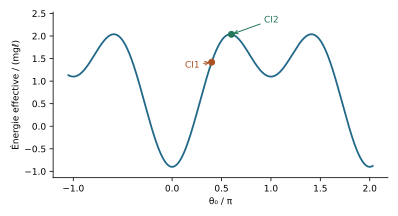
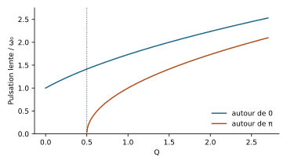
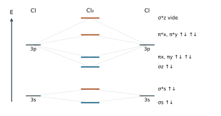
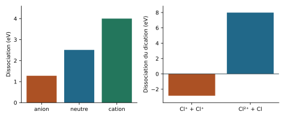
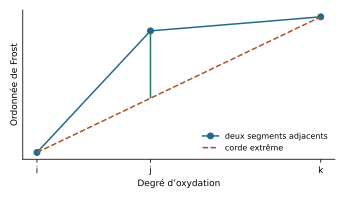
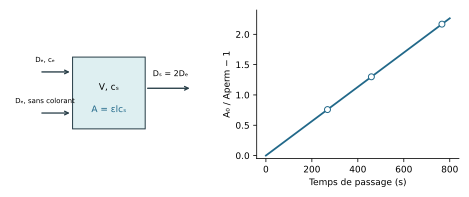

# ENS Lyon — PC, Physique-chimie 2019 · Corrigé brut

*Corrigé rédigé par IA, non officiel.*

**Rédaction (tour 1)** · GPT-6.2 Astra Ultra · vitesse non renseignée

Le fascicule numérote séparément P1 à P31 pour la physique et C1 à C37 pour la chimie. Les deux éditions corrigent entièrement 58 des 68 questions, dont toute la physique du pendule excité, la structure des ions diatomiques, les propriétés générales des diagrammes de Frost et les mesures du colorant. C31 se limite au transport de l’eau et à l’évolution du titre, C35 à la définition du catalyseur. Les huit questions de chimie hors couverture sont repérées dans les deux textes. Les lectures ont été confrontées au fascicule (18 pages numérotées) et au rapport de l’ENS de Lyon.

## Physique I · Excitation paramétrique

### Question P1 — Du pendule pesant au pendule simple

On suppose la masse de la tige négligeable devant $m$ et son moment d’inertie négligeable devant $m\ell^2$. La masse terminale est petite devant $\ell$ et assimilée à un point. La tige est rigide, la liaison pivot idéale et le champ de pesanteur uniforme. Alors le moment d’inertie autour de A est $m\ell^2$ et le bras du poids est celui du point M. Aucune approximation sur l’angle n’est nécessaire pour cette modélisation.

### Question P2 — Équation exacte au pivot fixe

En comptant $\theta$ depuis la verticale descendante, le poids fournit le moment $-mg\ell\sin\theta$. La réaction au pivot a un moment nul en A. Le théorème du moment cinétique donne **$\ddot\theta+\omega_0^2\sin\theta=0$**, avec $\omega_0^2=g/\ell$.

### Question P3 — Période des oscillations de petite amplitude

Pour $|\theta|\ll1$, $\sin\theta\simeq\theta$ et $T_0=2\pi\sqrt{\ell/g}$. Avec $\ell=0{,}20\ \mathrm{m}$ et $g=10\ \mathrm{m\,s^{-2}}$, on obtient **$T_0\simeq0{,}89\ \mathrm s$** ($\omega_0\simeq7{,}07\ \mathrm{rad\,s^{-1}}$).

### Question P4 — Pivot accéléré verticalement

L’axe $z$ est orienté vers le bas. Dans le repère de A, la force d’inertie de translation $-m\ddot h\,\mathbf e_z$ s’ajoute au poids. En remplaçant $g$ par $g-\ddot h$, on trouve **$\ddot\theta+\omega_0^2(1-G)\sin\theta=0$**, où $G=\ddot h/g$. Il n’y a pas de terme de Coriolis puisque le repère traduit ne tourne pas.

### Question P5 — Réaction transmise par la tige

Posons $\mathbf e_r=\sin\theta\,\mathbf e_x+\cos\theta\,\mathbf e_z$ de A vers M, et $\mathbf e_\theta=\partial\mathbf e_r/\partial\theta$. L’accélération est $\ddot h\,\mathbf e_z-\ell\dot\theta^2\mathbf e_r+\ell\ddot\theta\mathbf e_\theta$. L’équation tangentielle est P4. La réaction est axiale et vaut **$\mathbf R=-mg[(1-G)\cos\theta+U]\mathbf e_r$**, avec $U=\dot\theta^2/\omega_0^2$. Ses composantes $x,z$ s’obtiennent en multipliant l’expression scalaire par $(\sin\theta,\cos\theta)$. La composante $y$ est nulle.

### Question P6 — Développement au deuxième ordre

À l’ordre demandé, **$R_x=-mg(1-G)\theta$** et **$R_z=-mg[(1-G)(1-\theta^2)+U]$**. En effet $\cos^2\theta\simeq1-\theta^2$ et $U\cos\theta\simeq U$. Dans $R_x$, $U\sin\theta$ est d’ordre trois. Les grandeurs $h$ et $G$ n’ont pas été développées ici.

### Question P7 — Puissance fournie au point mobile

La vitesse du pivot dans le laboratoire est $\dot h\mathbf e_z$. La liaison idéale ne fournit pas de puissance relative au mouvement autour de A, et la tige transmet l’effort. La puissance extérieure reçue par le pendule est donc $\mathcal P=\mathbf R\cdot\dot h\mathbf e_z=-mg[(1-G)(1-\theta^2)+U]\dot h$ à l’ordre deux. La puissance est positive quand force et vitesse au pivot ont des composantes verticales de même signe.

### Question P8 — Harmoniques de la puissance

Pour $|G|\ll1$, $\theta=A\sin\omega_0t$ et $U=A^2\cos^2\omega_0t$. Alors $1-\theta^2+U=1+A^2\cos(2\omega_0t)$. Ainsi **$\mathcal P=-mga\Omega\cos(\Omega t+\varphi)[1+A^2\cos(2\omega_0t)]$**. L’harmonique double vient du caractère quadratique de la modulation de l’effort au pivot.

### Question P9 — Fréquence et phase d’amplification

La décomposition du produit fait intervenir $\Omega\pm2\omega_0$. Une composante moyenne constante et non nulle exige **$\Omega=2\omega_0$** (le cas $\Omega=0$ donne une puissance nulle). Sur toute fenêtre de longueur $T_0$, $\overline{\mathcal P}=-(mga\Omega A^2/2)\cos\varphi$. L’amplification est maximale pour **$\varphi=\pi\pmod{2\pi}$**, avec $\overline{\mathcal P}^{\,\star}=mga\omega_0 A^2$. Les autres harmoniques ont des moyennes nulles sur cette fenêtre.

### Question P10 — Contribution moyenne de l’accélération du pivot

Le terme omis est $mg\,G\dot h(1-\theta^2)$. Or $G\dot h\propto\sin(2\Omega t+2\varphi)$, de moyenne nulle. Pour $\Omega=2\omega_0$, cette pulsation $4\omega_0$ multipliée par la partie variable de $\theta^2$ à $2\omega_0$ fournit seulement $2\omega_0$ et $6\omega_0$. **Aucune contribution continue** n’est ajoutée dans l’approximation et sur la durée de P9.

### Question P11 — Enveloppe du régime initial

À petite amplitude, l’énergie mécanique de l’oscillation est $E_\theta\simeq m g\ell A^2/2$. Les termes de mouvement imposé purement périodiques n’apportent pas d’énergie cumulée sur une période. Pour une enveloppe lente, $mg\ell A\dot A\simeq mga\omega_0 A^2$. D’où **$A=A(0)e^{t/\tau_A}$**, $\tau_A=\ell/(a\omega_0)$ et **$T_0/\tau_A=2\pi a/\ell$**. La loi n’est valable que dans la première phase, quand le pendule reste presque harmonique et synchronisé.

### Question P12 — Lecture de l’enveloppe de la figure 2

Sur la figure 2 de l’original, l’enveloppe $A/\pi$ vaut environ 0,025 vers $t/T_0=10$ et 0,07 à 0,08 vers 20. Alors $T_0/\tau_A\simeq\ln[A(20T_0)/A(10T_0)]/10\simeq\mathbf{0{,}10\text{ à }0{,}12}$. La lecture des crêtes d’un tracé épais ne justifie pas davantage de précision. Le maximum vers $32T_0$ est déjà hors du régime exponentiel.

### Question P13 — Séparation entre période et temps de croissance

Avec $T_0/\tau_A\simeq0{,}1$, $A(t+T_0)/A(t)\simeq e^{0{,}1}\simeq1{,}11$. La croissance caractéristique s’étend sur environ dix oscillations. L’enveloppe lente constitue une approximation raisonnable au début, avec une variation de l’ordre de 10 % par période. Elle ne fournit pas une identité exacte à amplitude finie.

### Question P14 — Renversement de la croissance

Quand l’amplitude devient importante, la période du pendule augmente par rapport à $T_0$. L’excitation imposée conserve sa pulsation initiale et se déphase peu à peu par rapport aux oscillations. La puissance moyenne reçue diminue, puis peut devenir négative. Le pivot reprend alors de l’énergie au pendule. Ce mécanisme est compatible avec l’absence de dissipation postulée.

### Question P15 — Variation périodique de la longueur

Il faut **raccourcir au passage par le bas** et **rallonger près des extrémités** de la trajectoire, à chaque demi-oscillation. En bas la vitesse et la tension sont élevées, donc l’opérateur apporte un grand travail positif en tirant. À l’extrémité la tension est moindre, et l’allongement rend un travail plus faible en module. Pour une même petite course de corde, le bilan par cycle est positif.

## Physique II · Stabilisation dynamique du pendule inversé

### Question P16 — Deux conditions initiales pour une même excitation

La courbe de gauche part près de $0{,}4\pi$ et oscille autour de zéro. C’est **CI1**. La courbe de droite part à $0{,}6\pi$ et reste dans un voisinage de $\pi$ en moyenne. C’est **CI2**, une stabilisation dynamique du pendule renversé. Les deux signaux portent une ondulation rapide superposée à l’oscillation lente. Les oscillations lentes de droite sont visiblement plus espacées.

### Question P17 — Période du mouvement rapide

Les petites crêtes près de $t/T_0\simeq0{,}5$ sur la figure de droite, ou près des extrema de la courbe gauche, sont espacées d’environ **$0{,}05$ à $0{,}06\,T_0$**. Ainsi $T_{ex}\simeq0{,}05\ \mathrm s$ et $\Omega/\omega_0$ est de l’ordre de 18. L’intervalle entre les grands maxima donnerait la période lente et ne répondrait pas à cette lecture.

### Question P18 — Équilibre renversé en excitation forte

$\theta=\pi$, $\dot\theta=0$ est une solution exacte puisque $\sin\pi=0$. Si $G_0=a\Omega^2/g>1$, le coefficient $1+G_0\sin\psi$ peut s’inverser au cours d’une période, si bien que le couple près de la position haute peut devenir temporairement de rappel. L’instabilité du pendule immobile ne permet donc pas d’écarter une stabilisation périodique. Cette observation ne suffit pas encore à démontrer la stabilité.

### Question P19 — Demi-somme des couples aux deux phases extrêmes

Avec $\Gamma^\star=m\ell^2\omega_0^2$, le couple instantané est $-\Gamma^\star(1+G_0\sin\psi)\sin(\theta_0+\varepsilon_1\sin\psi)$. Aux deux extrema rapides, les couples sont $-\Gamma^\star(1\pm G_0)[\sin\theta_0\pm\varepsilon_1\cos\theta_0]$ au premier ordre. Leur demi-somme vaut **$\Gamma(\theta_0)=-\Gamma^\star[\sin\theta_0+G_0\varepsilon_1\cos\theta_0]$**. La moyenne conventionnelle sur deux extrema diffère de la moyenne temporelle employée plus loin.

### Question P20 — Couple de rappel sous la position haute

Pour $\pi/2<\theta_0<\pi$, la pesanteur seule fournit un couple négatif. Le retour vers $\pi$ exige un couple positif, donc $G_0\varepsilon_1(-\cos\theta_0)>\sin\theta_0$, soit **$G_0\varepsilon_1>-\tan\theta_0$**. L’égalité donne une compensation exacte, sans couple de rappel à cet angle.

### Question P21 — Signe de l’ondulation de part et d’autre de π

En dessous de $\pi$, $-\tan\theta_0>0$, ce qui impose $\varepsilon_1>0$ pour pouvoir satisfaire P20. Au-dessus de $\pi$ le sens du couple de rappel s’inverse. Comme $\cos\theta_0$ reste négatif dans un voisinage de $\pi$, la correction doit devenir négative, ce qui demande $\varepsilon_1<0$. Pour un mouvement symétrique et une dépendance continue, $\varepsilon_1(\pi)=0$ et le signe change.

### Question P22 — Correction géométrique à grande fréquence

Sur une période rapide, la direction OM fait l’angle fixe $\theta_0$. La projection de $\overrightarrow{OM}=h\mathbf e_z+\ell\mathbf e_r(\theta_0+\theta_1)$ sur $\mathbf e_\theta(\theta_0)$ est nulle. Comme $\mathbf e_z\cdot\mathbf e_\theta(\theta_0)=-\sin\theta_0$, il vient $\ell\sin\theta_1=h\sin\theta_0$. Au premier ordre, **$\theta_1=(a/\ell)\sin\theta_0\sin\psi$**. On retrouve le changement de signe prévu.

### Question P23 — Équation moyennée et coefficient Q

Posons $\epsilon=a/\ell$. À angle lent quasi constant, $\sin(\theta_0+\theta_1)\simeq\sin\theta_0+\epsilon\sin\theta_0\cos\theta_0\sin\psi$. En multipliant par $1+G_0\sin\psi$ et en moyennant, le terme en $\sin\psi$ disparaît et $\langle\sin^2\psi\rangle=1/2$. L’accélération de la composante purement rapide a une moyenne nulle à cet ordre. Ainsi **$\ddot\theta_0+\omega_0^2[\sin\theta_0+Q\sin(2\theta_0)]=0$**, avec **$Q=G_0\epsilon/4=(a/\ell)^2(\Omega/\omega_0)^2/4$**.

### Question P24 — Vérification de l’équation lente

Quand $a=0$, $Q=0$, et l’équation du pendule fixe est retrouvée. Le couple est une fonction impaire de $\theta_0$, conforme à la symétrie gauche-droite. Le terme moyen dépend de $a^2$, cohérent avec le fait que changer le signe du déplacement rapide équivaut à changer sa phase de $\pi$.

### Question P25 — Potentiel effectif et norme d’énergie

En multipliant l’équation par $m\ell^2\dot\theta_0$, on vérifie la conservation de $\tfrac12m\ell^2\dot\theta_0^2+E_{eff}$. Une primitive compatible avec la figure est **$E_{eff}=m\ell^2\omega_0^2[1-\cos\theta_0-(Q/2)\cos2\theta_0]$**. L’échelle d’énergie est $m\ell^2\omega_0^2=mg\ell$. Une constante additive est libre. Cette convention donne bien zéro en $\theta_0=0$ pour $Q=0$.

### Question P26 — Puits de potentiel et conditions initiales

Le graphe présente un puits profond en 0 et, à $\pi$, un autre minimum local. Ils sont séparés par une crête, légèrement en dessous de $0{,}6\pi$ du côté positif. L’angle $0{,}4\pi$ de CI1 est sur le versant du puits bas. L’angle $0{,}6\pi$ de CI2 est juste au-delà de la crête et du côté du puits renversé. Avec une faible vitesse lente initiale, le mouvement reste borné dans le puits où il est parti. À énergie plus élevée il serait possible de traverser la barrière.

### Question P27 — Pourquoi les périodes lentes sont différentes

La courbure $E''_{eff}$ est plus grande en 0 qu’en $\pi$. À déplacement angulaire comparable près du minimum, le couple de rappel est plus intense en bas et la période plus courte. Pour les grandes excursions observées, le séjour près de la crête ralentit aussi le mouvement. Une translation verticale du potentiel ne changerait aucune période.

### Question P28 — Seuil de stabilisation dynamique

$E''_{eff}/(mg\ell)=\cos\theta_0+2Q\cos2\theta_0$. En $\pi$ cette quantité vaut $-1+2Q$. La position haute est un minimum strict pour **$Q>Q_c=1/2$**, soit $a^2\Omega^2>2g\ell$. Au seuil la courbure est nulle. Le premier terme variable non nul du potentiel y est d’ordre quatre et négatif, ce qui ne fournit pas un puits stable de petite amplitude.

### Question P29 — Estimation du dépassement du seuil

$f(\pi/2)-f(0)=1+Q$. Sur la figure, $f(0)\simeq-0{,}9$ et $f(\pi/2)\simeq1{,}9$, d’où $Q\simeq1{,}8$ et **$Q/Q_c\simeq3{,}6$**. On retrouve ce nombre en situant la crête, où $\cos\theta_0=-1/(2Q)$. La valeur graphique est bien supérieure à un en unités du seuil.

### Question P30 — Pulsations locales et séparation d’échelles

Pour une petite déviation par rapport à chaque minimum, **$\omega_b^\star=\omega_0\sqrt{1+2Q}$** en bas et **$\omega_h^\star=\omega_0\sqrt{2Q-1}$** en haut, cette dernière pour $Q>1/2$. La pulsation lente n’est donc pas nécessairement $\omega_0$, surtout près du seuil en haut ou pour $Q$ très grand. La moyenne suppose en réalité que la pulsation d’excitation domine les pulsations lentes pertinentes. Dans le régime $a/\ell\ll1$, $\omega_0\sqrt{2Q}/\Omega=a/(\sqrt2\ell)$ fournit un contrôle utile.

### Question P31 — Phase initiale et modèle moyenné

La moyenne sur $T_{ex}$ conserve $\langle\sin^2(\Omega t+\varphi)\rangle=1/2$ et annule $\langle\sin(\Omega t+\varphi)\rangle$, indépendamment de $\varphi$. Le potentiel ne garde donc pas l’information sur la phase initiale ni sur l’ondulation instantanée. Pour comparer deux phases à conditions initiales physiques identiques, il faudrait considérer le mouvement rapide, la correspondance des conditions initiales lentes ou l’équation temporelle complète.

## Chimie I · Isotopes et structure des ions diatomiques

### Question C1 — Configuration électronique du chlore atomique

Le chlore a **$Z=17$** et pour configuration fondamentale $1s^2\,2s^2\,2p^6\,3s^2\,3p^5$, soit $[Ne]3s^23p^5$. Il possède sept électrons de valence, dont un célibataire dans une orbitale $3p$.

### Question C2 — Écritures nucléaires du chlore 36

La désintégration bêta moins est $^{36}_{17}\mathrm{Cl}\to{}^{36}_{18}\mathrm{Ar}+e^-+\bar
u_e$. La capture électronique est $^{36}_{17}\mathrm{Cl}+e^-\to{}^{36}_{16}\mathrm{S}+
u_e$. Le nombre de masse reste 36 dans les deux cas. L’électron capturé appartient initialement au cortège électronique.

### Question C3 — Orbitales de valence de la molécule diatomique

Les niveaux atomiques $3s$ des deux Cl sont dégénérés entre eux et plus bas que les $3p$. Les $3s$ donnent une liante $\sigma_s$ et une antiliante $\sigma_s^*$. Les $3p_z$ donnent $\sigma_z,\sigma_z^*$, les $3p_x,3p_y$ deux paires $\pi,\pi^*$ dégénérées. Une liante augmente la densité entre noyaux par continuité des phases. Une antiliante possède un plan nodal interatomique supplémentaire. En négligeant le mélange $s$–$p$, le classement usuel est $\sigma_s,\sigma_s^*,\sigma_z,\pi_{x,y},\pi^*_{x,y},\sigma_z^*$. Chaque niveau liant est en dessous des OA dont il est issu et le niveau antiliant correspondant au-dessus. Les deux atomes étant identiques, leurs coefficients ont même module.

### Question C4 — Indice de liaison de cinq espèces

Le neutre possède 14 électrons de valence, huit liants et six antiliants. L’indice est $(n_l-n_a)/2$. Les cations perdent un puis deux électrons dans la paire $\pi^*$, les anions peuplent $\sigma_z^*$. On trouve **2 pour $Cl_2^{2+}$, 1,5 pour $Cl_2^+$, 1 pour $Cl_2$, 0,5 pour $Cl_2^-$ et 0 pour $Cl_2^{2-}$**.

### Question C5 — Conséquence d’un indice nul pour le dianion

Pour le dianion, tous les niveaux liants et antiliants de valence sont remplis. L’indice nul ne fournit pas de liaison covalente nette dans ce modèle, et les charges négatives se repoussent. La dissociation attendue en phase gazeuse est **$Cl_2^{2-}(g)\to 2Cl^-(g)$**.

### Question C6 — Raccourcissement du cation

En passant du neutre à $Cl_2^+$ on enlève un électron antiliant. L’indice de liaison passe de 1 à 1,5. La liaison renforcée a sa distance d’équilibre à **189,2 pm** dans le cation, contre **198,8 pm** dans la molécule neutre, en accord avec cette lecture.

### Question C7 — Énergie de première ionisation

Dans $Cl_2$ l’électron arraché occupait une orbitale $\pi^*$ antiliante, plus haute que le niveau $3p$ atomique. Il est donc qualitativement moins lié. Cela concorde avec **11,48 eV** pour la molécule contre **12,97 eV** pour l’atome. L’argument est orbitalaire et ne calcule pas les énergies de relaxation après ionisation.

### Question C8 — Cycle énergétique de l’anion

Pour obtenir $Cl+Cl^-$ à partir de $Cl_2^-$, on peut détacher l’électron de la molécule ($+2{,}38$ eV), dissocier la molécule neutre ($+2{,}51$ eV) puis attacher l’électron à un atome ($-3{,}61$ eV). **$\Delta E=+1{,}28\ \mathrm{eV}$**. L’état moléculaire gazeux est donc plus bas que les fragments de ce canal.

### Question C9 — Deux canaux de dissociation du dication

Former le dication à partir du neutre coûte $11{,}48+19{,}82=31{,}30$ eV. Les deux atomes simplement ionisés coûtent, à partir du même neutre, $2{,}51+2(12{,}97)=28{,}45$ eV. La dissociation en $Cl^++Cl^+$ libère donc **2,85 eV**. Pour le canal $Cl^{2+}+Cl$, le coût est $2{,}51+12{,}97+23{,}81=39{,}29$ eV. Ce second canal demande **7,99 eV** à partir du dication. Il suffit qu’un canal soit plus bas pour que le dication ne soit pas l’état de plus basse énergie.

### Question C10 — Indice de liaison et métastabilité

L’indice de liaison du dication est 2, ce qui suggère localement une liaison covalente forte. Pourtant le canal vers deux cations monatomiques est plus bas en énergie. Le comptage liant/antiliant omet notamment le coût de mettre deux charges positives sur la même espèce, la répulsion entre charges et la relaxation des orbitales. Une courbe d’énergie peut avoir un minimum local séparé par une barrière d’une asymptote de dissociation plus basse. La liaison locale et la métastabilité globale sont donc compatibles.

## Chimie II · Géométrie et thermodynamique des diagrammes de Frost

*Question C11 hors couverture.*

*Question C12 hors couverture.*

### Question C13 — Potentiel d’un couple et pente du diagramme de Frost

Posons $Y_n=nE^\circ(n,0)$. Pour une réduction du degré supérieur $N$ au degré inférieur $M$, la différence d’énergies libres standard par mole de sites est $-F(Y_N-Y_M)=-(N-M)FE^\circ(N,M)$. Donc **$E^\circ(N,M)=(Y_N-Y_M)/(N-M)$**. Le produit d’un potentiel par son nombre d’électrons fait apparaître l’additivité qui manque aux potentiels pris seuls.

### Question C14 — Construction à partir de couples successifs

Placer $Y_0=0$. À partir d’un point connu d’abscisse $M$, on construit $Y_N=Y_M+(N-M)E^\circ(N,M)$, en respectant le sens des abscisses. On répète sur les couples adjacents, avec le bon nombre d’électrons à chaque étape. Une différence de deux unités d’oxydation multiplie ainsi la pente par deux. Les couples non adjacents permettent un contrôle indépendant en recalculant la pente de leur corde.

### Question C15 — Énergie libre d’une dismutation abstraite

Dans le bilan écrit pour $(k-i)$ sites initialement au degré $j$, $(k-j)$ sites passent de $j$ à $i$ et $(j-i)$ sites passent de $j$ à $k$. Le nombre d’électrons échangés dans chaque demi-bilan est $n_e=(k-j)(j-i)$. On obtient **$\Delta_rG^\circ=-n_eF[E^\circ(i,j)-E^\circ(j,k)]$**. Le premier potentiel est celui de la branche réduite et le second celui de la branche parcourue en oxydation.

### Question C16 — Trois pentes lorsque le point médian est élevé

Écrivons $s_{ij}=(Y_j-Y_i)/(j-i)$ et $s_{jk}=(Y_k-Y_j)/(k-j)$. Si $Y_j$ est au-dessus de la corde $ik$, la pente à gauche est la plus forte. La pente totale $s_{ik}=[(j-i)s_{ij}+(k-j)s_{jk}]/(k-i)$ est strictement intermédiaire. Ainsi **$E^\circ(j,k)<E^\circ(i,k)<E^\circ(i,j)$**.

### Question C17 — Critère géométrique de métastabilité

Si le point $j$ est au-dessus de la corde reliant deux degrés qui l’encadrent, $E^\circ(i,j)-E^\circ(j,k)>0$. D’après C15, $\Delta_rG^\circ<0$ pour la dismutation écrite. Le mélange des deux états extrêmes de cette corde a une énergie libre standard inférieure à l’état $j$. Le diagramme donne ce critère thermodynamique et ne prédit pas le temps nécessaire à la transformation.

*Question C18 hors couverture.*

*Question C19 hors couverture.*

### Question C20 — Autres causes d’instabilité d’un état extrême

Un degré extrême ne peut pas se dismuter, mais il peut réagir avec l’eau, le dioxygène dissous ou un partenaire redox du milieu. On compare graphiquement la pente d’un couple accessible de l’élément à celle du couple du partenaire dans les mêmes conditions de pH et d’activité, notamment aux limites redox de l’eau. Une différence de potentiels positive dans le sens accepteur moins donneur indique un transfert favorable. Des cinétiques ou surtensions peuvent en retarder l’observation.

*Question C21 hors couverture.*

## Chimie III · Cinétique en réacteur et spectrophotométrie

### Question C22 — Temps de passage dans un réacteur ouvert

**$\tau=V/D_s$**. Il faut prendre la somme des deux débits d’entrée, égale au débit sortant stationnaire. Pour les trois colonnes de la table 2, on obtient environ **459 s, 268 s et 766 s**. Ce sont des durées moyennes de séjour dans un volume parfaitement agité.

### Question C23 — Bilan du colorant en régime permanent

À volume constant, le bilan de quantité de matière est $0=D_ec_e-D_sc_{s,perm}-Vv$. Le mélange étant parfait, la concentration de sortie est celle du réacteur et $D_e=D_s/2$. Ainsi **$v=(c_e/2-c_{s,perm})/\tau$**. Si la réaction ne consomme aucun colorant, le débit de sortie double celui de son alimentation et $c_s=c_e/2$.

### Question C24 — Absorbance initiale après dilution

La mesure initiale se fait **après** le mélange à parts égales. La concentration initiale en colorant vaut donc $c_e/2$. La loi de Beer–Lambert donne $A_0=\varepsilon l c_e/2$, soit **$c_e=2A_0/(\varepsilon l)$**. À un instant ultérieur, $c_s=A/(\varepsilon l)$. Ce facteur deux concerne l’alimentation initiale du colorant et ne se répète pas dans la seconde expression.

### Question C25 — Vitesse déduite des absorbances

Le bilan de C23 donne **$v=(A_0-A_{perm})/(\varepsilon l\tau)$**. Les absorbances sont sans dimension. $1/(\varepsilon l)$ a l’unité d’une concentration et le quotient par $\tau$ donne une concentration par unité de temps.

### Question C26 — Concentration quasi constante du coréactif

D’après les concentrations de la figure 4, le coréactif se trouve en excès d’environ $20\times10^{-3}/(12\times10^{-6})\simeq1{,}7\times10^3$ avant le mélange. La dilution par deux s’applique aux deux espèces et conserve ce rapport. Une consommation de l’ordre de celle du colorant modifie donc très peu la concentration du coréactif. Celle-ci reste proche de la moitié de sa concentration dans l’alimentation.

### Question C27 — Linéarisation à l’ordre zéro

Si l’ordre en colorant est nul, $v=k_{app}$ à coréactif quasi constant. Alors $A_0-A_{perm}=\varepsilon l k_{app}\tau$, soit **$A_{perm}=A_0-k_0\tau$** avec $k_0=\varepsilon l k_{app}$. La pente est exprimée en absorbance par seconde si $\tau$ est en secondes.

### Question C28 — Linéarisation à l’ordre un

Si $v=k_{app}c_{s,perm}=k_{app}A_{perm}/(\varepsilon l)$, l’égalité avec la vitesse de C25 donne **$A_0/A_{perm}-1=k_{app}\tau$**. La grandeur à tracer est donc un rapport d’absorbances sans dimension. $k_{app}$ a pour unité $\mathrm{s^{-1}}$.

### Question C29 — Comparer les ajustements des figures 5 et 6

Les trois points de la figure 6 suivent de près une droite passant par l’origine, avec $R^2=0{,}999$, contre environ $0{,}949$ pour le test de l’ordre zéro de la figure 5. L’ordre **un** en colorant est ainsi le mieux soutenu par ces trois essais. La pente de la figure 6 est **$k_{app}\simeq2{,}83\times10^{-3}\ \mathrm{s^{-1}}$**. Celle de la figure 5 est associée à un autre modèle.

### Question C30 — Tester l’ordre du coréactif à partir de plusieurs pentes

Pour plusieurs séries à concentration du coréactif connue et quasi constante dans chacune, on déduit d’abord $k_{app}$ de la pente du tracé de C28, à température fixée. La relation $k_{app}=k c_{cor}^{\beta}$ implique que le tracé de $\ln(k_{app}/k_{ref})$ en fonction de $\ln(c_{cor}/c_{ref})$ a pour pente $\beta$. Une pente compatible avec un, ou une droite de $k_{app}$ proportionnelle à $c_{cor}$, est le test attendu. Il faut utiliser les concentrations après dilution.

## Chimie IV · Lecture des propriétés et des spectres

### Question C31 — Conséquences logistiques et analytiques (partie traitée)

Une solution peu concentrée impose le transport et le stockage d’une grande masse d’eau pour une même quantité de réactif. Si le titre décroît avec le temps, une quantité de solution donnée n’apporte plus une quantité de matière parfaitement prévisible. Il faut alors contrôler le titre pour interpréter les bilans. Ces deux inconvénients constituent le périmètre traité.

### Question C32 — Effet de la température sur le vieillissement

Dans la loi d’Arrhenius $k=A\exp[-E_a/(RT)]$, une énergie d’activation positive implique une diminution de la constante de vitesse à température plus basse. La décomposition est donc plus lente et le titre varie moins vite. Une stabilité cinétique accrue ne démontre pas une inversion de l’équilibre thermodynamique.

*Question C33 hors couverture.*

### Question C34 — Comparer les spectres de l’octan-2-ol et de l’octan-2-one

Dans le spectre de l’alcool, le méthine $CH(OH)$ résonne vers 3,8 ppm et le méthyle voisin est dédoublé par ce proton. Dans le spectre de la cétone, le signal du méthine a disparu et le méthyle $CH_3CO-$ donne un singulet de trois protons vers 2,1 ppm. Le $CH_2$ de l’autre côté du carbonyle apparaît vers 2,4 ppm. Ces changements sont cohérents avec la transformation d’un alcool secondaire en cétone.

### Question C35 — Définition du catalyseur (partie traitée)

Un catalyseur intervient dans des étapes élémentaires et se régénère au cours du cycle. Il rend une voie cinétique plus rapide, sans changer l’équilibre thermodynamique de la transformation globale. Il peut être présent en quantité inférieure à celle du substrat. La comparaison appliquée des conditions opératoires de l’oxydation n’est pas incluse.

*Question C36 hors couverture.*

*Question C37 hors couverture.*
