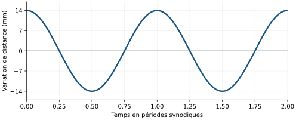
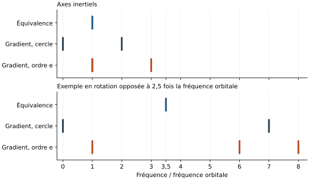
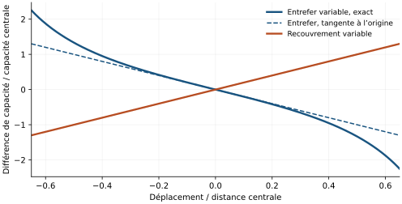
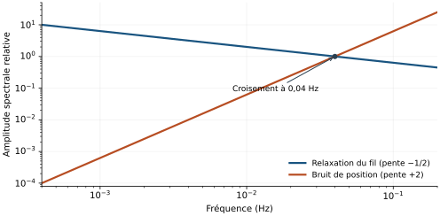

# ENS Ulm PSI 2019 — Physique U · Corrigé brut

*Corrigé rédigé par IA, non officiel. Signalez toute erreur.*

**Rédaction** · GPT-6.2 Astra Ultra · vitesse non renseignée

## Le principe d’équivalence à l’épreuve de la mission MICROSCOPE

## Préliminaire — Deux pendules de même longueur

### Question 1 — Période et composition

La tension est radiale. La projection tangentielle donne $m_I l\ddot\theta=-m_Gg\sin\theta$. Aux petits angles, $\ddot\theta+(1+\eta_k)g\theta/l=0$. La période est donc $T_k=2\pi\sqrt{l/[g(1+\eta_k)]}$.

### Question 2 — Retard relatif

En posant $T_0=2\pi\sqrt{l/g}$, on a $T_k=T_0(1-\eta_k/2)+O(\eta_k^2)$. Comme $E_{1,2}=\eta_1-\eta_2$, il vient $(T_1-T_2)/(T_1+T_2)\simeq-E_{1,2}/4$. Le pendule de plus grand rapport $m_G/m_I$ est le plus rapide.

### Question 3 — Accumulation du déphasage

Le retard atteint une période pour $N\simeq 2/|E_{1,2}|$, soit $2,0\times10^{15}$ périodes pour la cible $10^{-15}$. Même à une seconde par période, cela prendrait $6,3\times10^7$ ans. Avec une résolution de phase exprimée en temps $\delta t$, la sensibilité est $2\delta t/(NT_0)$. Par exemple, mille périodes observées au dixième de période donnent environ $2\times10^{-4}$ avant prise en compte des frottements et des différences de longueur.

## Partie I — La distance entre la Terre et la Lune

### Question 4 — Attractions dans le référentiel héliocentrique

Avec $\mathbf r=\mathbf r_L-\mathbf r_T$ et $\mu_j=GM_G^{(j)}$, la loi de Newton donne $\mathbf a_T=(1+\eta_T)(-\mu_S\mathbf r_T/r_T^3+\mu_L\mathbf r/r^3)$ et $\mathbf a_L=(1+\eta_L)(-\mu_S\mathbf r_L/r_L^3-\mu_T\mathbf r/r^3)$. La masse grave du Soleil est déjà incluse dans $\mu_S$.

### Question 5 — Accélération relative

En posant $\mathbf u_j=\mathbf r_j/r_j^3$, la différence s'écrit $\ddot{\mathbf r}=-\mu^*\mathbf r/r^3+\mu_S(\mathbf u_T-\mathbf u_L)+\mu_S(\eta_T\mathbf u_T-\eta_L\mathbf u_L)$, avec $\mu^*=(1+\eta_L)\mu_T+(1+\eta_T)\mu_L$. Le deuxième terme est la marée solaire ordinaire.

### Question 6 — Orbite circulaire relative

Sans le Soleil, $\ddot{\mathbf r}=-\mu^*\mathbf r/r^3$. Sur le cercle de rayon $r_0$, l'accélération vaut $-\omega_0^2\mathbf r$. Par identification, $\omega_0=\sqrt{\mu^*/r_0^3}$.

### Question 7 — Constante képlérienne

Pour $\eta_T=\eta_L=0$, $\mu_0=\mu_T+\mu_L=G(M_T+M_L)$. Changer $\mu^*$ déplace la relation entre fréquence moyenne et rayon d'une orbite circulaire. Une fois les éléments moyens de l’orbite ajustés, le rayon circulaire est constant.

### Question 8 — Périodicité des deux perturbations solaires

La direction relative tourne à la pulsation synodique $\Omega=\omega_0-\omega_T$. La projection radiale du terme en $\eta_T-\eta_L$ contient $\cos\Omega t$. La marée ordinaire est proportionnelle au gradient du champ solaire appliqué à $\mathbf r$ et sa projection contient $3\cos^2\Omega t-1$, soit une constante et un terme à $2\Omega$. Les deux perturbations forcent ainsi des variations périodiques de distance.

### Question 9 — Énergie au dénominateur

Le dénominateur vaut $\int_V\rho_k c^2\,dV=M_kc^2$. C'est l'énergie de masse au repos, de dimension $ML^2T^{-2}$, en joules.

### Question 10 — Énergie de liaison gravitationnelle

L'énergie potentielle propre vaut $U=-\tfrac12\iint G\rho(\mathbf r)\rho(\mathbf r')/|\mathbf r-\mathbf r'|\,dV\,dV'$. Le numérateur positif est donc $-2U$. Il mesure la liaison gravitationnelle de l'astre, avec le facteur deux dû au double comptage.

### Question 11 — Champ et potentiel d'une boule homogène

La masse intérieure à $r<R$ est $4\pi\rho r^3/3$. Le champ est radial, $g_r=-4\pi G\rho r/3$ à l'intérieur et $g_r=-GM/r^2$ à l'extérieur. Avec $I(\infty)=0$, $I(R)=-GM/R$. L'intégration de $I'(r)=-g_r$ donne $I(r)=-2\pi G\rho(R^2-r^2/3)$ pour $r\leq R$.

### Question 12 — Intégration sur l'astre

Le numérateur est $8\pi^2G\rho^2\int_0^R(R^2-r^2/3)r^2\,dr=32\pi^2G\rho^2R^5/15=(6/5)GM^2/R$. Après division par $Mc^2$, $\eta_k=\eta\,6GM_k/(5R_kc^2)$.

### Question 13 — Poids relatif de la Terre et de la Lune

Avec les constantes du sujet, $\eta_T/\eta=8,0\times10^{-10}$ et $\eta_L/\eta=4,3\times10^{-11}$. Comme $r_L\simeq r_T$, la contribution lunaire vaut environ $5,4\,\%$ de la contribution terrestre. On la néglige au niveau de l'approximation demandée.

### Question 14 — Moment cinétique par unité de masse

Le champ terrestre est central. Le terme solaire donne $\dot{\boldsymbol\ell}=\mathbf r\times\delta a\,\widehat{\mathbf r}_T=-r\delta a\sin\Phi\,\mathbf u_z$, avec $\delta a=\mu_S\eta_T/r_T^2$, une accélération en $\mathrm{m\,s^{-2}}$. Pour $\eta_T=0$, $\boldsymbol\ell$ est constant. Le mouvement circulaire donne $\boldsymbol\ell_0=r_0^2\omega_0\mathbf u_z$.

### Question 15 — Équation radiale

La projection radiale de l'accélération vaut $\ddot r-r\dot\theta^2=-\mu_0/r^2+\delta a\cos\Phi$. Comme $\ell=r^2\dot\theta$, on trouve $\ddot r=\ell^2/r^3-\mu_0/r^2+\delta a\cos\Phi$.

### Question 16 — Phase synodique

La direction $\mathbf r_T$ tourne à $\omega_T$ et celle de la Lune à $\omega_0$. Donc $\Phi_0(t)=(\omega_0-\omega_T)t+\Phi_0(0)$. On choisit l'alignement comme origine des temps, ce qui donne $\Phi_0=\Omega t$.

### Question 17 — Linéarisation du mouvement

De $\delta\dot\ell=-r_0\delta a\sin\Omega t$ et de la moyenne nulle, on tire $\delta\ell=(r_0\delta a/\Omega)\cos\Omega t$. La variation de $\ell^2/r^3-\mu_0/r^2$ vaut $(2\ell_0/r_0^3)\delta\ell-\omega_0^2\delta r$ puisque $\mu_0=\omega_0^2r_0^3$. Ainsi $\delta\ddot r+\omega_0^2\delta r=\delta a(1+2\omega_0/\Omega)\cos\Omega t$.

### Question 18 — Polarisation de l'orbite

C'est un oscillateur harmonique linéaire forcé, sans amortissement. Sa réponse comprend une oscillation libre à $\omega_0$ fixée par les conditions initiales, et une composante forcée à $\Omega$. Cette dernière allonge puis raccourcit la distance Terre–Lune en phase avec la configuration solaire. L'amplitude libre relève des éléments initiaux de l'orbite.

### Question 19 — Amplitude synodique

On obtient $A=\delta a(1+2\omega_0/\Omega)/(\omega_0^2-\Omega^2)$. Avec $\omega_T/\omega_0\simeq30/365=0,082$, le numérateur vaut environ $3\delta a$ et le dénominateur $2\omega_0\omega_T$. En insérant $\delta a=(GM_S/r_T^2)\eta\,6GM_T/(5R_Tc^2)$ et $GM_T\simeq\omega_0^2r_0^3$, on obtient l'amplitude algébrique $A\simeq\eta(9/5)(GM_S/c^2)[r_0^3/(r_T^2R_T)](\omega_0/\omega_T)$. Son module est l'amplitude de la variation.

### Question 20 — Télémétrie laser

On date l'émission d'une impulsion laser et le retour des photons renvoyés par un rétroréflecteur lunaire. La distance station–réflecteur est $c\Delta t/2$. Deux centimètres correspondent à $1,3\times10^{-10}\ \mathrm{s}$ sur le trajet aller-retour. Le cumul des retours et les corrections de propagation atmosphérique, de position de la station et de libration lunaire permettent de remonter à la distance des centres.

### Question 21 — Sensibilité de la distance

On a $GM_S/c^2\simeq1,4\times10^3\ \mathrm m$, $r_0^3/(r_T^2R_T)\simeq4,4\times10^{-4}$ et $\omega_0/\omega_T\simeq12$. Leur produit, multiplié par $9/5$, donne $\delta r_0/\eta\simeq14\ \mathrm m$.

### Question 22 — Précision du test lunaire

La sensibilité nominale est $|\eta|\sim0,020/14\simeq1,4\times10^{-3}$. Comme $\eta_T/\eta=8,0\times10^{-10}$, cela correspond à $|\eta_T|\sim1,2\times10^{-12}$. Cette estimation utilise le modèle simplifié de réponse de l'orbite.

## Partie II — Gravité, centrage des masses et rotation du satellite

### Question 23 — Résultante sur chaque corps

Chaque volume $dV$ subit la force de pesanteur $\rho_G^{(k)}\mathbf g\,dV$. La résultante sur le cylindre est donc $\mathbf F_k=\int_{V_k}\rho_G^{(k)}\mathbf g\,dV+\mathbf f_{\mathrm{el},k}$. Par action et réaction, le satellite subit $\mathbf F_s=\int_{V_s}\rho_G^{(s)}\mathbf g\,dV-\sum_j\mathbf f_{\mathrm{el},j}$.

### Question 24 — Mouvement relatif au satellite

Posons $\mathbf d_k=\overrightarrow{O_sO_k}$, $\mathbf P_i=\int_{V_i}\rho_G^{(i)}\mathbf g\,dV$ et $m_i=m_I^{(i)}$. La soustraction des deux lois de Newton donne $\ddot{\mathbf d}_k=\mathbf P_k/m_k-\mathbf P_s/m_s+\mathbf f_{\mathrm{el},k}/m_k+\sum_j\mathbf f_{\mathrm{el},j}/m_s$.

### Question 25 — Gradient de gravité terrestre

Avec $g_i=-\mu_T x_i/r^3$ et $\partial_j r^{-3}=-3x_j/r^5$, $T_{ij}=(\mu_T/r^3)(3x_i x_j/r^2-\delta_{ij})$. La matrice est symétrique et de trace nulle hors de la Terre. Sa dimension est $\mathrm{s^{-2}}$.

### Question 26 — Champ moyenné sur un cylindre

À l'ordre linéaire, $\mathbf P_k=m_G^{(k)}\mathbf g_s+[T_s]\int_{V_k}\rho_G^{(k)}\overrightarrow{O_sP}\,dV$. Le second facteur est $m_G^{(k)}\mathbf d_k$ car $\int\rho_G^{(k)}\overrightarrow{O_kP}\,dV=0$ pour le cylindre homogène. On obtient $m_G^{(k)}(\mathbf g_s+[T_s]\mathbf d_k)$.

### Question 27 — Équation dans le repère en translation

Le premier moment du satellite par rapport à son centre s'annule, donc $\mathbf P_s=m_G^{(s)}\mathbf g_s$ à cet ordre. Dans Q24, le facteur de $\mathbf g_s$ devient $(1+\eta_k)-(1+\eta_s)=E_{k,s}$. Ainsi $\ddot{\mathbf d}_k=E_{k,s}\mathbf g_s+(1+\eta_k)[T_s]\mathbf d_k+\mathbf f_{\mathrm{el},k}/m_k+\sum_j\mathbf f_{\mathrm{el},j}/m_s$.

### Question 28 — Accélération différentielle asservie

Régler $\ddot{\mathbf d}_1=\ddot{\mathbf d}_2=0$, remplacer $1+\eta_k$ par 1 devant le gradient et soustraire. Avec $\boldsymbol\Delta=\mathbf d_2-\mathbf d_1$, on obtient $\delta\boldsymbol\Gamma=\boldsymbol\Gamma_{\mathrm{el},1}-\boldsymbol\Gamma_{\mathrm{el},2}=E_{2,1}\mathbf g_s+[T_s]\boldsymbol\Delta$. Un décentrage transforme donc le gradient terrestre en signal même si $E_{2,1}=0$.

### Question 29 — Fréquence du signal recherché

Posons $n=\Omega_s$, $a=r_s$ sur le cercle, $g_0=\mu_T/a^2$. Le champ pointe vers la Terre et $g_x=-g_0\cos nt$. Une violation fournirait $-E_{2,1}g_0\cos nt$, à $f_{\rm PE}=n/(2\pi)=f_{\rm orb}$ en mode inertiel.

### Question 30 — Fréquence du décentrage en orbite circulaire

Dans le sens de la figure 2.1, $\widehat{\mathbf r}=(\cos nt,0,-\sin nt)$. Écrivons $A=\mu_T/a^3$. Q25 donne $T_{xx}=A(1/2+3\cos(2nt)/2)$, $T_{xy}=0$, $T_{xz}=-3A\sin(2nt)/2$. Le décentrage fixe produit une composante constante et une raie à $2f_{\rm orb}$, distincte de la raie d'équivalence.

### Question 31 — Quel point choisir comme origine de l'ellipse ?

Pour $a=r_s^{(0)}$, $p=a(1-e^2)$ et $FF'=2a|e|\ll a$. Depuis le foyer terrestre, $r_s=p/(1+e\cos\theta_s)=a(1-e\cos\theta_s)+O(ae^2)$. La distance entre foyer et centre est petite mais du premier ordre conservé. Depuis le centre géométrique du dessin, la distance ne présenterait qu'une variation d'ordre $e^2$.

### Question 32 — Gradient orbital sur une ellipse

Prenons le périgée à $t=0$ et $M=nt$. La loi des aires donne $\dot\theta=n(1+2e\cos M)+O(e^2)$, donc $\theta=M+2e\sin M+O(e^2)$ et $r^{-3}=a^{-3}(1+3e\cos M)+O(e^2)$. Dans Q30 on remplace $nt$ par $\theta$ et $A$ par $\mu_T/r^3$. Après développement, $T_{xx}/A=\tfrac12+\tfrac32\cos 2M+\tfrac e4(3\cos M+21\cos 3M)$ et $T_{xz}/A=-\tfrac32\sin 2M+\tfrac e4(3\sin M-21\sin 3M)$ à cet ordre. Le fondamental a pour amplitude $3|e|A/4$ dans les deux canaux. $T_{xy}=0$ car l'orbite reste dans le plan $xz$.

### Question 33 — Projection à la fréquence d'équivalence

La correction d'ordre $e$ au champ $g_x$ contient du continu et du deuxième harmonique, sans terme fondamental. Avec les axes et l'origine temporelle du sujet, Q28–Q32 donnent donc $\delta\Gamma_{x,1}=[-E_{2,1}g_0+(3/4)eA\Delta_x]\cos M+(3/4)eA\Delta_z\sin M$. L'expression proposée dans la question ne découle pas de ces hypothèses. Par exemple, même pour $\boldsymbol\Delta=0$, Q28 impose $g_x(0)<0$, alors que Q33 imprime $+E_{2,1}g_s\cos M$. Même la simplification $\theta=M$ sur l'ellipse donnerait les coefficients $15/4$ et $-9/4$ pour le gradient. Le résultat physique commun est une contamination proportionnelle au produit de l'excentricité par le décentrage.

### Question 34 — Étalonnage en vol

Démoduler $\delta\Gamma_x$ à $2f_{\rm orb}$. Sur le cercle, les coefficients en cosinus et sinus valent $(3A/2)\Delta_x$ et $-(3A/2)\Delta_z$. Une fois la phase orbitale connue, les deux quadratures donnent le décentrage. Au sol, la suspension doit soutenir le poids et les masses ne sont pas dans leur équilibre de chute libre. En outre, le gradient ne balaie pas les axes au rythme orbital. L'étalonnage du point de fonctionnement en vol exige donc des données orbitales.

### Question 35 — Budget d'excentricité

Pour appliquer le budget explicitement proposé en Q33, imposer $(9/2)|e|\sigma_{\Delta x}/a\leq10^{-15}$. Avec $a=(6500+700)\ \mathrm{km}=7,2\times10^6\ \mathrm m$ et $\sigma_{\Delta x}=10^{-7}\ \mathrm m$, on trouve $|e|\lesssim1,6\times10^{-2}$. Le coefficient képlérien $3/4$ établi en Q32 conduirait à $9,6\times10^{-2}$ au premier ordre. La valeur nominale du sujet est donc ici plus contraignante.

### Question 36 — Rotation du repère de mesure

Pour des rotations de sens opposés comme sur la figure 2.2, l'angle relatif évolue à $\Omega_s+\omega_r$ en valeur absolue. La projection du champ sur l'axe sensible oscille à $f_{\rm PE}=f_{\rm orb}+f_{\rm rot}$, avec $f_{\rm rot}=|\omega_r|/(2\pi)$. En notation algébrique générale, c'est le module de la différence des vitesses angulaires divisé par $2\pi$.

### Question 37 — Raies créées par le mauvais centrage

Sur le cercle, le terme de gradient contient du continu et $2f_{\rm PE}$. À l'ordre $e$, le facteur $r^{-3}$ varie à $f_{\rm orb}$ et module le continu et le second harmonique. La modulation de phase de l'angle vrai fournit les mêmes bandes latérales. Il s'ajoute donc $f_{\rm orb}$ et $|2f_{\rm PE}\pm f_{\rm orb}|$.

### Question 38 — Choix d'une vitesse de rotation

Une rotation choisie déplace le signal recherché hors des raies de décentrage et vers une bande moins bruitée. On choisit $f_{\rm rot}$ pour séparer $f_{\rm PE}$ de $f_{\rm orb}$, $2f_{\rm PE}$ et de leurs bandes latérales, avec des écarts supérieurs à $1/T_{\rm observation}$. Une vitesse opposée de quelques fois $\Omega_s$ est un choix possible. La bande passante du capteur fixe aussi une limite.

## Partie III — Capteurs capacitifs et lecture de position

### Question 39 — Électrodes axiales

Les électrodes X entourent les extrémités du cylindre. Une translation axiale conserve les rayons et l'entrefer, mais augmente la longueur de recouvrement d'un côté et la diminue de l'autre. C'est donc l'aire en regard qui fournit la mesure.

### Question 40 — Approximation de plaques planes

Un déplacement transverse rapproche un secteur de la masse et éloigne le secteur opposé. Pour appliquer le modèle plan, l'entrefer doit être petit devant le rayon de courbure et les dimensions latérales du secteur. La normale au secteur doit aussi varier peu si l'on veut assimiler partout le déplacement projeté au même $x$. Des secteurs larges nécessitent une intégration angulaire pour une estimation précise.

### Question 41 — Capacités à entrefer variable

L'électrode 1 est du côté des $x$ négatifs. Les distances sont $e_1=e+x$, $e_2=e-x$. Pour des plaques en influence totale, $C_1=\varepsilon_0S/(e+x)$ et $C_2=\varepsilon_0S/(e-x)$ pour $|x|<e$.

### Question 42 — Sensibilité différentielle de l'entrefer

Avec $C_0=\varepsilon_0S/e$ au centre, $C_1-C_2=-2\varepsilon_0Sx/(e^2-x^2)\simeq-2C_0x/e$. La moyenne $(C_1+C_2)/2$ diffère de $C_0$ seulement à l'ordre $(x/e)^2$. Si on emploie la moyenne instantanée, la relation $\Delta C=-(C_1+C_2)x/e$ est exacte.

### Question 43 — Condensateur coaxial

Pour une charge $q$ sur la portion de cylindre, $E_r=q/(2\pi\varepsilon_0 e_i r)$. La différence de potentiel a pour module $|q|\ln(R_e/R_t)/(2\pi\varepsilon_0 e_i)$. Ainsi $C_i=2\pi\varepsilon_0 e_i/\ln(R_e/R_t)$, sans effet de bord.

### Question 44 — Sensibilité par recouvrement

Dans cette configuration $e_1=e+x$, $e_2=e-x$ sont des recouvrements. Avec $C'_0=2\pi\varepsilon_0 e/\ln(R_e/R_t)$, la moyenne est constante et $\Delta C=2C'_0x/e$, exactement dans le modèle tant que les deux recouvrements existent.

### Question 45 — Énergie des deux armatures

Pour $U_i=V_i-V_p$, l'énergie emmagasinée est $E_{p,i}=C_iU_i^2/2$. À tension imposée, $dE_{p,i}=(U_i^2/2)dC_i$. Le signe dépend du déplacement.

### Question 46 — Travail électrique fourni

La charge de l'armature $i$ est $q_i=C_iU_i$. Pour une variation $dq_i=U_i\,dC_i$, le générateur fournit $\delta W_{\rm gen}=U_i\,dq_i=U_i^2\,dC_i$. Si $dC_i<0$, il reçoit de l'énergie.

### Question 47 — Force électrostatique à tension fixée

Sans dissipation, $\mathbf F_i\cdot d\mathbf u=\delta W_{\rm gen}-dE_{p,i}=\tfrac12U_i^2dC_i$. Comme $dC_i=\nabla C_i\cdot d\mathbf u$ pour tout déplacement, $\mathbf F_i=\tfrac12U_i^2\nabla C_i$. La force tend vers les capacités croissantes.

### Question 48 — Gain d'action axial

Posons $m=m_I^{(k)}$. Avec $\partial_xC_1=-\partial_xC_2=C'_0/e$, on a $m\Gamma_x=C'_0[(V_e-V_p)^2-(-V_e-V_p)^2]/(2e)=-2C'_0V_pV_e/e$. Ainsi $\boldsymbol\Gamma=-G_aV_e\mathbf u_x$ avec $G_a=2C'_0V_p/(me)$.

### Question 49 — Gain transverse et raideur parasite

Au premier ordre, $\partial_x C_1=-(C_0/e)(1-2x/e)$ et $\partial_xC_2=(C_0/e)(1+2x/e)$. Q47 donne $\Gamma_x=(2C_0V_p/me)V_e+[2C_0(V_p^2+V_e^2)/(me^2)]x$. Avec la convention $-G_g V_e$ de l'énoncé, $G_g=-2C_0V_p/(me)$ et $\omega_p^2=2C_0V_p^2/(me^2)$. La force proportionnelle à $+x$ correspond à une raideur mécanique négative. Tout déplacement résiduel crée ainsi une accélération parasite dans la boucle.

### Question 50 — Ordre de grandeur du gain transverse

Prenons pour une électrode un quart de la surface extérieure du cylindre intérieur, $S\simeq2\pi(0,20)(0,40)/4=0,13\ \mathrm{m^2}$. Alors $|G_g/V_p|=2\varepsilon_0S/(me^2)\simeq1,4\times10^{-8}\ \mathrm{m\,s^{-2}\,V^{-2}}$ avec $m=0,40\ \mathrm{kg}$, $e=0,020\ \mathrm m$. Le rapport signé est négatif dans la convention de Q49. Ce calcul assimile chaque secteur à une électrode plane de même aire.

### Question 51 — Signes du transformateur différentiel

Posons $h=n_p/n_s$. Les enroulements et les flèches de la figure 3.3 donnent $V_1=V_2=hV_s$. L'électrode haute est donc à $+hV_s$ et la basse à $-hV_s$. Les courants $i_1,i_2,I_s$ entrent par les bornes indiquées. Les ampères-tours se compensent, $n_p(i_1-i_2)+n_sI_s=0$, soit $I_s=h(i_2-i_1)$. On retrouve aussi cette relation en annulant la puissance instantanée totale du transformateur idéal.

### Question 52 — Bandes latérales de la porteuse

Une variation de position, une vibration, du bruit électronique ou une variation parasite de capacité module l'amplitude de la porteuse. Si $\Delta C$ contient un terme à $\nu$, le produit $\Delta C\,V_d/C_0$ contient $f_d+\nu$ et $|f_d-\nu|$. Le bruit de la source et les couplages électromagnétiques peuvent également ajouter des raies.

### Question 53 — Courant secondaire et déséquilibre

Pour le signal de mesure, $i_1=j\omega C_1(V_d-V_s)$ et $i_2=j\omega C_2(V_d+V_s)$. Avec $I_s=i_2-i_1$, $I_s=j\omega[(C_1+C_2)V_s-\Delta C V_d]=j\omega C_0(2V_s-V_x)$. D'où $V_x=2V_s-I_s/(j\omega C_0)$, pour chaque composante du signal issu du déséquilibre.

### Question 54 — Convertisseur charge–tension

Avec l'amplificateur idéal en régime linéaire, $V_s=0$, donc $I_s=-j\omega C_0V_x$. Le courant vient du condensateur de contre-réaction, $I_s=j\omega C_f(V_f-V_s)$. Finalement $V_f=-(C_0/C_f)V_x=-\Delta C\,V_d/C_f$.

### Question 55 — Sélection de la porteuse

Posons $p=j\omega RC$ et $W$ le potentiel entre les deux $R$. Le nœud intermédiaire donne $(2+\eta p)W=V_a$. L'entrée inverseuse étant à zéro, sa loi des nœuds multipliée par $R$ donne $V_f/(\eta/2+1/p)+W+pV_a=0$. Il vient $V_a/V_f=-2p/(1+2p+\eta p^2)=-[1-j(\sqrt\eta/2)(\omega_0/\omega-\omega/\omega_0)]^{-1}$, où $\omega_0=1/(RC\sqrt\eta)$. Accorder $\omega_0$ sur $\omega_d=2\pi\times100\ \mathrm{kHz}$. Le passe-bande de facteur de qualité $\sqrt\eta/2$ doit transmettre les bandes latérales utiles et rejeter les parasites éloignés.

### Question 56 — Démodulation synchrone

Le dernier inverseur a pour gain $H=-R_2/[R_1(1+j\omega R_2C')]$. À l'accord, $V_a=-V_f=(\Delta C/C_f)V_d$. Pour un multiplicateur de coefficient $k_m$, son produit avec $V_d$ vaut $k_m(\Delta C/C_f)(V_d^{(0)})^2[1+\cos(2\omega_dt)]/2$. Choisir la coupure $1/(2\pi R_2C')$ au-dessus de la bande de position et très en dessous de $2f_d$, puis ajuster $R_2/R_1$ à la dynamique souhaitée. La tension basse fréquence est $V_e\simeq-(R_2/R_1)k_m(V_d^{(0)})^2\Delta C/(2C_f)$. Le potentiel de polarisation constant $V_p$ est rejeté par la chaîne sélective.

## Partie IV — Densités spectrales et premiers résultats de MICROSCOPE

### Question 57 — Unités des densités spectrales

Comme $\int_{-\infty}^{+\infty}S_x(f)\,df$ est en $\mathrm{m^2}$, $\sqrt{S_{\rm mes}}$ est en $\mathrm{m\,Hz^{-1/2}}$. Pour l'accélération, $\sqrt{S_{\rm pos}}$ est en $\mathrm{m\,s^{-2}\,Hz^{-1/2}}$. Les densités elles-mêmes ont les unités correspondantes au carré.

### Question 58 — Propagation du bruit par double dérivation

La fonction de transfert de la position vers l'accélération est $-(2\pi f)^2$. La densité de puissance est multipliée par son module carré, soit $S_{\rm pos}=(2\pi f)^4S_{\rm mes}$. En amplitude spectrale, $\sqrt{S_{\rm pos}}=(2\pi f)^2\sqrt{S_{\rm mes}}$.

### Question 59 — Bruit transmis par le fil d'or

Une fluctuation de position produit une force $-\kappa_f x$, soit une accélération $-(\kappa_f/m_c)x$. Ainsi $\sqrt{S_{\rm fil}}=(\kappa_f/m_c)\sqrt{S_{\rm mes}}$, indépendante de la fréquence dans le modèle de bruit de position blanc.

### Question 60 — Oscillateur soumis à une force fluctuante

L'équation est $m_c\ddot x+m_c\beta\dot x+\kappa_f x=F$. En posant $\omega_f^2=\kappa_f/m_c$ et $\omega=2\pi f$, $x/F=[m_c(\omega_f^2-\omega^2+j\beta\omega)]^{-1}$. Pour $S_F=G_0$, $S_x(f)=G_0/\{m_c^2[(\omega_f^2-\omega^2)^2+\beta^2\omega^2]\}$.

### Question 61 — Normalisation du spectre thermique

L'équipartition donne $R_x(0)=\langle x^2\rangle=k_BT/\kappa_f$. Or $R_x(0)=\int_{\mathbb R}S_x(f)\,df$. En posant $df=d\omega/(2\pi)$, l'intégrale du formulaire vaut $\pi/(\beta\omega_f^2)$. Donc $R_x(0)=G_0/(2m_c^2\beta\omega_f^2)$ et $G_0=2\beta m_c k_BT$. Le facteur deux correspond à l'intégration sur les deux signes de fréquence.

### Question 62 — Impédance et dissipation visqueuse

L'impédance est $Z=m_c\beta+j(m_c\omega-\kappa_f/\omega)$. Ainsi $\operatorname{Re} Z=m_c\beta$. Q61 devient bien $S_F=2k_BT\operatorname{Re}Z$ : seule la partie dissipative fixe la densité de la force fluctuante.

### Question 63 — Pertes internes du fil

Pour $f>0$, $Z=jm_c\omega+\kappa_f(1+j\psi)/(j\omega)=\kappa_f\psi/\omega+j(m_c\omega-\kappa_f/\omega)$. Il en résulte $S_F=2k_BT\kappa_f\psi/\omega$. La force rapportée à la masse donne $\sqrt{S_{\rm relax}}=m_c^{-1}\sqrt{k_BT\kappa_f\psi/(\pi f)}$. Le spectre bilatéral réel se prolonge symétriquement avec $|f|$.

### Question 64 — Comparaison au niveau mesuré

Pour $m_c=0,40\ \mathrm{kg}$, $\sqrt{S_{\rm fil}}\simeq (10^{-5}/0,40)10^{-11}=2,5\times10^{-16}\ \mathrm{m\,s^{-2}\,Hz^{-1/2}}$. Pour $1\ \mathrm{kg}$, on trouve $1,0\times10^{-16}$ dans la même unité. La figure 4.1 donne autour de $f_{\rm PE}$ un fond de quelques $10^{-11}\ \mathrm{m\,s^{-2}\,Hz^{-1/2}}$. L’article des premiers résultats précise $5,6\times10^{-11}$ pour la paire de compositions différentes. Même la somme des deux contributions du fil calculées en Q59 est environ cinq ordres de grandeur sous ce fond.

### Question 65 — Lecture des pentes du spectre

Du côté inférieur au croisement vers $4\times10^{-2}\ \mathrm{Hz}$, l'ajustement décroît approximativement comme $f^{-1/2}$, signature de la relaxation du fil. Au-dessus du croisement, l'ajustement croît comme $f^2$, signature de la double dérivation du bruit de position. Ces identifications concernent les bandes ajustées de la figure 4.1, en excluant les raies étroites.

### Question 66 — Identifier le mode de vol

Avec $a=7,2\times10^6\ \mathrm m$, $f_{\rm orb}=\sqrt{GM_T/a^3}/(2\pi)\simeq1,6\times10^{-4}\ \mathrm{Hz}$. La flèche $f_{\rm PE}$ de la figure 4.1 est vers $3\times10^{-3}\ \mathrm{Hz}$, bien au-dessus. Le tableau III de Touboul et al. précise $3,1113\times10^{-3}\ \mathrm{Hz}$ pour la mesure Pt–Ti. Le satellite est donc en mode rotation. La raie forte à $2f_{\rm PE}$ correspond à l'action du gradient de gravité sur le décentrage des masses de test.

### Question 67 — Décroissance avec le nombre d'orbites

Pour des erreurs centrées, indépendantes d'une orbite à l'autre et de même variance $\sigma^2$, la variance de la moyenne est $N\sigma^2/N^2=\sigma^2/N$. L'écart-type décroît donc comme $1/\sqrt N$. Cette loi suppose l'absence de fortes corrélations entre les contributions orbitales.

### Question 68 — Lecture de l'accumulation orbitale

La figure 4.2 montre environ $1,7\times10^{-13}\ \mathrm{m\,s^{-2}}$ vers 12 orbites et $7\times10^{-14}\ \mathrm{m\,s^{-2}}$ vers 120 orbites, avec une tendance proche de l'ajustement en $1/\sqrt N$. La baisse appuie une origine statistique dominante. Les derniers points atteignent le niveau estimé des erreurs systématiques, voisin de $7\times10^{-14}\ \mathrm{m\,s^{-2}}$. Le graphe à lui seul ne permet pas d'exclure un biais plus petit que cette sensibilité.

### Question 69 — Paire de référence en platine

Deux masses de platine de même composition ont le même rapport $m_G/m_I$ dans le modèle testé, même si ce rapport dépend du matériau. La soustraction donne donc $E(\mathrm{Pt},\mathrm{Pt})=0$. Cette paire contrôle les effets instrumentaux différentiels.

### Question 70 — Portée des premiers résultats

La paire de référence donne $(4\pm4)\times10^{-15}$, compatible avec zéro à un écart-type. Pour Pt–Ti, $(-1\pm9_{\rm stat}\pm9_{\rm syst})\times10^{-15}$ est aussi compatible avec zéro. La publication note cette estimation $\delta(\mathrm{Ti},\mathrm{Pt})$ et donne $9\times10^{-15}$ à un écart-type pour la statistique, ainsi qu’une borne systématique de $9\times10^{-15}$. La convention d’ordre des matériaux joue sur le signe, sans changer le test de zéro. Les deux contributions sont données séparément puisque la seconde est une borne. Les premières données confortent l'universalité de la chute libre pour cette paire à l'échelle de $10^{-14}$, sans établir une égalité exacte. L'objectif nominal de $10^{-15}$ est distinct de cette précision des premiers résultats.

## Documents consultés

L’archive ENS-PSL fournit le sujet de Physique/Ulm, session PSI 2019. La cellule du rapport de l’écrit ne contient aucun lien. Les figures 2.1 à 4.2 et les mesures de 2017 sont lues dans cet énoncé. [Sujet officiel](https://www.ens.psl.eu/sites/default/files/19_psi_phyu_sujet.pdf) · [Archive ENS-PSL 2019](https://www.ens.psl.eu/rapports-et-sujets-2019-psi)

P. Touboul et al., *MICROSCOPE Mission: First Results of a Space Test of the Equivalence Principle*, 2017, article 231101. Les figures 2 et 3, le tableau III et l’équation (2) documentent le spectre, l’intégration sur 120 orbites et la borne systématique. Le numéro imprimé dans la bibliographie de l’épreuve est 231107. [Publication](https://doi.org/10.1103/PhysRevLett.119.231101) · [Texte intégral consulté](https://arxiv.org/pdf/1712.01176)
