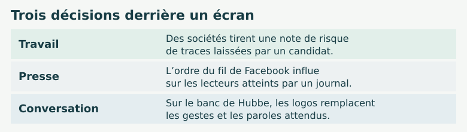

# X-ENS · MP-PC-PSI · Allemand 2019 — Corrigé brut

*Corrigé rédigé par IA, non officiel. Signalez toute erreur.*

**Rédaction** · GPT-6.2 Astra Ultra · vitesse non renseignée

Garde XEULCR, filières MP, PC et PSI. Les deux exercices se rédigent en allemand en quatre heures. A demande une synthèse des quatre documents, sans commentaire personnel, avec un titre et 600 à 675 mots. B demande un texte d’opinion de 500 à 600 mots qui répond aux arguments de l’éditorial.

## A. Synthèse de documents

**Wer entscheidet, was ein Klick bedeutet?**

Zwei Jugendliche sitzen nebeneinander, jeder auf sein Telefon konzentriert. In Phil Hubbes Karikatur erscheinen über ihnen der Vogel von Twitter und das Zeichen für Zustimmung auf Facebook. Zwei Erwachsene deuten das Schweigen auf der Bank als besorgniserregendes Zeichen. Tatsächlich findet Kommunikation statt, nur können die Beobachter sie kaum sehen. Die drei Pressetexte verfolgen eine ähnliche Verschiebung für den Arbeitsmarkt, die Öffentlichkeit und den Alltag. Wer über die Spuren digitaler Kommunikation verfügt, kann ihnen Bedeutungen geben, von denen die Betroffenen zunächst nichts erfahren.

Auf dem Arbeitsmarkt wird aus einer Äußerung über den Umweg einer Software ein Urteil über die Person, die sie gemacht hat. Michael Moorstedt beschreibt Firmen, die Arbeitgebern die Auswertung öffentlich zugänglicher Beiträge von Bewerbern anbieten. Ein weiteres Unternehmen richtet sich sogar an Familien, die etwa einen Babysitter suchen. Für einen festen Preis erhalten sie eine Einstufung in mehrere Risikokategorien. Das Versprechen des Dienstleisters lautet, eine schwer zu beurteilende persönliche Eigenschaft messbar zu machen. Der Artikel stellt diesem Anspruch die Schwierigkeit gegenüber, Ironie, bildliche Sprache und den ursprünglichen Zusammenhang einer Bemerkung zu erkennen. Ein sichtbarer Beitrag liefert zwar Material für eine Auswertung; ob die vergebene Note etwas über die Zuverlässigkeit am künftigen Arbeitsplatz aussagt, bleibt fraglich.

Bei Nachrichtenportalen werden die Beiträge nicht nach dem vermeintlichen Charakter eines Bewerbers geordnet. Dennoch kann eine Entscheidung im Hintergrund ähnlich folgenreich sein. Zeitungen erreichen einen erheblichen Teil ihrer Leser über Facebook. Ändert die Plattform die Reihenfolge der Beiträge im Nachrichtenstrom, kann ein Artikel plötzlich kaum noch sein Publikum erreichen, obwohl sein Inhalt unverändert bleibt. Ein amerikanisches Portal wie Vice erhielt nach den im Artikel genannten Zahlen fast die Hälfte seiner Seitenbesucher über Facebook. Die brasilianische Zeitung Folha de São Paulo entschied sich angesichts solcher Abhängigkeit, die Verbreitung eigener Artikel auf der Plattform einzustellen. Dieser Schritt zeigt zugleich das Dilemma: Unabhängigkeit vom Vermittler kann den unmittelbaren Kontakt zu vielen Interessierten kosten.

Die Sortierung beeinflusst darüber hinaus, was überhaupt als Nachricht erscheint. Im persönlichen Strom steht ein Ereignis unter Freunden neben einer Meldung über eine Naturkatastrophe. Beides kann für denselben Nutzer interessant sein, doch nur eines würde eine Redaktion schon wegen seiner öffentlichen Bedeutung auswählen. Dass Plattformen journalistische Projekte finanziell unterstützen, löst diesen Konflikt nicht ohne Weiteres. Das Interesse der Anbieter an häufig angeklickten Inhalten deckt sich nur teilweise mit dem Interesse einer Redaktion, auch unbequeme und wenig populäre Themen sichtbar zu machen. Die gleichen technischen Möglichkeiten, die neue Leser zu einem Bericht führen, erlauben es dem Vermittler also auch, dessen Verbreitung zu begrenzen.

Warum Nutzer sich trotzdem immer wieder auf die Plattform begeben, erklärt der frühere Facebook-Präsident Sean Parker mit dem Bedürfnis nach sozialer Bestätigung. Die Aussicht auf eine Reaktion veranlasse Nutzer dazu, Beiträge zu veröffentlichen und nachzusehen, wie andere darauf reagieren. Seine Kritik an diesem Geschäftsmodell hat besonderes Gewicht, weil er selbst am Aufbau des Unternehmens beteiligt war. Sie enthält zugleich Fragen, etwa nach den langfristigen Folgen für Kinder, die der Bericht nicht durch einen wissenschaftlichen Nachweis beantwortet. In Hubbes Zeichnung treten die Symbole der Dienste sogar dort an die Stelle von Sprechblasen, wo zwei Menschen einander unmittelbar ansprechen könnten. Die zugespitzte Bemerkung der Erwachsenen verrät allerdings auch, wie schwer die neue Form der Verständigung von außen zu deuten ist.

Insofern bildet der scheinbar private Augenblick auf der Bank die andere Seite eines wirtschaftlichen Vorgangs. Die Aufmerksamkeit, die den Beobachterinnen vor Ort fehlt, steht den Diensten für die Verbreitung weiterer Beiträge zur Verfügung.

Damit hängen drei scheinbar getrennte Entscheidungen zusammen: ob jemand als vertrauenswürdig gilt, welche Meldung viele Leser erreicht und welchem Gegenüber ein Nutzer seine nächste Minute widmet. In jedem Fall wird eine vorhandene Spur ausgewählt, bewertet und in eine weitere Entscheidung übersetzt. Die Reichweite dieser privaten Regeln geht inzwischen über den Austausch zwischen denjenigen hinaus, die einander auf dem Bildschirm unmittelbar begegnen.

*621 Wörter.*

## B. Texte d’opinion

Jürgen Marks plädiert für einen digitalen Führerschein und für eine einfache Regel am Esstisch: Man kann das Telefon auch einmal beiseitelegen. Ich stimme ihm darin zu, dass wir den Umgang mit einem so vielseitigen Gerät lernen müssen. Doch wer das Problem vor allem als mangelnde Disziplin des Einzelnen beschreibt, verlangt von einer Familie etwas, das Anbieter und Schulen ebenso angeht. Eine hilfreiche Gegenstrategie müsste bei den Situationen beginnen, in denen jemand tatsächlich die Kontrolle über seine Zeit verliert.

Die von Marks genannten durchschnittlich 88 Blicke auf das Gerät an einem Tag sind eindrucksvoll. Sie erklären aber noch nicht, welche davon ein Problem darstellen. Eine Pflegekraft, die auf eine Nachricht aus dem Krankenhaus wartet, eine Schülerin, die eine Busverbindung prüft, und ein Erwachsener, der beim Abendessen gedankenlos Meldungen öffnet, tun äußerlich dasselbe. Einen Unterschied macht, ob sie das Gerät zu einem bestimmten Zweck benutzen und danach wieder zur vorigen Tätigkeit zurückkehren können. Die Häufigkeit allein sollte deshalb weder als Diagnose noch als moralisches Urteil dienen.

Ein digitaler Führerschein könnte nützlich sein, wenn man darunter eine Reihe praktischer Übungen versteht. Eine Klasse könnte zum Beispiel untersuchen, wie dasselbe Foto je nach Ausschnitt und Bildunterschrift verschiedene Geschichten erzählt. Anschließend könnten die Jugendlichen überprüfen, welche Mitteilungen eine neu eingerichtete Anwendung von sich aus sendet und was geschieht, wenn sie diese abschalten. Eine Woche später ließe sich besprechen, welche Einstellungen sich bewährt haben. Eine Prüfung, nach der die Erwachsenen das Problem für erledigt halten, wäre weniger überzeugend. Die Gewohnheiten einer Gruppe und die Gestaltung der Dienste ändern sich auch nach bestandener Prüfung.

Bei der Verantwortung der Eltern verdient ein Punkt mehr Aufmerksamkeit. Wer selbst während eines Gesprächs jede Arbeitsnachricht beantwortet, wird einem Jugendlichen schwer erklären können, warum dessen Nachrichten bis nach dem Essen warten sollen. Eine verabredete gemeinsame Pause wäre glaubwürdiger, wenn auch Erwachsene ihrem Arbeitgeber Grenzen setzen können. Zugleich sollte sie Ausnahmen zulassen, etwa für eine dringende Nachricht von einem Angehörigen. Das Ziel einer Regel ist, eine gemeinsam gewünschte Unterhaltung zu ermöglichen. Wer das Handy nur vom Tisch verbannt, ohne sich dann für die Menschen am Tisch zu interessieren, hat wenig erreicht.

Schließlich dürfen Unternehmen sich ihre Rolle nicht durch den Hinweis auf die Selbstbestimmung der Nutzer leichtmachen. Eine Anwendung kann neue Beiträge erst dann zeigen, wenn ich sie öffne. Sie kann mich aber auch bei jeder Reaktion unterbrechen und mir sofort eine weitere anbieten. Bevor Schulen viel Zeit darauf verwenden, jede einzelne Voreinstellung zu erklären, könnten Anbieter begründen müssen, warum eine Unterbrechung überhaupt als Standard vorgesehen ist. Auch die Möglichkeit, eine Klasse oder einen Freundeskreis zu erreichen, sollte nicht davon abhängen, ständig auf Empfang zu sein.

Eine Schule könnte deshalb für wichtige Mitteilungen einen Weg vereinbaren, der auch dann funktioniert, wenn jemand ein Wochenende offline verbringt. Dann wäre die Aufforderung zur Pause mehr als ein gut gemeinter Rat.

Ich würde den Erfolg also weder an möglichst wenig Bildschirmzeit noch an der Zahl ausgestellter Führerscheine messen. Kann jemand ein bearbeitetes Bild einordnen, eine Nachricht auf später verschieben und einen hilfreichen Kontakt weiterhin pflegen? Wenn Kinder und Erwachsene darüber miteinander sprechen können und die Dienste ihnen echte Wahlmöglichkeiten lassen, wird aus Marks’ Forderung nach Beherrschung der digitalen Welt eine Fähigkeit, die sich im Alltag erproben lässt.

*531 Wörter.*

Le rapport porte sur MP et PC. La garde du sujet inclut également PSI.

[Cahier d’allemand, A1–A3 p. 3–7, dessin p. 8, B p. 9–10](https://banques-ecoles.fr/cms/wp-content/uploads/2019/10/2019_MPPC_sujet_All.pdf) · [Rapport de l’écrit, p. 1–2](https://banques-ecoles.fr/cms/wp-content/uploads/2020/01/19_MPPC_rapport_eAll.pdf)
