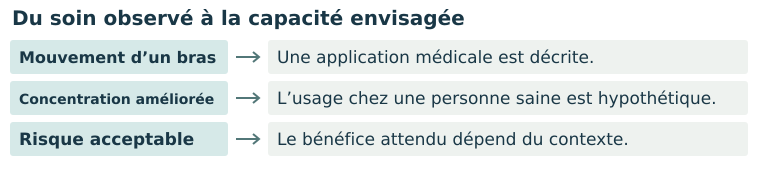

# X-ENS · MP-PC-PSI · Anglais 2019 — Corrigé guidé

*Corrigé rédigé par IA, non officiel. Signalez toute erreur.*

**Rédaction** · GPT-6.2 Astra Ultra · vitesse non renseignée

Le cahier XEULCR prévoit quatre heures pour les deux parties. Dictionnaires et outils de traduction interdits. La partie A demande une synthèse en anglais de 600 à 675 mots, précédée d’un titre, qui croise les documents 1 à 4 dans leur contexte géographique, sans commentaire personnel. La partie B demande un texte d’opinion en anglais de 500 à 600 mots en réaction au document de la seconde partie. Les décomptes portent sur le corps du texte, hors titre.

Le tableau de Pew et l’article de Gina Kolata rendent compte de la même enquête. Ils apportent deux éclairages sur une source commune. Séparer les applications médicales évoquées comme réelles des trois usages hypothétiques soumis aux adultes américains.

## A. Synthèse de documents

**Attribuer les positions.** Church rapproche les projets actuels de pratiques anciennes. Johnston examine les risques acceptables selon la finalité et souhaite que les scientifiques contribuent collectivement aux décisions. Bidshahri interroge la part de chance déjà admise dans le mérite. Le sondage américain permet de confronter ces prises de position à des anticipations déclarées.

**Lire une ligne horizontalement.** Pour l’anticipation d’un usage prématuré, les trois valeurs atteignent 73 %, 74 % et 73 %. Pour la productivité au travail, elles sont de 32 %, 55 % et 46 %. Les répondants évaluent plusieurs conséquences séparément. Les pourcentages ne s’additionnent pas et n’expriment pas une probabilité médicale.

**Better by Whose Measure?**

A cup of coffee rarely prompts a debate about the future of the species. A brain implant intended to improve concentration does. Yet both can be described as attempts to extend an ordinary human capacity. The New York Academy of Sciences and Raya Bidshahri in Singularity Hub examine the continuity between familiar practices and prospective enhancements. Gina Kolata in the New York Times and a Pew Research Center graphic explore Americans' responses to three imagined applications. Across the documents, the decisive questions concern what counts as an improvement, who would benefit and who could reasonably accept the risks.

The Academy reports geneticist George Church's comparison with vaccines, transport and smartphones. Human beings have long enlisted tools to overcome biological limits. For Bidshahri, however, the increasing speed and invasiveness of intervention give an old ambition new force. Kolata helps locate the distance between clinical achievement and speculative enhancement. A device allowing a paralysed man to move his arm offers evidence of a particular medical benefit. It does not establish the feasibility of making a healthy person think more effectively. Similarly, replacing donated blood in treatment and giving someone extraordinary physical endurance would serve distinct purposes even if the same word described the material involved.

That distinction changes the terms on which risks are accepted. As bioethicist Josephine Johnston explains to the Academy, a patient facing serious illness may reasonably accept uncertainty that would have little justification in an intervention offered to someone who is well. Kolata reports greater American acceptance of restoring a person's physical capacities than of exceeding them. Nevertheless, there is no simple public endorsement of every preventive application. In Pew's chart, 73 per cent expect an intervention to reduce disease risk in babies to be used before its effects are sufficiently understood. The corresponding shares for a cognitive implant and for synthetic blood are 74 and 73 per cent. These are expectations about how decisions will be made, distinct from estimates of medical danger.

Improvement also depends on a society's standards of achievement. Bidshahri questions the assumption that an unassisted performance reflects individual merit alone. A natural endowment that makes learning easier owes something to chance. Altering someone's starting point could therefore challenge an existing inequality as well as create another one. Johnston, however, draws attention to pressure to conform to a narrow definition of what makes a person better. The Pew figures give the distributional concern considerable weight. Seven in ten American adults expect access restricted to the wealthy to increase inequality in the case of reduced disease risk, and a slightly larger proportion foresee this with cognitive implants.

The public can anticipate advantages at the same time. In Pew's graphic, 55 per cent expect recipients of a brain chip to become more productive at work, while 73 per cent anticipate greater inequality from that technology. The questions allow both judgements to coexist. Kolata's discussion of religious differences also shows why expert assurances about performance could settle only part of the debate. Some respondents place interventions within a history of human self-improvement, while others see limits to the acceptable alteration of nature. Bidshahri adds the possibility of pressures from governments or institutions, raising questions about an individual's continuing ability to decide.

For the American researchers, commentators and respondents, then, the prospect of a technically successful intervention is only the beginning of an argument. Church points to existing standards for responsible research. Johnston asks scientists to participate collectively in policy while recognising the limits of any individual researcher's authority. Whether a future application improves lives will depend on the purposes people can choose for themselves, the alternatives available to those who decline and the terms under which its benefits are shared.

*613 mots hors titre.*

## B. Texte d’opinion

**Répondre à Nosta.** Son raisonnement relie l’étroitesse de notre perception biologique à l’idée d’une humanité « améliorée ». L’image de la destinée manifeste donne à cette trajectoire la force d’une obligation historique. Le texte peut reconnaître le gain d’un appareil auditif programmable, puis contester cette obligation au nom du choix de la personne. L’éditorial figure sous « B – Document 1 » à l’intérieur du cahier.

**Let the Listener Choose**

John Nosta invites readers of Fortune to feel a little sorry for the human being equipped with ordinary senses. I find it hard to pity the person who made a violin, wrote a quartet or learned to hear the difference between two interpretations of a phrase. All three worked within a narrow band of audible frequencies. Better instruments can give us access to experiences beyond that band. I welcome the invitation to explore them. I question Nosta's suggestion that accepting it would make any of us more human.

His examples are persuasive when they start with somebody's own purpose. A hearing aid that can be adjusted to a busy restaurant may make the difference between following a friend's story and smiling politely at guesses. That achievement cannot be measured simply by counting the frequencies reaching an ear. Indeed the user may need fewer competing sounds to hear the one voice that matters. Nosta treats access to more of reality as an obvious gain. His own example suggests a richer principle. A good instrument lets its owner choose what deserves attention.

There is real intellectual pleasure in extending our senses. An astronomer who turns radio signals into a map can discover structures no eye could ever see. The rest of us can share that discovery by learning to read the map. Nobody need implant a receiver to participate in the achievement. Some advances will work best inside a person's body, others on a laboratory bench or in a public library. If we judge an invention by what people can understand and do together, all three settings count. An enthusiastic reader of Nosta might otherwise mistake bodily modification for the only route forward.

What worries me most is his appeal to manifest destiny. The American expansion celebrated under that name looked rather different to people whose land was treated as waiting to be claimed. A metaphor of conquest conceals the person entitled to say no. Consider a worker offered unusually acute hearing to detect faults in machinery. It might be an attractive option until the employer starts measuring every colleague against the volunteers. The same device could broaden one person's opportunities and narrow another's without any change in its engineering.

I would ask practical questions of a proposed enhancement. Can its user turn it off? Can she keep the job if she declines it? Does she decide who sees the information it collects? Can a person who needs a device to communicate afford repairs once the original supplier loses interest? These questions concern the freedom a technology creates across its lifetime. They are especially important when a gadget becomes part of somebody's body and a faulty update can interrupt an ordinary conversation.

Nosta is right that the boundaries of human perception have never been final. He is also free to seek colours, sounds or abilities for which we have no names. I would call that curiosity a recognisably human quality. I would say the same of the listener who switches off the extra channels to attend to a friend. The measure of progress is whether both have a genuine choice.

*518 mots hors titre.*

Dans le cahier de huit pages, l’éditorial de John Nosta est identifié comme premier document de la partie B. Il correspond à la pièce d’opinion annoncée sur la garde. Sujet et rapport annuels consultés.

[Sujet officiel](https://banques-ecoles.fr/cms/wp-content/uploads/2019/10/2019_MPPC_sujet_Angl.pdf) · [Rapport du jury](https://banques-ecoles.fr/cms/wp-content/uploads/2019/11/19_MPPC_rapport_eAng.pdf)
