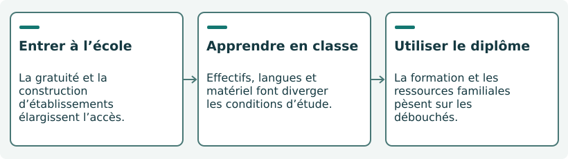

# X-ENS · MP-PC-PSI · Arabe 2019 — Corrigé brut

*Corrigé rédigé par IA, non officiel. Signalez toute erreur.*

**Rédaction** · GPT-6.2 Astra Ultra · vitesse non renseignée

Écrit commun de quatre heures, code XEULCR. La partie A croise les trois articles et l’image du dossier. La partie B répond à l’éditorial séparé. Le rapport de l’écrit porte sur les filières MP et PC, et la garde du sujet inclut également la PSI. La synthèse compte 633 mots hors titre et l’opinion 523, en comptant les unités séparées par des espaces.

## A. Synthèse du dossier

من مقعد للجميع إلى تعليم على قدر الدخل: المدرسة والحراك الاجتماعي في البلدان العربية

جمع أبناء الأحياء والقرى المختلفة في المدرسة نفسها مشروع حمل في مراحل من التاريخ العربي وعدا بتغيير موقع الإنسان في المجتمع. بيد أن التوسع في التعليم ترافق في بلدان عديدة مع تباعد بين ما يتعلمه المرء في مؤسسة وأخرى وما يتيحه له ذلك بعد التخرج. يتتبع الملف التحول من تحسين فرص الوصول إلى تكريس فروق جديدة في نوعية الدراسة. وبين قراءة رحاب الخترشي لدور المدرسة العام، وتحليل علي أسعد وطفة للتعليم الخاص في الخليج، وتجربة الأردن المعروضة في صحيفة الغد، يبرز سؤال عما يبقى من المساواة إذا أصبح الحصول على تعليم ذي قيمة مرتبطا بما تستطيع الأسرة أن تدفعه.

ترد الخترشي الطموح إلى نشر التعليم إلى تاريخ ربط المعرفة بالحرية والقدرة على المشاركة في حياة المجتمع منذ عصر التنوير في أوروبا. ويبين وطفة كيف اكتسب الطموح نفسه معنى سياسيا وثقافيا في البلدان العربية بعد الاستقلال. فالمدرسة المجانية الإلزامية تجمع حول لغة وثقافة مشتركتين فئات كانت متفرقة، وتفتح بابا للعمل أمام أبناء لا يملكون ما يضمن لهم مكانة آبائهم أو يحسنها. وفي الأردن تحديدا أتاح التعليم الجامعي في السبعينيات والثمانينيات لآلاف من أبناء البادية والريف والمدن دخول الطبقة الوسطى، عن طريق وظائف محلية أو فرص عمل في الدول النفطية. واتسع إقبال الفتيات على مختلف المراحل حتى تقلصت الفجوة بين الجنسين في الالتحاق.

ولم يبدأ التعليم الخاص من فراغ عند تراجع هذا المشروع. يذكر وطفة مدارس تمتعت بامتيازات أجنبية منذ أواخر العهد العثماني، ثم انحسر بعض نفوذها مع نشأة التعليم الوطني. أما توسع الاستثمار الخاص في العقود الأخيرة فيندرج، كما توضح الخترشي، في تحول اقتصادي أوسع شمل خدمات كانت الدولة تتولاها. وتبين أرقام الأردن أن القطاع الخاص كان يملك نحو ثمانية وثلاثين في المئة من المدارس في السنة الدراسية ألفين وسبع وألفين وثمان، ويدرس فيها نحو أربعة وعشرين في المئة من الطلبة. فوجود مؤسسات كثيرة لا يعني أنها تستقبل نسبة مماثلة من مجموع التلاميذ، ولا أن اتساع القطاعين تم في ظروف متماثلة.

ومن هنا يختلف السؤال المطروح على الوزارة عن السؤال الذي يطرحه الوالدان، إذ يتعلق الأول بما يحصل عليه مجموع التلاميذ، فيما ينصب الثاني على الإمكانات المتاحة لطفل بعينه في المكان الذي يقيم فيه.

ويتبدى أثر هذا التطور داخل الصف. فاللغات الأجنبية والبرامج التي تلائم بعض الامتحانات الدولية والتجهيزات الحديثة وعناية المدرس بحاجات التلميذ الفردية عناصر تغري الأسرة الميسورة بالتوجه إلى مؤسسات خاصة. وفي المقابل يختصر الرسم المنشور مع مقال عن الطبقية في التعليم وضع الفصل المكتظ. يتزاحم التلاميذ صفوفا متراصة أمام مقاعد قليلة، ويحاول المعلم أن يعلن أن درس اليوم عن يوم الحشر. تحيل العبارة إلى موضوع الدرس الديني وإلى حشد الأجساد الذي يملأ المكان في آن واحد. وبهذا تتحول صورة نجاح المدرسة في جمع أعداد كبيرة إلى سؤال ساخر عن إمكان الإصغاء لكل واحد منهم أو مساعدته حين يتعثر.

ويبرز عند الخترشي معنى أعمق لهذا التفاوت في قراءتها لتحليل بيير بورديو. فحتى إذا دخل أبناء الطبقات المختلفة مدرسة واحدة، يصل بعضهم ومعه أساليب تعبير وعادات ثقافية قريبة مما تقبله المدرسة وتكافئه. وعندما تنقسم المؤسسات ذاتها بحسب الرسوم التي يقدر الأهل عليها يضاف اختلاف البيئة المدرسية إلى اختلاف الموارد المنزلية. ويصف وطفة أسرا تثقلها تكاليف التعليم الخاص، فيما تتراجع فرص الاختلاط بين أبناء الفئات المتباينة. وليس قرار الوالدين بالبحث عن فرصة أفضل لطفلهما في حد ذاته سعيا إلى إضعاف التعليم المشترك، غير أن اجتماع قرارات من هذا النوع قد يرسخ الفصل الذي يصفه المقالان.

ويكشف المثال الأردني النتيجة عند الانتقال إلى الجامعة وسوق العمل. فبعد أن أسهم انتشار الشهادة في تغيير أوضاع عائلات عديدة، غدا نوع البرنامج واللغة التي أتقنها الخريج واسم المؤسسة التي درس فيها مؤثرة في الفرص المتاحة له. ويفسر ذلك كيف يستمر تزايد أعداد الملتحقين فيما تضعف وظيفة التعليم بوصفه وسيلة للصعود الاجتماعي. ولا يعرض النص الأردني العودة إلى الوراء باعتبارها أمرا سهلا، بل يشير إلى إصلاح التعليم العام المدرسي والجامعي كي يستعيد قدرته على توفير بدائل ذات قيمة. فالفارق الحاسم بين نظام يجمع المواطنين وآخر يعيد توزيعهم بحسب أصولهم لا يظهر في أعداد المقاعد وحدها، وإنما في المعرفة التي يحصلون عليها فيها وفي الآفاق التي تحملها لهم تلك المعرفة.

## B. Texte d’opinion

تلفت فيروز عمر النظر إلى مفارقة واضحة: قد توقع دولة اتفاقية تكفل المساواة في التعليم ثم يظل عنوان البيت الذي ولد فيه الطفل أفضل وسيلة للتنبؤ بما سيتعلمه. أتفق معها في أن فتح أبواب المدارس لا يكفي لتحقيق حق متساو، لكنني أفضل أن نختبر هذه الفكرة بالسؤال عما يجري في يوم عادي من أيام الدراسة. متى خرج التلميذ من بيته؟ من شرح له ما لم يفهم؟ وهل كان عليه أن يدفع ليجد شرحا ثانيا؟ في الإجابة عن هذه الأسئلة يبدأ في رأيي الفرق بين وعد أخلاقي وسياسة يمكن أن نطالب المسؤولين بنتائجها.

تورد الكاتبة عن تقرير نشر سنة ألفين واثنتي عشرة أن نسبة من يفتقرون إلى مهارات أساسية من الشباب الفقراء في المغرب بلغت ستة وسبعين في المئة في المدن وتسعين في المئة في الريف. لا أستنتج من ذلك أن الطفل القروي أقل استعدادا للتعلم. أتخيل فتاتين تدرسان المقرر نفسه، تنزل إحداهما من بيتها إلى مدرسة قريبة فيما تنتظر الأخرى حافلة لا تصل كل صباح. إتاحة نشاط للمراجعة بعد انتهاء الدروس ستفيد الأولى، وقد تبقى الثانية محرومة منه إذا غادرت حافلتها الوحيدة قبل موعده. ولذلك أدافع عن توزيع للموارد يعطي الأبعد والأشد حرمانا حصة إضافية، ويشرك الأسر في تحديد العقبة التي ستعالج بهذه الحصة.

وتنتقد الكاتبة تحوّل التعليم إلى سلعة وتضرب مثلا بمراكز الدروس الخصوصية. لا ألوم أبا يدفع ثمن ساعة إضافية قبيل امتحان يحدد مستقبل ابنه، لكنني أقلق حين يصبح فهم درس عادي رهنا بدفع مبلغ خارج المدرسة. هناك تضارب واضح إذا كان الشخص الذي يقيم التلميذ هو أيضا من يبيع الإعداد لاختباره. أؤيد عندئذ إتاحة ساعات دعم مجانية داخل المؤسسة وتعويض المدرسين عن العمل فيها، وتنظيم تقويم مشترك يمكن مراجعته. ومن العدل كذلك أن تتوفر للمعلم أدوات ووقت للشرح ضمن الدوام، كي لا نطالبه بأن يحل مشكلة تتسبب فيها ظروف عمله ثم نحاسبه وحده عليها.

وقد يقال إن ترك مجال واسع للجمعيات والمدارس الخاصة يوفر على الدولة أموالا تحتاج إليها لبناء مؤسسات جديدة. أرى أن المساهمة مفيدة حين تضيف مكتبة أو وسيلة نقل أو خبرة إلى ما يستطيع الجميع بلوغه. لكنها لا ترفع مسؤولية الدولة عن ضمان تعلم حقيقي لمن لم يختره صاحب مبادرة خيرية. ويحق لنا أن نسأل أيضا من يضع المناهج ومن يملك الاعتراض عليها. لا تصلح مركزية تخنق ما يقترحه المعلم في قريته، كما لا يصلح سوق يقرر فيه الممول وحده أي معرفة تستحق الوقت. تستطيع السلطة أن تضمن تمويلا مستقرا وتترك للمعلمين والأهل مجالا لتكييف الوسائل مع الحاجات.

وأحب أن أضيف ضمانة للشفافية هنا. فمن حق قرية لا ترى أثرا للإنفاق المعلن أن تطلع على الوظائف الشاغرة في مدرستها وعلى مواعيد شغلها، وأن تجد جهة تجيب عن اعتراضها في أجل معلوم. هذه معلومة بسيطة، لكن إتاحتها تنقل النقاش من تبادل الوعود إلى متابعة قرار محدد.

وأخيرا لا أختزل ثمرة المدرسة في أول أجر يحصل عليه خريجها، على أهمية أن تفتح له طريقا إلى الكسب. فالقدرة على فهم عقد، أو على مناقشة قرار بلدي، أو على متابعة تعلم جديد بعد تبدل المهنة، جزء من العدالة أيضا. ولو نشرت مدرسة نتائجها السنوية لأردت أن أعرف، إلى جانب عدد الناجحين، ما تعلمه الذين دخلوا إليها وهم الأبعد عن المستوى المطلوب. عندها يمكن للأسرة أن تسأل عن أثر الدرس، وللمعلم أن يرى موضع التحسن، وللممول أن يحكم على جدوى إنفاقه. وتكون المساواة قد خرجت خطوة من نص الاتفاقية إلى حياة التلاميذ.

[Synthèse p. 3–9. Texte d’opinion p. 10–11.](https://banques-ecoles.fr/cms/wp-content/uploads/2019/10/2019_MPPC_sujet_Arabe.pdf) · [Rapport du jury de l’écrit.](https://banques-ecoles.fr/cms/wp-content/uploads/2019/11/19_MPPC_rapport_eAra.pdf)
