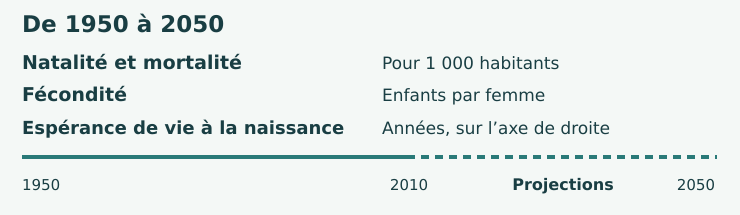

# X-ENS · MP-PC-PSI · Chinois 2019 — Corrigé guidé

*Corrigé rédigé par IA, non officiel. Signalez toute erreur.*

**Rédaction** · GPT-6.2 Astra Ultra · vitesse non renseignée

Mardi 23 avril 2019, de 14 h à 18 h, épreuve n° 6, XEULCR, commune aux filières MP, PC et PSI de l’École polytechnique, de l’ESPCI et des ENS. La garde interdit le dictionnaire et la machine à traduire. A demande une synthèse en chinois des documents 1 à 4, en 600 à 675 mots, avec titre et sans opinion personnelle. B demande une réaction argumentée en chinois à l’éditorial 5, en 500 à 600 mots.

## A. Synthèse de documents

> [!INDICATION]
> **Partir d’une question à laquelle les sources répondent ensemble.** Les années vécues, la fécondité et les taux de naissance et de décès appartiennent à la dynamique démographique. Le foyer dit « 4–2–1 », quatre grands-parents, deux parents, un enfant, manifeste une concentration des responsabilités. Le jury relève la confusion entre ce symptôme et les causes du vieillissement. A1 donne un effectif de personnes âgées en 2014 sans en définir explicitement ici le seuil d’âge, puis une série distincte concernant les 65 ans ou plus.

> [!INDICATION]
> **Différencier les témoignages et lire la figure.** À Luoyang, les parents de Xu Xiaobo ont des pensions et partagent son domicile. Ils hésitent pourtant à parler de leur santé à leur fille. À Fuzhou, l’achat public de services confiés à un opérateur est décrit au centre 福机新苑. Le témoignage de Mme Yang porte sur le centre de 鼓东街道. Les 3 100 yuans mensuels, repas compris, concernent sa situation. Dans A4, espérance de vie à la naissance, fécondité, natalité et mortalité sont quatre séries différentes. Les segments en pointillé, après 2010, représentaient des projections au moment de la publication de la figure en 2013. Le titre de A et sa conclusion peuvent désormais répondre à la même question sur les conditions réelles de la prise en charge.

**当孩子照顾不过来，谁来接住老年生活？**

洛阳一位年轻母亲与父母同住，却忙得连老人身体不舒服也未必知道。福州一位儿女常年不在身边的老人，反而有人全天照料，还能找到同伴聊天。两段报道的差别提出了一个问题：中国老年人口迅速增加时，老人能否得到照顾，究竟取决于子女住得多近，还是取决于身边有没有能够实际提供帮助的人和服务？

要理解这两家的处境，先要看需要照料的人数和人口结构怎样变化。腾讯新闻刊载的文章说，到二〇一四年底，中国老年人口已超过两亿。若看六十五岁及以上人口在总人口中所占的比重，二〇一五年已经达到百分之十。文章援引的预测认为，这一比例到二〇三〇年可能达到百分之十八，到二〇五〇年约为三分之一。前一组说的是人数，后一组说的是有明确年龄界限的人口比例。仅仅知道全国有多少老人，还看不出同一时期有多少年轻人可能承担照料工作。

从一九五〇年到二〇五〇年的图表把变化放进了更长的时间里。图中出生率长期下降，每名妇女生育的孩子数也明显减少，与此同时，出生时的预期寿命不断延长。走过同样长的一段时间，更多人能够活到老年，而较年轻的一代人数相对减少。图中后半段的虚线是对未来的推算。它能说明趋势，并不等于那些年份的情形已经发生。第一代独生子女的父母陆续变老，正使这种人口变化在许多家庭里集中显现。

新华社网站所写的徐晓博夫妇都是独生子女，还要照料两岁的孩子。徐的父母是退休教师，经济上压力不大；真正让她担心的是万一老人病倒，谁能在需要的时间赶来。她的父母有点小病也不愿对她说，正因为他们知道女儿得在上班和育儿之间奔忙。将来四位老人都有可能需要帮助，而两个成年人每天可以拿出来的时间毕竟有限。因此，“四二一”家庭让人看见的是养老责任集中在少数子女身上的后果。有养老金、有儿女、甚至与儿女同住，都不足以保证生活照料和情感交流随时有人承担。

福州的报道展示了家庭以外的安排。福机新苑的社区照料中心由政府购买服务、企业运营，把体检康复、活动、上门服务和送餐组织起来，使一些生活所需可以在熟悉的社区内得到满足。在鼓东街道的照料中心，杨奶奶每月支付三千一百元，费用包括伙食。她看重的不只是日夜有人帮忙，也包括有人可以说说日常生活里的事。两个例子把养老的不同内容具体区分开来：有些工作需要连续值守，有些可以送到家门口，另一些则依靠同龄人之间经常见面而建立的关系。

在这样的安排下，子女即使工作繁忙，老人也可以按时吃饭、到中心参加活动；而服务中心提供的帮助，也各有自己的费用和条件。报道中的一位住户满意，仍不足以判断所有家庭都能负担同样的服务。

因此，人口老龄化带来的压力，既体现为总量增加，也体现为家庭能够提供的时间同老人所需帮助之间的距离。社区服务可以在这个距离里发挥作用。它如何衔接家人的支持，决定了人口结构的变化将怎样落实到每一位老人每天的生活中。

Le découpage lexical indicatif donne 650 mots hors titre et ponctuation.

## B. Texte d’opinion

> [!INDICATION]
> **Reconstituer le débat.** L’éditorial de Chen Xingjie prend pour point de départ une déclaration de l’économiste Li Daokui. Des critiques craignent que les seniors occupent les postes des jeunes. Chen répond que des compétences particulières et les dépenses de ceux qui travaillent peuvent créer de l’activité. Il reconnaît aussi la contribution de ceux qui gardent leurs petits-enfants. Distinguez la thèse du journaliste de la déclaration de l’économiste et de l’objection qui leur est faite.

> [!INDICATION]
> **Tester où chaque argument s’applique.** Une transmission de savoir-faire dans un atelier illustre la complémentarité des emplois. Une embauche différée dans un service à effectif fixé montre sa limite immédiate. Introduisez ensuite les différences de santé, d’usure au travail et de débouchés selon le territoire, que le rapport invite à prendre en compte. La conclusion propose des critères vérifiables pour le travail choisi et pour le droit au repos. En relisant le chinois, distinguez la particule nominale 的, l’adverbiale 地 et la marque de complément 得, trois formes signalées par le jury.

陈兴杰认为，让老人继续工作，是老龄化社会为自己寻找出路的一种办法。我赞成愿意就业的老人有机会继续工作，却不赞成把一份工资看成老人有没有给年轻人添负担的证明。一个合适的政策应当同时回答两个问题：愿意留下的人有没有岗位，劳动了一辈子想停下来的人能不能安心退休？

说老人工作一定会挤走年轻人，把岗位想成了数目永远不变的一排椅子。比如，一名有多年经验的维修师傅可以改为每周来两天，带学徒判断那些从书本上不容易看出的故障。企业因此敢接原来不敢接的活，年轻人也有机会学会独立上手。这里两代人的工作可以互相补充。但在人员名额已经确定、工作内容又完全相同的单位里，眼前确实可能有人要等更久才能得到岗位。只说老人会创造新的需求，还不足以消除一个正在等待机会的人的顾虑。

作者又说，有工资的老人有消费能力，能给社会带来更多就业。这个说法指出了收入的作用，却没有说明收入一定要从继续上班而来。稳定的养老金同样使人敢于消费。而且，老人替子女照料孩子，往往正是年轻父母能够按时到单位的一项条件。若要求老人都去挣工资，家庭可能要另付照护费用，或者由一个年轻人缩短工作时间。此时表面上多了一个领取工资的人，家庭可以使用的时间和收入却未必一起增加。

更重要的是，年龄相同的两个人，作选择的条件可以相差很远。在办公室做过多年设计的人，可能希望以短工时继续参与项目；长期从事重体力劳动的人，身体也许已不容许他再按原来的节奏干下去。大城市可能找得到与经验相符的兼职，小地方可选的岗位却很少。若两个人都因为养老金不够才不得不接受任何工作，即使就业数字上升，也很难说他们的晚年过得更好。

对愿意重新就业的人，也要让他能够在试过以后改变主意。身体状况和家庭安排都会变化，六十五岁时乐于承担的任务，过两年未必仍然合适。

因此，我会把延长职业生活当作一种应当保障的可能。企业可以提供工时较短的岗位、指导学徒的机会和适合身体条件的工作环境，养老金和社区照料则要让拒绝这份工作的人也能过日子。评估这种安排时，除了数有多少老人就业，还应问他们有没有选择、报酬是否合理、原先由他们承担的照护后来由谁接手。只有把有偿劳动和没有工资的贡献都看清楚，我们才可能让两代人真正分担责任。

Le découpage lexical indicatif donne 514 mots hors titre et ponctuation.

Le cahier de 2019 comprend neuf pages, dont une page blanche avant A1 et une après le lexique de B5. La garde mentionne MP, PC et PSI. Le rapport écrit porte sur MP et PC.

[Cahier de chinois, p. 1–9](https://banques-ecoles.fr/cms/wp-content/uploads/2019/10/2019_MPPC_sujet_Chinois.pdf) · [Rapport de l’écrit, p. 1–3](https://banques-ecoles.fr/cms/wp-content/uploads/2020/01/19_MPPC_rapport_eChi.pdf)
