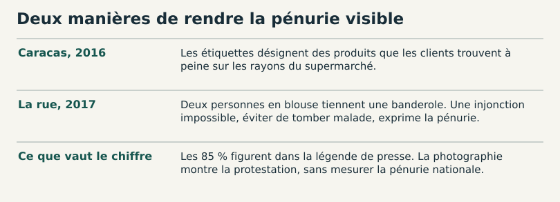

# X-ENS MP-PC-PSI — Espagnol 2019 · Corrigé guidé

*Corrigé rédigé par IA, non officiel. Signalez toute erreur.*

**Rédaction** · GPT-6.2 Astra Ultra · vitesse non renseignée

Le cahier XEULCR des filières MP, PC et PSI prévoit quatre heures sans document. La partie A demande une synthèse en espagnol de 600 à 675 mots, précédée d’un titre. La partie B demande un texte d’opinion en espagnol de 500 à 600 mots, en réponse au document 5. Le rapport de l’écrit concerne les filières MP et PC. Le PDF officiel conserve la garde et une seconde page portant le seul chiffre 2. Le fac-similé collectif donne la garde p. 20, les documents de A p. 22–27 et celui de B p. 28–29. Les titres, les photographies et les publications concordent avec les observations du jury.

## A. Synthèse de documents

> [!INDICATION]
> Interrogez d’abord ce que mesure chaque nombre. Les 2,3 millions de départs correspondent à une estimation du HCR, les 89 retours à une opération médiatisée par le gouvernement. Sur les photos, séparez l’affichage du magasin, le texte revendicatif et le chiffre donné dans la légende. Attribuez les accusations de chaque partie.

**Venezuela, una crisis sin fronteras**

¿Cómo llega un Estado que dispuso de una extraordinaria renta petrolera a perder la capacidad de abastecer a su población y a enfrentarse con sus vecinos por el destino de quienes se marchan? A través de un supermercado, de una manifestación, de los tribunales y de las fronteras, el dossier sigue el deterioro de las condiciones de vida en Venezuela. Su diagnóstico cambia según hablen las organizaciones civiles, el gobierno de Nicolás Maduro o las instituciones encargadas de asistir a los migrantes.

En El Mundo, Nuria López recoge la explicación de Mercedes de Freitas, directora de la sección venezolana de Transparencia Internacional. A su juicio, durante la presidencia de Hugo Chávez se concentró en manos del Estado el poder de comprar alimentos y medicinas, asignar divisas y contratar equipos. A la vez llegaron ingresos petroleros excepcionales sin mecanismos adecuados de fiscalización. La entrevistada admite que resulta difícil calcular el dinero desaparecido. Sí describe consecuencias concretas de ese sistema, desde medicamentos caducados hasta aparatos que el hospital destinatario carece de medios para instalar. Allí donde la Administración controla la importación, un contrato provechoso para un intermediario puede privar a un paciente de la atención que necesita.

Las dos fotografías permiten apreciar dos momentos de esa crisis. En la imagen publicada por El País en enero de 2016, el rótulo de un supermercado caraqueño anuncia embutidos, lácteos y zumos por encima de unos estantes casi vacíos. Los clientes aún circulan por un comercio que en gran parte ha perdido su función. Un año después, en la imagen publicada por El Comercio de Lima, dos personas con bata despliegan en la calle una pancarta que insta a no enfermar porque faltan medicinas. La primera fotografía muestra lo que queda en el punto de venta, mientras la segunda recoge una denuncia pública. La cifra del 85 % de escasez procede del pie de foto, no de un recuento que pueda hacerse a partir de la imagen.

Las críticas a la gestión de los recursos desembocan en una cuestión de justicia. De Freitas observa discrepancias entre fiscales que piden la libertad de jóvenes manifestantes y jueces que les imponen fianzas. En El Nacional, Rafael León recoge testimonios sobre un desplazamiento más profundo de competencias hacia los militares. La organización Provea señala que la contrainteligencia interviene incluso contra ejecutivos bancarios acusados de atacar la moneda. Los abogados consultados subrayan lo que cambia para el detenido civil al comparecer ante un tribunal castrense o ingresar en una prisión militar. Se compromete su derecho al juez que legalmente le corresponde y se dificulta tanto el contacto con sus familiares como el acceso a la defensa.

Las consecuencias alcanzan a los países de acogida. Según BBC Mundo, el organismo de las Naciones Unidas para los refugiados calcula en más de dos millones trescientas mil personas las salidas desde el comienzo de la crisis migratoria, aproximadamente el siete por ciento de la población. Mientras varios gobiernos procuran coordinar la recepción de venezolanos, Brasil contempla limitar las entradas sin cerrar la frontera. Caracas ofrece otra lectura de las salidas. Atribuye la devaluación y la carestía a una ofensiva económica internacional, acusa a medios y gobiernos vecinos de fomentar la xenofobia y da amplia publicidad al regreso de ochenta y nueve personas desde Perú.

Las dimensiones de esas cifras aclaran el desacuerdo. El retorno de un grupo ayuda a ilustrar las dificultades que algunos emigrados encuentran fuera, pero el relato del gobierno lo presenta como confirmación de que salieron engañados. Para quienes denuncian la corrupción y la pérdida de garantías, en cambio, las razones para marcharse se encuentran en instituciones cada vez menos capaces de procurar sustento o protección dentro del país. De ahí que una crisis interna haya pasado a condicionar las relaciones con los vecinos.

## B. Texte d’opinion

> [!INDICATION]
> Le texte d’Héctor E. Schamis date de février 2017, avant plusieurs pièces de A. Identifiez le sens d’« hora cero » et le ton de l’horoscope final. Discutez les conditions du dialogue, la différence entre sanction individuelle et sanction collective et la place des Vénézuéliens dans une issue soutenue de l’extérieur.

Cuando Héctor Schamis habla de la «hora cero» de Venezuela, ve una grieta en la cúpula del poder y una posible coincidencia entre adversarios internacionales. Entiendo por qué considera decisiva la sanción estadounidense contra el vicepresidente y por qué le indigna que, mientras se discutía la suerte de los presos políticos, hubiese nuevas detenciones. Me convence su exigencia de resultados verificables. Me cuesta más compartir su confianza en que un cambio de actitud en Washington acerque por sí mismo a los venezolanos a un gobierno responsable ante sus ciudadanos.

El caso de las cadenas de televisión es revelador. Frente a las denuncias difundidas por CNN, la respuesta que describe Schamis consistió en impedir que los venezolanos vieran la cadena. Quien considere falsa una investigación tiene la posibilidad de publicar documentos, abrir los archivos administrativos y contestar a las preguntas de periodistas independientes. Cerrar la ventana por la que llega la noticia disminuye la capacidad de los ciudadanos para formarse un juicio, incluso de quienes quisieran defender al gobierno. Ahora bien, la obligación de investigar las acusaciones alcanza también a sus adversarios. Una decisión del Tesoro estadounidense puede tener efectos financieros inmediatos sin sustituir el examen contradictorio de las pruebas ante un tribunal.

Precisamente por eso distinguiría entre formas de presión exterior. Congelar bienes de un responsable identificado y permitirle recurrir la decisión puede elevar el coste personal de un abuso. Adoptar medidas generales que dificulten el suministro de medicinas trasladaría el coste a personas que apenas tienen medios para influir en el poder. El criterio para evaluar una sanción debe incluir lo que le ocurre al ciudadano y las condiciones concretas en que se levantará. Si queda indefinidamente en pie, incluso después de una mejora comprobable, pierde su capacidad de inducir cambios y facilita que el gobierno culpe al extranjero de cualquier carencia.

También matizaría el rechazo de Schamis a la palabra diálogo. Tiene razón en que una fotografía de delegados sonrientes puede conceder tiempo y legitimidad a quienes siguen encarcelando rivales. Pero alguien tendrá que negociar, entre otras cosas, las condiciones para que los detenidos recuperen sus derechos. Una mediación creíble podría empezar por una lista pública de casos cuyo seguimiento aceptasen ambas partes, acceso efectivo de abogados independientes y plazos para comprobar los compromisos. Si hay incumplimientos, el mediador debería comunicarlos en lugar de elogiar la simple continuación de las reuniones. Eso permitiría juzgar por sus actos tanto al gobierno como a una oposición que tampoco está exenta de rendir cuentas.

La coincidencia de González y Aznar acerca de los presos muestra que una exigencia de garantías puede atravesar divisiones ideológicas profundas. Daría más valor a ese acuerdo si reforzase la labor de asociaciones venezolanas capaces de documentar abusos y representar a las familias. La Carta Democrática de la OEA proporciona un marco regional para discutir obligaciones que los propios Estados han aceptado. Su utilidad depende de que el debate produzca garantías duraderas dentro de Venezuela. El horóscopo con el que juega Schamis cambia de signo en un día. La posibilidad de publicar una denuncia, defenderse de ella y presentarse libremente a una elección debería sobrevivir a cualquier alineación de los astros.

[Cahier complet, garde p. 20](https://www.alloschool.com/assets/documents/course-300/x-ens-mp-pc-psi-2019-langues-vivantes-2.pdf#page=20) · [Garde officielle et consignes](https://banques-ecoles.fr/cms/wp-content/uploads/2019/10/2019_MPPC_sujet_Esp.pdf) · [Rapport de l’écrit](https://banques-ecoles.fr/cms/wp-content/uploads/2019/11/19_MPPC_rapport_eEsp.pdf)
