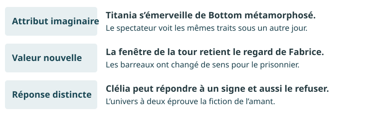

# X-ENS · MP-PC-PSI · Composition française 2019 — corrigé brut

*Corrigé rédigé par IA, non officiel. Signalez toute erreur.*

**Rédaction** · GPT-6.2 Astra Ultra · vitesse non renseignée · 25 novembre 2026

## Sujet et œuvres

Dans l’« Entretien sur les romans » de *Julie ou la Nouvelle Héloïse*, Rousseau attribue à l’amour « un autre Univers », peuplé d’objets imaginaires ou auxquels il aurait lui-même « donné l’être ». Le sujet demande de discuter cette formule à la lumière du *Banquet* de Platon, du *Songe d’une nuit d’été* de Shakespeare et de *La Chartreuse de Parme* de Stendhal.

## Dissertation

Une prison peut-elle devenir le lieu d’où l’on redoute d’être délivré ? Dans *La Chartreuse de Parme*, Fabrice s’attache à la tour Farnèse parce qu’il y aperçoit Clélia. Pour ses amis, les murs continuent à signifier la contrainte et le danger. Pour lui, ils entourent désormais une promesse dont la liberté le priverait peut-être. Quel est le véritable lieu que Fabrice habite ? Dans l’« Entretien sur les romans », Rousseau attribue à l’amour la faculté de se faire « un autre Univers ». L’amour y apparaît d’abord comme une illusion sans reste. Pourtant la suite distingue les objets inexistants et ceux auxquels lui seul donne l’être. Créer une chose que personne d’autre ne perçoit est-il nécessairement se tromper ? La question se pose avec une force particulière si l’objet est une personne qui peut confirmer, démentir ou transformer ce que l’on imagine d’elle. Nous distinguerons l’erreur qui attribue abusivement une qualité, la préférence qui fait apparaître une valeur, et l’invention plus risquée d’un monde susceptible d’être partagé.

### Quand le désir produit lui-même ses preuves

La forêt du *Songe d’une nuit d’été* est un admirable laboratoire du premier phénomène. Lysandre s’éveille sous l’effet du philtre et tourne vers Héléna des déclarations dont Hermia était jusque-là destinataire. Héléna, qui a vécu le dédain, ne trouve à ce renversement qu’une explication intelligible. Elle croit qu’on se joue d’elle. Son erreur fait ressortir celle de l’amant. Tandis qu’elle cherche une cause au changement, lui trouve dans la beauté de celle qu’il voit de quoi justifier entièrement sa préférence nouvelle. Le spectateur sait que l’événement décisif s’est passé sur les paupières de Lysandre. Les amants peuvent donc développer un discours cohérent sur les qualités de l’objet au moment où ils ignorent le plus complètement ce qui les a rendus sensibles à ces prétendues preuves.

La rencontre de Titania et de Bottom en tire une conséquence plus troublante que la simple satire de la crédulité. Titania entourée de sa cour et le public du théâtre ont sous les yeux le même personnage affublé d’une tête d’âne. À la différence de l’amante, le public rit. De quels objets Rousseau dirait-il qu’ils n’existent pas ? Bottom est bien là, on peut l’entendre et le toucher. Ce qui n’a aucun soutien indépendant de la passion de Titania, c’est le privilège d’enchantement qu’elle attache à sa voix et à sa figure. La réalité de sa sensation ne garantit pas l’existence objective de la perfection qu’elle lui prête. Le passage de « je suis charmée » à « il est charmant » fait entrer dans l’univers commun ce qui ne disposait d’évidence que pour un seul être.

Platon démonte un mouvement analogue avec des moyens très différents. Dans *Le Banquet*, Agathon dépeint Éros sous les traits d’un dieu beau, heureux et délicat. Son discours séduit ses auditeurs. Socrate lui demande ensuite si celui qui désire la beauté la possède par cela même qu’il la désire. Si le désir se porte vers ce qui manque ou vers la conservation incertaine de ce que l’on a, il n’est plus permis de remettre à l’amant tous les attributs de l’aimé. La belle parole d’Agathon avait assuré le passage de l’un à l’autre. La correction socratique fait apparaître une première limite à l’univers que l’amour se construit. Une proposition, même éclairée par le plus vif sentiment, peut devenir contradictoire dès qu’on précise de qui l’on parle. L’illusion a parfois moins besoin de mensonges que d’une grammaire imprécise.

### Des objets auxquels le désir donne effectivement l’être

Cette critique rend-elle suffisamment compte de la tour Farnèse ? Le lecteur peut situer une fenêtre et vérifier de quel côté se trouve Clélia. Il ne trouvera sur aucun plan l’importance qu’elle acquiert pour Fabrice. Celle-ci n’a pourtant rien de comparable à une erreur d’orientation. Le jeune homme adapte à cette fenêtre l’emploi de ses journées. Les travaux dont il s’occupe, les moments qu’il attend et jusqu’aux motifs qu’il a d’espérer changent. Un avenir qui n’aurait appartenu à personne vient prendre consistance dans ses actes. Dans le texte de Rousseau, la formule prudente « pour ainsi dire » convient à cette sorte de création. L’amour ne met au monde ni la tour ni le visage de Clélia. Il fait être entre eux un ensemble de possibilités qui, sans lui, n’auraient jamais compté même comme possibilités. Réduire cet univers à une perception fausse reviendrait à confondre la valeur d’un lieu avec l’inventaire de ce qu’il contient.

La leçon de Diotime permet d’aller plus loin. Éros, né de Pénia et de Poros, réunit le manque et la capacité d’inventer des ressources. L’image corrige à la fois l’idéalisation d’Agathon et le jugement selon lequel l’amour ne serait que privation de vérité. Le désir de posséder durablement le bien suscite des actes qui ne se bornaient pas à attendre que l’objet apparaisse. Dans le discours de Diotime, les êtres humains cherchent notamment à laisser après eux des œuvres ou des institutions. La durée qu’ils ambitionnent n’est pas donnée au point de départ. Ils la rendent, pour une part, effective en produisant quelque chose qui pourra leur survivre. L’univers de l’amour dépasse ainsi le face-à-face d’une imagination et d’une image. L’objet que le désir contribue à former peut devenir accessible à des hommes qui n’ont jamais partagé l’émotion première.

Shakespeare donne une curieuse petite vérification de ce pouvoir à la fin de sa comédie. Les artisans cherchent à représenter Pyrame et Thisbé devant la cour. Il faut qu’un homme joue le mur, qu’une fente permette aux amants de communiquer. On rit beaucoup du mauvais théâtre, particulièrement lorsqu’il veut expliquer son propre artifice. Pourtant il suffit que deux personnages se donnent rendez-vous de part et d’autre de l’obstacle pour que cette main et ces doigts cessent d’être de simples accessoires. Un amour représenté leur confère une fonction dans un monde commun, aussi fragile soit la représentation. Le public peut y entrer et en sortir à volonté. L’illusion consentie démontre qu’une chose tient parfois son existence humaine de ce que plusieurs imaginations acceptent de faire avec elle.

### L’épreuve de la réponse

Reste une différence essentielle entre monter une pièce et aimer une personne. Sur la scène, on peut distribuer tous les rôles. Dans la vie amoureuse, le risque d’illusion reparaît dès que le sujet prétend décider aussi de ce que l’autre éprouve. Alcibiade vient en donner l’exemple à la fin du *Banquet*. Il compare Socrate à un silène dont l’extérieur cache des figures divines. Son portrait révèle une beauté intérieure que ceux qui s’arrêtent à l’apparence pourraient manquer. Mais il raconte aussi la déconvenue que lui a value sa tentative d’obtenir la sagesse de Socrate en contrepartie de sa propre beauté. L’objet aimé lui résiste précisément là où il pensait en avoir le mieux pénétré le secret. Un même amour a donc rendu possible une découverte et une erreur de captation. La réponse de Socrate fixe la ligne de partage. La vérité aperçue chez quelqu’un ne confère aucun titre sur lui.

L’écriture des signes entre Clélia et Fabrice donne un contenu positif à cette limite. Pour qu’un alphabet improvisé devienne un langage, le regard du prisonnier ne suffit plus. Il faut que Clélia lise, qu’elle attache elle aussi un sens aux signes et qu’elle consente à en émettre. Le monde amoureux acquiert une réalité vérifiable dans l’écart entre une question et sa réponse, particulièrement lorsque celle-ci déjoue les vœux de celui qui interroge. Clélia a ses propres obligations filiales et religieuses, ses scrupules et sa peur. Les attentes des amants ne forment donc jamais un univers sans dehors. La beauté de la scène des fenêtres tient justement à la précarité d’un lien qu’aucun des deux ne peut faire exister seul.

La comédie insiste pour finir sur l’inquiétude que laisse cette vérification. Là où le charme est dissipé pour Lysandre, Démétrius reste attaché à Héléna sous l’effet de la métamorphose de son désir. Les unions finales rétablissent une harmonie publique. Elles ne nous autorisent pas à tracer partout une frontière assurée entre un amour authentique et un effet d’enchantement. Le spectateur est invité à se réjouir et conserve une raison de s’interroger. Cette double disposition rejoint la situation du lecteur de roman auquel s’adresse Rousseau. Se savoir dans une fiction ne rend pas indifférent à ce qui, dans cette fiction, est donné à entendre de l’autre.

Si l’amour peut « donner l’être », c’est donc d’abord parce que la valeur et la relation ne préexistent pas toutes faites à celui qui aime. Le soupçon d’illusion demeure salutaire chaque fois que l’amant transforme sa préférence en preuve ou prête à l’être aimé une réponse qu’il n’a pas donnée. Mais l’autre univers prend place dans celui que nous partageons lorsqu’il produit un geste que quelqu’un peut recevoir, une parole qu’un interlocuteur peut contredire, une œuvre dont l’existence dépasse sa cause. Le désir le plus juste sera peut-être celui qui laisse à l’autre assez d’existence pour qu’il puisse le surprendre.

## Repère de lecture

## Sources

Le cahier XEULCR comporte quatre pages. La garde nomme MP, PC et PSI, et la citation de Rousseau se trouve p. 3. Le rapport de seize pages, intitulé MP et PC, identifie le corpus et examine les liens entre illusion, création et vérité. La formulation est attribuée au dialogue littéraire de Rousseau.

[Sujet](https://banques-ecoles.fr/cms/wp-content/uploads/2019/10/2019_MPPC_sujet_Fr.pdf) · [Rapport](https://banques-ecoles.fr/cms/wp-content/uploads/2019/11/19_MPPC_rapport_eFr.pdf)
