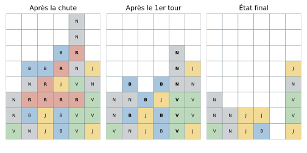
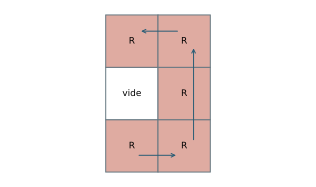

# X-ENS MP-PC-PSI · Informatique B 2019 · Corrigé brut

*Corrigé rédigé par IA, non officiel. Signalez toute erreur.*

**Rédaction** · GPT-6.2 Astra Ultra · vitesse non renseignée · 24 novembre 2026

## I · Initialisation et affichage

### Question 1 · Créer des colonnes indépendantes

La grille contient $w$ colonnes de $h$ cases chacune. Les colonnes sont des objets distincts, donc changer une seule case n'altère aucune autre colonne. La création coûte $\Theta(wh)$.

```python
def creerGrille(largeur, hauteur):
    return [[VIDE for y in range(hauteur)] for x in range(largeur)]
```

### Question 2 · Afficher depuis la ligne du haut

Pour chaque hauteur parcourue dans l'ordre décroissant, on émet une couleur ou un espace par colonne, puis exactement un saut de ligne au moyen des primitives fournies. Le bas de l'écran correspond ainsi à $y=0$.

```python
def afficheGrille(grille):
    if len(grille) == 0:
        return
    for y in range(len(grille[0]) - 1, -1, -1):
        for x in range(len(grille)):
            c = grille[x][y]
            if c == VIDE:
                afficheBlanc()
            else:
                afficheCouleur(c)
        nouvelleLigne()
```

## II · Mouvements du barreau

### Question 3 · Tester la zone de naissance

Pour une colonne de hauteur $h$, l'intervalle à vérifier est $h-k,\ldots,h-1$. La fonction accepte dès la première colonne dont toutes ces cases sont vides. Le pire cas demande $\Theta(wk)$ inspections pour $w$ colonnes, par exemple si seul le dernier élément examiné de chaque colonne est occupé. L'espace auxiliaire est constant.

```python
def grilleLibre(grille, k):
    for colonne in grille:
        libre = True
        for y in range(len(colonne) - k, len(colonne)):
            if colonne[y] != VIDE:
                libre = False
                break
        if libre:
            return True
    return False
```

### Question 4 · Descendre d'une case

Le fond ou un bloc en $y-1$ immobilise le barreau. Sinon la copie de bas en haut décale ses $k$ couleurs, puis l'ancienne case supérieure redevient vide. Le coût d'une descente est $\Theta(k)$.

```python
def descente(grille, x, y, k):
    col = grille[x]
    if y == 0 or col[y-1] != VIDE:
        return
    for j in range(y, y+k):
        col[j-1] = col[j]
    col[y+k-1] = VIDE
```

### Question 5 · Déplacement latéral atomique

Le bord est contrôlé avant tout accès à la colonne voisine. Si un obstacle se trouve à une hauteur quelconque, le plateau reste intact. Lorsque les $k$ cases sont libres, on copie les couleurs dans le même ordre et on libère l'origine.

```python
def deplacerBarreau(grille, x, y, k, direction):
    voisin = x + direction
    if voisin < 0 or voisin >= len(grille):
        return
    for j in range(y, y+k):
        if grille[voisin][j] != VIDE:
            return
    for j in range(y, y+k):
        grille[voisin][j] = grille[x][j]
        grille[x][j] = VIDE
```

### Question 6 · Permutation circulaire

Les copies s'effectuent vers le haut, donc en descendant les indices de destination. On place ensuite l'ancienne couleur supérieure en $y$. Le multiensemble des couleurs et l'emplacement du barreau sont conservés.

```python
def permuterBarreau(grille, x, y, k):
    col = grille[x]
    sommet = col[y+k-1]
    for j in range(y+k-1, y, -1):
        col[j] = col[j-1]
    col[y] = sommet
```

### Question 7 · Chute rapide

Le balayage descendant teste au plus $h$ cases. Le déplacement vers la nouvelle base coûte ensuite $O(k)$, y compris si les zones se recouvrent, car un emplacement source déjà déplacé peut être réutilisé comme destination à une itération ultérieure. Le temps est $O(h+k)$ et l'espace auxiliaire $O(1)$.

```python
def descenteRapide(grille, x, y, k):
    col = grille[x]
    base = y
    while base > 0 and col[base-1] == VIDE:
        base -= 1
    if base == y:
        return
    for i in range(k):
        col[base+i] = col[y+i]
        col[y+i] = VIDE
```

## III · Alignements et cascades

### Question 8 · Calcul manuel du score

Le barreau atterrit dans la colonne 3, en $y=2$. Au premier tour, quatre rouges horizontaux de $(1,2)$ à $(4,2)$ et quatre rouges diagonaux de $(1,2)$ à $(4,5)$ donnent $2+2=4$. Après effacement simultané et tassement, on trouve deux diagonales de trois bleus, de $(1,1)$ à $(3,3)$ et de $(1,3)$ à $(3,1)$, ainsi qu'une verticale de trois verts et une de trois noirs dans la colonne 4. Gain supplémentaire $1+1+1+1=4$. Le tassement suivant ne crée aucun alignement. **Total : 8 points.**



### Question 9 · Marquer les séries maximales

Une série réelle s'étend de « début » à $i-1$ quand la couleur change. Si elle a longueur $m\ge3$ et une couleur non vide, on marque son intervalle et on ajoute $m-2$. Chaque case de la rangée est lue exactement une fois et chaque case du résultat est marquée au plus une fois. Le traitement est linéaire et les plages vides rapportent zéro.

```python
def detecteAlignement(rangee):
    n = len(rangee)
    marque = [False for i in range(n)]
    couleur = VIDE
    debut = 0
    score = 0
    for i in range(n+1):
        if i < n:
            c = rangee[i]
        else:
            c = VIDE
        if c != couleur:
            longueur = i - debut
            if couleur != VIDE and longueur >= 3:
                score += longueur - 2
                for j in range(debut, i):
                    marque[j] = True
            debut = i
            couleur = c
    return marque, score
```

### Question 10 · Parcourir une rangée dans une direction

Les couples $(i+k\,dx,j+k\,dy)$ définissent une rangée pour toute direction non nulle. Le test des deux coordonnées arrête le parcours au bord. La seconde boucle convertit les indices marqués en coordonnées de plateau et renvoie le score de la rangée.

```python
def scoreRangee(grille, g, i, j, dx, dy):
    if dx == 0 and dy == 0:
        raise ValueError("direction nulle")
    w, h = len(grille), len(grille[0])
    x, y = i, j
    ligne = []
    while 0 <= x < w and 0 <= y < h:
        ligne.append(grille[x][y])
        x, y = x+dx, y+dy
    marque, score = detecteAlignement(ligne)
    for k in range(len(ligne)):
        if marque[k]:
            g[i+k*dx][j+k*dy] = VIDE
    return score
```

### Question 11 · Explorer les quatre orientations

Les horizontales commencent au bord gauche et les verticales en bas. Les diagonales montantes partent du bord gauche ou du bord inférieur, les descendantes du bord gauche ou du bord supérieur. On exclut le coin déjà traité dans la seconde famille de départs. Chaque case est ainsi visitée une fois par orientation, et une intersection peut rapporter des points dans plusieurs orientations tout en n'étant effacée qu'une fois. La grille originale reste intacte. Temps et espace sont $\Theta(wh)$.

```python
def effaceAlignement(grille):
    w, h = len(grille), len(grille[0])
    g = [[grille[x][y] for y in range(h)] for x in range(w)]
    score = 0
    for y in range(h):
        score += scoreRangee(grille, g, 0, y, 1, 0)
        score += scoreRangee(grille, g, 0, y, 1, 1)
        score += scoreRangee(grille, g, 0, y, 1, -1)
    for x in range(w):
        score += scoreRangee(grille, g, x, 0, 0, 1)
        if x > 0:
            score += scoreRangee(grille, g, x, 0, 1, 1)
            score += scoreRangee(grille, g, x, h-1, 1, -1)
    return g, score
```

### Question 12 · Tasser sans changer l'ordre vertical

Chaque bloc non vide est copié dans la première case libre en partant du bas. À la fin du parcours, seules les cases au-dessus du dernier bloc doivent être vidées. Les couleurs conservent donc leur ordre relatif, pour un coût $\Theta(wh)$.

```python
def tassementGrille(grille):
    for col in grille:
        libre = 0
        for y in range(len(col)):
            if col[y] != VIDE:
                col[libre] = col[y]
                libre += 1
        for y in range(libre, len(col)):
            col[y] = VIDE
```

### Question 13 · Enchaîner les cascades

On élimine toutes les rangées du même tour simultanément, puis on tasse et on remplace les valeurs de la grille fournie. Un gain nul signifie qu'il n'existe plus d'alignement. La terminaison découle de la décroissance stricte du nombre de blocs lors de chaque tour positif.

```python
def calculScore(grille):
    total = 0
    while True:
        g, gain = effaceAlignement(grille)
        if gain == 0:
            return total
        total += gain
        tassementGrille(g)
        for x in range(len(grille)):
            for y in range(len(grille[x])):
                grille[x][y] = g[x][y]
```

## IV · Régions unicolores

### Question 14 · Composante monochrome

La recherche suit les quatre côtés et compte un point par case nouvelle de la couleur initiale. Une case vide d'origine donne zéro bloc coloré. Tout chemin monochrome est suivi de proche en proche. Chaque appel qui développe quatre descendants marque auparavant une case nouvelle, donc il en existe au plus $wh$ et les appels terminent. La grille du jeu reste intacte.

```python
def tailleRegionUnicolore(grille, x, y):
    couleur = grille[x][y]
    if couleur == VIDE:
        return 0
    w, h = len(grille), len(grille[0])
    vu = [[False for j in range(h)] for i in range(w)]
    def visite(i, j):
        if i < 0 or i >= w or j < 0 or j >= h:
            return 0
        if vu[i][j] or grille[i][j] != couleur:
            return 0
        vu[i][j] = True
        return (1 + visite(i-1, j) + visite(i+1, j)
                  + visite(i, j-1) + visite(i, j+1))
    return visite(x, y)
```

### Question 15 · Contre-exemple au balayage horizontal

Prenons deux colonnes, de bas en haut $[R,\mathrm{VIDE},R]$ et $[R,R,R]$, et partons de $(0,0)$. Les cinq rouges sont reliés par les côtés. Dans la colonne de départ, le segment vertical a seulement une case. Le passage vers la droite ajoute les trois rouges de la seconde colonne, puis le bord arrête la progression. Il n'y a aucun passage vers la gauche depuis la colonne de départ et aucun retour depuis la seconde colonne. La fonction de la figure 9 renvoie donc $1+3=4$ au lieu de $5$.



## V · Classements en SQL

### Question 16 · Parties d'un joueur dans l'ordre des dates

La jointure rattache chaque partie à son auteur. Le second critère de tri fixe l'ordre de résultats ayant la même date. Les paramètres SQL nommés représentent les valeurs données dans les questions.

```sql
SELECT p.date, p.duree, p.score
FROM PARTIES AS p
JOIN JOUEURS AS j ON j.id_j = p.id_joueur
WHERE j.nom = :cc
ORDER BY p.date, p.id_p;
```

### Question 17 · Rang d'une partie

Les scores égaux n'avancent pas le rang de la nouvelle partie. Chaque partie de meilleur score compte séparément. Pour les scores $87,75,75,63,60,60$, les rangs des demandes $75,70,60$ sont respectivement 2, 4 et 5.

```sql
SELECT 1 + COUNT(*) AS rang
FROM PARTIES
WHERE score > :s;
```

### Question 18 · Record de France

La jointure fournit le pays du joueur qui a réalisé chaque score. Le maximum après filtrage est le record demandé. En l'absence de partie d'un joueur français, la valeur SQL de l'agrégat est NULL.

```sql
SELECT MAX(p.score) AS record
FROM PARTIES AS p
JOIN JOUEURS AS j ON j.id_j = p.id_joueur
WHERE j.pays = 'France';
```

### Question 19 · Rang d'un joueur selon son record

La sous-requête calcule le meilleur score du joueur désigné, supposé identifiable par son nom et ayant déjà joué. La requête extérieure compte les **joueurs distincts** qui ont une partie strictement meilleure, puis ajoute un. Les ex æquo obtiennent ainsi le même rang.

```sql
SELECT 1 + COUNT(DISTINCT p.id_joueur) AS rang
FROM PARTIES AS p
WHERE p.score > (
    SELECT MAX(q.score)
    FROM PARTIES AS q
    JOIN JOUEURS AS j ON j.id_j = q.id_joueur
    WHERE j.nom = :cc
);
```
