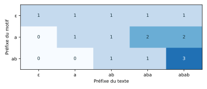
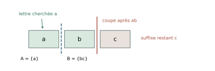
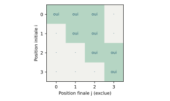

# X-ENS MP · Informatique A 2019 · Corrigé guidé

*Corrigé rédigé par IA, non officiel. Signalez toute erreur.*

**Rédaction** · GPT-6.2 Astra Ultra · vitesse non renseignée · 24 novembre 2026

## Repères

Pour plonger un mot, on peut sauter des lettres. Pour compter les plongements, des choix d’indices différents comptent séparément. Pour compter les sous-mots distincts, les choix conduisant à la même chaîne ne comptent qu’une fois. Dans un résidu, la dernière lettre utilisée par le plongement peut précéder la fin du préfixe témoin.

## Préliminaires

### Question 1 · Tester un sous-mot

**Indication.** Un plongement préserve l’ordre des positions et peut ignorer certaines lettres.

#### Solution

**a.** Dans un plongement de $ua$ dans $u'a'$, ou bien la dernière position du texte n’est pas utilisée, auquel cas $ua\preceq u'$, ou bien elle porte la dernière lettre du motif. Dans ce cas $a=a'$ et les positions précédentes plongent $u$ dans $u'$. Réciproquement un tel plongement dans $u'$ reste valable dans $u'a'$, et un plongement de $u$ dans $u'$ s’étend par les dernières lettres égales.

**b.** Pour chaque lettre du motif, prendre la première occurrence possible après la précédente. Avancer une occurrence vers la gauche laisse toutes les positions suivantes d’un plongement disponibles. Par récurrence sur les lettres du motif, le choix glouton réussit exactement lorsqu’un plongement existe.
```ocaml
let teste_sous_mot v u =
  let i = ref 0 in
  String.iter (fun c ->
    if !i < String.length v && v.[!i] = c then incr i
  ) u;
  !i = String.length v
```
L’indice compte les lettres déjà trouvées. Le motif vide est accepté, même dans le texte vide. Le coût est $O(|u|+1)$ en temps et $O(1)$ en espace auxiliaire.

## I · Compter et construire

### Question 2 · Trois règles de dénombrement

**Indication.** Compter les choix de positions, même lorsque les lettres choisies sont les mêmes.

#### Solution

**a.** Dans $abab$, les couples d’indices commençant à zéro qui donnent $ab$ sont $(0,1),(0,3),(2,3)$. Cela donne trois plongements.

**b.** Un plongement de $a^m$ dans $a^n$ est déterminé par le choix de $m$ positions parmi $n$. Il y en a $\binom nm$, avec valeur zéro si $m>n$ et un si $m=0$.

**c.** Notons $B(v,u)$ le nombre de plongements du motif $v$ dans le texte $u$. Les plongements de $va$ dans $ua$ qui ignorent la dernière position sont au nombre de $B(va,u)$. Ceux qui l’utilisent sont en bijection avec les plongements de $v$ dans $u$. Les deux familles sont disjointes, donc $B(va,ua)=B(va,u)+B(v,u)$.

### Question 3 · Fonction récursive du sujet

**Indication.** Donner une spécification à l’appel auxiliaire portant sur deux longueurs de préfixe.

#### Solution

**a.** À chaque appel récursif, $j$ diminue strictement et reste entier naturel. Dès que $i=0$ ou $j=0$, la fonction termine sans nouvel appel. En particulier elle ne lit jamais un indice négatif.

**b.** L’invariant est $aux(i,j)=B(v[0:i],u[0:j])$ sur les préfixes de longueurs $i,j$. Le motif vide a un unique plongement et un motif non vide n’en a aucun dans le texte vide. Si les dernières lettres diffèrent, il faut ignorer la dernière du texte. Si elles coïncident, appliquer la partition de Q2c. Par récurrence sur $j$ pour tous les $i$, ces branches calculent la valeur spécifiée. L’appel initial prend les deux longueurs entières. Les calculs sur le type OCaml `int` donnent le dénombrement exact dans sa plage représentable.

### Question 4 · Nombre d’appels du calcul naïf

**Indication.** Représenter chaque appel par un nœud. Un appel a zéro, un ou deux fils.

#### Solution

**a.** La profondeur est au plus $n=|u|$. Même entièrement binaire, l’arbre a au plus $1+2+\cdots+2^n=2^{n+1}-1$ nœuds. On peut prendre $C_1=2$.

**b.** Pour $v=a^{n+1}$ et $u=a^n$, $B(v,u)=0$ alors que la récursion produit un arbre binaire complet de profondeur $n$, le motif ne pouvant jamais être épuisé. Ainsi $T(v,u)=2^{n+1}-1$. Aucune fonction du seul dénombrement, en particulier aucun polynôme de ce dénombrement, ne majore ces temps.

**c.** Les feuilles renvoyant 1 correspondent exactement aux $B(v,u)$ plongements. Si $L$ est le nombre de feuilles, $U$ celui des nœuds à un fils et $D$ celui des nœuds à deux fils, le décompte des arêtes donne $D=L-1$. Donc $T=2L+U-1\ge2B(v,u)-1$ et l’on peut prendre $C_2=-1$. Pour $u=a^{2m}$ et $v=a^m$, le coefficient binomial central est au moins $2^{2m}/(2m+1)$, ce qui confirme un pire cas exponentiel en longueur totale.

### Question 5 · Compter les plongements par programmation dynamique

**Indication.** La colonne du texte précédent suffit. Parcourir les longueurs de motif dans le bon sens pour ne pas réutiliser la même position.

#### Solution

```ocaml
let nb_plongements_rapide v u =
  let m = String.length v in
  let d = Array.make (m + 1) 0 in
  d.(0) <- 1;
  String.iter (fun c ->
    for i = m downto 1 do
      if v.[i-1] = c then d.(i) <- d.(i) + d.(i-1)
    done
  ) u;
  d.(m)
```
Après lecture d’un préfixe du texte, $d[i]$ compte les plongements du préfixe de longueur $i$ du motif. En descendant, $d[i-1]$ est encore celui de l’étape précédente. Le temps est $O((|u|+1)(|v|+1))$ et l’espace auxiliaire $O(|v|+1)$ dans le modèle d’opérations du sujet. Pour des résultats dépassant `max_int`, le même algorithme demande des entiers de précision arbitraire, dont les additions ont un coût dépendant de leur taille.



### Question 6 · Sous-mots nouveaux après une dernière lettre

**Indication.** Comparer le sous-mot obtenu quand on utilise ou ignore la dernière position.

#### Solution

**a.** Posons $S=\downarrow(wav)$, $P=\downarrow w$. Tout sous-mot de $wava$ est dans $S$ ou s’écrit $xa$ avec $x\in S$. Si $x\in P$, ce dernier mot était déjà plongé dans $wa$, donc dans $wav$. Cela donne $\downarrow(wava)=S\cup(S\setminus P)a$. L’inclusion inverse vient en étendant un plongement par la dernière lettre lorsque nécessaire.

**b.** Si $v$ ne contient pas $a$, toute occurrence de $a$ dans $wav$ est dans $wa$. Si $xa\in S$, le préfixe $x$ a donc été plongé dans $w$, ce qui empêche $x\in S\setminus P$. L’union est disjointe. Si $v$ contient $a$, prendre $x=wa$. Ce $x$ est dans $S\setminus P$ par la longueur. Le mot $xa=waa$ appartient à $S$ en utilisant un $a$ de $v$, et appartient aussi à $(S\setminus P)a$. L’union ne l’est plus.

### Question 7 · Compter les sous-mots distincts

**Indication.** Retenir le nombre de sous-mots que l’occurrence précédente de la lettre avait déjà permis de former.

#### Solution

**a.** Notons $D_i=|\downarrow u[0:i]|$, avec $D_0=1$. Lorsqu’on ajoute $c=u[i]$, on garde tous les anciens sous-mots et on peut leur ajouter $c$. Si $c$ est inédit, $D_{i+1}=2D_i$. Si sa dernière occurrence précédente est $j$, les doublons sont exactement les mots $xc$ avec $x\preceq u[0:j]$, donc $D_{i+1}=2D_i-D_j$. La disjonction de Q6 s’applique en prenant les deux occurrences consécutives de $c$.

**b.** Stocker, pour chaque caractère OCaml, $D_j$ correspondant à sa dernière occurrence, ou zéro pour un caractère inédit.
```ocaml
let nb_sousmots u =
  let avant = Array.make 256 0 in
  let total = ref 1 in
  String.iter (fun c ->
    let k = Char.code c in
    let ancien = !total in
    total := ancien + (ancien - avant.(k));
    avant.(k) <- ancien
  ) u;
  !total
```
Le temps est $O(|u|+256)$ et l’espace $O(256)$, constant pour l’alphabet OCaml. L’écriture de l’addition évite un doublement intermédiaire susceptible de dépasser la capacité alors que la valeur finale tient encore.

### Question 8 · Plus court sur-mot commun, premier lexicographique

**Indication.** Comparer d’abord les longueurs, puis l’ordre lexicographique. Il faut comparer les mots candidats entiers.

#### Solution

**a.** Supposons $a\ne b$ et $pcsmc(ua,vb)=wa$. Le dernier $b$ de $vb$ ne peut pas utiliser la dernière position $a$. On a donc $vb\preceq w$ et $u\preceq w$. Si un meilleur sur-mot $w'$ de $u,vb$ existait, $w'a$ serait un sur-mot de $ua,vb$, plus court que $wa$ ou lexicographiquement plus petit à longueur égale, contradiction.

**b.** Soit $S(u,v)=pcsmc(u,v)$, et $\min_{lc}$ le minimum pour cet ordre longueur puis lexicographique. On a $S(\varepsilon,v)=v$, $S(u,\varepsilon)=u$. Si $a=b$, $S(ua,va)=S(u,v)a$. Un sur-mot optimal finit par une lettre utilisée par au moins un motif, et les deux dernières lettres égales peuvent être plongées sur cette dernière position. Si $a\ne b$,

$$
S(ua,vb)=\min_{lc}\{S(u,vb)a,\ S(ua,v)b\}.
$$

Ces deux candidats conviennent et l’argument de a couvre les deux terminaisons.

**c.** Pour éviter de stocker des chaînes à chaque case, calculer les **longueurs sur les suffixes** et reconstruire depuis la gauche. Si deux choix ont même longueur et des premières lettres distinctes, la plus petite lettre décide alors immédiatement.
```ocaml
let pcsmc u v =
  let n = String.length u and m = String.length v in
  let d = Array.make_matrix (n+1) (m+1) 0 in
  for i = n downto 0 do
    for j = m downto 0 do
      d.(i).(j) <-
        if i = n then m-j
        else if j = m then n-i
        else if u.[i] = v.[j] then 1 + d.(i+1).(j+1)
        else 1 + min d.(i+1).(j) d.(i).(j+1)
    done
  done;
  let s = Buffer.create d.(0).(0) in
  let rec lire i j =
    if i = n then Buffer.add_substring s v j (m-j)
    else if j = m then Buffer.add_substring s u i (n-i)
    else if u.[i] = v.[j] then
      (Buffer.add_char s u.[i]; lire (i+1) (j+1))
    else if d.(i+1).(j) < d.(i).(j+1)
         || (d.(i+1).(j) = d.(i).(j+1) && u.[i] < v.[j]) then
      (Buffer.add_char s u.[i]; lire (i+1) j)
    else (Buffer.add_char s v.[j]; lire i (j+1))
  in
  lire 0 0;
  Buffer.contents s
```
La table demande $O((n+1)(m+1))$ en temps et espace. La reconstruction terminale écrit au plus $n+m$ lettres.

## II · Sous-mots et expressions rationnelles

### Question 9 · Premières lettres de deux langages

**Indication.** Un produit contenant un facteur de langage vide est lui-même vide.

#### Solution

$L(e_1)=\varnothing$ à cause du facteur `Empty` dans le produit de droite. Aucune des lettres $a,b,c$ ne peut commencer un mot. On a $L(e_2)=(ba)^*(\varepsilon+a)c^*$. Les mots $a$, $ba$ et $c$ donnent respectivement les trois débuts possibles. Le mot vide également présent ne commence par aucune lettre.

### Question 10 · Calculer les débuts possibles

**Indication.** Pour un produit, il faut savoir si le facteur restant peut produire au moins un mot, ainsi que si le premier accepte le mot vide.

#### Solution

Pour une expression, calculons simultanément les booléens « langage habité », « contient $\varepsilon$ » et « possède un mot commençant par $c$ ». Dans un produit, on peut commencer dans le facteur droit si le gauche peut être vide. Commencer dans le facteur gauche exige que le droit soit habité.
```ocaml
type ratexp =
  | Epsilon | Empty | Letter of char
  | Sum of ratexp * ratexp | Product of ratexp * ratexp
  | Star of ratexp

let rec proprietes c = function
  | Empty -> false, false, false
  | Epsilon -> true, true, false
  | Letter a -> true, false, a = c
  | Sum (p, q) ->
      let h, z, b = proprietes c p in
      let h', z', b' = proprietes c q in
      h || h', z || z', b || b'
  | Product (p, q) ->
      let h, z, b = proprietes c p in
      let h', z', b' = proprietes c q in
      h && h', z && z', (b && h') || (z && b')
  | Star p ->
      let _, _, b = proprietes c p in true, true, b

let peut_debuter_par e c =
  let _, _, b = proprietes c e in b

let rec habite = function
  | Empty -> false
  | Epsilon | Letter _ | Star _ -> true
  | Sum (p, q) -> habite p || habite q
  | Product (p, q) -> habite p && habite q
```
Une induction sur l’arbre syntaxique justifie les trois valeurs. Le test de début coûte $O(|e|)$ temps et une pile proportionnelle à la hauteur.

### Question 11 · Quatre identités sur les résidus

**Indication.** Déplier $\langle u\rangle L$ avec un préfixe contenant $u$ comme sous-mot, puis examiner le suffixe restant.

#### Solution

**1. Faux.** Pour $L=\{a\}$, le résidu par $\varepsilon$ contient $a$ et $\varepsilon$. En général, ce résidu est l’ensemble des **suffixes** des mots de $L$.

**2. Faux en général.** Pour $L_1=\varnothing$ et $L_2=\{a\}$, le membre de gauche est vide, mais le second terme de droite contient $\varepsilon$. Même avec deux facteurs habités elle peut échouer : prendre $L_1=\{a\}$, $L_2=\{bc\}$. Le suffixe $c$ est permis à gauche après avoir consommé le préfixe $ab$. À droite seul $bc$ subsiste. Il faut localiser à la fois la lettre et la coupe du préfixe témoin.

**3. Faux dans cet ordre.** Pour $u=a$, $v=b$ et $L=\{ab\}$, $\langle ab\rangle L=\{\varepsilon\}$ et $\langle a\rangle(\langle b\rangle L)=\varnothing$. La composition correcte est $\langle uv\rangle L=\langle v\rangle(\langle u\rangle L)$. On coupe le préfixe témoin après la partie qui plonge $u$.

**4. Faux pour un mot arbitraire.** Prendre $L=\{a,b\}$ et $u=ab$. Le résidu de $L$ est vide, mais $ab\in L^*$ donc $\varepsilon\in\langle ab\rangle L^*$. Le plongement peut utiliser plusieurs facteurs. Même pour une lettre, la coupe peut suivre la fin du facteur qui la contient. Avec $u=a$ et $L=\{a,bc\}$, le résidu de l’étoile contient $c$ (mot témoin $abc$), alors que le membre de droite vaut $L^*$ et ne contient pas $c$.



### Question 12 · Résidu par le mot vide

**Indication.** Un suffixe d’un produit commence dans le premier facteur ou dans le second. Un suffixe d’une étoile peut être vide.

#### Solution

**a.** Pour $S(L)=\langle\varepsilon\rangle L$, on a $S(L_1 L_2)=S(L_1)L_2\cup S(L_2)$ si $L_1$ est habité, et le produit vide sinon. En outre $S(L^*)=\{\varepsilon\}\cup S(L)L^*$. L’ajout de $\varepsilon$ est nécessaire lorsque $L$ est vide.
```ocaml
let rec eps_residu_ratexp = function
  | Empty -> Empty
  | Epsilon -> Epsilon
  | Letter a -> Sum (Letter a, Epsilon)
  | Sum (p, q) -> Sum (eps_residu_ratexp p, eps_residu_ratexp q)
  | Product (p, q) ->
      if habite p then
        Sum (Product (eps_residu_ratexp p, q), eps_residu_ratexp q)
      else Empty
  | Star p ->
      Sum (Epsilon, Product (eps_residu_ratexp p, Star p))
```

**b.** Pour $s=|e|$, l’expression dépliée a taille $O(s^2)$. Chaque nœud de l’entrée crée un nombre constant de connecteurs et peut recopier un sous-arbre original de taille au plus $s$, tel que le droit d’un produit ou le corps d’une étoile. Le parcours récursif transformant visite chaque nœud original au plus une fois. Les références partagées d’OCaml peuvent diminuer la mémoire réellement allouée, mais la taille demandée compte les constructeurs avec leurs occurrences.

### Question 13 · Résidu par une lettre

**Indication.** Dans un produit, distinguer la position de la lettre. Dans une étoile, isoler le facteur qui la contient.

#### Solution

**a.** Notons $D_a(L)=\langle a\rangle L$. Les langages vides et le mot vide ne contiennent aucun préfixe comportant $a$. Pour un singleton lettre, le résidu est soit $\{\varepsilon\}$ soit vide. Dans une étoile il faut localiser la lettre et la coupe finale du préfixe témoin ; elles peuvent tomber dans deux facteurs distincts.

Si un mot $w\in L$ contient $a$, tout suffixe $v$ d’un mot $zv\in L^*$ appartient à $D_a(L^*)$ : le mot $wzv$ est dans l’étoile et le préfixe $wz$ porte la lettre. Réciproquement tout résultat est un suffixe. Donc $D_a(L^*)=S(L^*)$. Si $D_a(L)$ est vide, le résidu de l’étoile est vide. De même, dans $L_1 L_2$, si le premier facteur peut fournir $a$ et que la coupe se fait dans le second, un suffixe arbitraire de $L_2$ est permis, même si $L_2$ ne contient pas $a$.

```ocaml
let rec contient c = function
  | Empty | Epsilon -> false
  | Letter a -> a = c
  | Sum (p, q) -> contient c p || contient c q
  | Product (p, q) ->
      (contient c p && habite q) || (habite p && contient c q)
  | Star p -> contient c p

let rec char_residu_ratexp c = function
  | Empty | Epsilon -> Empty
  | Letter a -> if a = c then Epsilon else Empty
  | Sum (p, q) ->
      Sum (char_residu_ratexp c p, char_residu_ratexp c q)
  | Product (p, q) ->
      if not (habite p) then Empty
      else
        let gauche = Product (char_residu_ratexp c p, q) in
        let fin = if contient c p then eps_residu_ratexp q
                  else char_residu_ratexp c q in
        Sum (gauche, fin)
  | Star p ->
      if contient c p then eps_residu_ratexp (Star p) else Empty
```

**b.** Une borne polynomiale pour la taille dépliée de ce programme est $O(s^2)$ avec $s=|e|$. À un produit, un sous-arbre droit est recopié une fois puis une seule transformation lui est appliquée, en mode suffixe ou résidu. À une étoile, le traitement suffixe visite son sous-arbre une seule fois. En chargeant à chaque nœud au plus $O(s)$ constructeurs recopiés, on obtient la borne. Les appels booléens de reconnaissance n’ajoutent aucun constructeur à l’expression produite.

### Question 14 · Appliquer les résidus successifs

**Indication.** Consommer les lettres de gauche à droite, puis vérifier si le langage restant est habité.

#### Solution

**a.** Un résidu par un mot non vide est fermé par prise de suffixes : tout suffixe plus court est obtenu en prolongeant le préfixe témoin. Il est donc habité si et seulement s’il contient $\varepsilon$. Pour le motif initial vide, il suffit que $L(e)$ soit habité.
```ocaml
let sousmot_de_ratexp u e =
  let courant = ref e in
  String.iter (fun c -> courant := char_residu_ratexp c !courant) u;
  habite !courant
```
La composition dans l’ordre de Q11 assure qu’après chaque lettre on a exactement le résidu du langage par le préfixe parcouru.

**b.** Cette implémentation par arbres syntaxiques, sans simplification des unions, a un pire cas exponentiel, même sur un alphabet d’une lettre. Notons $S=a^*$, $T=\varepsilon+(a+\varepsilon)S$ l’arbre effectivement construit par $D_a(S)$, et $W=(\varepsilon+\varnothing)S$. Avec exactement les constructeurs du code, $D_a(T)$ contient sous des unions un exemplaire de $T$ et un de $W$. En effet, le facteur gauche $a+\varepsilon$ contient $a$, donc la branche droite est le résultat de Q12 sur l’étoile, à savoir $T$. De même, $D_a(W)$ contient sous une union un exemplaire de $T$ car $\varepsilon+\varnothing$ est habité et ne contient pas $a$. Les unions sont parcourues branche par branche, sans mémoïsation. Ainsi chaque occurrence distinguée de $T$ engendre au moins deux occurrences disjointes de $T$ au bout de deux itérations. Sur le motif $a^n$, le nombre d’appels croît au moins comme $2^{\lfloor(n-1)/2\rfloor}$.

### Question 15 · Matrice des facteurs couverts

**Indication.** L’union se traite case par case, le produit par une coupure intermédiaire, l’étoile par une fermeture transitive.

#### Solution

Soit $n=|u|$. Le facteur vide est couvert par tout langage habité. Une lettre couvre en outre les facteurs de longueur un qui lui sont égaux. Pour un produit, le plongement se décompose en une partie dans chaque facteur pour au moins une coupure $k$ entre $i$ et $j$. Pour l’étoile, une suite de telles couvertures correspond à un chemin sur les positions, avec chemin vide possible.
```ocaml
let facteurs_couverts u e =
  let n = String.length u in
  let matrice f =
    Array.init (n+1) (fun i -> Array.init (n+1) (fun j -> f i j))
  in
  let rec fc = function
    | Empty -> matrice (fun _ _ -> false)
    | Epsilon -> matrice (fun i j -> i = j)
    | Letter c -> matrice (fun i j ->
        i = j || (j = i+1 && u.[i] = c))
    | Sum (p, q) ->
        let a = fc p and b = fc q in
        matrice (fun i j -> a.(i).(j) || b.(i).(j))
    | Product (p, q) ->
        let a = fc p and b = fc q in
        matrice (fun i j ->
          let rec couper k =
            k <= j && ((a.(i).(k) && b.(k).(j)) || couper (k+1))
          in couper i)
    | Star p ->
        let a = fc p in
        for i = 0 to n do a.(i).(i) <- true done;
        for k = 0 to n do
          for i = 0 to k do
            if a.(i).(k) then
              for j = k to n do
                if a.(k).(j) then a.(i).(j) <- true
              done
          done
        done;
        a
  in fc e
```
Les indices strictement sous la diagonale restent faux. Une matrice a $(n+1)^2$ cases. Le produit et la fermeture de Warshall coûtent au plus $O((n+1)^3)$ par nœud de syntaxe. Le temps est donc $O(|e|(n+1)^3)$, l’espace $O(|e|(n+1)^2)$ comme borne supérieure simple, sortie comprise.



### Question 16 · Décision par la case extrême

**Indication.** Le mot demandé est le facteur de l’indice 0 jusqu’à la borne exclue $n$.

#### Solution

```ocaml
let sousmot_de_ratexp_rapide u e =
  (facteurs_couverts u e).(0).(String.length u)
```
Le résultat est vrai exactement quand le mot entier est plongé dans un mot de $L(e)$. La lecture finale est constante. Le temps $O(|e|(|u|+1)^3)$ est polynomial en la taille de l’entrée. Pour $u$ vide, la case diagonale renvoie correctement l’habitabilité de $L(e)$, y compris pour $\varnothing$ et $\varnothing^*$.
