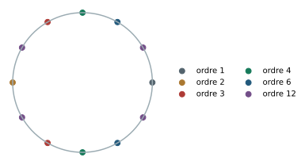
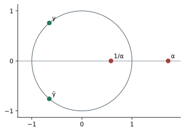
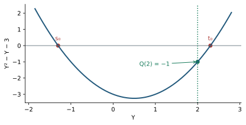

# X-ENS MP — Mathématiques A 2019 · Corrigé brut

*Corrigé rédigé par IA, non officiel. Signalez toute erreur.*

**Rédaction** · modèle exact non renseigné (famille GPT-6) · effort non renseigné · vitesse non renseignée

**Révision** · modèle exact non renseigné (famille GPT-6) · effort non renseigné · vitesse non renseignée

**Révision (tour 2)** · GPT-6.2 Astra Ultra · vitesse non renseignée

**Révision (tour 3)** · GPT-6.2 Astra Ultra · vitesse non renseignée · 26 novembre 2026

## Présentation du sujet

L’épreuve du 18 avril 2019 dure quatre heures. Ses 24 numéros contiennent 43 questions et sous-questions. Elle étudie les conjugués des entiers algébriques, les racines de l’unité et les nombres de Salem, pour calculer le plus petit de ces nombres en degré quatre. [Sujet officiel](https://banques-ecoles.fr/cms/wp-content/uploads/2019/10/2019_MPI_sujet_MathA.pdf)

## I — Polynôme minimal et entiers algébriques

On note Π associé à α le polynôme minimal unitaire de ce nombre sur les rationnels. Un entier algébrique annule un polynôme unitaire à coefficients entiers. On admet que les entiers algébriques constituent un anneau.

### Question 1

L’application d’évaluation $\mathbb Q[X]\to\mathbb C$, $P\mapsto P(\alpha)$, respecte les sommes et les produits. Son noyau $I(\alpha)$ est donc un idéal. Il est non nul par la définition d’un nombre algébrique, et propre puisque le polynôme constant $1$ ne s’annule pas.

### Question 2

Si $\alpha\in\mathbb Q$, la division par $X-\alpha$ montre que $I(\alpha)=(X-\alpha)$, donc $\alpha$ a degré un. Réciproquement un polynôme unitaire rationnel de degré un s’écrit $X-q$ avec $q\in\mathbb Q$. Son unique racine, ici $\alpha$, est rationnelle.

### Question 3a

Si $\Pi_\alpha=AB$ avec $A,B$ de degrés strictement positifs dans $\mathbb Q[X]$, l’un des deux s’annule en $\alpha$ puisque $\mathbb C$ est intègre. Ce facteur appartiendrait à $(\Pi_\alpha)$ tout en étant non nul et de degré strictement inférieur à celui du générateur. C’est impossible.

### Question 3b

Puisque $P(z)=0$, $\Pi_z$ divise $P$ sur $\mathbb Q$. Il n’est pas constant et $P$ est irréductible, donc le quotient est constant. Les deux polynômes étant unitaires, ce quotient vaut un.

### Question 4a

S’ils étaient premiers entre eux sur $\mathbb Q$, Bézout donnerait $UA+VB=1$ avec $U,V\in\mathbb Q[X]$. Évaluer en une racine commune complexe donnerait $0=1$. Leur PGCD ne peut donc être constant.

### Question 4b

Une racine multiple serait commune à $\Pi_\alpha$ et $\Pi_\alpha'$. La question 4a et l’irréductibilité de 3a imposeraient alors $\Pi_\alpha\mid\Pi_\alpha'$. Or la dérivée est non nulle en caractéristique zéro et de degré strictement inférieur, contradiction.

### Question 5a

Écrivons $\alpha=a/b$, avec $a,b$ premiers entre eux et $b>0$. Dans une équation unitaire entière de degré $d$ annulant $\alpha$, multiplier par $b^d$ donne $a^d$ plus des termes tous divisibles par $b$. Ainsi $b\mid a^d$. La coprimalité impose $b=1$.

### Question 5b

Soit $P\in\mathbb Z[X]$ unitaire annulant $\alpha$. Comme $\Pi_\alpha\mid P$ dans $\mathbb Q[X]$, chaque racine de $\Pi_\alpha$ est racine de $P$ et donc un entier algébrique. Les coefficients de $\Pi_\alpha$ sont, au signe près, les fonctions symétriques élémentaires de ces racines. Le théorème admis sur l’anneau des entiers algébriques en fait des entiers algébriques. Ils sont aussi rationnels ; 5a les rend entiers.

### Question 6a

Une racine réelle de module un serait $1$ ou $-1$, de degré un. Les deux racines du minimal sont donc $\alpha,\bar\alpha$, dont le produit vaut $1$. Leur somme, entière par 5b, est strictement entre $-2$ et $2$. D’où $\Pi_\alpha=X^2+X+1$, $X^2+1$ ou $X^2-X+1$. Leurs racines ont respectivement ordre $3$, $4$ ou $6$.

### Question 6b

Pour $w=(3+4i)/5$, $|w|=1$, $w+\bar w=6/5$ et $w\bar w=1$. Son polynôme minimal est $X^2-(6/5)X+1$ : il annule $w$ et ne peut se réduire à un degré un puisque $w$ n’est pas réel. Son coefficient médian n’est pas entier. Par 5b, $w$ n’est pas un entier algébrique. Une racine de l’unité est toujours entière algébrique, étant racine d’un $X^k-1$, donc $w$ n’en est pas une.

## II — Racines de l’unité et polynômes cyclotomiques

Le polynôme cyclotomique d’indice n a pour racines, chacune prise une fois, les racines complexes de l’unité d’ordre exactement n. On cherche à établir sa rationalité puis son irréductibilité.

### Question 7

Toute racine de $X^n-1$ a un ordre exact $d$ qui divise $n$ par division euclidienne de $n$ par $d$. Réciproquement, une racine primitive d’ordre $d\mid n$ est racine de $X^n-1$. Les racines sont simples car $nX^{n-1}$ ne s’annule sur aucune d’elles. Partitionner les racines par ordre donne $X^n-1=\prod_{d\mid n}\Phi_d$.

### Question 8a

Les diviseurs de $p^k$ sont $1,p,\ldots,p^k$. Diviser les factorisations de 7 pour $p^k$ et $p^{k-1}$ donne $\Phi_{p^k}=(X^{p^k}-1)/(X^{p^{k-1}}-1)=\sum_{j=0}^{p-1}X^{jp^{k-1}}$ par somme géométrique.

### Question 8b

On trouve successivement $\Phi_1=X-1$, $\Phi_2=X+1$, $\Phi_3=X^2+X+1$, $\Phi_4=X^2+1$, $\Phi_5=X^4+X^3+X^2+X+1$. Pour le dernier cas, $\Phi_6=(X^6-1)/(\Phi_1\Phi_2\Phi_3)=X^2-X+1$.

### Question 9a

La question 7 donne, en zéro, $-1=\Phi_1(0)\prod_{1<d\mid n}\Phi_d(0)$ avec $\Phi_1(0)=-1$. Par récurrence forte pour $n\ge2$, tous les facteurs propres d’indice supérieur à un valent déjà un, donc $\Phi_n(0)=1$.

### Question 9b

Diviser l’identité de 7 par $X-1$, puis évaluer en $1$ : $n=\prod_{1<d\mid n}\Phi_d(1)$. Si $n=p^k$, la question 8a donne $\Phi_n(1)=p$. Pour un $n$ ayant au moins deux facteurs premiers distincts, procéder par récurrence forte. Les diviseurs propres $p,p^2,\ldots,p^{v_p(n)}$ contribuent $p^{v_p(n)}$ pour chaque $p\mid n$. Les autres diviseurs propres $d>1$ ont au moins deux facteurs premiers et contribuent un par hypothèse. Le produit des facteurs propres vaut donc $n$, ce qui impose $\Phi_n(1)=1$.

### Question 10

Par récurrence forte, $D=\prod_{d\mid n,\ d<n}\Phi_d$ est unitaire dans $\mathbb Z[X]$ (le cas initial $\Phi_1=X-1$ est acquis). La division euclidienne de $X^n-1$ par un polynôme **unitaire** se fait dans $\mathbb Z[X]$ en soustrayant des multiples à coefficients entiers. Par unicité dans $\mathbb C[X]$ et 7, le reste est nul et le quotient est $\Phi_n$, donc $\Phi_n\in\mathbb Z[X]$.

Dans les questions 11 et 12, $P$ est unitaire entier, irréductible sur les rationnels et toutes ses racines $z_1,\ldots,z_n$ sont de module un. On pose $a_k=\sum_i z_i^k$.

### Question 11a

Chaque $z_i$ étant de module un, $|a_k|\le n$ pour tout $k$. La série $\sum a_k z^k$ est donc absolument convergente pour $|z|<1$ par comparaison avec la série géométrique $n\sum|z|^k$.

### Question 11b

La somme des séries géométriques donne $f(z)=\sum_i(1-zz_i)^{-1}$. Or $P'(y)/P(y)=\sum_i1/(y-z_i)$ hors des racines. Pour $0<|z|<1$, on peut prendre $y=1/z$, puisque les racines de $P$ ont module un, et obtenir $P'(1/z)/P(1/z)=zf(z)$. On retrouve l’égalité annoncée.

### Question 11c

Multiplier 11b par $z^{n-1}$. On obtient $f(z)D(z)=H(z)$ avec $D(z)=z^nP(1/z)\in\mathbb Z[z]$, $D(0)=1$ et $H(z)=z^{n-1}P'(1/z)\in\mathbb Z[z]$. L’égalité se prolonge en zéro. Si $D=1+\sum_{j=1}^nd_jz^j$ et si $h_k$ est le coefficient de $z^k$ dans $H$, la récurrence $a_k=h_k-\sum_{j=1}^{\min(k,n)}d_j a_{k-j}$ donne $a_k\in\mathbb Z$, en commençant par $a_0=n$.

### Question 12a

Chaque entier $a_k$ est compris entre $-n$ et $n$. Les blocs $(a_k,\ldots,a_{k+n})$ ne peuvent prendre que $(2n+1)^{n+1}$ valeurs, tandis qu’il y a une infinité d’indices de départ. Deux blocs, d’indices $k<l$, sont donc égaux.

### Question 12b

Pour un monôme $F(X)=X^h$, $0\le h\le n$, la somme demandée est $a_{l+h}-a_{k+h}=0$ par 12a. L’expression étant linéaire en $F$, le résultat s’étend à tous les polynômes de degré au plus $n$.

### Question 12c

L’irréductibilité de $P$ et 3b en font le minimal de chacune de ses racines, et 4b les rend simples. Pour un indice $i$, prendre $F_i(X)=\prod_{j\ne i}(X-z_j)/(z_i-z_j)$. Il vaut un en $z_i$ et zéro aux autres racines. La question 12b donne $z_i^l=z_i^k$ ; comme $z_i\ne0$, on a $z_i^{l-k}=1$. Toutes les racines de $P$ sont des racines de l’unité. Le même exposant convient simultanément à toutes les racines. Plus précisément, parmi les $(2n+1)^{n+1}+1$ premiers blocs, deux coïncident. On peut ainsi choisir $m=l-k$ avec $1\le m\le(2n+1)^{n+1}$. Alors $P$ divise $X^m-1$ : chacun de ses facteurs linéaires, tous distincts, divise ce dernier polynôme.

Dans les questions 13 et 14, $z$ est primitive d’ordre $n$ et $p$ est premier, avec $p\nmid n$.

### Question 13a

Dans la formule du binôme, $p\mid\binom pk$ pour $1\le k<p$, puisque $k\binom pk=p\binom{p-1}{k-1}$ et $p\nmid k$. Les termes autres que $F^p$ et $G^p$ ont donc des coefficients multiples de $p$, d’où le polynôme entier $H$.

### Question 13b

Comme $z^n=1$, $z$ est un entier algébrique ; 5b donne $\Pi_z\in\mathbb Z[X]$. Appliquée successivement aux monômes de $\Pi_z$, 13a donne $\Pi_z(X)^p\equiv\sum_j c_j^pX^{jp}\pmod p$. Le petit théorème de Fermat donne $c_j^p\equiv c_j\pmod p$, donc le membre droit est $\Pi_z(X^p)$ modulo $p$. Leur différence est $pF(X)$ avec $F\in\mathbb Z[X]$.

### Question 13c

L’évaluation de 13b en $z$ donne $\Pi_z(z^p)/p=F(z)$. L’entier algébrique $z$ engendre un sous-anneau d’entiers algébriques contenant les valeurs en $z$ des polynômes entiers, donc le quotient demandé est entier algébrique.

### Question 14a

Écrivons $P=X^n-1$ et $P'(z_i)=\prod_{j\ne i}(z_i-z_j)=n z_i^{n-1}$. Le produit sur $i$ vaut d’une part $(-1)^{n(n-1)/2}\prod_{i<j}(z_i-z_j)^2$, d’autre part $n^n(\prod_i z_i)^{n-1}=(-1)^{n-1}n^n$ puisque $\prod_i z_i=(-1)^{n+1}$. Ainsi
$$\prod_{i<j}(z_i-z_j)^2=(-1)^{(n-1)(n+2)/2}n^n.$$ Le signe est positif pour $n\equiv1,2\pmod4$ et négatif pour $n\equiv0,3\pmod4$. Par exemple, pour $n=3$, la différence des deux racines conjuguées est imaginaire pure de carré $-3$ ; les deux autres différences ont pour produit $3$, donnant $-27$.

### Question 14b

Le minimal $\Pi_z$ divise $X^n-1$, donc ses racines distinctes sont parmi les $z_i$. Si $\Pi_z(z^p)\ne0$, $z^p$ serait une autre racine $n$-ième, distincte de chacune de celles de $\Pi_z$. Le produit $\Pi_z(z^p)=\prod_{\Pi_z(\xi)=0}(z^p-\xi)$ apparaît alors, au signe près, parmi les facteurs de 14a. Le produit des facteurs restants, avec le signe, est un entier algébrique $u$ car chaque différence de racines de l’unité en est un. On aurait $n^n=u\Pi_z(z^p)$. D’après 13c, $n^n/p=u\,[\Pi_z(z^p)/p]$ serait entier algébrique. Ce rationnel serait alors dans $\mathbb Z$ par 5a, alors que $p\nmid n$. Cette contradiction prouve $\Pi_z(z^p)=0$.

### Question 14c

Toute racine primitive d’ordre $n$ vaut $z^a$, avec $a\ge1$ premier à $n$. Tous les facteurs premiers de $a$ sont premiers à $n$. Par 14b, élever une racine primitive à une telle puissance première conserve son polynôme minimal : le nouveau nombre est racine du même irréductible unitaire, donc son minimal est le même par 3b. En itérant, toutes les racines primitives annulent $\Pi_z$, si bien que $\Phi_n\mid\Pi_z$ dans $\mathbb C[X]$. Inversement $\Phi_n\in\mathbb Q[X]$ par 10 et $\Phi_n(z)=0$, donc $\Pi_z\mid\Phi_n$. Les polynômes unitaires sont égaux.

## III — Polynômes réciproques et nombres de Salem

S regroupe les entiers algébriques réels strictement supérieurs à un, de degré au moins deux, dont les conjugués ont un module au plus un et dont au moins un conjugué atteint le module un.

### Question 15a

Pour $P=\sum_{i=0}^d a_iX^i$, on a $X^dP(1/X)=\sum_{i=0}^da_{d-i}X^i$. L’identité avec $P$ équivaut, coefficient par coefficient, à $a_i=a_{d-i}$ pour tout $i$.

### Question 15b

Le terme constant d’un réciproque unitaire vaut $a_d=1$, donc aucune racine n’est nulle. Si $P(X)=(X-x)^mQ(X)$ avec $Q(x)\ne0$, alors $X^dP(1/X)=(1-xX)^m X^{d-m}Q(1/X)$. Le second facteur est non nul en $1/x$. L’identité de 15a donne donc à $1/x$ la même multiplicité $m$.

### Question 16

Sur le cercle unité, $1/x=\bar x$. Le polynôme minimal a des coefficients réels, donc $\bar x$ est aussi racine. Les deux sont distincts puisque $x\notin\{-1,1\}$. Le polynôme réciproque $P^*(X)=X^d\Pi_x(1/X)$, de degré $d$ car $\Pi_x(0)\ne0$, annule $x$. Son quotient par $\Pi_x$ est donc une constante $c$. Évaluer en $1$ donne $\Pi_x(1)=c\Pi_x(1)$. Or $\Pi_x(1)\ne0$, car une racine rationnelle imposerait $\Pi_x=X-1$. Ainsi $c=1$ et $\Pi_x$ est réciproque.

### Question 17a

Le conjugué $\gamma$ ne peut être $1$ ni $-1$, sinon le minimal irréductible de $\alpha>1$ aurait une racine rationnelle et serait linéaire. Par 3b, $\Pi_\gamma=\Pi_\alpha$. La question 16 rend ce polynôme réciproque. Par 15b, $1/\alpha$ est une autre racine, donc un conjugué de $\alpha$.

### Question 17b

Si $\gamma$ était d’ordre fini $m$, son polynôme minimal diviserait $X^m-1$. Comme $\Pi_\alpha=\Pi_\gamma$, cela imposerait $\alpha^m=1$, en contradiction avec $\alpha>1$.

### Question 17c

Tout conjugué de $\alpha$ a un module au plus un. Si un conjugué $w$ a un module strictement inférieur à un, son inverse est racine du même minimal par 15b et a un module strictement supérieur à un. La seule telle racine est $\alpha$ ; alors $w=1/\alpha$. Tous les autres conjugués ont donc module un.

### Question 18

Les racines sont simples. On a la paire réelle $\alpha,1/\alpha$. Toutes les autres racines se trouvent sur le cercle unité et sont non réelles : $\pm1$ sont exclus par irréductibilité. Elles forment des paires de conjuguées complexes distinctes. Au moins une telle paire existe car le maximum du module des conjugués est atteint et vaut un. Le degré est ainsi pair et au moins quatre.

## IV — Construction en degré quatre

On étudie les quartiques réciproques de la famille proposée, puis le plus petit élément de S en degré quatre.

Le quartique considéré est $P_n=X^4-(6+n)X^3+(10+n)X^2-(6+n)X+1$.

### Question 19

Par le critère des racines rationnelles, les seules racines rationnelles possibles de ce polynôme unitaire de terme constant un sont $1$ et $-1$. Or $P_n(1)=-n<0$ et $P_n(-1)=24+3n>0$. Comme $P_n(x)\to+\infty$ lorsque $x\to+\infty$, le théorème des valeurs intermédiaires fournit une racine $\alpha_n>1$.

### Question 20

Les coefficients $1,-(6+n),10+n,-(6+n),1$ sont symétriques. La question 15b s’applique, donc les racines apparaissent par paires inverses de même multiplicité.

### Question 21

Écrire $P_n=(X^2-t_nX+1)(X^2-s_nX+1)$. L’identification des coefficients de $X^3$ et $X^2$ donne $t_n+s_n=6+n$ et $t_ns_n+2=10+n$, d’où $t_ns_n=8+n$.

### Question 22

$t_n=\alpha_n+1/\alpha_n>2$ est réel et $s_n=6+n-t_n$ aussi. Les deux nombres sont les racines de $Q_n(Y)=Y^2-(6+n)Y+(8+n)$. On a $Q_n(0)=8+n>0$ et $Q_n(2)=-n<0$, donc l’autre racine $s_n$ appartient à $]0,2[$. Les racines de $X^2-s_nX+1$ sont alors non réelles, conjuguées, et de produit un. Elles ont module un ; en particulier $|\gamma_n|=1$.

### Question 23a

Une preuve courte utilise directement les valeurs du trinôme. On a $Q_n(1)=3$ et $Q_n(2)=-n<0$. Comme $t_n>2$, il vient $1<s_n<2$. Or toute racine rationnelle de ce trinôme unitaire entier serait entière. Ainsi $s_n$ est irrationnel et $t_n=n+6-s_n$ aussi.

On peut également contrôler ce résultat en calculant les deux racines. Le discriminant de $Q_n$ vaut $\Delta_n=n^2+8n+4=(n+4)^2-12$. Pour $n\ge3$, $\Delta_n-(n+3)^2=2n-5>0$, donc $\Delta_n$ est strictement entre les deux carrés consécutifs $(n+3)^2$ et $(n+4)^2$. Pour $n=1,2$, les valeurs $13,24$ ne sont pas non plus des carrés. La racine carrée d’un entier n’est rationnelle que si elle est entière. Les deux racines $t_n,s_n$ du trinôme sont ainsi irrationnelles.

### Question 23b

Une factorisation non triviale sur $\mathbb Q$ sans facteur linéaire serait un produit de deux quadratiques unitaires rationnels. Le facteur contenant $\gamma_n$ devrait contenir aussi $\bar\gamma_n=1/\gamma_n$, car ses coefficients sont réels. Il serait donc $X^2-s_n X+1$, contredisant 23a. Ainsi $P_n$ est irréductible et il est le minimal de $\alpha_n$. Celle-ci est entière algébrique ; ses conjugés sont $1/\alpha_n$ et la paire de module un de 22. Par définition $\alpha_n\in S$.

### Question 23c

Puisque $s_n<2$, $t_n=n+6-s_n>n+4$. Or $\alpha_n=t_n-1/\alpha_n>t_n-1$ car $\alpha_n>1$. Donc $\alpha_n>n+3$, ce qui prouve la divergence vers l’infini. On peut situer cette racine plus précisément. La petite racine du trinôme est $s_n=(n+6-\sqrt{(n+4)^2-12})/2$, soit
$$s_n-1=\frac{6}{n+4+\sqrt{(n+4)^2-12}}\longrightarrow0.$$
Comme $\alpha_n=n+6-s_n-1/\alpha_n$, il vient $\alpha_n-n\to5$.

### Question 24

Soit $\alpha\in S$ de degré quatre. Les racines de son minimal sont $\alpha,\alpha^{-1},\gamma,\bar\gamma$ avec $|\gamma|=1$ et $\gamma\notin\mathbb R$. Posons $t=\alpha+\alpha^{-1}>2$ et $s=\gamma+\bar\gamma\in]-2,2[$. Le développement du minimal donne $A=t+s\in\mathbb Z$ et $B=ts\in\mathbb Z$ car il est unitaire entier (5b). Comme $t>2$ et $s>-2$, $A\ge1$. Le trinôme $Q(Y)=Y^2-AY+B$ vérifie $Q(2)=(2-t)(2-s)<0$. Sa valeur étant entière, on a
$$1\le(t-2)(2-s)=(t-2)(t+2-A)\le(t-2)(t+1).$$
Ainsi $t^2-t-3\ge0$, soit $t\ge t_0=(1+\sqrt{13})/2$. La fonction $\alpha\mapsto\alpha+1/\alpha$ est strictement croissante sur $]1,+\infty[$.

L’égalité exige simultanément $A=1$ et $Q(2)=-1$. Puisque $Q(2)=4-2A+B$, cela force $B=-3$. Le seul trinôme qui puisse atteindre la borne est donc $Q(Y)=Y^2-Y-3$. Ses racines $t_0$ et $s_0=(1-\sqrt{13})/2\in]-2,2[$ sont irrationnelles. On obtient
$$H(X)=X^2Q(X+X^{-1})=X^4-X^3-X^2-X+1.$$
Ce quartique n’a pas de racine rationnelle : les seuls candidats $\pm1$ ne l’annulent pas. Si l’on pouvait le factoriser en deux quadratiques rationnels, la paire complexe conjuguée provenant de $s_0$ formerait un facteur $X^2-s_0X+1$ non rationnel, contradiction. $H$ est donc irréductible. Ses racines forment une paire réelle inverse, dont le plus grand élément est supérieur à un, et une paire non réelle de module un. Il réalise le minimum cherché, à savoir
$$\boxed{\min T=\frac{t_0+\sqrt{t_0^2-4}}{2}=\frac{1+\sqrt{13}+\sqrt{2\sqrt{13}-2}}4\simeq1{,}72208.}$$

