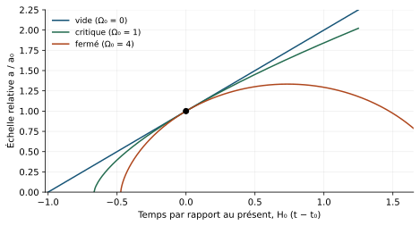
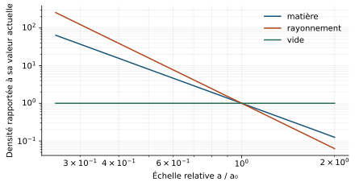

# X-ENS MP 2019 — Physique · Corrigé guidé

*Corrigé rédigé par IA, non officiel. Signalez toute erreur.*

**Lecture du rapport du jury** · GPT-6.2 Astra Ultra · vitesse non renseignée

**Rédaction** · GPT-6.2 Astra Ultra · vitesse non renseignée

## La dynamique de l’Univers

## I — Loi de Hubble et expansion

### Question 1 — Décalage Doppler classique

**Indication.** Tracer les deux parcours lumineux et comparer leurs durées. Utiliser ensuite le lien entre période et longueur d’onde du signal reçu.

**1-a.** Pendant la période $T$ séparant les émissions, la source s’éloigne de $vT$. La seconde impulsion doit parcourir cette distance supplémentaire avant de parvenir à l’observateur. L’intervalle de réception est $T'=T+vT/c=T(1+v/c)$.

**1-b.** Deux crêtes successives jouent le rôle des deux impulsions. Comme $\lambda=cT$ et $\lambda'=cT'$, on obtient $\lambda'=\lambda(1+v/c)$ au premier ordre pour $v\ll c$. L’utilisation d’une même durée d’émission dans les deux référentiels relève de cette approximation non relativiste.

**1-c.** Le décalage relatif vaut donc $z=(\lambda'-\lambda)/\lambda\simeq v/c$. Il est positif pour une source qui s’éloigne.

### Question 2 — Dimension et valeur du taux de Hubble

**Indication.** Convertir indépendamment le kilomètre du numérateur et le mégaparsec du dénominateur.

**2-a.** Dans $v=H_0r$, le rapport d’une vitesse à une longueur a la dimension d’un inverse de temps.

**2-b.** Un mégaparsec vaut $10^6\times3{,}09\times10^{16}\,\mathrm m$. Ainsi $H_0=70\times10^3/(3{,}09\times10^{22})\simeq2{,}27\times10^{-18}\,\mathrm{s^{-1}}$, soit $2\times10^{-18}\,\mathrm{s^{-1}}$ à la précision demandée.

### Question 3 — Même loi depuis une autre galaxie

**Indication.** Soustraire des vecteurs, ce qui permet au nouvel observateur de se trouver hors de la droite initiale.

Notons $\vec r_A,\vec r_{O'}$ les positions dans le référentiel de $O$. Les deux galaxies suivent $\vec v_A=H_0\vec r_A$ et $\vec v_{O'}=H_0\vec r_{O'}$. Leur différence donne $\vec v_{A/O'}=H_0(\vec r_A-\vec r_{O'})=H_0\overrightarrow{O'A}$. Cette loi vectorielle est vraie pour toute position de $O'$ et dans toute direction. Elle respecte donc homogénéité et isotropie.

### Question 4 — Paramètre d’échelle

**Indication.** Séparer le changement de taille de l’Univers des coordonnées qui restent attachées à la galaxie.

Une galaxie comobile a $\vec r=a(t)\vec\chi$ avec $\vec\chi$ fixe. La dérivation donne $\vec v=\dot a\,\vec\chi=(\dot a/a)\vec r$. Le taux d’expansion est donc $H(t)=\dot a(t)/a(t)$.

## II — Cosmologie newtonienne

### Question 5 — Champ de gravitation

**Indication.** Rappeler à la fois le théorème de Gauss et l’existence du potentiel scalaire.

En gravitation newtonienne, $\nabla\cdot\vec g=-4\pi G\rho$ et $\nabla\times\vec g=\vec0$. Le signe négatif correspond à l’attraction. En posant $\vec g=-\nabla\Phi$, la première équation devient $\nabla^2\Phi=4\pi G\rho$.

### Question 6 — Accélération gravitationnelle

**Indication.** Choisir une sphère passant par la galaxie. La coordonnée comobile $\vec\chi$ est un vecteur constant possédant une dimension de longueur.

La symétrie autour de $O$ impose un champ radial. Le flux à travers une sphère de rayon $r$ vaut $4\pi r^2 g_r=-4\pi G(4\pi r^3\rho/3)$. La masse $m$ de la galaxie se simplifie dans le principe fondamental. Ainsi $\ddot{\vec r}=-(4\pi G\rho/3)\vec r$. Comme $\vec r=a\vec\chi$ avec $\vec\chi$ constant, $\ddot a=-(4\pi G/3)\rho a$.

### Question 7 — Dilution de matière

**Indication.** Suivre un volume délimité par les mêmes galaxies, puis écrire sa masse par unité de volume.

La sphère de rayon $r=a\chi$ est comobile. Sans vitesse propre ni échanges de matière à travers sa surface, elle contient les mêmes galaxies au cours du temps et sa masse $M_r$ est constante. L’égalité $\rho(t)a^3(t)=\rho_0a_0^3$ donne $\rho(t)=\rho_0(a_0/a)^3$.

### Question 8 — Intégrale d’énergie

**Indication.** Intégrer l’équation du mouvement avant d’interpréter le résultat à l’échelle physique $r=a\chi$.

Posons $C=8\pi G\rho_0a_0^3/3$. L’équation précédente devient $\ddot a=-C/(2a^2)$. Après multiplication par $2\dot a$, $d(\dot a^2-C/a)/dt=0$, d’où $K=\dot a^2-C/a$. En multipliant par $m\chi^2/2$, les deux termes deviennent $\tfrac12m(\chi\dot a)^2$ et $-GmM_r/(a\chi)$. La constante $m\chi^2K/2$ est l’énergie mécanique conservée de la galaxie dans ce problème radial, avec le choix d’origine usuel pour le potentiel de la masse intérieure.

### Question 9 — Équation de Friedmann–Lemaître

**Indication.** Évaluer la constante $K$ une seule fois, en prenant les données actuelles.

À l’instant présent, $K=\dot a_0^2-C/a_0=a_0^2(H_0^2-8\pi G\rho_0/3)$. En reportant dans $\dot a^2=K+C/a$ et en divisant par $a^2$, on obtient
$$
\frac{\dot a^2}{a^2}-\frac{8\pi G\rho_0}{3}\frac{a_0^3}{a^3}
=\frac{a_0^2}{a^2}\left(H_0^2-\frac{8\pi G\rho_0}{3}\right).
$$
Tous les termes ont la dimension d’un inverse de temps au carré.

### Question 10 — Univers vide

**Indication.** Fixer la pente par sa valeur présente, puis chercher quand l’extrapolation linéaire coupe l’axe des temps.

Pour $\rho_0=0$, $\ddot a=0$ et $\dot a=a_0H_0$ sur la branche en expansion. Ainsi $a(t)=a_0[1+H_0(t-t_0)]$. L’extrapolation donne $a=0$ à $t'=t_0-H_0^{-1}$, origine de temps du modèle d’expansion libre. Dans un univers exactement vide, cela exprime la rencontre des trajectoires extrapolées, sans singularité de densité de matière. L’âge est $T_0=H_0^{-1}\simeq4{,}4\times10^{17}\,\mathrm s$, environ $14$ milliards d’années, soit un ordre de grandeur de $10^{10}$ ans.

### Question 11 — Densité critique

**Indication.** Chercher un zéro fini de $\dot a^2$ et contrôler ce qui se passe à ce zéro.

Avec $C>0$, $\dot a^2=K+C/a$. Si $K<0$, l’expansion atteint le rayon fini $a_{\max}=C/(-K)>a_0$, où $\dot a=0$. Le temps pour y arriver est fini, car au voisinage du point d’arrêt $dt/da=1/\sqrt{K+C/a}$ est proportionnel à $(a_{\max}-a)^{-1/2}$, intégrable. L’accélération y est négative. Le seuil $K=0$ donne
$$
\rho_c=\frac{3H_0^2}{8\pi G}\simeq9\times10^{-27}\,\mathrm{kg\,m^{-3}}.
$$
C’est la masse d’environ cinq à six protons par mètre cube. Une densité $\rho_0>\rho_c$ entraîne donc le retournement de ce modèle de matière seule.

### Question 12 — Évolution critique

**Indication.** Prendre la racine positive de l’équation d’énergie et séparer les variables.

Lorsque $\rho_0=\rho_c$, la branche en expansion vérifie $\dot a=H_0a_0^{3/2}/\sqrt a$. En intégrant $\sqrt a\, da$ de $a_0$ à $a(t)$, on obtient
$$
a(t)=a_0\left[1+\tfrac32H_0(t-t_0)\right]^{2/3}.
$$
L’âge, mesuré depuis l’annulation du crochet, est $T_0=2/(3H_0)\simeq9\times10^9$ ans. À taux actuel fixé, l’attraction a rendu l’expansion passée plus rapide que dans l’univers vide.

### Question 13 — Équation sans dimension

**Indication.** Transformer aussi la variable temporelle de la dérivée afin que tous les termes soient sans dimension.

Avec $x=a/a_0$ et $\tau=H_0t$ on a $\dot a=a_0H_0\,dx/d\tau$. Le rapport $8\pi G\rho_0/(3H_0^2)$ est $\Omega_0$. Une forme réduite de l’équation est
$$
\left(\frac{dx}{d\tau}\right)^2=1-\Omega_0+\frac{\Omega_0}{x}.
$$
Elle donne bien $dx/d\tau=1$ aujourd’hui sur la branche en expansion.

### Question 14 — Destin et âge de l’univers de matière

**Indication.** Tracer les courbes en imposant le même point et la même pente aujourd’hui. Le signe de $\ddot a$ indique quel côté de la tangente contient le passé.

**14-a.** Pour $\Omega_0<1$, l’énergie mécanique est positive. Pour $\Omega_0=1$ elle est nulle. Dans ces deux cas l’expansion ne s’arrête pas à distance finie. Pour $\Omega_0>1$, l’énergie est négative et l’expansion est bornée par $x_{\max}=\Omega_0/(\Omega_0-1)$.

**14-b.** Les équations sont invariantes sous le renversement du temps. Au point d’arrêt $\ddot a<0$, donc le système repart en contraction. La branche descendante est la symétrique temporelle de la branche ascendante autour de $t_{\max}$. Si le premier zéro se situe à $t'$, le second est à $t''=2t_{\max}-t'$, en un temps fini.

**14-c.** L’équation $\ddot a=-(4\pi G/3)\rho a$ est strictement négative pour $a,\rho>0$. Pour une expansion, $\dot a$ diminue.

**14-d.** À $a_0,H_0$ fixés, les courbes atteignent $x=0$ plus récemment quand $\Omega_0$ augmente. En effet pour $0<x<1$, $(dx/d\tau)^2=1+\Omega_0(1/x-1)$ augmente avec $\Omega_0$, donc l’intégrale de $d\tau=dx/(dx/d\tau)$ depuis zéro diminue. À vitesse actuelle donnée, plus l’expansion a été freinée, plus elle était rapide dans le passé.

## III — Matière baryonique et matière noire

### Question 15 — Univers de matière visible et noire

**Indication.** Les deux valeurs sont normalisées par la même densité critique, ce qui permet de les additionner directement.

Les fractions données par le sujet additionnent deux densités de matière sans pression. $\Omega_M=0{,}05+0{,}26=0{,}31<1$. Dans ce modèle contenant ces seuls constituants, $K>0$ et l’univers est ouvert au sens de l’énoncé.

### Question 16 — Forme générale du premier bilan

**Indication.** Reconnaître la densité à l’instant $t$ dans l’expression obtenue après division.

En divisant l’intégrale d’énergie de la question 8 par $a^2$, on a $H^2=(8\pi G/3)\rho_0a_0^3/a^3+K/a^2$. La loi de conservation de la masse identifie le premier facteur de densité à $\rho(t)$, d’où $H^2=8\pi G\rho/3+K/a^2$.

## IV — Thermodynamique d’un volume comobile

### Question 17 — Premier principe dans un volume comobile

**Indication.** La pression et la densité d’énergie ont la même dimension. Le système est toute la matière contenue dans la sphère comobile.

Le volume est $V=(4\pi/3)(a\chi)^3$. Pour cette évolution adiabatique d’un fluide homogène, $dU=-P\,dV$ avec $U=uV$. Développer donne $V\,du+(u+P)dV=0$. Comme $\dot V/V=3\dot a/a$, il vient $\dot u+3(\dot a/a)(u+P)=0$.

### Question 18 — Écriture en densité de masse

**Indication.** Traiter aussi le terme de pression lors de la division par $c^2$.

L’équivalence masse–énergie donne $u=\rho c^2$. En remplaçant dans l’équation de la question 17 et en divisant tous les termes par $c^2$, on obtient $\dot\rho+3(\dot a/a)(\rho+P/c^2)=0$.

### Question 19 — Dérivée de la densité de matière

**Indication.** La dilution de matière suit le volume, qui croît comme le cube du paramètre d’échelle.

Pour une composante non relativiste conservée, $\rho_M=\rho_{M0}a_0^3a^{-3}$. La dérivée temporelle est donc $\dot\rho_M=-3(\dot a/a)\rho_M$. Elle est négative sur une branche en expansion.

### Question 20 — Pression de la matière froide

**Indication.** Identifier la contribution qui demeure une fois la variation de densité compensée par la dilution volumique.

En substituant $\dot\rho_M=-3H\rho_M$ dans le bilan de cette seule composante, il reste $3HP_M/c^2=0$, soit $P_M=0$ dans le modèle en expansion. La matière dite froide est décrite par son énergie de masse, avec agitation et pression négligeables devant $\rho_Mc^2$ à l’échelle considérée.

## V — Rayonnement et matière relativiste

### Question 21 — Gaz monoatomique et rayonnement

**Indication.** Écrire les deux lois du gaz en utilisant le même nombre de particules.

En considérant l’énergie cinétique microscopique seule, $U=(3/2)Nk_BT$ et $PV=Nk_BT$ pour $N$ particules de gaz parfait monoatomique. Ainsi $P=(2/3)u$ avec $u=U/V$. Pour le rayonnement, $P_{\rm em}=u_{\rm em}/3$. À densité d’énergie cinétique ou radiative égale, le coefficient du gaz non relativiste est deux fois plus grand. La comparaison avec la question 20 doit tenir compte de l’exclusion de l’énergie de masse ici.

### Question 22 — Dilution du rayonnement

**Indication.** Séparer les variables en dérivées logarithmiques après avoir remplacé la pression.

Le bilan d’une composante sans échange avec les autres, joint à $P_{\rm em}=\rho_{\rm em}c^2/3$, donne $\dot\rho_{\rm em}+4H\rho_{\rm em}=0$. Après intégration,
$$
\rho_{\rm em}(t)=\rho_{{\rm em}0}\left(\frac{a_0}{a(t)}\right)^4 .
$$
La densité d’énergie $u_{\rm em}=c^2\rho_{\rm em}$ suit la même loi.

### Question 23 — Matière et rayonnement dans Friedmann–Lemaître

**Indication.** Appliquer le bilan thermodynamique à chaque composante puis injecter leur somme dans le bilan gravitationnel.

Le rayonnement et les particules relativistes du modèle se diluent comme $a^{-4}$, la matière froide comme $a^{-3}$. L’addition de leurs densités donne
$$
\left(\frac{\dot a}{a}\right)^2=
\frac{8\pi G}{3}\left[\rho_{M0}\left(\frac{a_0}{a}\right)^3+
\rho_{R0}\left(\frac{a_0}{a}\right)^4\right]+\frac{K}{a^2}.
$$

### Question 24 — Signe de l’accélération

**Indication.** Dériver une formule portant sur $\dot a^2$ pour que le terme constant $K$ s’élimine.

Multiplions par $a^2$. Le membre droit est $K+(8\pi G/3)(\rho_{M0}a_0^3/a+\rho_{R0}a_0^4/a^2)$. Pour $\dot a>0$, dériver et diviser par $2\dot a$ donne
$$
\frac{\ddot a}{a}=-\frac{4\pi G}{3}(\rho_M+2\rho_R)<0
$$
dès qu’une des densités est positive. Le terme de courbure disparaît et les deux formes d’énergie freinent l’expansion.

## VI — Distance de luminosité et énergie noire

### Question 25 — Trajet lumineux en coordonnées comobiles

**Indication.** Utiliser la vitesse locale de la lumière sur un segment infinitésimal et respecter la décroissance de la coordonnée $\chi$.

**25-a.** Dans le voisinage de la galaxie $A_n$, la distance propre à temps fixé est $d\ell=a(t)|d\chi|=-a(t)d\chi$ pour un rayon allant vers l’observateur.

**25-b.** Localement $c\,dt=d\ell$, donc $d\chi=-c\,dt/a(t)$.

**25-c.** La coordonnée passe de $\chi_A$ à zéro entre $t_1$ et $t_2$. Intégrer la relation précédente donne $\chi_A=c\int_{t_1}^{t_2}dt/a(t)$. La coordonnée de la galaxie comobile est fixe, même si la distance propre au départ et à l’arrivée diffère.

### Question 26 — Étirement du signal lumineux

**Indication.** Comparer deux trajets infiniment voisins avant de passer des durées aux longueurs d’onde puis aux énergies.

**26-a.** Les deux impulsions parcourent la même distance comobile. En soustrayant leurs intégrales, $\int_{t_1}^{t_1+\delta t_1}dt/a=\int_{t_2}^{t_2+\delta t_2}dt/a$. Aux bornes, l’échelle varie peu pendant chaque courte durée, donc $\delta t_2/\delta t_1=a(t_2)/a(t_1)$.

**26-b.** Appliquée aux périodes de l’onde, la relation donne $\lambda'=\lambda\,a(t_2)/a(t_1)$.

**26-c.** Le facteur d’étirement de la longueur d’onde est exactement celui de toute distance propre entre deux galaxies comobiles pendant le voyage.

**26-d.** Avec $E=hc/\lambda$ et une réception à $t_0$, le rapport d’énergies est $E'/E=a(t_1)/a_0$.

**26-e.** À nombre de photons conservé, leur densité numérique est proportionnelle à $a^{-3}$. L’énergie de chacun est proportionnelle à $a^{-1}$, d’où la densité d’énergie en $a^{-4}$.

**26-f.** Finalement $1+z=\lambda'/\lambda=a_0/a(t_1)$. Cette relation cosmologique découle de la propagation entre observateurs comobiles et s’applique aussi aux objets lointains du modèle.

### Question 27 — Distance de luminosité

**Indication.** Comptabiliser séparément l’aire au moment de la réception, l’énergie par photon et l’intervalle de réception.

**27-a.** La puissance émise dans le référentiel de la source est $L=N\overline E/\delta t_1$.

**27-b.** À la réception, les photons sont répartis sur l’aire $4\pi R^2$ avec $R=a(t_2)\chi_A$. Le flux est $p_s=N\overline E'/(4\pi R^2\delta t_2)$. Comme $\overline E'/\overline E=\delta t_1/\delta t_2=a(t_1)/a(t_2)$,
$$
p_s=\frac{L}{4\pi[a(t_2)\chi_A]^2}\left(\frac{a(t_1)}{a(t_2)}\right)^2.
$$
Un facteur vient de la perte d’énergie par photon, l’autre de la diminution du débit des arrivées.

**27-c.** La mesure de $p_s$ pour un astre de $L$ connue donne $d_L=\sqrt{L/(4\pi p_s)}$. Pour $t_2=t_0$ il vient $d_L=a_0\chi_A(1+z)$. On connaît donc séparément la distance actuelle $a_0\chi_A=d_L/(1+z)$ et la distance à l’émission $a(t_1)\chi_A=d_L/(1+z)^2$ dans la géométrie du sujet.

### Question 28 — Constante cosmologique

**Indication.** Comparer les coefficients dans l’équation d’expansion puis convertir la densité de masse en densité d’énergie.

**28-a.** Le terme $\Lambda c^2/3$ a la dimension de $H^2$, donc $[\Lambda]=\mathrm L^{-2}$ et son unité SI est $\mathrm{m^{-2}}$.

**28-b.** Pour l’écrire sous la forme $(8\pi G/3)\rho_\Lambda$, il faut $\rho_\Lambda=\Lambda c^2/(8\pi G)$.

**28-c.** La densité d’énergie correspondante est $u_\Lambda=\rho_\Lambda c^2=\Lambda c^4/(8\pi G)$, en $\mathrm{J\,m^{-3}}$.

### Question 29 — Accélération et énergie noire

**Indication.** Distinguer le signe de la densité d’énergie, celui de sa pression et celui de sa contribution à l’accélération.

**29-a.** Si $\Lambda$ est constante, $\rho_\Lambda$ et $u_\Lambda$ sont constantes. L’énergie d’un volume comobile croît donc comme son volume.

**29-b.** Après multiplication de l’équation de Friedmann par $a^2$, le terme nouveau est $\Lambda c^2a^2/3$. Sa dérivée ajoute $+\Lambda c^2/3$ à $\ddot a/a$. Ainsi
$$
\frac{\ddot a}{a}=-\frac{4\pi G}{3}(\rho_M+2\rho_R-2\rho_\Lambda).
$$
À l’instant présent, l’accélération exige $\Omega_\Lambda>\Omega_M/2+\Omega_R$, donc $\Lambda>0$.

**29-c.** Le bilan adiabatique appliqué à la composante constante donne $0=\dot\rho_\Lambda=-3H(\rho_\Lambda+P_\Lambda/c^2)$, soit $P_\Lambda=-\rho_\Lambda c^2=-u_\Lambda$. Cela explique que son énergie totale augmente dans un volume en expansion.

**29-d.** Pour la galaxie de position $\vec r=a\vec\chi$, la contribution de $\Lambda$ à l’accélération relative est $+(\Lambda c^2/3)\vec r$. Pour le signe déterminé ci-dessus, elle accroît la séparation. L’effet sur la galaxie témoin est répulsif.

