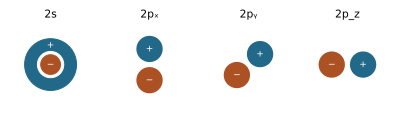
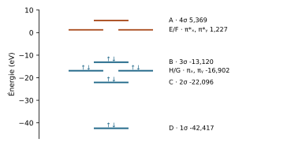
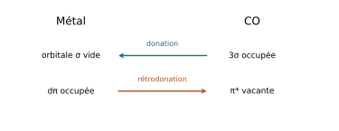
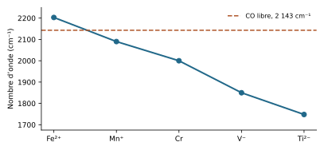
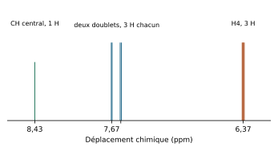
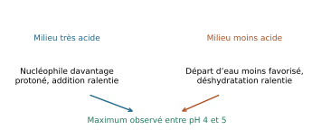
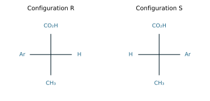

# X–ENS — PC, Chimie A 2019 · Corrigé guidé

*Corrigé rédigé par IA, non officiel.*

**Rédaction (tour 1)** · GPT-6.2 Astra Ultra · vitesse non renseignée

Sur les 63 questions de l’épreuve, 40 sont entièrement traitées et cinq en partie. Q4 attribue les huit OM sans détailler le partage du caractère liant entre les deux niveaux σ les plus bas. Q31 porte sur la conversion transmittance–absorbance et Q40, Q45 et Q47 sur les bilans ou transformations de fonctions indiqués. La partie sur les donneurs de CO se limite aux effets physiologiques, à la RMN du ligand libre et à des lectures qualitatives ou générales de spectrophotométrie. Les 18 questions hors couverture sont marquées à leur emplacement. La lecture s’appuie sur le sujet original (11 pages numérotées et feuillets de tête) et le rapport du jury de chimie A.

## 1. Structure électronique de CO

### Question 1 — Lewis et charges formelles

> [!INDICATION]
> Combien d’électrons peuvent être répartis entre deux atomes dont chacun vise l’octet ?

#### Solution

CO possède dix électrons de valence. Une liaison triple et un doublet libre sur chaque atome donnent $\mathrm{^{-}{:}C{\equiv}O{:}^{+}}$. Les deux octets y sont complets, ce qui en fait l’écriture dominante. Deux écritures de poids moindre s’obtiennent en reportant successivement un doublet liant sur O : $\mathrm{C{=}O}$, neutre, avec un doublet sur C et deux sur O, puis $\mathrm{C^+{-}O^-}$, avec un doublet sur C et trois sur O. Le carbone possède respectivement six et quatre électrons dans ces deux dernières formes. Il y a deux, un puis zéro doublet π dans les trois écritures.

### Question 2 — Orbitales atomiques pertinentes

> [!INDICATION]
> Écarter les couches de cœur et orienter l’axe internucléaire.

#### Solution

C a la configuration $[He]2s^22p^2$ et O $[He]2s^22p^4$. Les orbitales de valence **$2s,2p_x,2p_y,2p_z$** de chaque atome sont les huit fonctions de base. Les $1s$ de cœur sont trop contractées et basses en énergie pour fournir une contribution appréciable à la liaison. Une $2s$ a une symétrie sphérique et un nœud radial. Chaque $2p_i$ a deux lobes de phase opposée et un plan nodal perpendiculaire à l’axe $i$. Pour C–O suivant $z$, $s$ et $p_z$ donnent des OM de symétrie $\sigma$, les $p_x,p_y$ des OM de symétrie $\pi$.

### Question 3 — Énergies relatives des orbitales atomiques

> [!INDICATION]
> Relier la charge nucléaire effective à l’attraction des électrons de valence.

#### Solution

De gauche à droite dans la deuxième période, l’électronégativité augmente globalement. Le nombre de protons augmente et l’écrantage supplémentaire dans une même couche reste incomplet. À type d’orbitale correspondant, **les $2s$ et $2p$ de l’oxygène sont plus basses que celles du carbone**. Il en résulte des combinaisons moléculaires dissymétriques.

### Question 4 — Attribuer les huit dessins du calcul (partie traitée)

> [!INDICATION]
> Classer séparément les orbitales axiales et les deux paires transverses dégénérées.

#### Solution

Le code de gris de la figure 1 donne la phase, non le signe d’une charge. En classant les orbitales axiales par nombre croissant de changements de phase, on lit **D = $1\sigma$ (−42,417 eV), C = $2\sigma$ (−22,096 eV), B = $3\sigma$ (−13,120 eV), A = $4\sigma$ (+5,369 eV)**. La plus haute axiale A est antiliante. B présente un lobe externe marqué du côté carbone et porte le doublet donneur.

Les lobes supérieurs et inférieurs de H indiquent **$\pi_x$**, ceux de G **$\pi_y$**, tous deux liants à −16,902 eV. Le nœud entre les deux centres dans E et F donne **$\pi_x^*$ pour E et $\pi_y^*$ pour F**, toutes deux à +1,227 eV. Une rotation commune autour de l’axe C–O échange les deux membres de chaque paire. Cette réponse attribue les huit niveaux et les caractères des orbitales de frontière et des orbitales π. La répartition individuelle du caractère liant entre les deux niveaux σ les plus bas n’est pas détaillée.

### Question 5 — Remplissage des orbitales moléculaires

> [!INDICATION]
> Les dix électrons de valence occupent combien d’orbitales spatiales ?

#### Solution

En remplissant les niveaux par énergie croissante et en respectant Pauli, le fondamental est **$(1\sigma)^2(2\sigma)^2(\pi_x)^2(\pi_y)^2(3\sigma)^2$**. Les cinq orbitales sont doublement occupées et le spin total vaut zéro. Les deux $\pi^*$ constituent les orbitales vacantes de plus basse énergie.

### Question 6 — Ordre de liaison et doublets non liants

> [!INDICATION]
> Dans le bilan de valence, combien de liaisons sont de type π ?

#### Solution

Les deux OM $\pi$ liantes sont doublement occupées et leurs partenaires $\pi^*$ vides, soit deux liaisons π nettes. Le sous-espace σ occupé rend compte d’une liaison σ nette et de deux doublets à caractère non liant répartis sur les deux extrémités. L’ordre de liaison formel est donc **3**, compatible avec le Lewis dominant à liaison triple. Une valeur de population calculée dans une base particulière n’est pas nécessairement un entier.

### Question 7 — Doublet donneur du carbone

> [!INDICATION]
> Identifier une orbitale occupée et localiser son grand lobe externe.

#### Solution

La plus haute orbitale occupée est $3\sigma$ à −13,120 eV. Le dessin B montre un lobe axial important dirigé vers l’extérieur du **carbone**, situé à gauche. Cette orbitale contient deux électrons et présente un fort caractère de doublet localisé disponible sur C. Une orbitale vacante ne pourrait pas fournir ce doublet.

### Question 8 — Petit moment dipolaire de CO

> [!INDICATION]
> Distinguer polarisation des liaisons et répartition des doublets externes.

#### Solution

Les orbitales liantes sont en partie polarisées vers l’oxygène, plus électronégatif. Le doublet de frontière et une partie de la densité σ sont cependant polarisés vers le carbone. Les différentes contributions au dipôle se compensent presque. La faible résultante expérimentale $0{,}11\ \mathrm D$ traduit un excès de charge du côté C et un déficit du côté O dans le sens du vecteur physique, du pôle négatif vers le pôle positif, **C vers O**. La seule électronégativité ne prédit pas ce signe.

## 2. Liaisons et spectroscopie vibrationnelle

### Question 9 — Coordination par l’extrémité carbone

> [!INDICATION]
> Quelle orbitale occupée a le meilleur recouvrement axial avec un accepteur métallique ?

#### Solution

La HO $3\sigma$ de CO possède son grand lobe externe sur C. Le recouvrement axial avec une orbitale vacante appropriée du métal permet une donation du doublet. La coordination terminale ordinaire se fait donc suivant **M–C–O**.

### Question 10 — Donation et rétrodonation

> [!INDICATION]
> Identifier, de chaque côté, une orbitale remplie et une orbitale vacante de même symétrie.

#### Solution

Le transfert $3\sigma(CO)\longrightarrow$ orbitale métallique vacante de symétrie σ est une donation axiale. Dans le sens inverse, des orbitales métalliques $d_{xz}$ et $d_{yz}$ occupées, pour $z$ suivant M–C–O, peuvent alimenter les $\pi_x^*,\pi_y^*$ vacantes de CO. C’est la rétrodonation. Le carbonyle est donc **σ-donneur et π-accepteur**. Les deux interactions créent de la densité liante entre M et C.

### Question 11 — Effet opposé sur M–C et C–O

> [!INDICATION]
> L’orbitale qui reçoit de la densité est-elle liante entre C et O ?

#### Solution

La rétrodonation renforce la composante π de la liaison métal–carbone. Elle peuple en même temps des orbitales **antiliantes pour C–O**, donc affaiblit et allonge en général cette liaison interne. À masse réduite donnée, l’élongation C–O est attendue à un nombre d’onde plus faible.

### Question 12 — Modèle d’une vibration d’élongation

> [!INDICATION]
> Quel mouvement interne reste après séparation de la translation du centre de masse ?

#### Solution

On représente C et O par deux masses reliées par un ressort de raideur $k$. Près de la distance d’équilibre, l’énergie potentielle est approximativement quadratique et la force de rappel suit la loi de Hooke. Le mouvement relatif est celui d’un oscillateur harmonique de masse réduite $m_Cm_O/(m_C+m_O)$.

### Question 13 — Relation entre nombre d’onde et force de liaison

> [!INDICATION]
> Convertir successivement la pulsation en fréquence puis en nombre d’onde.

#### Solution

Pour la coordonnée interne $u$, $\mu\ddot u+ku=0$. Ainsi $\omega=\sqrt{k/\mu}$, $
u=\omega/(2\pi)$ et **$\widetilde
u=(2\pi c)^{-1}\sqrt{k/\mu}$**. Si $k$ est en $\mathrm{N\,m^{-1}}$ et $\mu$ en kg, prendre $c$ en $\mathrm{cm\,s^{-1}}$ donne le nombre d’onde en $\mathrm{cm^{-1}}$. Un plus grand $k$ donne un nombre d’onde plus élevé.

### Question 14 — Tendance IR dans la série isoélectronique

> [!INDICATION]
> Comparer les densités électroniques des métaux à ligands et nombre d’électrons d identiques.

#### Solution

La série Fe(II), Mn(I), Cr(0), V(−I), Ti(−II) est isoélectronique. En allant vers les centres les plus riches en électrons et les moins fortement attracteurs, la rétrodonation vers $\pi^*(CO)$ augmente. La liaison C–O s’affaiblit, et les fréquences passent de **2203 à 2090, 2000, 1850 puis 1748 $\mathrm{cm^{-1}}$**. Le CO libre est à 2143. Pour le complexe de Fe(II), la rétrodonation réduite laisse prévaloir les autres effets de coordination et de polarisation, et la fréquence dépasse celle du gaz libre. On ne peut donc pas attribuer à toute coordination un décalage rouge universel.

### Question 15 — Chrome atomique

> [!INDICATION]
> Le remplissage réel du chrome neutre respecte-t-il la distribution naïve 4s²3d⁴ ?

#### Solution

Le chrome neutre présente la configuration **$[Ar]3d^54s^1$**. Il compte six électrons de valence dans le décompte du tableau. Le complexe neutre à six ligands CO neutres place formellement le chrome au degré zéro.

### Question 16 — Constante de force en géométrie octaédrique

> [!INDICATION]
> À partir d’un CO choisi, compter les autres ligands à 90° puis à 180°.

#### Solution

Pour le fragment de chrome à six électrons de valence, $k_d=1387\ \mathrm{N\,m^{-1}}$. Autour d’un CO choisi, il existe quatre voisins cis et un trans. Le modèle donne **$k_{CO}=1387+4(27)+128=1623\ \mathrm{N\,m^{-1}}$**. Le ligand de référence lui-même ne s’ajoute pas à la somme.

### Question 17 — Masse réduite de C–O

> [!INDICATION]
> Commencer par la masse réduite molaire puis passer à une seule molécule.

#### Solution

Les masses atomiques approchées donnent $\mu=(12\times16/28)\,\mathrm u=6{,}86\,\mathrm u$. Avec $1\ \mathrm u\simeq1{,}66\times10^{-27}\ \mathrm{kg}$, **$\mu\simeq1{,}14\times10^{-26}\ \mathrm{kg}$**. La masse réduite est inférieure à chacune des masses individuelles.

### Question 18 — Nombre d’onde prédit pour un carbonyle du chrome

> [!INDICATION]
> Le facteur 100 vient-il de la masse ou du passage de m⁻¹ à cm⁻¹ ?

#### Solution

La loi de Hooke avec les deux résultats précédents donne $\widetilde
u\simeq(2\pi\times3{,}0\times10^{10})^{-1}\sqrt{1623/(1{,}14\times10^{-26})}\simeq\mathbf{2{,}00\times10^3\ \mathrm{cm^{-1}}}$. C’est très proche de la valeur de $2000\ \mathrm{cm^{-1}}$ du tableau 2. Le modèle de mode d’élongation local et les arrondis justifient de ne pas donner davantage de chiffres.

## 3. Physiologie et lectures spectroscopiques

### Question 19 — Conséquences physiologiques d’une inhalation

> [!INDICATION]
> Quel constituant du sang assure normalement le transport de l’oxygène ?

#### Solution

Le CO inhalé se fixe fortement à l’hémoglobine, forme de la carboxyhémoglobine et diminue la quantité d’oxygène transportée. Il gêne aussi sa délivrance aux tissus. Une administration respiratoire expose l’ensemble de l’organisme et ne cible pas spécifiquement un tissu. Son principal inconvénient est donc le risque d’hypoxie systémique. Son caractère incolore et inodore empêche de se fier aux sens pour reconnaître une exposition.

*Question 20 hors couverture.*

*Question 21 hors couverture.*

### Question 22 — RMN d’un ligand à trois cycles équivalents

> [!INDICATION]
> Comparer les intégrales de 1 H et de 3 H aux symétries de la molécule.

#### Solution

Le singulet de 1 H à 8,43 ppm est le méthine central lié aux trois azotes. Les trois cycles pyrazolyle sont équivalents, de sorte qu’à chaque position du cycle correspondent trois protons de même déplacement. Le proton central de la suite C3–C4–C5, H4, donne le doublet de doublets à **6,37 ppm** avec les deux couplages 1,6 et 2,5 Hz. Les doublets à 7,67 et 7,58 ppm correspondent aux protons H3 et H5, chacun n’ayant qu’un voisin protoné principal. La seule mesure des deux couplages ne suffit pas pour fixer sans ambiguïté l’étiquette H3 ou H5 de chaque doublet.

*Question 23 hors couverture.*

### Question 24 — Loi de Beer–Lambert

> [!INDICATION]
> Employer des unités de chemin optique compatibles avec celles du coefficient molaire.

#### Solution

**$A(\lambda)=-\log_{10}(I/I_0)=\varepsilon(\lambda)lc$** pour une seule espèce absorbante. $A$ est sans unité, $l$ peut être en cm, $c$ en $\mathrm{mol\,L^{-1}}$ et $\varepsilon$ en $\mathrm{L\,mol^{-1}\,cm^{-1}}$. À longueur d’onde choisie, la solution doit être suffisamment diluée, homogène, sans diffusion appréciable, avec une lumière quasi monochromatique et un blanc corrigé. Pour plusieurs espèces indépendantes on additionne leurs absorbances.

### Question 25 — Lecture qualitative d’une famille de spectres

> [!INDICATION]
> Une hausse uniforme de toute la courbe reproduirait-elle les changements observés ?

#### Solution

Le document 5 montre une diminution de l’absorption dans une partie du domaine visible et une augmentation dans une autre. Les courbes passent près de points de croisement communs, dits **isobestiques**. Pour deux formes qui s’interconvertissent à concentration totale fixe, $A=l(\varepsilon_1c_1+\varepsilon_2c_2)$ devient indépendante des proportions là où $\varepsilon_1=\varepsilon_2$. Ces observations sont compatibles avec la disparition d’une forme et l’apparition de l’autre. Elles ne démontrent pas à elles seules que le mécanisme ne possède aucun intermédiaire.

*Question 26 hors couverture.*

*Question 27 hors couverture.*

*Question 28 hors couverture.*

*Question 29 hors couverture.*

*Question 30 hors couverture.*

### Question 31 — Transmittance et absorbance (partie traitée)

> [!INDICATION]
> L’appareil donne-t-il une fraction ou un pourcentage ?

#### Solution

Pour une transmittance fractionnaire $T=I/I_0$, $A=-\log_{10}T$. Si l’axe est en pourcentage, **$A=-\log_{10}(T_{\%}/100)$**. La relation d’étalonnage d’une espèce isolée à une longueur d’onde donnée est $c=A/(\varepsilon l)$ après correction de la ligne de base. Cette réponse porte sur la lecture et la transformation des unités de spectrophotométrie.

*Question 32 hors couverture.*

*Question 33 hors couverture.*

*Question 34 hors couverture.*

*Question 35 hors couverture.*

*Question 36 hors couverture.*

## 4. Cycle industriel et bilans de fonctions

### Question 37 — Catégories d’actes élémentaires du cycle métallique

> [!INDICATION]
> Suivre la coordinence et distinguer une migration d’une simple coordination.

#### Solution

Le schéma 2 illustre successivement **une addition oxydante, une insertion migratoire formant un acyle, une coordination d’un ligand neutre, puis une élimination réductrice** qui régénère le centre actif. Pendant l’insertion, un groupe organique migre vers le carbone d’un ligand CO déjà coordonné. Une place de coordination devient disponible, ce qui distingue l’insertion de l’association qui suit.

### Question 38 — Degrés d’oxydation de l’iridium

> [!INDICATION]
> Traiter les carbonyles comme des ligands neutres et les halogénures comme des anions.

#### Solution

L’iridium part de **+I**. L’addition oxydante le conduit à **+III**, soit une variation de deux unités. L’insertion migratoire et la coordination du ligand neutre conservent +III, car le ligand alkyle anionique est remplacé par un acyle également anionique. L’élimination réductrice ramène le métal à +I.

*Question 39 hors couverture.*

### Question 40 — Bilan d’hydrolyse d’un dérivé d’acide (partie traitée)

> [!INDICATION]
> Quel groupe remplace l’halogène sur le carbone acyle ?

#### Solution

L’hydrolyse de l’iodure d’acétyle remplace l’iode par OH. Le bilan formel est **$CH_3COI+H_2O\to CH_3COOH+HI$**. En solution aqueuse, la dernière espèce est essentiellement dissociée. La réponse se limite au bilan.

### Question 41 — Équation globale du procédé industriel

> [!INDICATION]
> Éliminer les intermédiaires qui réapparaissent à la fin du cycle.

#### Solution

Le bilan net est **$CH_3OH+CO\longrightarrow CH_3COOH$**. Le méthanol fournit le méthyle et le CO le carbone carbonylé. Les deux atomes de carbone et les deux atomes d’oxygène entrants se retrouvent dans l’acide acétique, de même que les quatre hydrogènes.

*Question 42 hors couverture.*

## 5. Fonctions organiques et stéréochimie de l’ibuprofène

### Question 43 — Équation de l’acylation aromatique

> [!INDICATION]
> Identifier le produit correspondant à l’autre moitié de l’anhydride acétique.

#### Solution

En notant $ArH$ l’isobutylbenzène, le bilan est $ArH+(CH_3CO)_2O\to p\text{-}iBu{-}C_6H_4{-}COCH_3+CH_3COOH$. La fonction créée est une cétone aromatique. Un hydrogène aromatique est remplacé par le groupe acétyle et l’autre moitié de l’anhydride se retrouve sous forme d’acide acétique.

*Question 44 hors couverture.*

### Question 45 — Nature de la transformation de l’ester (partie traitée)

> [!INDICATION]
> Quelle partie du groupe ester change de structure dans une saponification ?

#### Solution

Il s’agit de la **saponification d’un ester éthylique**. Le groupe $-C(=O)OEt$ devient $-CO_2^-$, l’alcool correspondant est l’éthanol et le carboxylate a un contre-ion sodium. Le reste du squelette est conservé dans l’écriture du schéma. Seuls l’identification de la fonction et le bilan de groupes sont traités.

*Question 46 hors couverture.*

### Question 47 — Formation d’une oxime par condensation (partie traitée)

> [!INDICATION]
> Comparer le bilan à une condensation classique entre un carbonyle et un nucléophile azoté.

#### Solution

L’azote nucléophile de $NH_2OH$ forme une liaison avec le carbone du carbonyle. L’adduit initial est une carbinolamine. Des transferts de proton et une élimination d’eau conduisent à la liaison $C=N{-}OH$. Pour un aldéhyde générique, le bilan est $RCHO+NH_2OH\rightleftharpoons RCH=NOH+H_2O$. Les fonctions et le bilan sont traités ici, sans détailler le mécanisme appliqué à la suite de préparation du sujet.

### Question 48 — Deux géométries d’aldoxime

> [!INDICATION]
> Combien de configurations nouvelles la double liaison C=N ajoute-t-elle à un substrat déjà choisi ?

#### Solution

Pour un stéréoisomère fixé de l’aldéhyde 6, le centre stéréogène préexistant garde sa configuration. La double liaison C=N permet **deux** géométries, E et Z, qui sont diastéréoisomères en présence de ce centre. Dans 7 tel que dessiné, le substituant carboné le plus encombrant du carbone et le groupe OH de l’azote sont opposés. Cette disposition **E** limite les contacts stériques et rend sa formation majoritaire plausible.

### Question 49 — Pourquoi la vitesse présente un maximum avec le pH

> [!INDICATION]
> Qu’arrive-t-il au nucléophile quand le milieu devient très acide, et à la déshydratation quand il l’est moins ?

#### Solution

Le maximum de la figure 3 se situe vers **pH 4 à 4,5**. Du côté plus acide, l’hydroxylamine est davantage protonée en $NH_3OH^+$, donc moins disponible sous la forme neutre dont le doublet peut attaquer le carbonyle. L’addition nucléophile tend à limiter la vitesse. Du côté moins acide, la protonation permettant le départ d’eau depuis la carbinolamine est moins efficace. La déshydratation devient limitante. La compétition entre les deux effets explique le profil en cloche.

### Question 50 — Attribution de la nouvelle fonction ester

> [!INDICATION]
> Quelle partie de l’oxime a encore un hydrogène lié à un hétéroatome ?

#### Solution

L’oxime $RCH=N{-}OH$ donne le dérivé **O-acétylé** $RCH=N{-}O{-}C(=O)CH_3$. Le nouveau carbonyle d’ester rend compte de l’absorption proche de $1750\ \mathrm{cm^{-1}}$, absente de l’oxime. L’autre fragment de l’anhydride a pour bilan l’acide acétique.

### Question 51 — Nature du passage au nitrile

> [!INDICATION]
> Quelle petite molécule manque au bilan entre le dérivé O-acétylé et le nitrile ?

#### Solution

Le passage de $RCH=N{-}OAc$ à $RC{\equiv}N$ correspond à une **élimination** d’acide acétique. La multiplicité C–N augmente de deux à trois. À l’échelle de l’oxime de départ, l’ensemble a le bilan d’une déshydratation.

### Question 52 — Site basique du nitrile

> [!INDICATION]
> Placer les doublets sur un nitrile organique, qui est électriquement neutre.

#### Solution

La fonction est $R{-}C{\equiv}N{:}$. Le carbone est lié quatre fois et l’azote porte un doublet libre. **L’azote capte le proton**, donnant $R{-}C{\equiv}N^+{-}H$. Le carbone du nitrile n’a pas de doublet libre dans le Lewis neutre.

### Question 53 — Activation électrophile du nitrile

> [!INDICATION]
> Déplacer un doublet π vers N sans déplacer les noyaux.

#### Solution

Les formes limites sont $R{-}C{\equiv}N^+H\leftrightarrow R{-}C^+{=}NH$. Dans la seconde, le carbone a une lacune et l’azote un doublet libre. Elles décrivent un même ion nitrilium dont le carbone est électrophile. Un nucléophile peut donc former une liaison à ce carbone.

### Question 54 — Hydratation du nitrilium

> [!INDICATION]
> Distinguer l’addition initiale de la tautomérie qui donne l’amide.

#### Solution

Avec $R$ pour le substituant carboné, le doublet de l’eau attaque le carbone de $R{-}C{\equiv}NH^+$ et un doublet π revient sur N. On obtient $R{-}C(OH_2^+){=}NH$, qui par perte de proton donne $R{-}C(OH){=}NH$. La protonation sur N conduit à $R{-}C(OH){=}NH_2^+\leftrightarrow R{-}C^+(OH){-}NH_2$. Un doublet de O peut former C=O, puis la perte du proton de l’oxygène livre $R{-}C(=O){-}NH_2$. C’est une tautomérie acide imidique–amide, relayée par le milieu. Dans ces Lewis, un O neutre porte deux doublets, un $O^+$ un, un N neutre à trois liaisons un et un $N^+$ à quatre liaisons aucun. Le carbone cationique de l’écriture limite possède une lacune.

### Question 55 — Hydrolyse acide d’une fonction amide

> [!INDICATION]
> Quel transfert de proton permet à l’azote de quitter l’intermédiaire tétraédrique ?

#### Solution

Le proton est d’abord capté par un doublet de l’oxygène carbonylé. L’eau attaque le carbone activé, le doublet π allant sur O. Des échanges de protons avec le milieu donnent un intermédiaire de type $R{-}C(OH)_2{-}NH_3^+$. La reformation de C=O à partir d’un doublet de OH et la rupture de C–N vers N libèrent $NH_3$ transitoire. La déprotonation du carboxyle protoné conduit à $RCO_2H$. En milieu acide l’ammoniac se trouve sous forme ammonium. Le bilan de fonctions est **$RCONH_2+H_2O+H^+\to RCO_2H+NH_4^+$**. Les oxygènes neutres ont deux doublets et ceux protonés à trois liaisons un. L’ammoniac en a un, l’ammonium aucun.

*Question 56 hors couverture.*

### Question 57 — Stéréoisomères de l’ibuprofène

> [!INDICATION]
> Le carbone de la ramification isobutyle porte-t-il deux substituants identiques ?

#### Solution

L’ibuprofène possède un seul centre stéréogène, le carbone α du carboxyle qui porte H, méthyle, aryle et carboxyle. La ramification isobutyle porte deux méthyles identiques, donc n’apporte pas d’autre centre. Il existe **deux énantiomères**, $R$ et $S$, images l’un de l’autre dans un miroir et non superposables.

### Question 58 — Configuration absolue de 9S

> [!INDICATION]
> Classer les atomes de la première sphère suivante pour départager les trois substituants carbonés.

#### Solution

À Cα, la priorité CIP est **$CO_2H>Ar>CH_3>H$**. Les atomes suivants sont $O,O,O$ pour le carbone carboxylique, $C,C,C$ pour le carbone ipso aromatique et $H,H,H$ pour le méthyle. En Fischer, placer $CO_2H$ en haut, $CH_3$ en bas, **H à gauche et Ar à droite**, avec Ar = 4-isobutylphényle. Le parcours apparent haut–droite–bas est horaire. Comme le H horizontal pointe vers l’observateur, on inverse ce sens et l’on obtient **S**.

### Question 59 — Résolution d’un mélange racémique

> [!INDICATION]
> Comment transformer une discrimination chirale en différence de propriété mesurable ?

#### Solution

Une chromatographie sur phase stationnaire chirale distingue les interactions diastéréoisomères des deux énantiomères avec le support. On peut aussi former, avec une base chirale énantiopure, deux sels diastéréoisomères d’un acide racémique. Une différence de solubilité peut permettre de séparer les sels, puis de retrouver les acides. Le choix pratique dépend de la résolution réelle obtenue.

### Question 60 — Sélectivité de l’activation biologique

> [!INDICATION]
> Suivre ce qui arriverait si les deux énantiomères subissaient également l’activation et une épimérisation réversible.

#### Solution

Pour que le schéma transforme globalement la forme R en forme S, il faut que l’entrée dans le cycle privilégie R et préserve le produit S libre. Si R et S étaient activés de la même manière, l’interconversion des thioesters suivie d’une hydrolyse non discriminante ramènerait les deux sens de conversion. L’activation énantiosélective fournit une des discriminations nécessaires à l’enrichissement net dans le schéma proposé.

### Question 61 — Deux thioesters avec la coenzyme A

> [!INDICATION]
> Le lien entre le médicament et la coenzyme implique quel atome de la coenzyme ?

#### Solution

Les deux composés ont la formule $Ar{-}CH(CH_3){-}C(=O){-}S{-}CoA$. Le soufre de la coenzyme remplace l’OH du carboxyle, sans déplacement des substituants de Cα. Avec $C(O)SCoA$ en haut et $CH_3$ en bas d’une projection de Fischer, **10R a Ar à gauche et H à droite**, **10S a H à gauche et Ar à droite**. Le classement local conserve le groupe thioester en tête. La coenzyme elle-même est chirale, de sorte que les deux conjugués complets sont des diastéréoisomères qui diffèrent au carbone α.

### Question 62 — Rôle du thioester dans l’épimérisation

> [!INDICATION]
> Quel centre doit devenir temporairement plan pour permettre l’inversion ?

#### Solution

Le proton situé en α du thioester peut être retiré par l’enzyme pour former un énolate stabilisé par délocalisation. Le carbone α devient pratiquement plan, puis sa reprotonation par l’autre face permet la configuration opposée. Le thioester rend cette déprotonation plus accessible que celle de la forme carboxylate libre, pour laquelle elle engendrerait un dianion très défavorable. L’enzyme contrôle l’orientation sans rompre le squelette carbone–carbone.

### Question 63 — Principes de chimie verte présents dans le bilan

> [!INDICATION]
> Quelles propriétés sont démontrées par le cycle et son équation globale ?

#### Solution

Le centre métallique est régénéré, ce qui relève du principe de **catalyse**. L’équation nette incorpore dans l’acide acétique tous les atomes du méthanol et du CO, soit une **économie d’atomes théorique de 100 %**, favorable à la prévention des déchets stœchiométriques. Cela ne donne pas un rendement expérimental de 100 % et ne suffit pas à juger les risques des réactifs, les pertes de procédé, la dépense énergétique ou l’origine du carbone. Ces critères demanderaient des données supplémentaires.
