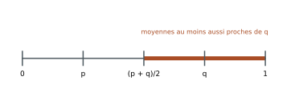

# X–ENS · PC · Mathématiques 2019 · Corrigé brut

*Corrigé rédigé par IA, non officiel. Signalez toute erreur.*

**Rédaction** · GPT-6.2 Astra Ultra · vitesse non renseignée

Une dilation unitaire et un polynôme produit donnent un minorant sur un petit arc du cercle. Avec une inégalité de concentration, ce minorant permet de reconstruire une suite de bits après des effacements aléatoires. [Sujet officiel](https://banques-ecoles.fr/cms/wp-content/uploads/2019/10/2019_PC_sujet_Maths.pdf) · [Rapport du jury](https://banques-ecoles.fr/cms/wp-content/uploads/2019/12/19_PC_rap_eMath.pdf)

## Préliminaires. Norme opératorielle

### Question 1

En notant $x^*=\overline{x}^{\,t}$, on a $x^*x=\sum_{j=0}^{n-1}\bar x_jx_j=\sum_j|x_j|^2=\|x\|_2^2$.

### Question 2

La question 1 donne $\|Ux\|_2^2=x^*U^*Ux=x^*x$ puisque $U^*U=I_n$. Les normes étant positives ou nulles, $\|Ux\|_2=\|x\|_2$.

### Question 3

Si $d=\max_j|d_j|$, alors $\|Dx\|_2^2=\sum_j|d_j|^2|x_j|^2\le d^2\|x\|_2^2$. Pour un indice $j$ réalisant le maximum, $\|De_j\|_2=d$. D’où $\|D\|=d$.

### Question 4

Comme $U$ et $U^{-1}=U^*$ sont unitaires, $x\mapsto U^{-1}x$ permute la sphère unité. Pour $B=UAU^{-1}$, $\|Bx\|_2=\|AU^{-1}x\|_2$ par 2. Prendre le supremum donne $\|B\|=\|A\|$.

## I. Maximum d’un polynôme sur le disque

### Question 5

Écrivons $t=\sqrt{1-|z|^2}$. Dans la base $e_0,\ldots,e_n$, les colonnes extrêmes sont $ze_0+te_1$ et $te_0-\bar z e_1$. Chacune a norme un et leur produit hermitien vaut $\bar zt-t\bar z=0$. Les colonnes restantes sont les vecteurs distincts $e_2,\ldots,e_n$, orthogonaux aux précédentes. Donc $M^*M=I$. Comme $M$ est carrée ce premier résultat la rend inversible avec $M^{-1}=M^*$, d’où aussi $MM^*=I$.

### Question 6

Pour $0\le k\le n$ on a
$$M^ke_0=z^ke_0+t\sum_{j=1}^k z^{k-j}e_j.$$
Au rang zéro la somme est vide. Pour $k<n$, appliquons $M$ en utilisant $Me_0=ze_0+te_1$ et $Me_j=e_{j+1}$ pour $1\le j\le k$. Cela redonne la formule au rang suivant. Puisque $P=e_0$, $P^*M^kP$ est la composante d’indice zéro, égale à $z^k$.

### Question 7

La question 6 donne $f(z)=P^*f(M)P$ pour $\deg f\le n$. Par Cauchy–Schwarz puis par définition de la norme opératorielle, $|f(z)|\le\|P\|_2\|f(M)P\|_2\le\|f(M)\|$, car $\|P\|_2=1$.

### Question 8

Écrivons $M=UDU^{-1}$ avec $|\lambda_j|=1$ sur la diagonale. Alors $f(M)=Uf(D)U^{-1}$ et les questions 3–4 donnent $\|f(M)\|=\max_j|f(\lambda_j)|\le\sup_{|w|=1}|f(w)|$. Combinée à 7, cette borne vaut pour tout $|z|\le1$. L’inclusion du cercle dans le disque donne l’inégalité inverse des suprema. Les polynômes constants, y compris le polynôme nul, satisfont directement l’égalité.

## II. Valeurs sur un petit arc du cercle

### Question 9

Si $|z|=1$, $|A(z)|\le\sum_{k=0}^{n-1}|a_k||z|^k\le n$, puisque $a_k\in\{-1,0,1\}$.

### Question 10a

L’hypothèse $a_0=1$ donne $F(0)=1$. Par le théorème 1, $\sup_{|z|=1}|F(z)|\ge1$. La continuité de $|F|$ sur le cercle compact permet de choisir $z_0$ réalisant ce maximum.

### Question 10b

Les angles des $L$ rotations $z_0e^{2\pi ij/L}$ sont régulièrement espacés. L’un d’eux est, modulo $2\pi$, à distance au plus $\pi/L$ de zéro. Le facteur correspondant a un module au plus $M_L=\max_{|\theta|\le\pi/L}|A(e^{i\theta})|$. Les $L-1$ autres ont module au plus $n$ par 9. Donc $|F(z_0)|\le n^{L-1}M_L$, également pour $L=1$.

### Question 11

Le polynôme non nul s’écrit $A(z)=a_rz^rB(z)$, avec $r$ le premier indice non nul, $a_r=\pm1$ et $B(0)=1$. Les coefficients de $B$ sont encore dans $\{-1,0,1\}$ et on peut les compléter par des zéros jusqu’au degré $n-1$. Par 10a–b, son maximum sur l’arc est au moins $n^{-(L-1)}$. Sur le cercle $|a_rz^r|=1$, donc la même borne vaut pour $A$.

## III. Distinguer deux moyennes de Bernoulli

### Question 12a

Le nombre $1-p+pe^x$ est strictement positif pour $p\in[0,1]$, même aux deux extrémités. Ainsi $g$ est $C^2$ et $g'(x)=pe^x/(1-p+pe^x)$. Une dérivation donne $g''(x)=\alpha\beta/(\alpha+\beta)^2$ avec $\alpha=1-p$, $\beta=pe^x$, tous deux positifs ou nuls.

### Question 12b

L’inégalité $(\alpha-\beta)^2\ge0$ équivaut à $4\alpha\beta\le(\alpha+\beta)^2$. Puisque $\alpha+\beta>0$, on obtient $g''(x)\le1/4$.

### Question 12c

Comme $g(0)=0$ et $g'(0)=p$, la formule à reste intégral donne $g(x)=px+\int_0^x(x-t)g''(t)\,dt\le px+x^2/8$ pour $x\ge0$.

### Question 13a

Pour $s=S_n/n$ et $p<q$, $(s-q)^2-(s-p)^2=(q-p)(p+q-2s)$. La condition $|s-q|\le|s-p|$ équivaut donc à $s\ge(p+q)/2$, avec l’égalité incluse.

### Question 13b

Pour $u>0$, $\mathbb E(e^{uX})=(1-p)e^0+pe^u=1-p+pe^u$.

### Question 13c

Pour $u>0$, l’événement $S_n\ge n(p+q)/2$ impose $e^{uS_n}\ge e^{un(p+q)/2}$. Par Markov et indépendance des $X_i$, sa probabilité est au plus
$$e^{-un(p+q)/2}\prod_{i=1}^n\mathbb E(e^{uX_i})=\exp\{-n[(p+q)u/2-\ln(1-p+pe^u)]\}.$$

### Question 13d

Par 12c, le crochet de 13c est au moins $(q-p)u/2-u^2/8$. Cette parabole atteint son maximum en $u=2(q-p)>0$, où elle vaut $(q-p)^2/2$. D’où la borne $e^{-n(q-p)^2/2}$.

### Question 14

Le cas $p<q$ a été démontré en 13. Pour $p=q$, la probabilité et le majorant valent un. Si $p>q$, les $1-X_i$ sont indépendantes de paramètre $1-p<1-q$. Leur moyenne est $1-S_n/n$ et les deux distances recherchées sont inchangées par le passage au complément. On retrouve $e^{-n(p-q)^2/2}$.

## IV. Reconstruire une source à partir d’observations avec effacements

### Question 15a

L’inégalité $|\sin t|\le|t|$ donne $1-\cos\theta=2\sin^2(\theta/2)\le\theta^2/2$.

### Question 15b

En développant puis en appliquant 15a,
$$\left|\frac{e^{i\theta}-(1-p)}p\right|^2=1+\frac{2(1-p)}{p^2}(1-\cos\theta)\le1+\frac{1-p}{p^2}\theta^2\le\exp\!\left(\frac{1-p}{p^2}\theta^2\right).$$
La racine carrée donne l’exposant $(1-p)\theta^2/(2p^2)$.

### Question 16a

Le bit d’indice $k$ est le $(j+1)$-ième bit gardé exactement si $B_k=1$ et si parmi $B_0,\ldots,B_{k-1}$ il y a $j$ succès. Les variables après $k$ sont libres. Par indépendance, la probabilité est $p\binom kj p^j(1-p)^{k-j}$ pour $0\le j\le k<n$.

### Question 16b

On a $O_j(x)=\sum_{k=j}^{n-1}x_k\mathbf1_{\{N\ge j+1,\,I_j=k\}}$, le remplissage donnant zéro s’il manque un bit. Par linéarité et 16a,
$$\mathbb E O_j(x)=p\sum_{k=j}^{n-1}x_k\binom kjp^j(1-p)^{k-j}.$$

### Question 16c

Pour tout $w\in\mathbb C$,
$$\mathbb E\sum_{j=0}^{n-1}O_j(x)w^j=p\sum_{k=0}^{n-1}x_k\sum_{j=0}^{k}\binom kj(pw)^j(1-p)^{k-j}
=p\sum_{k=0}^{n-1}x_k(pw+1-p)^k.$$

### Question 17a

Comme $x\ne y$, $A_{x,y}$ est non nul et a ses coefficients dans $\{-1,0,1\}$. Posons $L=L_n=\lfloor n^{1/3}\rfloor\ge1$. Le théorème 2 et la continuité sur le segment compact donnent $|\theta_0|\le\pi/L$ avec $|A_{x,y}(e^{i\theta_0})|\ge n^{-(L-1)}$.

### Question 17b

Posons $w=(e^{i\theta_0}-(1-p))/p$ et $\Delta_j=\mathbb EO_j(x)-\mathbb EO_j(y)$. La différence des formules de 16c donne $\sum_j\Delta_jw^j=pA_{x,y}(e^{i\theta_0})$. Par inégalité triangulaire, $\sum_j|\Delta_j|\,|w|^j\ge p/n^{L-1}$.

### Question 17c

Pour $j<n$, 15b donne $|w|^j\le\exp((1-p)\pi^2n/(2p^2L^2))$. Prenons $j_n(x,y)$ réalisant $\max_j|\Delta_j|$. La question 17b donne
$$|\Delta_{j_n(x,y)}|\ge\delta_n,\qquad \delta_n=\frac p{n^L}\exp\!\left(-\frac{(1-p)\pi^2}{2p^2}\frac n{L^2}\right).$$
Choisir le plus petit indice réalisant le maximum fournit le même indice pour $(x,y)$ et $(y,x)$.

### Question 18

Gardons le choix symétrique de 17c. Si la vraie source $x$ surpasse tout $y\ne x$, les comparaisons strictes à une coordonnée commune excluent tout autre vainqueur. L’erreur est donc contenue dans l’union des événements « $x$ ne surpasse pas $y$ ». Pour une paire fixée, les $T$ valeurs $O_j^i(x)$ sont des Bernoulli indépendantes de moyenne $a=\mathbb E O_j(x)$, avec $j=j_n(x,y)$. La moyenne concurrente $b=\mathbb E O_j(y)$ satisfait $|a-b|\ge\delta_n$. Le théorème 3, égalités de distances comprises, majore la probabilité d’échec de cette comparaison par $e^{-T\delta_n^2/2}$. Une borne uniforme de l’erreur est donc
$$u_n=\min\{1,\,(2^n-1)e^{-T_n\delta_n^2/2}\}.$$

Pour $C=(1-p)\pi^2/(2p^2)$, $L\le n^{1/3}$ et $L\ge n^{1/3}/2$, d’où
$$\log(T_n\delta_n^2)\ge 2\log p+(3n^{1/3}-2L)\log n-2Cn/L^2
\ge 2\log p+n^{1/3}(\log n-8C).$$
Le membre droit dépasse $\log n$ d’une quantité tendant vers l’infini. Ainsi $T_n\delta_n^2/n\to\infty$ et $u_n\to0$.

Si des indices distincts ont été fixés pour les deux orientations d’une paire, on peut imposer simultanément que $x$ gagne le test dans les deux orientations. Chacun des deux événements d’échec satisfait le même majorant. Le facteur supplémentaire $2$ dans la borne d’union conserve la conclusion et garantit alors l’unicité du gagnant sur l’événement favorable.
