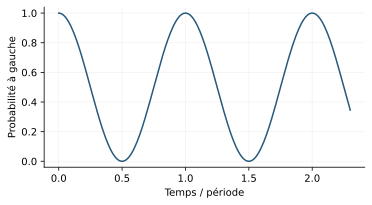
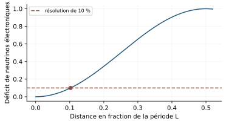
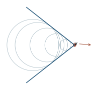
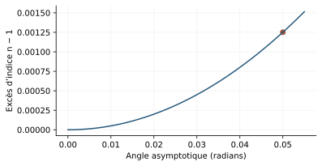
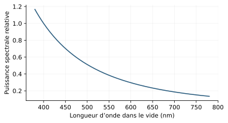

# X, ESPCI et ENS PC 2019 — Physique B · Corrigé brut

*Corrigé rédigé par IA, non officiel. Signalez toute erreur.*

**Lecture du rapport du jury** · GPT-6.2 Astra Ultra · vitesse non renseignée

**Rédaction** · GPT-6.2 Astra Ultra · vitesse non renseignée

## Détection de l’oscillation des neutrinos

## Inversion de l’ammoniac et oscillations de saveur

### Question 1 — Inversion quantique

Les deux configurations pyramidales sont les minima d’un double puits. L’effet tunnel à travers la barrière couple les configurations localisées. Les états stationnaires symétrique et antisymétrique ont alors des énergies différentes. Un état initial localisé superpose ces deux états et la différence de phase accumulée fait osciller les probabilités.

### Question 2 — Amplitudes et normalisation

$C_G$ et $C_D$ sont des amplitudes complexes. Une mesure de position dans les deux configurations orthogonales donne $G$ avec probabilité $|C_G|^2$ et $D$ avec probabilité $|C_D|^2$. La normalisation impose $|C_G|^2+|C_D|^2=1$. La phase relative intervient dans une autre base.

### Question 3 — Évolution stationnaire

Si $H\varphi_\pm=E_\pm\varphi_\pm$, l’équation de Schrödinger donne $\varphi(x,t)=e^{-iE_\pm t/\hbar}\varphi_\pm(x)$ pour la préparation correspondante. La densité de position reste constante car l’exponentielle a pour module un.

### Question 4 — Retour vers la gauche

On inverse la transformation, $\varphi_G=(\varphi_++\varphi_-)/\sqrt2$. Chaque composante acquiert sa phase propre. La projection de la somme sur $G$ fournit $C_G(t)=[e^{-iE_+t/\hbar}+e^{-iE_-t/\hbar}]/2=e^{-i(E_++E_-)t/(2\hbar)}\cos[(E_+-E_-)t/(2\hbar)]$.

### Question 5 — Probabilité et période

Le module carré élimine la phase moyenne. En notant $\Delta E=|E_+-E_-|$, $P_G(t)=\cos^2[\Delta Et/(2\hbar)]=(1+\cos(\Delta Et/\hbar))/2$. La période vaut $T=2\pi\hbar/\Delta E$. La probabilité descend de un à zéro à $T/2$ et remonte à un à $T$.

### Question 6 — Énergie ultrarelativiste

Sur la branche d’énergie positive, $E=pc\sqrt{1+(mc/p)^2}$. Pour $mc\ll p$, $E=pc+m^2c^3/(2p)+O(pc(mc/p)^4)$. Le deuxième terme est le premier qui distingue les masses à quantité de mouvement fixée.

### Question 7 — Écart d’énergie à impulsion fixée

Le terme commun $pc$ s’annule dans $E_1-E_2$. La première différence est $\Delta E\simeq(m_1^2-m_2^2)c^3/(2p)=\Delta m^2 c^3/(2p)$. Elle est positive avec le classement choisi dans l’énoncé.

### Question 8 — Longueur d’oscillation

Dans le mélange égal du modèle, $P_e(\ell)=\cos^2[\Delta E\ell/(2\hbar c)]=\cos^2(\pi\ell/L)$ car $t\simeq\ell/c$. Il vient $L=2\pi\hbar c/\Delta E=4\pi\hbar p/(\Delta m^2c^2)$. En utilisant $E\simeq pc$, $L/E=4\pi\hbar c/(\Delta m^2c^4)$.

### Question 9 — Lecture de KamLAND

La figure 1 représente $\ell/E$. Deux maxima successifs de la courbe d’ajustement se situent vers $34$ et $70\,\mathrm{km/MeV}$. Une période vaut donc environ $36\,\mathrm{km/MeV}=0,036\,\mathrm{m/eV}$. Avec $\hbar c=2,0\,10^{-7}\,\mathrm{eV\,m}$, $\Delta m^2 c^4\simeq 4\pi\hbar c/(L/E)\simeq7\,10^{-5}\,\mathrm{eV}^2$. La réduction du contraste mesuré ne modifie pas la lecture de l’espacement.

### Question 10 — Premier déficit mesurable

Pour que le déficit dépasse $10\,\%$, il faut $1-P_e=\sin^2(\pi\ell/L)\gtrsim0,1$. La première solution vaut $\ell_{\min}=L\arcsin(\sqrt{0,1})/\pi\simeq0,10L$. D’où $\ell_{\min}/E\simeq3,6\,\mathrm{km/MeV}$, soit environ $14\,\mathrm{km}$ à $4\,\mathrm{MeV}$. La valeur en kilomètres dépend de la bande d’énergie étudiée.

### Question 11 — Expériences à courte distance

À $4\,\mathrm{MeV}$, $L\simeq144\,\mathrm{km}$. Les distances du Bugey, de l’ordre de dizaines de mètres, et de Chooz, environ un kilomètre, sont toutes bien inférieures à $14\,\mathrm{km}$. Le déficit attendu est de l’ordre de $(\pi\ell/L)^2$, inférieur à $10^{-3}$ même à un kilomètre. Les ratios voisins de un sur la figure 2 sont cohérents avec ces distances et leurs incertitudes.

### Question 12 — Moyenne sur la source solaire

La distance Soleil–Terre $1,5\,10^8\,\mathrm{km}$ représente plus d’un million de périodes à $4\,\mathrm{MeV}$. Une faible dispersion en énergie mélange les phases à l’arrivée car $L\propto E$. Dans le modèle à deux états de l’exercice, $\langle P_e\rangle=\langle\cos^2\varphi\rangle=1/2$.

## Géométrie du rayonnement Tcherenkov

### Question 13 — Front conique

À l’instant $t$, les sphères émises à $t'<t$ sont centrées sur les anciennes positions et de rayon $u(t-t')$. Si $v>u$, leur enveloppe est un cône dont le sommet est la position actuelle et l’axe la droite de la trajectoire. Il s’ouvre vers l’arrière. Le rayon jusqu’au point de tangence est perpendiculaire à la génératrice. Dans le triangle rectangle, $\sin\alpha=u(t-t')/[v(t-t')]=u/v$. Les perturbations occupent l’intérieur de ce cône pour une trajectoire longue.

### Question 14 — Superposition en phase

Deux émissions séparées de $\Delta t$ ont lieu à une distance $v\Delta t$. Dans la direction de visée d’angle $\theta$, la seconde a $v\Delta t\cos\theta$ de trajet en moins. L’écart de temps d’arrivée est donc $\Delta t(1-v\cos\theta/u)$. Pour que les phases coïncident pour tout couple de points voisins, ce facteur doit s’annuler, d’où $\cos\theta=u/v$.

### Question 15 — Direction de propagation

Les contributions constructives rayonnent tout autour de l’axe sous $\theta=\arccos(u/v)$. Ce rayon est dans l’hémisphère avant. Comme $\sin\alpha=u/v$, on a $\theta+\alpha=\pi/2$ : le rayon est normal à la surface du front d’onde. C’est la relation d’orthogonalité entre rayon et front dans un milieu isotrope.

### Question 16 — Cône dans l’eau

Avec $u=c/n$, $n=1,33$ et $v\simeq c$, $\cos\theta\simeq0,75$. Cette valeur se situe entre $\cos(\pi/6)=0,866$ et $\cos(\pi/4)=0,707$. Ainsi $\pi/6<\theta<\pi/4$, soit environ $41^\circ$.

### Question 17 — Reconstruction de l’événement

La trace lumineuse est l’intersection du cône des rayons d’ouverture connue avec le cylindre et son fond. Sa position repère la direction de l’électron. Sa forme et son extension, après remise en place de la paroi dépliée, contraignent l’inclinaison de l’axe et la distance du sommet aux parois. À angle fixé, une intersection proche d’un plan normal à l’axe a un rayon approximatif $d\tan\theta$. Pour lever les ambiguïtés, on ajuste sommet, axe et instant de départ aux capteurs touchés et aux délais de propagation dans l’eau. La zone rouge arrive avant les zones jaunes puis bleues. Un écart d’environ $70\,\mathrm{ns}$ correspond à quelque $16\,\mathrm m$ de trajet dans l’eau, plausible pour une cuve de plusieurs dizaines de mètres.

### Question 18 — Indice du détecteur LHCb

À grande impulsion toutes les branches tendent vers $\theta_\infty\simeq0,05\,\mathrm{rad}$. Ainsi $n=1/\cos\theta_\infty\simeq1+\theta_\infty^2/2\simeq1,00125$. $n-1\simeq1,3\,10^{-3}$ est beaucoup plus petit que $0,33$ pour l’eau et de quelques fois supérieur aux $3\,10^{-4}$ usuels pour l’air. L’émission demande $v>c/n$, soit un seuil proche de $0,9988c$.

## Puissance spectrale et photons

### Question 19 — Puissance par intervalle de pulsation

$P(\omega)d\omega$ est une puissance. Ainsi $P(\omega)$ a la dimension d’une énergie. Comme $q^2/\epsilon_0$ a celle d’une énergie fois une longueur et $\omega/c$ celle d’un inverse de longueur, l’unique combinaison, à facteur numérique près et avec une puissance quadratique en charge, est $P(\omega)=Aq^2\omega/(\epsilon_0c)$. La dimension de charge impose elle-même le rapport $q^2/\epsilon_0$.

### Question 20 — Spectre en longueur d’onde

La puissance d’un même intervalle doit se conserver, donc $P_\lambda=P(\omega)|d\omega/d\lambda|$. Avec $\omega=2\pi c/\lambda$, $P_\lambda=4\pi^2Aq^2c/(\epsilon_0\lambda^3)$. Cette loi décroît vivement sur le visible. À la différence du spectre solaire terrestre de la figure 5, fort sur une large partie du visible, elle favorise nettement les courtes longueurs d’onde. Le rayonnement apparaît bleu.

### Question 21 — Compter les photons

Pour $\lambda_1<\lambda_2$, le temps d’émission est $D/v$. On divise la puissance de chaque bande par l’énergie d’un photon $hc/\lambda$ avant d’intégrer. Ainsi $N=(D/v)\int_{\lambda_1}^{\lambda_2}P_\lambda\lambda/(hc)\,d\lambda=(D/v)[2\pi Aq^2/(\epsilon_0\hbar)](1/\lambda_1-1/\lambda_2)$.

### Question 22 — Ordre de grandeur dans le visible

Pour $D=0,05\,\mathrm m$, $v\simeq c$, $\lambda_1\simeq400\,\mathrm{nm}$ et $\lambda_2\simeq800\,\mathrm{nm}$, la différence des inverses vaut environ $1,25\,10^6\,\mathrm{m^{-1}}$. L’hypothèse $A\sim1$ et $e^2/(\epsilon_0\hbar c)\simeq0,1$ donnent $N\sim2\pi\times0,1\times0,05\times1,25\,10^6\sim4\,10^4$ photons. Ce décompte de photons émis dépend du facteur supposé et ne tient pas compte du rendement de détection.

## Source en mouvement et polarisation

### Question 23 — Courant en translation

Si l’origine est la position initiale de la charge, $\mathbf j(\mathbf r,t)=q\mathbf v\,\delta^{(3)}(\mathbf r-\mathbf vt)$. La dépendance spatiale et temporelle est donc portée par la combinaison $\mathbf r-\mathbf vt$. Un profil de charge étendu en translation uniforme présente la même combinaison.

### Question 24 — Condition sur une composante de Fourier

Une composante spatiale de ce profil s’écrit $e^{i\mathbf k\cdot(\mathbf r-\mathbf vt)}=e^{i\mathbf k\cdot\mathbf r-i(\mathbf k\cdot\mathbf v)t}$. Par identification, son spectre vérifie $\omega=\mathbf k\cdot\mathbf v$.

### Question 25 — Dispersion dans le milieu

Pour une onde lumineuse de pulsation positive dans le milieu transparent isotrope d’indice $n$, le nombre d’onde vaut $k=n\omega/c$. La vitesse de phase est $\omega/k=c/n=u$.

### Question 26 — Retrouver l’angle

Les conditions source et propagation doivent être satisfaites simultanément. On a $kv\cos\theta=\omega=ku$ et donc $\cos\theta=c/(nv)$. L’existence d’une direction à angle non nul impose $v>c/n$, en accord avec la construction des fronts.

### Question 27 — Polarisation d’un rayon

Le plan contenant $\mathbf k$ et $\mathbf v$ est un plan de symétrie de la source et de la direction d’observation. Le champ électrique, vecteur polaire, est dans ce plan. Il est transverse à $\mathbf k$, donc porté par la projection de $\mathbf v$ sur le plan transversal. Le champ magnétique, axial, est normal au plan de symétrie, avec $\mathbf B=\mathbf k\times\mathbf E/\omega$. Chaque rayon est polarisé linéairement dans son plan méridien.

### Question 28 — Analogie acoustique

Une source supersonique forme un cône de Mach, par la même construction des enveloppes. L’onde sonore de compression dans un fluide est longitudinale. Près du seuil $v\downarrow u$, la direction rayonnée approche celle du mouvement. La vibration acoustique lui est alors presque parallèle, tandis que le champ électrique lumineux lui est presque perpendiculaire. L’analogie concerne la géométrie des fronts, avec deux polarisations physiques différentes.
