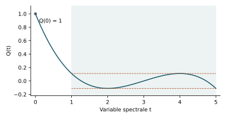
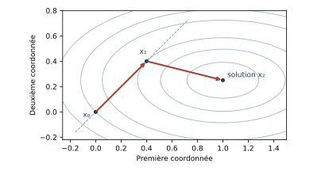

# X–ENS · PSI · Mathématiques 2019 · Corrigé brut

*Corrigé rédigé par IA, non officiel. Signalez toute erreur.*

**Rédaction** · GPT-6.2 Astra Ultra · vitesse non renseignée

**Révision (tour 1)** · GPT-6.2 Astra Ultra · vitesse non renseignée

Le problème construit le gradient conjugué pour résoudre un système symétrique défini positif. Le nombre de composantes spectrales actives fixe son rang d’arrêt exact. [Sujet officiel](https://www.ens.psl.eu/sites/default/files/19_psi_math_sujet.pdf)

On note $\bar x=A^{-1}b$, $r_k=b-Ax_k$ et $e_k=x_k-\bar x$. La norme d’énergie vérifie $\|u\|_A^2=\langle Au,u\rangle$. La vérification suit les questions du sujet officiel. Le rapport écrit de mathématiques de cette session reste introuvable dans les archives consultées.

## I. Normes et calcul spectral

### Question 1

Le théorème spectral donne des valeurs propres réelles. Si $A$ est définie positive, $\lambda\|v\|^2=\langle Av,v\rangle>0$ pour tout vecteur propre $v\ne0$, donc $\lambda>0$. Réciproquement, dans une base propre orthonormée, $\langle Ax,x\rangle=\sum_i\lambda_ix_i^2$ est strictement positif pour $x\ne0$ si toutes les valeurs propres le sont.

### Question 2

La sphère unité est compacte et $x\mapsto\|Bx\|$ y est continue. Sa borne supérieure est donc finie et atteinte. Elle est positive ou nulle, homogène en $B$, et sous-additive par l’inégalité triangulaire appliquée aux images de chaque vecteur unitaire. Si elle vaut zéro, $Be_i=0$ pour tous les vecteurs de base et $B=0$. Cela définit une norme, notée ici $\|B\|_{\rm op}$. Pour $x\ne0$, tester en $x/\|x\|$ donne $\|Bx\|\le\|B\|_{\rm op}\|x\|$. L’inégalité vaut aussi pour $x=0$.

### Question 3

Si $L=\max_i|\lambda_i|$, dans une base propre orthonormée $\|Ax\|^2=\sum_i\lambda_i^2x_i^2\le L^2\|x\|^2$. Un vecteur propre unitaire associé à un indice maximal atteint $L$. Ainsi $\|A\|_{\rm op}=L$.

### Question 4a

La forme $(u,v)_A=\langle Au,v\rangle$ est bilinéaire, symétrique par symétrie de $A$, et définie positive par hypothèse. C’est un produit scalaire. Sa norme associée est $\|x\|_A=\sqrt{\langle Ax,x\rangle}$.

### Question 4b

En base propre orthonormée, $\lambda_{\min}\sum x_i^2\le\sum\lambda_i x_i^2\le\lambda_{\max}\sum x_i^2$. Les constantes demandées sont $C_1=\sqrt{\lambda_{\min}}>0$ et $C_2=\sqrt{\lambda_{\max}}$. Les vecteurs propres aux extrêmes donnent l’égalité correspondante.

### Question 5

Dans une base propre orthonormée de $A$, la matrice de $P(A)$ est diagonale réelle de termes $P(\lambda_i)$, donc $P(A)$ est symétrique. Ses valeurs propres sont les valeurs distinctes $\mu=P(\lambda_i)$. Le sous-espace propre pour $\mu$ est la somme directe des espaces propres de $A$ d’indices tels que $P(\lambda_i)=\mu$. Ses éléments non nuls sont exactement les vecteurs propres associés.

### Question 6a

Dans la base orthonormée des colonnes de $U$, les projecteurs $p_{F_i}$ conservent les coordonnées du bloc propre $\lambda_i$ et annulent les autres. Leur somme pondérée par $\sqrt{\lambda_i}$ a donc pour matrice $D^{1/2}$. Revenir à la base canonique donne $A^{1/2}=UD^{1/2}U^t$.

### Question 6b

La matrice $A^{1/2}$ est symétrique, de valeurs propres $\sqrt{\lambda_i}>0$, donc définie positive par 1. Son carré est $UDU^t=A$. Elle commute avec son carré, donc avec $A$.

### Question 6c

Par symétrie et 6b, $\|A^{1/2}x\|^2=\langle x,(A^{1/2})^tA^{1/2}x\rangle=\langle x,Ax\rangle=\|x\|_A^2$. Les deux normes sont positives ou nulles.

## II. Espaces de Krylov et nombre de pas

### Question 7a

En autorisant naturellement le polynôme nul, $H_k=\operatorname{Vect}(r_0,Ar_0,\ldots,A^{k-1}r_0)$ pour $k\ge1$. C’est un sous-espace, contenu dans $H_{k+1}$. L’inclusion vaut aussi pour $H_0=\{0\}$.

### Question 7b

On lit $H_k$ pour le symbole $K_k$ imprimé ici, lequel n’a pas été défini. Si toutes les inclusions jusqu’à $H_{N+1}$ étaient strictes, cet espace aurait dimension au moins $N+1$. Il existe donc $k\le N$ avec $H_{k+1}=H_k$. Comme $r_0=-A(x_0-\bar x)\ne0$, le premier tel entier $m$ est au moins un.

### Question 7c

Chaque étape ajoute au plus un générateur. Avant $m$, chaque inclusion est stricte, donc $\dim H_k=k$ pour $0\le k\le m$. À l’égalité, $AH_m\subset H_{m+1}=H_m$. Toutes les puissances suivantes de $A$ appliquées à $r_0$ restent donc dans $H_m$, ce qui impose $H_k=H_m$ et $\dim H_k=m$ dès $k\ge m$.

On peut repérer le premier arrêt sans calculer tous les espaces. Avant lui, les $k$ colonnes de la matrice $[r_0\ Ar_0\ \ldots\ A^{k-1}r_0]$ sont indépendantes. Dès que la colonne suivante dépend des précédentes, appliquer $A$ à cette relation ramène toutes les colonnes ultérieures dans le même espace.

### Question 8a

Si $Ar_0=\lambda r_0$, toutes ses puissances sont colinéaires à $r_0\ne0$. Ainsi $H_1=H_2$ est une droite et $m=1$.

### Question 8b

Posons $u_i=p_{F_i}r_0$ et $I=\{i:u_i\ne0\}$. Comme $A^jr_0=\sum_{i\in I}\lambda_i^ju_i$, les espaces sont contenus dans $\operatorname{Vect}(u_i:i\in I)$. Réciproquement, le polynôme de Lagrange $P_i$ de degré au plus $|I|-1$ valant $1$ en $\lambda_i$ et $0$ aux autres nœuds actifs satisfait $P_i(A)r_0=u_i$. Ces vecteurs non nuls et orthogonaux sont indépendants. Il en résulte $m=|I|\le d$.

Explicitement, $P_i(X)=\prod_{j\in I\setminus\{i\}}(X-\lambda_j)/(\lambda_i-\lambda_j)$. Le produit vide vaut un, ce qui comprend le cas d’un seul espace propre actif. Même si une valeur propre a multiplicité supérieure à un, les puissances de $A$ n’y engendrent que la droite portée par $u_i$.

### Question 8c

Choisissons un vecteur non nul $u_i$ dans chacun de $n$ espaces propres distincts et posons $r=\sum u_i$. Alors $x_0=\bar x-A^{-1}r$ fournit $r_0=r$ et exactement $n$ composantes propres non nulles. La réponse à 8b donne $m=n$.

### Question 8d

Comme $p_{F_i}r_0=-\lambda_i p_{F_i}(x_0-\bar x)$ et $\lambda_i>0$, une composante manque précisément si $x_0\in\bar x+F_i^\perp$. Par 8b, l’ensemble où $m=d$ est le complémentaire de $\bigcup_{i=1}^d(\bar x+F_i^\perp)$. Chaque sous-espace directeur est de dimension $N-\dim F_i\le N-1$.

### Question 9

Les indices actifs de $e_0=x_0-\bar x$ sont les mêmes que ceux de $r_0=-Ae_0$. Le polynôme $Q(X)=\prod_{i\in I}(X-\lambda_i)$ est de degré $m$ et $Q(A)e_0=0$ par décomposition spectrale.

### Question 10

Pour tout $Q$ de degré $m$ tel que $Q(A)e_0=0$, projeter sur $F_i$ donne $Q(\lambda_i)p_{F_i}e_0=0$. Il faut donc les $m$ racines distinctes actives. Elles épuisent le degré et sont toutes strictement positives, d’où $Q(0)\ne0$.

### Question 11a

Écrivons $Q(X)=Q(0)+XR(X)$, avec $\deg R\le m-1$. L’annulation donne $Q(0)e_0=-AR(A)e_0=R(A)r_0$. Ainsi $\bar x-x_0=-e_0=-R(A)r_0/Q(0)\in H_m$.

### Question 11b

Pour $k=0$, $\bar x\ne x_0$. Si $\bar x=x_0+P(A)r_0$ pour $1\le k<m$ et $\deg P\le k-1$, alors $(I-AP(A))e_0=0$. Le polynôme $1-XP(X)$ vaut un en zéro et annule pourtant les $m$ valeurs propres actives d’après l’argument de 10. Son degré au plus $k<m$ rend cela impossible.

## III. Minimisation et borne de Tchebychev

### Question 12

Par symétrie et $A\bar x=b$, $\|x-\bar x\|_A^2=\langle Ax,x\rangle-2\langle b,x\rangle+\langle b,\bar x\rangle=2[J(x)-J(\bar x)]$. Le carré est positif ou nul et s’annule exactement pour $x=\bar x$. Cela donne l’existence et l’unicité du minimum global.

### Question 13

Le sous-espace $H_k$ est fermé en dimension finie. La projection orthogonale pour $(\cdot,\cdot)_A$ de $\bar x-x_0$ sur $H_k$ existe et est unique. En la translatant de $x_0$, on obtient l’unique point de $x_0+H_k$ le plus proche de $\bar x$ en norme $A$, donc l’unique minimiseur de $J$ sur cet espace affine par 12.

### Question 14

L’identité de 12 montre que minimiser $J(x)$ sur $x_0+H_k$ revient exactement à minimiser $\|x-\bar x\|_A$. Ainsi $\|x_k-\bar x\|_A=\min_{x\in x_0+H_k}\|x-\bar x\|_A$. En outre, $(x_k-\bar x,h)_A=0$ pour tout $h\in H_k$, ce qui équivaut à $\langle r_k,h\rangle=0$.

### Question 15

Pour $k<m$, 11b exclut $\bar x$ de $x_0+H_k$, donc $e_k\ne0$. Pour $k\ge m$, 11a et les inclusions donnent $\bar x\in x_0+H_k$. Par unicité, $x_k=\bar x$ et $e_k=0$.

### Question 16

Une erreur admissible s’écrit $e_0+P(A)r_0=(I-AP(A))e_0$. Le polynôme $Q=-P$ parcourt tous les polynômes de degré au plus $k-1$ comme $P$. Par 14, le minimum des $\|(I+AQ(A))e_0\|_A$ est $\|e_k\|_A$. Au rang zéro on conserve seulement le polynôme nul.

### Question 17

Pour $B=I+AQ(A)$, 6 et la décomposition spectrale donnent $A^{1/2}B=BA^{1/2}$. Ainsi $\|Be_0\|_A=\|BA^{1/2}e_0\|\le\|B\|_{\rm op}\|e_0\|_A$. Minimiser fournit l’inégalité par 16. Le minimum de $\|B\|_{\rm op}$ existe, car l’ensemble des matrices $B$ est un sous-espace affine fermé en dimension finie et toute suite minimisante y est bornée.

### Question 18

Les polynômes $1+XQ(X)$ décrivent exactement $\Lambda_k$. Pour $R\in\Lambda_k$, $R(A)$ est symétrique et $\|R(A)\|_{\rm op}=\max_i|R(\lambda_i)|\le\max_{[\lambda_1,\lambda_N]}|R|$ par 3 et 5. Le minimum sur $\Lambda_k$ fournit la borne. Il existe car la norme uniforme sur cet intervalle non réduit à un point est une norme sur l’espace de dimension finie des polynômes de degré au plus $k$, et $\Lambda_k$ y est fermé.

Pour détailler l’existence, la constante $1$ fournit un concurrent de norme uniforme $1$. On peut donc choisir une suite minimisante dans la boule de rayon $2$. En dimension finie, une sous-suite converge dans cette norme. La condition $R(0)=1$ passe à la limite par continuité de l’évaluation des polynômes de degré borné, même si $0$ est extérieur à l’intervalle spectral.

### Question 19a

Pour $k\ge1$ et $\theta=\arccos x$, $\cos((k+1)\theta)+\cos((k-1)\theta)=2\cos\theta\cos(k\theta)$. On obtient $f_{k+1}(x)=2xf_k(x)-f_{k-1}(x)$.

### Question 19b

Posons $T_0=1$, $T_1=X$ et $T_{k+1}=2XT_k-T_{k-1}$. Par 19a, $T_k=f_k$ sur $[-1,1]$. Si les degrés précédents sont $k$ et $k-1$, le terme de degré $k+1$ subsiste dans la récurrence. Les deux termes ont la parité de $k+1$, donc $T_{k+1}$ également. L’initialisation donne les assertions à tout rang.

### Question 20

Pour $t\ge0$, $\cosh((k+1)t)+\cosh((k-1)t)=2\cosh(t)\cosh(kt)$. Les valeurs initiales donnent donc par récurrence $T_k(\cosh t)=\cosh(kt)$. Pour $x\le-1$, écrire $-x=\cosh(\operatorname{arcosh}(-x))$ et appliquer la parité de 19b. Il vient $T_k(x)=(-1)^k\cosh(k\operatorname{arcosh}(-x))$.

### Question 21

Écrivons $a=\lambda_1$, $b=\lambda_N$. Comme $0<a<b$, $-(b+a)/(b-a)<-1$ et 20 donne un dénominateur non nul pour $\omega_k$. La transformation $t\mapsto(2t-a-b)/(b-a)$ envoie $[a,b]$ sur $[-1,1]$ et zéro sur $-(b+a)/(b-a)$. Ainsi $Q_k(0)=1$, $\deg Q_k=k$ et $Q_k\in\Lambda_k$. Sur l’intervalle spectral, $|T_k|\le1$ et l’égalité est atteinte en $t=b$. Le maximum vaut donc $|\omega_k|$.

### Question 22

Pour $\beta=(b+a)/(b-a)>1$, $\theta=\operatorname{arcosh}\beta>0$. Comme $\alpha=e^{-\theta}$, $\alpha+\alpha^{-1}=2\beta$. Donc $\alpha^2-2\beta\alpha+1=0$. Les deux racines sont $\beta\pm\sqrt{\beta^2-1}$. Puisque $0<\alpha<1$, c’est la petite racine $\alpha=\beta-\sqrt{\beta^2-1}$.

### Question 23

Avec $\kappa=b/a>1$, $\beta=(\kappa+1)/(\kappa-1)$ et $\sqrt{\beta^2-1}=2\sqrt\kappa/(\kappa-1)$. La différence vaut $\alpha=(\sqrt\kappa-1)/(\sqrt\kappa+1)$. Par 20–21,
$$|\omega_k|=\frac1{\cosh(k\theta)}=\frac{2\alpha^k}{1+\alpha^{2k}}\le2\alpha^k.$$
En choisissant $Q_k$ dans 18, on trouve $\|x_k-\bar x\|_A\le2\|e_0\|_A[(\sqrt\kappa-1)/(\sqrt\kappa+1)]^k$.

## IV. Construction du gradient conjugué

### Question 24

Les $r_0,Ar_0,\ldots,A^{m-1}r_0$ forment une base de $H_m$ par 7c. Appliquer Gram–Schmidt à ces vecteurs dans cet ordre, pour $(\cdot,\cdot)_A$, fournit des $p_0,\ldots,p_{m-1}$ non nuls et mutuellement $A$-orthogonaux. À chaque rang l’orthogonalisation conserve l’espace engendré par le préfixe, qui est précisément $H_k$.

Pour (i), au rang $j$ le coefficient du vecteur $A^j r_0$ dans son orthogonalisé vaut un. Le changement de famille sur tout préfixe est ainsi triangulaire inversible. Pour (ii), chaque terme soustrait est la projection selon $(\cdot,\cdot)_A$ sur une direction précédente, d’où $\langle Ap_i,p_j\rangle=0$ pour $i<j$.

### Question 25

La différence $x_{k+1}-x_k$ appartient à $H_{k+1}$. Par 14, $e_{k+1}$ et $e_k$ sont $A$-orthogonaux à $H_k$, donc leur différence aussi. Dans $H_{k+1}=H_k\oplus_A\mathbb Rp_k$, elle appartient par conséquent à $\mathbb Rp_k$.

### Question 26(i)

Dans cette preuve commune aux quatre assertions, enlevons provisoirement les tildes aux quantités calculées. Au rang zéro, $p_0=r_0\ne0$ est une base de $H_1$, et $r_0=b-Ax_0$ est orthogonal à $H_0$. Supposons qu’au rang $k<m$, les directions jusqu’à $p_k$ constituent une base $A$-orthogonale de $H_{k+1}$, que $x_k$ est le minimiseur et que $r_k=b-Ax_k\perp H_k$. En particulier, $r_k\ne0$ par 15. Comme $p_k-r_k\in H_k$, $\langle r_k,p_k\rangle=\|r_k\|^2$. Le dénominateur $\langle Ap_k,p_k\rangle$ est strictement positif. Le pas imprimé annule donc $\langle r_k-\alpha_kAp_k,p_k\rangle$. Pour tous les $i<k$, $\langle r_k-\alpha_kAp_k,p_i\rangle=0$ aussi par les hypothèses. D’où
$$r_{k+1}=r_k-\alpha_kAp_k\ \perp H_{k+1}.$$
Les $r_i$ appartiennent à $H_{i+1}$, car $r_i=r_0-A(x_i-x_0)$ et $x_i-x_0\in H_i$. Les orthogonalités entre résidus distincts et entre les directions antérieures et le nouveau résidu suivent.

Pour $k+1<m$, vérifions la conjugaison de $p_{k+1}=r_{k+1}+\beta_kp_k$. Quand $i<k$, $Ap_i=(r_i-r_{i+1})/\alpha_i\in H_{k+1}$, donc $\langle Ap_i,p_{k+1}\rangle=0$. Pour $i=k$, $\langle Ap_k,r_{k+1}\rangle=-\|r_{k+1}\|^2/\alpha_k$. Le terme $\beta_k\langle Ap_k,p_k\rangle=\|r_{k+1}\|^2/\alpha_k$ l’annule. Les étapes de projection et d’indépendance qui ferment cette récurrence sont précisées ci-dessous.

### Question 26(ii)

Dans le pas précédent, $x_{k+1}=x_k+\alpha_kp_k\in x_0+H_{k+1}$. Son résidu est orthogonal à $H_{k+1}$, donc son erreur est $A$-orthogonale à cet espace directeur. La propriété de projection de 14 prouve que c’est l’unique minimiseur sur $x_0+H_{k+1}$. Cela établit $\widetilde x_j=x_j$ jusqu’à $j=m$, y compris le rang zéro où l’espace affine est réduit à $x_0$.

Le point de départ est le sous-espace affine $x_0+H_k$, écrit à la question 13. Sur cette translation, pour $h\in H_k$, la variation est $J(x_k+h)-J(x_k)=-\langle r_k,h\rangle+\tfrac12\langle Ah,h\rangle$. L’annulation du premier terme et la positivité du second donnent une vérification directe du minimum.

### Question 26(iii)

Au départ $\widetilde r_0=b-A\widetilde x_0$. L’identité persiste car $b-A(\widetilde x_k+\alpha_k\widetilde p_k)=\widetilde r_k-\alpha_k A\widetilde p_k=\widetilde r_{k+1}$. Par (ii), $\widetilde r_j=b-Ax_j=r_j$ jusqu’au rang $m$, où il vaut zéro.

### Question 26(iv)

Lorsque $k+1<m$, $r_{k+1}\ne0$ par 15 et (ii)–(iii). Il appartient à $H_{k+2}$ et est orthogonal à $H_{k+1}$. Ainsi $p_{k+1}=r_{k+1}+\beta_kp_k$ appartient à $H_{k+2}$ et reste hors de $H_{k+1}$. Il complète donc la base précédente en une base, car les dimensions sont $k+1$ et $k+2$. Avec la conjugaison établie en (i), cela ferme l’induction. À la dernière mise à jour $r_m=0$, et aucune division par $\|r_m\|^2$ n’est requise.

Prenons $A=\operatorname{diag}(1,4)$, $b=(1,1)$ et $x_0=0$. Alors $p_0=r_0=(1,1)$, $\alpha_0=2/5$ et $x_1=(2/5,2/5)$. Le résidu devient $r_1=(3/5,-3/5)$, orthogonal à $r_0$. Comme $\beta_0=9/25$, on trouve $p_1=(24/25,-6/25)$ puis $\alpha_1=5/8$. Le point $x_2=(1,1/4)$ vérifie bien $Ax_2=b$. On a aussi $\langle Ap_0,p_1\rangle=24/25-24/25=0$.

