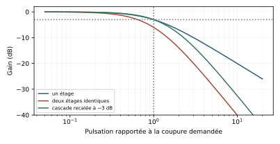
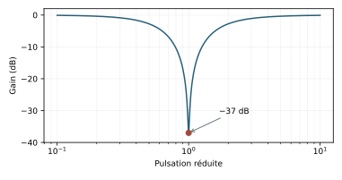
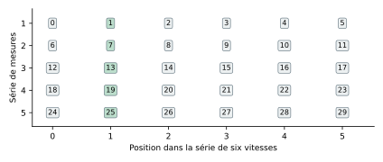

# X-ENS PSI · Modélisation 2019 · Corrigé partiel brut

*Corrigé rédigé par IA, non officiel. Signalez toute erreur.*

**Rédaction** · GPT-6.2 Astra Ultra · vitesse non renseignée · 24 novembre 2026

Ce corrigé partiel traite 19 des 49 questions. Il couvre les usages civils et les changements de base (Q1 à Q3), la flottabilité et l’inertie (Q6 à Q8), les nombres sans dimension (Q13 et Q14), la métrologie de laboratoire et les statistiques (Q23 à Q32), ainsi que la perturbation d’un magnétomètre (Q34). Les questions 4, 5, 9 à 12, 15 à 22, 33 et 35 à 49 sont hors du périmètre de cette édition.

## Usages civils et repères géométriques

### Question 1 · Trois usages civils

On peut cartographier les reliefs et les habitats du fond marin, mesurer la température et la salinité le long d’un transect océanographique, ou inspecter l’état extérieur de conduites sous-marines. Ces trois missions fournissent respectivement une carte, un profil de mesures et des images d’inspection.

### Question 2 · Changement de base autour de la verticale

Avec $c=\cos\psi$ et $s=\sin\psi$, on a $\vec x_0=c\vec x_2-s\vec y_2$ et $\vec y_0=s\vec x_2+c\vec y_2$. La matrice qui reçoit les composantes dans la base 0 et renvoie les composantes dans la base 2 a pour colonnes précisément ces vecteurs exprimés dans la base 2,

$$
P_{2\leftarrow0}=\begin{pmatrix}c&s&0\\-s&c&0\\0&0&1\end{pmatrix}.
$$

Dans la convention usuelle où $P_\psi$ a pour colonnes les axes **nouveaux exprimés dans l’ancienne base**, $P_\psi=P_{0\leftarrow2}=P_{2\leftarrow0}^{t}$. Les deux applications sont inverses. Le test $\psi=\pi/2$ donne $\vec x_0=-\vec y_2$.

### Question 3 · Deux autres rotations élémentaires

Notons $c_t=\cos\theta$, $s_t=\sin\theta$, $c_r=\cos\varphi$, $s_r=\sin\varphi$. Pour les coordonnées anciennes exprimées dans les bases successives indiquées par l’énoncé, les deux transformations sont

$$
P_{(x_1,y_2,z_3)\leftarrow(x_2,y_2,z_0)}
=\begin{pmatrix}c_t&0&-s_t\\0&1&0\\s_t&0&c_t\end{pmatrix},
\qquad
P_{(x_1,y_1,z_1)\leftarrow(x_1,y_2,z_3)}
=\begin{pmatrix}1&0&0\\0&c_r&s_r\\0&-s_r&c_r\end{pmatrix}.
$$

En particulier $\vec x_2=c_t\vec x_1+s_t\vec z_3$ et $\vec y_2=c_r\vec y_1-s_r\vec z_1$. Si, dans le produit $P_{01}=P_\psi P_\theta P_\varphi$, on range en colonnes les axes de la base nouvelle dans la précédente, $P_\theta$ et $P_\varphi$ sont les transposées des deux matrices affichées. Chaque matrice est orthogonale et son déterminant vaut un.

## Flottabilité et inertie

### Question 6 · Flottabilité passive

Pour le modèle cylindrique de diamètre $0{,}22\ \mathrm m$ et de longueur $2\ \mathrm m$, le volume immergé vaut $\pi(0{,}11)^2\times2\simeq0{,}0760\ \mathrm{m^3}$. Avec $\rho\simeq1000\ \mathrm{kg/m^3}$, la masse déplacée est d’environ $76\ \mathrm{kg}$. Pour la masse maximale retenue de $70\ \mathrm{kg}$, la résultante verticale a le sens de la remontée et vaut environ $(76-70)g\simeq59\ \mathrm N$. L’exigence est satisfaite pour ce cylindre. Pour une forme réelle dont les extrémités sont profilées, c’est le volume déplacé réel qui doit dépasser $0{,}070\ \mathrm{m^3}$ à cette masse.

### Question 7 · Équilibre et stabilité d’un flotteur immergé

La poussée d’Archimède, appliquée en C, est verticale vers le haut. Le poids, appliqué en G, est vertical vers le bas. L’absence de moment d’assiette impose l’alignement vertical de C et G, soit $X_G=Y_G=0$. Si G est **au-dessous** de C ($Z_G>0$ avec l’axe descendant du sujet), une inclinaison écarte la ligne d’action du poids et crée un moment de rappel. Dans le mouvement angulaire autour de C, l’augmentation d’énergie potentielle du poids est $mgZ_G(1-\cos\beta)$ pour une inclinaison $\beta$. G au-dessus donne une position instable. G confondu avec C donne une orientation indifférente. Le couple d’assiette s’annule même si la résultante verticale assure la remontée de Q6.


### Question 8 · Produits d’inertie

Au centre de gravité, la matrice d’inertie est symétrique. Le choix du point G n’annule pas en général ses produits d’inertie dans la base imposée. Les plans de symétrie de la forme extérieure cités pour C ne garantissent pas des symétries de **masse** autour de G, comme le relève le jury. En l’absence d’information supplémentaire, on conserve les trois termes croisés du sujet. Dans une base principale choisie à G, la matrice serait diagonale. Par exemple, une symétrie matérielle par rapport au plan $(G,x_1,z_1)$ annulerait seulement $I_{xy}$ et $I_{yz}$.

## Écoulement de l’eau

### Question 13 · Compressibilité de l’eau

Le nombre de Mach vaut $1{,}5/1500=10^{-3}$. Les variations de masse volumique liées à la vitesse sont négligeables dans cette expérience. L’équation générale $\partial_t\rho+\nabla\cdot(\rho\vec v)=0$ se réduit à $\nabla\cdot\vec v=0$ dans le modèle incompressible.

### Question 14 · Régime d’un écoulement externe

Pour un écoulement axial et la longueur de référence $L=2\ \mathrm m$, $Re_L=\rho U L/\mu\simeq1000\times1{,}5\times2/(1{,}1\times10^{-3})\simeq2{,}7\times10^6$. Les effets inertiels dominent à l’échelle du corps. Une couche limite peut transiter et devenir turbulente en aval. Son état local dépend aussi du bord d’attaque, des perturbations et de la rugosité. Si l’on annonce comme échelle le diamètre $D=0{,}22\ \mathrm m$, on obtient $Re_D\simeq3{,}0\times10^5$, un autre nombre caractéristique du même essai. Le seuil d’un écoulement en conduite ne s’applique pas directement.

## Conditionnement des mesures en laboratoire

### Question 23 · Équation et pulsation du passe-bas

Le premier ordre de gain statique unitaire est $H(p)=\omega_c/(p+\omega_c)$, soit $\dot s+\omega_cs=\omega_c e$. Les crêtes de l’ondulation lente du signal brut sont vers $4{,}5$, $6{,}5$, $8{,}5$, $10{,}5$ et $12{,}5\ \mathrm s$, à l’incertitude du graphique près. La période apparente vaut environ $2\ \mathrm s$, soit $f\simeq0{,}5\ \mathrm{Hz}$ et $\omega\simeq\pi\ \mathrm{rad/s}$. La coupure demandée est $\omega_c\simeq\pi/3\simeq1{,}05\ \mathrm{rad/s}$.

### Question 24 · Discrétisation d’Euler explicite

$\dot s(t_{k-1})=\omega_c(e_{k-1}-s_{k-1})$ et $s_k\simeq s_{k-1}+h\dot s(t_{k-1})$. Ainsi $s_k=(1-h\omega_c)s_{k-1}+h\omega_c e_{k-1}$. La partie homogène est stable pour $|1-h\omega_c|<1$. Aux données de Q23, $h=10^{-3}\ \mathrm s$ donne $h\omega_c\simeq0{,}00105$.

### Question 25 · Filtrer un tableau de mesures

```python
def filtre1(e, h, wc):
    if len(e) == 0:
        return []
    s = [float(e[0])]
    gain = h * wc
    for k in range(1, len(e)):
        s.append(s[-1] + gain * (e[k-1] - s[-1]))
    return s
```
Le départ $s_0=e_0$ suppose une sortie initialement en équilibre avec la première mesure. Si l’expérience impose une sortie initiale nulle, remplacer l’initialisation par $s_0=0$. Le tableau retourné a la même longueur que l’entrée. Temps et stockage de sortie sont linéaires.

### Question 26 · Deux étages en cascade

La cascade de deux étages de même paramètre se calcule par `s2 = filtre1(filtre1(sBr, h, wc), h, wc)`. Elle donne $H_2(p)=(1+p/\omega_c)^{-2}$. Si « même fréquence de coupure » désigne littéralement la fréquence à **−3 dB pour la cascade entière**, on doit décaler chaque pôle. Comme $|H_2(j\omega)|=1/[1+(\omega/\omega_p)^2]$, choisir $\omega_p=\omega_c/\sqrt{\sqrt2-1}\simeq1{,}554\omega_c$ dans les deux appels. Ces valeurs sont celles du modèle continu, avec écart de discrétisation négligeable au pas donné.



### Question 27 · Atténuation du filtre réjecteur

À la pulsation propre, $H_r(j\omega_n)=x_n/x_d=0{,}01\sqrt2\simeq0{,}01414$. Le gain vaut $20\log_{10}(0{,}01414)\simeq-37{,}0\ \mathrm{dB}$. L’atténuation est donc d’environ $37\ \mathrm{dB}$.



### Question 28 · Coefficients de la récurrence

Notons $q$ l’opérateur de retard d’un échantillon, $t=\omega_n h$. Remplacer $p$ par $(1-q)/h$ fournit, après multiplication par $h^2$, un polynôme générique

$$
N_x(q)=(1+2xt+t^2)-(2+2xt)q+q^2 .
$$

Ainsi $N_{x_d}(q)s=N_{x_n}(q)e$. La forme la plus simple aurait $a_2=b_2=1$. Le programme imprime déjà $a_2=t^2$. Multiplier **les deux** polynômes par $t^2$ reproduit cette normalisation sans changer la sortie. On obtient

$$
\begin{aligned}
a_0&=t^2(1+2x_nt+t^2),&a_1&=-t^2(2+2x_nt),&a_2&=t^2,\\
b_0&=t^2(1+2x_dt+t^2),&b_1&=-t^2(2+2x_dt),&b_2&=t^2 .
\end{aligned}
$$

Les signes moins devant $b_1s_{k-1}$ et $b_2s_{k-2}$ dans le code résultent du passage des termes retardés au membre de droite. Les deux premières lignes du calcul correspondent à des échantillons antérieurs nuls.

## Traitement statistique des essais

### Question 29 · Matrice du modèle polynomial

```python
def jacob(T):
    return [[1.0, v, v*v] for v in T]
```
À chaque observation correspond une ligne de trois colonnes. Sa multiplication par $(C_0,C_1,C_2)^t$ évalue $C_0+C_1v+C_2v^2$. Les essais à même vitesse ont des lignes identiques et restent autant d’observations distinctes.

### Question 30 · Variance en temps linéaire

```python
def variance(T):
    if len(T) == 0:
        raise ValueError("échantillon vide")
    moyenne = sum(T) / len(T)
    return sum((x - moyenne)**2 for x in T) / len(T)
```
La fonction effectue deux passages sur les $n$ observations et utilise une mémoire auxiliaire constante. Elle retourne zéro pour une mesure unique ou pour des mesures toutes égales. Le calcul centré évite la soustraction de deux grands moments proches.

### Question 31 · Poids d’une mesure

```python
def poids(T, i):
    if not 0 <= i < len(T):
        raise IndexError("indice de mesure")
    mesures = T[i % 6::6]
    v = variance(mesures)
    if v == 0:
        raise ValueError("variance nulle, poids inverse indéfini")
    return 1.0 / v
```
Avec les cinq séries du sujet, le sous-tableau contient exactement cinq mesures. En cas de variance nulle, il faut préciser un modèle d’incertitude, par exemple une variance minimale instrumentale connue, avant d’attribuer un poids fini.



### Question 32 · Équations normales

Le critère est $(Q-JC)^t W(Q-JC)$. Sa dérivée vaut $2J^tW(JC-Q)$. On a donc $A=J^tWJ$, $x=C$ et $b=J^tWQ$. Pour $n$ mesures, $J$ est de taille $n\times3$, $W$ de taille $n\times n$ et $A$ de taille $3\times3$. Si les poids sont strictement positifs et au moins trois abscisses sont distinctes, les colonnes $1,v,v^2$ sont indépendantes, donc $A$ est définie positive.

## Métrologie magnétique

### Question 34 · Fiabilité d’une mesure magnétique

Un courant dans l’électronique voisine ou une pièce ferromagnétique peut modifier la direction du champ local. Le magnétomètre mesure la somme de ce champ parasite et du champ terrestre. Si leurs composantes horizontales sont comparables, la direction mesurée peut être sensiblement biaisée. Le rapport du jury demande de préciser en quoi consiste la perturbation.
