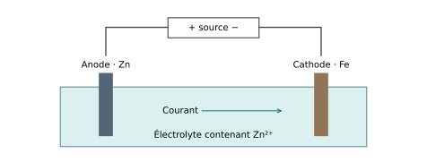
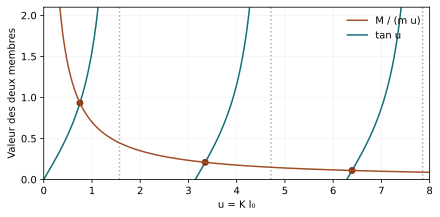

# X–ENS PSI 2019 — Physique (XCR) · Corrigé brut

*Corrigé rédigé par IA, non officiel. Signalez toute erreur.*

**Lecture du rapport du jury** · GPT-6.2 Astra Ultra · vitesse non renseignée

**Rédaction** · GPT-6.2 Astra Ultra · vitesse non renseignée

## Ressorts : conception, caractérisation et propagation

## I. Caractériser le ressort

### Question 1 — Liaison et raideur

Pour un équilibre stable, $U'(a_0)=0$ et $U''(a_0)>0$. Pour un petit déplacement $u=a-a_0$, $U(a)=U(a_0)+U''(a_0)u^2/2+O(u^3)$. La force est donc $-ku$ avec $k=U''(a_0)$ tant que les termes anharmoniques restent négligeables.

### Question 2 — Création de deux interfaces

Il y a $n=S/a_0^2$ liaisons en parallèle. Elles portent chacune $F/n$, donc emmagasinent au total $n(F/n)^2/(2k)$. La rupture crée deux surfaces d’énergie totale $2\gamma S$. L’égalité des énergies donne $F_{\max}=2S\sqrt{k\gamma}/a_0$.

### Question 3 — Passage au module d’Young

Chaque intervalle donne la même déformation relative $u/a_0$. La loi macroscopique donne $F/S=Eu/a_0$, tandis que les ressorts donnent $F/S=ku/a_0^2$. Il vient $k=Ea_0$, puis $F_{\max}=2S\sqrt{E\gamma/a_0}$.

### Question 4 — Maille du fer et effort de rupture

Deux atomes occupent chaque maille, d’où $\rho a_0^3=2M/N_A$ et $a_0\simeq2{,}9\times10^{-10}\ \mathrm m$. Pour $S=5\times10^{-6}\ \mathrm{m^2}$ et $\gamma=2\ \mathrm{J\,m^{-2}}$, la force idéale est $3{,}8\times10^5\ \mathrm N$, soit environ $4\times10^5\ \mathrm N$.

### Question 5 — Écart à la rupture observée

Un fil réel contient fissures, dislocations, joints de grains et défauts superficiels. Ils concentrent les contraintes et une fissure avance progressivement. Le calcul suppose un cristal parfait, une rupture simultanée sur toute la section et prolonge la loi harmonique jusqu’à rupture. Il surestime donc la résistance.

### Question 6 — Torseur transmis à une section

Avec le poids négligé, le bilan des forces impose une résultante $-\mathbf F$ de la partie inférieure. Au centre $C$ de la coupe cette résultante n’a pas de moment. Si $A$ est sur l’axe, le couple propre transmis doit vérifier $\mathbf M_t=-\overrightarrow{CA}\times\mathbf F$. Le bras de levier de l’effort axial vaut $D/2$, donc $|M_t|=FD/2$.

### Question 7 — Torsion et raideur axiale

En modules $ds=(D/2)d\alpha$, $d\alpha=M_t\,dl/(GI_0)$ et la longueur du fil vaut $N\pi D$ dans l’approximation des spires peu inclinées. Ainsi $s=F(D/2)^2N\pi D/(GI_0)=8FND^3/(Gd^4)$. En traction algébrique $F=ks$, avec $k=Gd^4/(8ND^3)$.

### Question 8 — Raideur du ressort en fer

Le diamètre vaut $d=(4S/\pi)^{1/2}=2{,}52\ \mathrm{mm}$. Pour $D=20\ \mathrm{mm}$ et $N=100$, la formule donne $k\simeq5{,}1\times10^2\ \mathrm{N\,m^{-1}}$. Une force d’un newton produit ainsi environ deux millimètres d’allongement.

## I. Échanges thermiques et protection du métal

### Question 9 — Montée en température

Notons $A$ la surface d’échange, $m_f$ la masse et $c_p$ la capacité massique. Pour un métal isotherme, un air maintenu à $T_r$ et des coefficients constants, $m_f c_p\dot T=\alpha A(T_r-T)$. On néglige rayonnement et contact avec le tapis. L’intégration donne $T_r-T=(T_r-T_i)e^{-\alpha At/(m_fc_p)}$, donc $t=(m_fc_p/\alpha A)\ln[(T_r-T_i)/(T_r-T_f)]$. Le symbole $P$ de l’encadré désigne une masse en kilogrammes.

### Question 10 — Vitesse du tapis

Pour une longueur de fil $l$, $m_f=\rho\pi d^2l/4$ et $A\simeq\pi dl$. Alors $t=(\rho c_pd/4\alpha)\ln[(T_r-T_i)/(T_r-T_f)]$. À températures fixées, $V_0=L/t=[4\alpha L/(\rho c_p\ln[(T_r-T_i)/(T_r-T_f)])]d^{-1}$, donc $n=-1$.

### Question 11 — Diffusion dans la section

La diffusivité est $D_T=\lambda_{\rm Fe}/(\rho c_p)$. Pour une diffusion du bord au cœur de rayon $d/2$, $t_{\rm diff}\sim(d/2)^2/D_T$ à un facteur numérique près. La vitesse correspondante $L/t_{\rm diff}$ varie en $d^{-2}$, d’où $m=-2$.

### Question 12 — Régime limitant

Le rapport $t_{\rm diff}/t_{\rm conv}$ est de l’ordre de $\alpha d/\lambda_{\rm Fe}$. Si ce rapport est très petit, la diffusion homogénéise le fil et l’échange externe commande la chauffe. S’il est très grand, la résistance interne domine et le modèle diffusif convient. Autour de l’unité, il faut coupler les deux transferts.

### Question 13 — Protection par le zinc

Une couche continue isole le fer du milieu. Le zinc, de potentiel standard plus négatif, sert en outre d’anode sacrificielle en contact électrique avec le fer dans un électrolyte. Une rayure limitée peut donc rester protégée. Les produits d’oxydation du zinc peuvent le passiver. Le revêtement se consomme toutefois et doit garder épaisseur, adhérence et continuité électrique suffisantes.

### Question 14 — Anode et cathode

La cathode est le ressort relié au pôle négatif, où $\mathrm{Zn^{2+}+2e^-\to Zn}$. L’anode de zinc reliée au pôle positif se dissout selon $\mathrm{Zn\to Zn^{2+}+2e^-}$. Le courant conventionnel va du pôle positif à l’anode, traverse l’électrolyte vers la cathode et rejoint le pôle négatif. Les électrons circulent dans les conducteurs métalliques.

### Question 15 — Quantité de zinc, tension et énergie

La surface est $A\simeq\pi d\,N\pi D=4{,}98\times10^{-2}\ \mathrm{m^2}$. Pour $e=10\ \mu\mathrm m$, $m_{\rm Zn}=\rho_{\rm Zn}Ae=3{,}54\ \mathrm g$. À rendement un, $t_{\min}=2N_A|e_{\rm el}|m_{\rm Zn}/(M_{\rm Zn}I)\simeq1{,}04\times10^4\ \mathrm s$ (2,9 h). La figure 6 donne vers $+1\ \mathrm A$ et $-1\ \mathrm A$ environ $E_a=-0{,}3\ \mathrm V$ et $E_c=-1{,}6\ \mathrm V$. La tension aux bornes de la cuve est $U=E_a-E_c+R_0 I\simeq6{,}3\ \mathrm V$. L’énergie minimale vaut $UIt\simeq6{,}6\times10^4\ \mathrm J$.

### Question 16 — Réaction concurrente de l’eau

À pression standard de dihydrogène, $E_{\rm eq}\simeq-0{,}059\,\mathrm{pH}=-0{,}30\ \mathrm V$. Avec la surtension indiquée, le dégagement débute autour de $-0{,}95\ \mathrm V$ sur fer. Le potentiel de dépôt lu est plus négatif. Une partie du courant peut donc réduire les protons et le rendement du dépôt diminue, allongeant le temps réel.

## II. Propagation longitudinale et pertes

### Question 17 — Ressorts en série

Sous la même force $F$, chaque ressort s’allonge de $F/k$. Deux en série ont $l_{\rm eq}=2l_0$ et $k_{\rm eq}=k/2$. Pour $n$ éléments, la longueur est $nl_0$ et la raideur $k/n$, donc $\alpha=kl_0$ est invariant pour une famille de même géométrie locale. Avec $l_0=Np$, la question 7 donne $\alpha=Gd^4p/(8D^3)$.

### Question 18 — Force transmise à une abscisse

Le segment s’allonge de $\xi(x+dx,t)-\xi(x,t)\simeq\partial_x\xi\,dx$. Sa raideur est $\alpha/dx$. En traction, sa partie gauche tire sa partie droite vers $-x$, d’où $F_{\rm gauche\ sur\ droite}(x,t)=-\alpha\partial_x\xi(x,t)$. Les actions réciproques ont des signes opposés.

### Question 19 — Équation locale du mouvement

La force totale sur $[x,x+dx]$ est $\alpha[\partial_x\xi(x+dx)-\partial_x\xi(x)]$. Avec une masse $\mu dx$, la dynamique donne $\mu\partial_t^2\xi=\alpha\partial_x^2\xi$. La célérité est $c=\sqrt{\alpha/\mu}$ et $\partial_x^2\xi-c^{-2}\partial_t^2\xi=0$.

### Question 20 — Dissipation par frottement

La perte positive est $E_f=\int_0^{2\pi/\omega}h\dot x^2dt=h\omega^2x_0^2\pi/\omega=\pi h\omega x_0^2$. L’énergie mécanique de l’oscillateur varie de l’opposé de ce nombre du seul fait de ce frottement.

### Question 21 — Sens du cycle de force

À $t=0$, $x=x_0$ est au point le plus à droite et $F=kx_0$. Ensuite $\dot x<0$ et $F=kx+h\dot x$ passe sous la droite élastique. Le trajet part vers le bas depuis le point droit et se poursuit vers la gauche, donc dans le sens horaire.

### Question 22 — Aire et bilan d’énergie

On a $\oint F\,dx=\oint d(kx^2/2)+h\int\dot x^2dt=E_f$. L’intégrale géométrique représente l’aire positive avec ce sens de parcours. L’énergie potentielle élastique retrouve sa valeur initiale au terme du cycle.

### Question 23 — Coefficient visqueux équivalent

L’identification $\pi h_{\rm eq}\omega x_0^2=\pi\beta x_0^2$ donne $h_{\rm eq}=\beta/\omega$. L’équivalence est énergétique à la fréquence étudiée.

### Question 24 — Raideur complexe

Dans l’équation $m\ddot x+kx+h_{\rm eq}\dot x=F_{\rm ext}$, la convention $e^{i\omega t}$ transforme l’effort interne en $(k+i\omega h_{\rm eq})\underline x$. La raideur complexe vaut donc $\underline k=k+i\beta$. Sa partie imaginaire positive représente la dissipation.

### Question 25 — Dispersion complexe

On obtient $\underline\alpha K^2=\mu\omega^2$. Pour une onde vers $+x$, $K=\omega\sqrt{\mu/(\alpha_r+i\alpha_i)}\simeq(\omega/c_r)[1-i\alpha_i/(2\alpha_r)]$, avec $c_r=\sqrt{\alpha_r/\mu}$ et $\alpha_i>0$.

### Question 26 — Vitesse des phases

La vitesse $v_\phi=\omega/\Re K\simeq c_r$ est indépendante de la fréquence si les caractéristiques du matériau sont constantes. Les composantes d’un paquet ne se déphasent donc pas par dispersion. Une modification de forme reste possible à cause de leur atténuation inégale.

### Question 27 — Longueur d’absorption

Pour cette convention, $|\xi(x)|=|\xi(0)|e^{\Im K\,x}$. La longueur d’atténuation de l’amplitude vaut $l_a=-1/\Im K\simeq2\alpha_rc_r/(\omega\alpha_i)$. Elle diminue lorsque la fréquence augmente.

### Question 28 — Créneau à grande distance

L’harmonique de rang impair $n$ part avec une amplitude proportionnelle à $1/n$ et décroît comme $e^{-nx/l_a(\omega_0)}$. Lorsque les harmoniques supérieures sont négligeables devant le fondamental, il subsiste une sinusoïde de période $T_0$, retardée et atténuée. À distance infinie l’amplitude de celle-ci s’annule également.

## II. Modes du ressort horizontal et décollage

### Question 29 — Deux sens de propagation

Le terme en $\omega t-Kx$ avance vers $+x$, celui en $\omega t+Kx$ vers $-x$. Pour $K>0$ et $\omega>0$, la relation sans pertes est $K=\omega/c$, $c=\sqrt{\alpha/\mu}$. Leur superposition rend possibles les ondes stationnaires.

### Question 30 — Conditions avec masse terminale

L’ancrage donne $\xi(0,t)=0$, donc la forme spatiale est $C\sin Kx$. À droite, $m\partial_t^2\xi(l_0,t)=-\alpha\partial_x\xi(l_0,t)$. Ainsi $m\omega^2\sin(Kl_0)=\alpha K\cos(Kl_0)$ et $\tan(\omega l_0\sqrt{\mu/\alpha})=\sqrt{\mu\alpha}/(m\omega)$.

### Question 31 — Nombre de modes propres

L’équation devient $\tan u=M/(mu)$. Sur chaque intervalle $(n\pi,n\pi+\pi/2)$, $n\ge0$, la tangente monte de zéro à l’infini tandis que le membre de droite est positif et décroît. Il y a une intersection par intervalle, donc une infinité de pulsations propres.

### Question 32 — Mode fondamental du ressort court

Pour ce mode, $\tan u\simeq u$. L’équation impose $u^2\simeq M/m$. On en tire $\omega^2\simeq(c^2/l_0^2)(\mu l_0/m)=\alpha/(ml_0)=k/m$, soit la pulsation usuelle.

### Question 33 — Condition quasi statique

La condition est $l_0\ll c/\omega_0$ (ou $l_0\ll\lambda_0/(2\pi)$). Comme $(\omega_0 l_0/c)^2=\mu l_0/m$, elle équivaut à $M\ll m$. La propagation établit alors presque instantanément le profil de tension à l’échelle de l’oscillation de la masse.

### Question 34 — Tranche verticale pesante

Avec la force interne de la question 19 et le poids, $\mu dx\,\partial_t^2\xi=\alpha dx\,\partial_x^2\xi-\mu g\,dx$. Ainsi $\partial_t^2\xi-c^2\partial_x^2\xi=-g$. On retrouve l’équation horizontale lorsque $g$ est négligeable.

### Question 35 — Compression par son propre poids

À l’équilibre $\xi''=g/c^2$, $\xi(0)=0$ et $\xi'(l_0)=0$. Il vient $\xi_{\rm eq}(x)=g(x^2/2-l_0x)/c^2$, d’où $\Delta l_{\rm eq}=-g l_0^2/(2c^2)=-Mg/(2k)$. Le signe décrit une compression et le poids effectif vaut la moitié du poids total pour l’allongement.

### Question 36 — Déplacement relatif à l’équilibre

Écrivons $e=\xi-\xi_{\rm eq}$. Comme $c^2\xi_{\rm eq}''=g$, la pesanteur disparaît de la dynamique relative, $\partial_t^2e=c^2\partial_x^2e$. Cela reste valable tant que la base est en contact avec le sol.

### Question 37 — Profil comprimé initial

Le déplacement additionnel est affine. Les conditions $e(0)=0$ et $e(l_0)=-a$ fixent $e(x,0)=-ax/l_0$. Au lâcher, la vitesse initiale est nulle.

### Question 38 — Oscillations avant décollage

Avec $e=f(x)\cos\omega t$, $f''+K^2f=0$. La condition $f(0)=0$ conserve le sinus. Après le lâcher $f'(l_0)=0$, donc $K_n=(n+1/2)\pi/l_0$, $\omega_n=cK_n$, $n\ge0$. Les modes sont $A_n\sin(K_n x)\cos(\omega_n t)$.

### Question 39 — Décomposition de l’état initial

Les sinus de la question précédente forment une base orthogonale sur $[0,l_0]$, obtenue également par extension impaire en zéro et paire en $l_0$. La projection de $-ax/l_0$ donne $A_n=(2/l_0)\int_0^{l_0}(-ax/l_0)\sin K_nx\,dx=-2a(-1)^n/(l_0K_n)^2$. La somme de ces modes vérifie le profil initial et la vitesse initiale nulle.

### Question 40 — Annulation de la réaction du sol

À la base, la réaction verticale est $N=-\alpha\partial_x\xi(0,t)=Mg-\alpha\partial_xe(0,t)$. Au décollage $N=0$ et $\partial_xe(0,t_d)=+\mu g l_0/\alpha$. Le jury signale l’erreur de signe dans le membre droit imprimé. La rampe initiale fournit, après réflexion de l’onde de détente, une pente maximale $a/l_0$ à la base (extension en créneau de la pente initiale). Le seuil limite est donc $a_{\min}=\mu g l_0^2/\alpha=Mg/k$. Au-delà, garder la base immobile exigerait une réaction négative.
