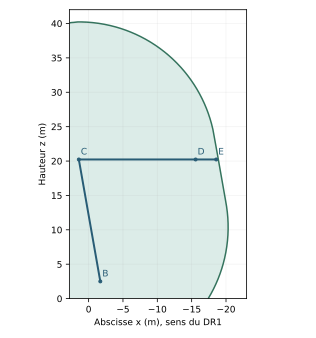
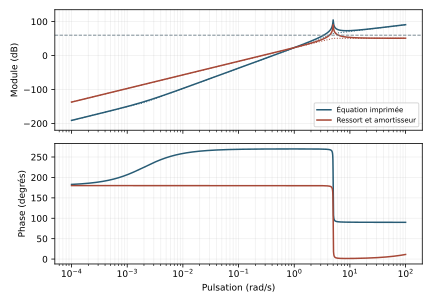
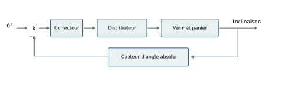
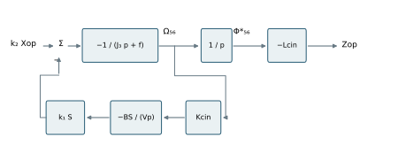
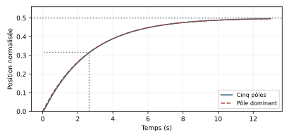

# X-ENS PSI · Sciences industrielles 2019 · Corrigé guidé

*Corrigé rédigé par IA, non officiel. Signalez toute erreur.*

**Rédaction** · GPT-6.2 Astra Ultra · vitesse non renseignée · 24 novembre 2026

## Repères

Sur DR1, les abscisses positives vont vers la gauche. Dans la partie II, les angles des trois pivots sont relatifs. À partir de la partie III, le schéma du constructeur remplace le modèle simplifié de l’annexe 1. Pour chaque essai hydraulique, relever à la fois la masse déplacée, la distance imposée et le point de mesure.

## Partie I · Géométrie, stabilité et sécurité en roulage

### Question 1 · Tracer l’enveloppe accessible

**Indication.** Décomposer la construction en trois déplacements successifs depuis B. Conserver sur DR1 le sens des abscisses, positives vers la gauche.

#### Solution

À l’échelle de DR1, $B$ est près de $(-1{,}7;2{,}5)$ m et $C$ près de $(1{,}5;19{,}5)$ m sur la machine dessinée. Pour un bras de longueur $l$, faire tourner $C$ sur l’arc de centre $B$, de rayon $l$, entre l’horizontale et la demi-droite $BC$ dessinée. Balayer $8\leq l\leq18$. Pour chaque $C$, tracer les positions de $D$ sur les arcs de centre $C$ et de rayons 8 à 17 m compris entre les butées de flèche. Porter enfin $DE=3$ m dans les orientations autorisées du pendulaire. Garder l’enveloppe extérieure côté travail, au-dessus du sol. Le tracé est une enveloppe de plusieurs arcs, car déplacer le télescope du bras déplace le centre du deuxième arc.

Une construction algébrique permet de refaire la figure. Écrivons $u(a)=(\cos a,\sin a)$ dans le plan $(x_0,z_0)$, $a_m=\arg(C-B)\simeq80°$. L’angle relatif bras/flèche va de $\pi$ en position repliée à $\pi/2-a_m$ en position déployée. Former $B+l u(a)+s u(a+b)$ pour $a\in[0,a_m]$, $b\in[\pi/2-a_m,\pi]$, $8\leq s\leq17$, puis ajouter le vecteur du pendulaire. La partie I ne cote pas sa butée. La figure montre l’enveloppe théorique obtenue avec la rotation libre en D. Pour une butée imposée, on garde seulement les points de l’arc terminal autorisé. La position haute avec les deux derniers tronçons verticaux atteint environ $2{,}5+18\sin80°+17+3\simeq40$ m.

### Question 2 · Barycentre du châssis lesté et du bras

**Indication.** Utiliser le milieu de BC pour la masse de 4,5 tonnes.

#### Solution

En tonnes et mètres, $x_{G_E}=(12\cdot0+4\cdot1{,}8+4{,}5(x_B+x_C)/2)/20{,}5$. Avec $x_B\simeq-1{,}7$ et $x_C\simeq1{,}5$, on trouve environ $0{,}33$ m, ce qui justifie la cote arrondie $0{,}3$ m. Le barycentre suit $G_2$ lorsque le bras change d’inclinaison ou de longueur. Une valeur constante convient au voisinage de la configuration dessinée. Le milieu de BC est lui-même un modèle de répartition des masses télescopiques.

### Question 3 · Réactions verticales et limite de basculement

**Indication.** Le poids total doit rencontrer le segment entre les deux appuis du modèle plan.

#### Solution

À l’arrêt sur sol horizontal, les efforts verticaux aux roues ont une somme égale au poids. L’équilibre des moments implique que leurs coefficients barycentriques aux abscisses $+2$ et $-2$ sont ceux de $x_G=(20{,}5\times0{,}3+3x_{G_3})/23{,}5$. Les deux réactions restent positives si $-2\leq x_G\leq2$, soit $-17{,}72\leq x_{G_3}\leq13{,}62$ m. À la limite une paire de roues se décharge. Sur la partie de DR1 représentée, tracer la verticale $x=-17{,}7$ m pour $G_3$ et garder le côté contenant O.

### Question 4 · Reporter la limite sur le panier

**Indication.** Le point soumis à la limite de Q3 est le milieu de CE.

#### Solution

Pour chaque position de $C$, prendre $G_3=(C+E)/2$. Côté portée arrière, il faut donc $x_E\geq-35{,}43-x_C$ ; de l’autre côté, $x_E\leq27{,}23-x_C$. Dans le secteur arrière du dessin, $x_C$ est près de 1,5 m et $CE\leq20$ m. Même avec la flèche horizontale maximale, $x_{G_3}$ reste près de $-8{,}5$ m, loin de $-17{,}7$. Plus généralement, dans ce secteur $x_C\geq x_B\simeq-1{,}7$, donc $x_{G_3}\geq-11{,}7$. L’enveloppe géométrique côté travail dessinée sur DR1 est accessible statiquement dans ce modèle ; pour une rotation vers l’autre côté, appliquer aussi la borne avant et recalculer $G_E$ si le bras change fortement d’orientation.

### Question 5 · Freinage à vitesse de route

**Indication.** Calculer d’abord la décélération et prendre les moments au contact arrière, dans le sens de freinage le plus défavorable.

#### Solution

La relation $v^2-v_0^2=2a\Delta x$ donne $|a|=1{,}4^2/(2\times0{,}25)=3{,}92$ m/s². Au seuil de décollement des roues opposées, le théorème du moment dynamique autour de l’appui à $x=-2$ compare le moment stabilisateur de la pesanteur et le moment de l’accélération. Le premier vaut $g[20{,}5\times2+3(-10+2)]=17g$ en t·m²/s². Le second vaut $|a|(16\times1+7{,}5H)$, car l’énoncé définit $H$ pour **l’ensemble bras, flèche, pendulaire et panier**, et les 16 tonnes restantes sont à 1 m. Ainsi $H\leq(17g/3{,}92-16)/7{,}5\simeq3{,}5$ m. Un appareil déployé peut dépasser cette valeur pendant un freinage à cette vitesse.

### Question 6 · Freinage à vitesse réduite

**Indication.** Une réduction simultanée de la vitesse et de la distance n’agit pas dans la même proportion sur la décélération.

#### Solution

À $0{,}5$ km/h, $v=0{,}139$ m/s et $|a|=v^2/(2\times0{,}025)\simeq0{,}386$ m/s². Le même bilan donne $H_{\max}\simeq55$ m. Cette limite dépasse même la hauteur extrême du panier (environ 40 m). Les hypothèses de terrain plat, d’accélération constante et de configuration imposée prédisent donc le maintien du contact longitudinal.

### Question 7 · Deux causes de renversement latéral

**Indication.** Regarder la projection de la résultante sur une coupe transversale.

#### Solution

Une forte pente transversale déplace la ligne de pesanteur vers les roues aval. Une tourelle tournée transversalement, bras déployé, accroît le moment de renversement, auquel un virage ou une rafale peut s’ajouter. Un inclinomètre couplé à un limiteur de déploiement peut interdire les mouvements aggravants. Des stabilisateurs latéraux déployables en station agrandissent le polygone de sustentation.

### Question 8 · Contact des quatre roues

**Indication.** Traiter ensemble l’orientation du châssis et le roulis relatif de l’essieu avant.

#### Solution

Dans le modèle sans les vérins, les quatre conditions normales portent sur le pilonnement, le tangage, le roulis du châssis et le roulis de l’essieu avant par rapport à lui. Les deux points arrière fixent deux combinaisons, la hauteur moyenne des deux points avant fixe la troisième et leur différence règle le palonnier. Ces quatre contraintes sont indépendantes, d’où $h=0$. Les rotations propres des roues ne changent pas ce bilan. Une inégalité de niveaux est compatible avec le contact des quatre roues dans les limites de débattement, pour un sol porteur et une charge permettant des réactions positives.

### Question 9 · Liaison avant équivalente

**Indication.** Sommer les torseurs de contact puis tenir compte de la rotation libre du palonnier.

#### Solution

Transportées au milieu de l’essieu, les deux normales avant parallèles transmettent une résultante $N+N'$ verticale et un moment de roulis proportionnel à $N-N'$. Elles forment entre sol et essieu une liaison linéaire rectiligne idéale (ligne transversale). En série, le pivot longitudinal du palonnier ne transmet aucun couple autour de son axe. L’équilibre de l’essieu impose donc $N=N'$ dans le modèle symétrique. Il reste entre sol et châssis la seule normale appliquée sur la verticale du milieu avant, soit une liaison ponctuelle équivalente.

### Question 10 · Quatre roues sur un terrain gauche

**Indication.** Comparer l’adaptation au relief puis la répartition de la traction.

#### Solution

Quatre roues fixées au même bâti imposent un contact redondant sur terrain plan et une roue peut perdre l’appui sur terrain gauche. Trois roues fixes définissent toujours un plan, mais n’offrent que trois surfaces de traction et de répartition de charge. Le palonnier conserve quatre appuis physiques et leur motricité tout en présentant trois appuis équivalents au châssis. Son blocage peut ensuite mobiliser le quadrilatère de sustentation.

### Question 11 · Pilotage du palonnier

**Indication.** Distinguer le suivi du relief en roulage du maintien d’assiette au poste de travail.

#### Solution

Les deux vérins accompagnent, corrigent ou verrouillent le roulis relatif. En déplacement lent sur terrain irrégulier, laisser l’essieu s’adapter tant que la pente et la course le permettent. À l’arrêt ou bras levé, immobiliser l’essieu si l’assiette et les charges de roues conviennent. Le calculateur peut utiliser inclinaison, positions des vérins, pression de contact, vitesse du châssis et position de la flèche.

### Question 12 · Chute de l’essieu avant

**Indication.** Dans le repère en translation uniforme du véhicule, prendre le moment sur la ligne de contact arrière pendant la perte d’appui avant.

#### Solution

À l’instant initial, la distance horizontale de $F_2$ au centre du corps de masse $M$ est $e/2$ vers l’avant. Celle du passager est $-d$, avec $d=L_{76}-L_{43}-e/2=12$ m. La réaction en $F_2$ disparaît de l’équation du moment. Le théorème du moment dynamique, positif pour une chute de l’avant, donne

$$
[J+M(e/2)^2+m\,F_2P^2]\ddot\theta=g(Me/2-md).
$$

Le transport du moment d’inertie de $M$ depuis O ajoute $M(e/2)^2$, puisque son centre est à la verticale de O. Pour la masse ponctuelle on garde la distance au carré à l’axe (ou $d^2$ si on néglige sa hauteur). C’est l’équation au départ pour la valeur $2$ rad/s² annoncée ; $J$ n’est pas chiffré.

### Question 13 · Hauteur de décollage

**Indication.** Après l’arrêt brusque du panier, le passager conserve initialement sa composante verticale de vitesse.

#### Solution

Avec $v_z\simeq4$ m/s vers le haut, un panier immobilisé verticalement et la pesanteur seule, $0=v_z^2-2g\Delta z$. On trouve $\Delta z\simeq0{,}82$ m. La vitesse horizontale commune n’intervient pas dans cette hauteur relative.

### Question 14 · Descente des roues arrière

**Indication.** Repérer de quel côté du nouveau centre de rotation se trouve le passager.

#### Solution

Quand l’arrière descend, la rotation autour de l’appui avant est de sens opposé. Le panier situé en porte-à-faux arrière descend avec lui. Le passager peut être soulagé si le plancher descend plus vite que sa chute libre, puis subir une forte réaction lors de la reprise d’appui. On ne peut reporter automatiquement la hauteur de Q13 à cette seconde phase.

### Question 15 · Effet de la flexibilité de la flèche

**Indication.** Distinguer la transmission immédiate du choc de la restitution d’énergie.

#### Solution

La flexion permet au panier de poursuivre son mouvement pendant que le châssis s’arrête. La vitesse verticale est modifiée sur une durée finie. Un ressort emmagasine $k\Delta l^2/2$ puis restitue cette énergie et peut provoquer un rebond ; l’amortissement en dissipe une partie. La hauteur de 0,82 m, obtenue avec un arrêt instantané du plancher, peut donc changer. Le signe et la valeur de l’écart dépendent de l’amortissement et de la phase où le contact avec l’opérateur cesse.

### Question 16 · Transmittance de l’accélération

**Indication.** Vérifier les dimensions des deux termes d’excitation de la base avant de choisir la relation à transformer.

#### Solution

À conditions initiales nulles, l’équation **imprimée** page 7 donne

$$
H_i(p)=\frac{K_1p^2(kp+f)}{mp^2+fp+k}.
$$

Elle intervertit visiblement la raideur et le frottement au second membre : $kK_1\dot\theta$ a la dimension d’une puissance par longueur et $fK_1\theta$ celle d’une force multipliée par un temps. Pour le ressort-amortisseur de la figure 7, l’effort est $k(K_1\theta-z)+f(K_1\dot\theta-\dot z)$, d’où

$$
H_m(p)=\frac{K_1p^2(fp+k)}{mp^2+fp+k}.
$$

Les deux lectures sont conservées aux questions suivantes. Le tracé DR2, qui commence à $10^{-4}$ rad/s, permet bien de placer le zéro de la formule imprimée.

### Question 17 · Diagramme de Bode de DR2

**Indication.** Factoriser autour de la pulsation propre, puis situer le zéro du numérateur.

#### Solution

Le dénominateur normalisé vaut $1+0{,}002p+0{,}04p^2$, de pulsation propre $5$ rad/s et d’amortissement $0{,}005$. Pour le texte imprimé $H_i=0{,}028 p^2(1+500p)/(1+0{,}002p+0{,}04p^2)$. Les pentes successives sont $+40,+60,+20$ dB/décade, les ruptures $0{,}002$ et $5$ rad/s. La phase part de $180°$, monte vers $270°$ puis redescend vers $90°$ (modulo $360°$). À 5 rad/s le module réel vaut environ $1{,}75\,10^5$, soit 105 dB.

Pour le modèle dimensionnel $H_m=14p^2(1+0{,}002p)/(1+0{,}002p+0{,}04p^2)$. Les ruptures sont 5 et 500 rad/s, les pentes $+40,0,+20$. La phase part de $180°$, descend vers $0°$ puis remonte vers $90°$. À 5 rad/s le pic atteint environ 91 dB. Le dessin porte les deux résultats pour rendre le choix de modèle explicite.

### Question 18 · Pulsations critiques

**Indication.** La limite porte sur l’accélération effective, égale au module du transfert multiplié par 0,01.

#### Solution

La valeur admissible du module est $10/0{,}01=1000$ (60 dB). Avec la relation imprimée, résoudre $14^2\omega^4(k^2\omega^2+f^2)=10^6[(k-m\omega^2)^2+f^2\omega^2]$ donne une traversée à $3{,}38$ rad/s. Le module reste au-dessus ensuite : éviter $\omega\geq3{,}38$ rad/s. Avec la relation ressort-amortisseur, permuter $k$ et $f$ dans le facteur du numérateur. Éviter environ $4{,}30$ à $6{,}20$ rad/s et, mathématiquement, $\omega\geq1{,}34\,10^3$ rad/s. Cette dernière limite est hors du domaine réaliste de représentation du terrain par le modèle.

### Question 19 · Espacement des bosses

**Indication.** La pulsation s’exprime en radians par seconde, la fréquence en cycles par seconde.

#### Solution

Pour un pas spatial $d$ et une vitesse $v$, la période est $d/v$ et $\omega=2\pi v/d$. Avec $v=1{,}4$ m/s, la relation imprimée donne un risque pour $d\lesssim2{,}60$ m. Le modèle dimensionnel place la bande résonante entre $1{,}42$ et $2{,}04$ m ; sa seconde branche mathématique correspond à $d\lesssim6{,}6$ mm. Il s’agit du seuil du modèle sinusoïdal en régime établi pour l’amplitude angulaire donnée.

### Question 20 · Excitation en phase des essieux

**Indication.** Comparer les hauteurs du sol sous les deux essieux.

#### Solution

Si l’empattement est un multiple entier de la période spatiale ($e=nd$), les roues avant et arrière de chaque côté rencontrent la même hauteur au même instant sur un relief périodique. L’angle du châssis reste nul alors que sa hauteur oscille. Il n’y a plus d’excitation en tangage à la fréquence de parcours.

## Partie II · Cinématique et dynamique de la nacelle

### Question 21 · Mobilités utiles

**Indication.** Compter les coordonnées indépendantes une fois l’horizontalité du panier imposée.

#### Solution

La chaîne plane ouverte comprend trois pivots indépendants motorisés en B, C, D et deux translations indépendantes de télescopage. Les cinq coordonnées sont $\theta_3,\theta_6,\theta_9,\lambda_{43},\lambda_{76}$. L’orientation absolue du panier est imposée par la compensation. Sa rotation compensatrice dépend des autres positions et n’ajoute aucune commande indépendante.

### Question 22 · Redondance pour le positionnement

**Indication.** Combien de coordonnées repèrent un point dans un plan ?

#### Solution

Deux mobilités indépendantes suffisent localement pour commander les deux coordonnées du conducteur, si le jacobien a le rang deux. Avec cinq, on peut viser le même point avec des postures différentes, par exemple contourner un obstacle, éviter une butée ou réduire le moment à la base.

### Question 23 · Vitesse du panier

**Indication.** Dans la dérivée d’un vecteur unitaire, utiliser la vitesse absolue du solide qui le porte.

#### Solution

Le vecteur $BG_{12}=\lambda_{43}\mathbf x_3+\lambda_{76}\mathbf x_6+L_9\mathbf x_9-L_{12}\mathbf x_1$. Le dernier terme est constant pour un panier horizontal. Avec $\boldsymbol e=\mathbf y_1$, poser $u_3=\dot\theta_3$, $u_6=\dot\theta_3+\dot\theta_6$, $u_9=\dot\theta_3+\dot\theta_6+\dot\theta_9$. Alors

$$
\mathbf V_{G_{12}/1}=\dot\lambda_{43}\mathbf x_3+\dot\lambda_{76}\mathbf x_6+\boldsymbol e\times(\lambda_{43}u_3\mathbf x_3+\lambda_{76}u_6\mathbf x_6+L_9u_9\mathbf x_9).
$$

Les sommes de vitesses viennent des angles relatifs de l’annexe 1.

### Question 24 · Vitesse du pendulaire à prévoir

**Indication.** Projeter la vitesse tangentielle à l’extrémité et prendre le moins bon bras de levier.

#### Solution

$|v_z|=L_9|\dot\alpha_P\cos\alpha_P|$. La plus grande vitesse **nécessaire pour atteindre** 1 m/s partout est $1/(3\cos60°)=2/3$ rad/s, contre $1/3$ rad/s à l’horizontale. À partir du repos, sur une rampe de vitesse angulaire de 0,5 s, le dimensionnement donne environ $1{,}33$ rad/s². Un pilotage à vitesse verticale constante doit adapter la vitesse angulaire à l’angle. Si 1 m/s est une borne supérieure à respecter avec une seule vitesse angulaire constante, la borne de commande uniforme est au contraire $1/3$ rad/s.

### Question 25 · Calcul successif des efforts d’actionneur

**Indication.** Couper une liaison à la fois et isoler les pièces situées en aval de cette coupe.

#### Solution

Partir de l’extrémité. Pour le pivot D, isoler pendulaire et panier, puis projeter le théorème du moment dynamique en D sur l’axe du pivot afin d’obtenir $C_{79}$. Pour la glissière 6–7, isoler 7 et tout l’aval, puis projeter le théorème de la résultante dynamique sur $\mathbf x_6$ pour $F_{67}$. Pour le pivot C, prendre tout l’aval à partir de 6 et les moments en C sur $\mathbf y_1$ pour $C_{46}$. Pour la glissière 3–4 isoler 4 et l’aval et projeter la résultante sur $\mathbf x_3$. Enfin isoler 3 et tout l’aval, puis projeter les moments en B sur $\mathbf y_1$. Dans chaque bilan inclure poids et actions extérieures, les efforts entre pièces isolées se compensant. Pour un centre de réduction mobile, calculer le moment dynamique à partir des accélérations ou appliquer la formule de transport correspondante.

### Question 26 · Couple statique à la base

**Indication.** Multiplier chaque poids par la projection horizontale de BG correspondant.

#### Solution

Posons $c_3=\cos\theta_3$, $c_6=\cos(\theta_3+\theta_6)$ et $c_9=\cos(\theta_3+\theta_6+\theta_9)$. Les abscisses relatives à B des quatre centres sont $X_2=\lambda_{43}c_3/2$, $X_{67}=\lambda_{43}c_3+\lambda_{76}c_6/2$, $X_9=\lambda_{43}c_3+\lambda_{76}c_6+L_9c_9/2$, $X_{12}=\lambda_{43}c_3+\lambda_{76}c_6+L_9c_9-L_{12}$. Puisque $(X\mathbf x_1)\times(-mg\mathbf z_1)=mgX\mathbf y_1$, le moment statique en B donne $C_{23}=-g(M_2X_2+m_{67}X_{67}+m_9X_9+m_{12}X_{12})$. La tourelle et le contrepoids sont du côté fixe de la coupe.

### Question 27 · Inertie d’une tige en son milieu

**Indication.** Intégrer le carré de la distance à l’axe pour une densité linéique constante.

#### Solution

Toute la matière est sur $\mathbf x_9$ : le moment autour de cet axe est nul, les produits d’inertie aussi. Les deux axes transverses ont le même moment $B_{G_9}=\int_{-L_9/2}^{L_9/2}x^2(m_9/L_9)\,dx=m_9L_9^2/12$. En G, la matrice est donc diagonale de termes $0,B_{G_9},B_{G_9}$.

### Question 28 · Inerties qui interviennent en rotation

**Indication.** Distinguer un solide privé de rotation de son centre de masse en translation.

#### Solution

Le bras et la flèche sont immobiles. Le panier asservi horizontal reste parallèle à lui-même, donc sa vitesse angulaire absolue est nulle, mais son centre accélère. Seul le pendulaire possède un moment dynamique propre autour de son centre. Il faut encore transporter les résultantes dynamiques de la tige et du panier jusqu’en B.

### Question 29 · Couple dynamique produit par le pendulaire

**Indication.** Réduire le torseur dynamique en D, puis le transporter en B.

#### Solution

Notons $\mathbf R=\overrightarrow{BD}=\lambda_{43}\mathbf x_3+\lambda_{76}\mathbf x_6$, $q=\theta_9$, $\mu=(m_9/2+m_{12})L_9$ et $I_D=(m_9/3+m_{12})L_9^2$. Le panier est ramené en E. Puisque D est fixe et que seule la dernière liaison tourne, la résultante dynamique est $\mu[\ddot q\,(\mathbf y_1\times\mathbf x_9)-\dot q^2\mathbf x_9]$. Son moment dynamique en D vaut $I_D\ddot q\,\mathbf y_1$. Après transport en B,

$$
C'_{23}=\big[I_D+\mu(\lambda_{43}\cos(\theta_6+q)+\lambda_{76}\cos q)\big]\ddot q-\mu\big[\lambda_{43}\sin(\theta_6+q)+\lambda_{76}\sin q\big]\dot q^2 .
$$

L’énoncé parle à la fois de vitesse constante et d’accélération. L’expression couvre le démarrage et le régime établi. Si la vitesse est strictement constante, poser $\ddot q=0$ ; le terme centripète peut toujours donner un couple en B.

### Question 30 · Marge du vérin de levage

**Indication.** Le moment dynamique est la somme des moments extérieurs à mouvement prescrit.

#### Solution

Pour le même état cinématique, le théorème du moment dynamique additionne algébriquement poids et inertie. Par l’inégalité triangulaire, la borne pessimiste est $|C_{23,\mathrm{total}}|\leq400+430=830$ kN·m, même lorsque les deux maxima ne correspondent pas à la même posture. La capacité de 1 000 kN·m laisse au moins 170 kN·m pour les cas modélisés.

## Partie III · Maintien de l’horizontalité et précision

### Question 31 · Boucle d’horizontalité

**Indication.** Mesurer une inclinaison absolue par rapport à la pesanteur et choisir l’actionneur qui corrige l’angle.

#### Solution

Imposer $0°$ au comparateur. Une mesure d’angle absolu du panier entre en retour négatif. L’erreur corrigée commande un distributeur électrohydraulique puis un vérin agissant sur l’orientation du support du panier ; la rotation de la flèche entre comme perturbation. L’annexe 3 mentionne déjà un capteur d’angle absolu du panier et un système hydraulique, avec pompe et distributeurs. Utiliser la mesure, l’alimentation et le calculateur existants. Pour rendre la boucle commandable, piloter le vérin de compensation par un distributeur proportionnel commandé ou ajouter un actionneur de correction entre le support et le panier si le montage passif interdit cette rotation. Un pivot vertical d’orientation du panier ne peut corriger un défaut d’horizontalité.

### Question 32 · Géométrie des vérins

**Indication.** Repérer l’angle entre les deux segments qui aboutissent aux ancrages.

#### Solution

Dans le triangle $C_3A_3B_3$, l’angle compris entre les longueurs $a_3,b_3$ est $\theta_{35}$ d’après la figure 10. La loi des cosinus donne $\lambda_{C3}=\sqrt{a_3^2+b_3^2-2a_3b_3\cos\theta_{35}}$. De même $\lambda_{C1}=\sqrt{a_1^2+b_1^2-2a_1b_1\cos\theta_{23}}$. Pour un angle nul on retrouve la différence des longueurs et pour $180°$ leur somme, comme sur le graphe.

### Question 33 · Rapport des courses hydrauliques

**Indication.** Identifier les deux chambres reliées par le trait commun de la figure 11.

#### Solution

La sortie de la tige de CYL1 réduit son volume annulaire ; l’huile déplacée remplit la chambre pleine de CYL3. En négligeant fuite et compression, $S_{1a}\Delta\lambda_{C1}=S_{3p}\Delta\lambda_{C3}$. Ainsi

$$
\frac{\Delta\lambda_{C3}}{\Delta\lambda_{C1}}=\frac{220^2-135^2}{210^2}=0{,}684.
$$

Les deux courses ont le même signe. Les 120 mm de la tige de CYL3 n’interviennent pas dans sa chambre pleine.

### Question 34 · Recalage de la compensation

**Indication.** Une conservation des volumes ne règle que les variations, pas l’orientation initiale.

#### Solution

Le distributeur de recalage ouvre temporairement la ligne de compensation vers le réservoir à travers une restriction. Amener le mécanisme à une posture de référence connue, l’immobiliser contre les efforts, puis commander la vanne et le distributeur principal selon le sens requis pour établir la bonne longueur relative et aligner la pièce 5 par rapport à la tourelle. Refermer dès la référence obtenue. Le volume piégé impose ensuite le rapport des variations. Ce recalage corrige par exemple une dérive due aux fuites.

### Question 35 · Condition angulaire de compensation

**Indication.** Comparer des variations de longueur sur le domaine de service, après réglage des angles initiaux.

#### Solution

Notons $l_i(a)$ les courbes de Q32 et $a=\theta_{23}$. Un maintien rigoureux après calage en $a_0$ exige, pour tout $a$, $l_3(a-k_{geo})-l_3(a_0-k_{geo})=0{,}684[l_1(a)-l_1(a_0)]$. Autrement dit le rapport local $l'_3(a-k_{geo})/l'_1(a)$ doit être 0,684, avec $l_i'(a)=a_i b_i\sin a/l_i(a)$ pour des angles en radians. Les courbes croissent ensemble entre 45 et 130°, avec des pentes différentes et approximativement proportionnelles sur la plage utile. Une lecture grossière à angles égaux donne, de 60 à 120°, environ 1,2 m pour CYL1 et 0,9 m pour CYL3, valeurs compatibles à l’échelle du graphique avec une compensation approchée. L’écart constant de calage décale les points où l’on lit les deux courbes. La construction explique le maintien pratique près du réglage. Les courbes ne prouvent ni la constance exacte sur toute la course ni une erreur inférieure à 1° sans mesurer le résidu et tenir compte du calage.

### Question 36 · Compensation entre les pièces 5 et 8

**Indication.** Suivre sur le schéma le volume déplacé par chacune des chambres de l’émetteur.

#### Solution

Le mouvement de la flèche par rapport à 5 impose la course du maître CYL5. Les deux conduites relient chacune une chambre du maître à une chambre de CYL7, monté entre flèche et pièce 8. À fluide incompressible et sans fuite, le volume chassé d’un côté remplit la chambre correspondante de l’esclave et l’autre ligne assure le retour. Sections et bras de levier fixent la course et le sens de la rotation correctrice. Elle compense la rotation de la flèche, si bien que la pièce 8 garde son orientation par rapport à 5 après réglage.

### Question 37 · Deux architectures hydrauliques

**Indication.** Comparer la fonction de puissance des vérins du bras à celle de la paire maître-esclave.

#### Solution

Le vérin principal CYL1 lève le bras et reçoit une alimentation de puissance. Son refoulement peut directement actionner la compensation par CYL3, moyennant un recalage. Pour la flèche, CYL4 assure déjà l’effort de levage. Une paire dédiée CYL5–CYL7 peut transmettre le déplacement de compensation jusqu’à son extrémité indépendamment de l’effort principal et dans les deux sens.

### Question 38 · Parallélogramme du pendulaire

**Indication.** Examiner la direction de la droite qui joint les deux pivots de la pièce 11.

#### Solution

Les quatre pivots forment le parallélogramme $E_4E_3E_2E_1$. Son côté $E_1E_2$ reste parallèle à $E_4E_3$, fixé à la pièce 8. La pièce 11 et le panier dans ce modèle ont donc un mouvement de translation circulaire par rapport à 8 : chaque point décrit un arc, toutes les vitesses instantanées sont identiques. L’angle $\theta_{8P}$ est constant.

### Question 39 · Perturbations au poste de travail

**Indication.** Chercher une action extérieure et une dérive interne même si la commande reste fixe.

#### Solution

Une rafale peut fléchir le bras et déplacer le panier. Une fuite interne d’un distributeur ou une fuite au piston peut faire dériver un vérin bloqué en commande. Une déformation des pneus ou un tassement du terrain sont d’autres causes.

### Question 40 · Moment sur le pivot de la flèche

**Indication.** Calculer les bras de levier des forces verticales et de l’effort du vérin.

#### Solution

Le moment dynamique en $C_6$ sur l’axe du pivot, pour l’ensemble situé en aval, équilibre le couple du vérin $S p_v L_V\sin\theta_V$, le frottement $-f\dot\varphi_{56}$, les poids du bras équipé et des opérateurs. Les distances horizontales dues aux segments inclinés sont $L_G\sin\varphi_{56}$ et $L_{67}\sin\varphi_{56}$. Le déplacement des opérateurs ajoute $x_{op}$ au bras de levier. Ainsi

$$
J\ddot\varphi_{56}=-C_{pes}+k_1 S p_v-f\dot\varphi_{56}-k_2x_{op},
\qquad k_1=L_V\sin\theta_V,\quad k_2=M_{op}g,
$$

avec $C_{pes}=g(M_3L_G+M_{op}L_{67})\sin\varphi_{56}$. Utiliser une masse $M_3$ hors opérateurs lorsqu’on ajoute explicitement leur poids. Le $J$ équivalent de l’équation est noté $J_3$ dans DR3 ; si l’inertie des opérateurs est modélisée séparément, l’incorporer à $J$ au point de fonctionnement.

### Question 41 · Compléter DR3 autour de la position d’équilibre

**Indication.** Le comparateur imprimé prend le couple des opérateurs sur son entrée positive.

#### Solution

En écarts à l’équilibre, l’entrée haute est $+k_2X_{op}$ et le retour de pression $-k_1SP_v$. Pour aboutir à $\Omega_{56}$, le premier bloc direct vaut donc $-1/(J_3p+f)$. Les deux blocs directs suivants sont $1/p$, puis $-L_{cin}$. Sur la branche de retour, en suivant le signal depuis $\Omega_{56}$ vers le comparateur, inscrire $K_{cin}$, puis $-BS/(Vp)$, puis $k_1 S$. La pression initiale équilibre le couple constant de pesanteur. Sa variation ne comporte plus ce couple puisque les coefficients sont figés au point de fonctionnement.

### Question 42 · Transfert de la perturbation horizontale au déplacement vertical

**Indication.** La compression de l’huile joue le rôle d’un rappel angulaire.

#### Solution

Posons $K_h=k_1K_{cin}BS^2/V$. La pression différentielle vaut $P_v=-(BS/V)K_{cin}\Phi_{56}^*$. L’équation de rotation devient $(J_3p^2+fp+K_h)\Phi_{56}^*=-k_2X_{op}$. En combinant avec $Z_{op}=-L_{cin}\Phi_{56}^*$, on obtient un second ordre de gain $K_0=L_{cin}k_2/K_h$, de pulsation $\omega_0=\sqrt{K_h/J_3}$ et d’amortissement $\xi=f/(2\sqrt{J_3K_h})$ :

$$
\frac{Z_{op}}{X_{op}}=\frac{K_0}{1+2\xi p/\omega_0+(p/\omega_0)^2}.
$$

Le signe positif exprime la convention de $z_{op}$ de l’exercice ; la courbe de position absolue décroît lorsque le plancher descend.

### Question 43 · Configuration la plus sensible

**Indication.** Comparer le quotient des fonctions qui entrent dans le gain statique.

#### Solution

Pour un même échelon de position, l’amplitude finale varie comme $L_{cin}/(k_1K_{cin})=L_{cin}/k_1^2$. À 90° on lit environ $20/(0{,}75)^2=36$ m⁻¹ et à 150° environ $10/(0{,}40)^2=63$ m⁻¹. La lecture intermédiaire confirme l’augmentation du rapport sur la plage. La position haute, vers 150°, est la plus sensible en régime final.

### Question 44 · Déplacement calculé

**Indication.** Convertir la section du piston en mètres carrés avant de l’élever au carré.

#### Solution

Pour $S=250\,\mathrm{cm}^2=0{,}025$ m², $BS^2/V=1{,}875\,10^7$ N/m. À 150°, prendre $L_{cin}\simeq10$ m, $k_1=K_{cin}\simeq0{,}40$ m et $k_2\simeq1960$ N. Pour 1 m, $|z_{op}(\infty)|\simeq10\times1960/(0{,}4^2\times1{,}875\,10^7)=6{,}5$ mm, très inférieur à 50 mm. La lecture graphique permet de retenir environ 6 mm. C’est le maximum entre positions **en régime permanent** ; le pic de la réponse temporelle dépend aussi de l’amortissement. Pour le second ordre passif de Q42, son amplitude reste inférieure au double de la valeur finale pour un échelon.

### Question 45 · Souplesse des vérins de télescopage

**Indication.** Comparer le travail virtuel du couple perturbateur dans une translation et dans une rotation.

#### Solution

Le déplacement horizontal des opérateurs change le moment de leur poids mais sa résultante verticale reste inchangée. À posture figée, la composante de la résultante suivant l’axe du bras télescopique est donc inchangée. La variation d’effort et de compression dans CYL2-1 et CYL2-2 est nulle au premier ordre dans le modèle statique idéal. Une rotation secondaire, une flexion ou les effets d’inertie pendant le transitoire peuvent coupler le télescopage au déplacement.

### Question 46 · Masse ou force appliquée à l’extrémité

**Indication.** Comparer un bilan statique et un bilan dynamique.

#### Solution

Une masse ponctuelle de 400 kg soumise à la pesanteur et une force verticale de $400g$ au même point ont le même effet statique. Dès que ce point accélère, la première ajoute $400\mathbf a$ à la résultante dynamique et un moment d’inertie autour du pivot. Une force imposée seule ignore cet effet et modifie les fréquences propres et le transitoire.

### Question 47 · Modélisation du déplacement des opérateurs

**Indication.** Remplacer la différence de deux poids égaux appliqués en deux points par leur couple.

#### Solution

La charge ponctuelle de 400 kg représente à la fois panier et opérateurs. Les 200 kg d’opérateurs se déplacent de 1 m dans un panier de masse 200 kg fixe par rapport à sa structure : le barycentre combiné se déplace de $200/400=0{,}5$ m. La même valeur de 0,5 m peut aussi décrire un essai partant du milieu d’un panier de 1 m pour aller vers un bord ; il faut préciser quelle masse est déplacée. Le sujet annonce pour la simulation **un déplacement des opérateurs de 0,5 m**. Son couple perturbateur vaut alors $M_{op}g\times0{,}5\simeq981$ N·m. S’il s’agissait d’un déplacement de 0,5 m de la masse combinée, le couple serait $400g\times0{,}5\simeq1962$ N·m, équivalent à l’essai opérateurs de 1 m. La variation de résultante est nulle, ce qui justifie un couple pur autour de l’axe du pivot.

### Question 48 · Influence de l’air piégé

**Indication.** Comparer la compressibilité du gaz et celle de l’huile.

#### Solution

À pression de service, le gaz est beaucoup plus compressible que l’huile. Une petite fraction volumique d’air augmente la compliance globale, diminue $B$ effectif et la raideur hydraulique, augmente le déplacement statique et abaisse les fréquences propres. Ignorer ce champ peut donc changer la conclusion près d’un seuil.

### Question 49 · Première simulation

**Indication.** Lire la différence des deux curseurs, puis comparer des déplacements imposés identiques.

#### Solution

Le graphe donne $\Delta Y=0{,}00281$ m pour l’échelon correspondant à 0,5 m. En doublant dans le domaine linéaire, on obtient $5{,}62$ mm pour 1 m, voisin des 6 à 7 mm estimés en Q44. Le premier minimum est plus éloigné que cette valeur finale. Dans le circuit (b), le module artificiellement multiplié par cent neutralise presque la souplesse des autres vérins, ce qui rend la comparaison pertinente.

### Question 50 · Trois configurations simulées

**Indication.** L’annexe fournit des déplacements stabilisés de l’ordre du millimètre, même si les coordonnées absolues sont de plusieurs mètres.

#### Solution

Les curseurs de l’annexe 4 donnent, pour un demi-mètre imposé, $4{,}10$, $1{,}84$ et $1{,}84$ mm de variation stabilisée. Pour 1 m, cela donne respectivement $8{,}20$, $3{,}68$ et $3{,}68$ mm. Le plus grand transitoire est celui de la configuration haute ; le premier creux de la figure représente environ 6 à 7 mm pour 0,5 m, soit de l’ordre de 13 mm pour 1 m. Les trois cas satisfont la limite de 50 mm, y compris à ce creux. L’introduction de la souplesse des autres vérins accroît le déplacement de la configuration haute par rapport à Q49.

## Partie IV · Commande des déplacements verticaux

### Question 51 · Choix entre rotations et télescopages

**Indication.** Pour une translation, la vitesse est parallèle au bras ; pour une rotation, elle est perpendiculaire au bras de levier.

#### Solution

En position basse presque repliée, les segments sont proches de l’horizontale. Le télescopage produit surtout un déplacement horizontal ; les rotations en B et C donnent une composante verticale importante. À grande hauteur, bras et flèche sont plus redressés : combiner les deux télescopages permet de monter et de compenser les composantes horizontales. Une posture exactement alignée peut faire perdre le rang du jacobien ; vérifier alors les courses disponibles et employer une autre combinaison ou changer légèrement de posture.

### Question 52 · Désigner l’actionneur maître en montée

**Indication.** Regarder l’effet d’un retard de la seconde commande sur la distance à la façade.

#### Solution

Dans la figure 16, l’extension 3–4 monte le panier tout en l’écartant du mur situé du côté de E. L’extension 6–7 peut ensuite compenser cet écart. Si la commande de régulation prend du retard, le mouvement spontané du maître augmente donc la distance à la façade. Inverser les rôles en montée ferait d’abord approcher le panier du bâtiment avec risque de contact. Le raisonnement s’inverse en descente.

### Question 53 · Distributeur sur le corps du vérin

**Indication.** Une conduite souple ajoute du volume d’huile et une paroi déformable.

#### Solution

Le montage direct réduit le volume de fluide comprimé entre distributeur et chambre, ainsi que la compliance et les pertes de charge d’un flexible. Le vérin répond plus vite et avec une relation débit–déplacement plus reproductible. La liaison courte limite aussi les conséquences d’une rupture de conduite entre organe de commande et chambre.

### Question 54 · Du courant au débit

**Indication.** Écrire la résultante longitudinale sur le tiroir, puis la loi d’un orifice.

#### Solution

Si $x_t$ est mesuré depuis l’équilibre, les deux ressorts de raideur $k$ fournissent ensemble $-2kx_t$. L’effort électromagnétique est supposé $K_I i_t$. Avec la masse $M_t$ et le frottement visqueux $f_t$, le théorème de la résultante dynamique donne $M_t\ddot x_t+f_t\dot x_t+2kx_t=K_I i_t$. Ainsi $X_t/I_t=K_I/(M_tp^2+f_tp+2k)$. La partie électrique relève de $u_t=Ri_t+L\dot i_t$ ($R$ résistance, $L$ inductance).

La loi d’orifice, issue du bilan d’énergie en écoulement, est $Q=C_d A(x_t)\sqrt{2\Delta P/\rho}$ dans un sens d’écoulement. $C_d$ est le coefficient de débit et $\rho$ la masse volumique. Avec une ouverture proportionnelle à $x_t$ et une chute de pression supposée constante, $Q/X_t=K_v$. La pression varie pourtant avec la charge. Saturation, recouvrement du tiroir, effort de jet, frottement sec et non-linéarité magnétique sont aussi négligés.

### Question 55 · Boucle ouverte de position

**Indication.** Réduire d’abord la partie hydraulique et mécanique entre le débit et la vitesse du panier.

#### Solution

Sur le schéma imprimé, $F_n=M_np V_n$, $F_v=R_SF_n$, $V_v=(Q-V_0F_v/(BS^2))/S$ et $F_n=(K_S/p)(R_S V_v-V_n)$. En éliminant les deux forces puis $V_v$,

$$
\frac{V_n}{Q}=\frac{R_S/S}{1+A_hp+B_hp^2},\quad A_h=\frac{M_nR_S^2 V_0}{BS^3},\quad B_h=\frac{M_n}{K_S}.
$$

L’intégrateur de position $1/p$ se simplifie avec le $p$ du bloc de commande $Kp/R_S$. Le retour externe est unitaire. La transmittance en boucle ouverte se factorise en

$$
G(p)=\frac{K K_I K_v}{2kRS}\frac{1}{(1+Lp/R)(1+A_tp+B_tp^2)(1+A_hp+B_hp^2)},\qquad A_t=\frac{f_t}{2k},\quad B_t=\frac{M_t}{2k}.
$$

Ici $2kRS$ signifie $2k\times R\times S$. Pour chaque facteur de second degré $1+Ap+Bp^2$, les deux constantes réelles sont $(A\pm\sqrt{A^2-4B})/2$ si $A^2\geq4B$. Sinon, conserver le facteur du second ordre irréductible. Les valeurs numériques données ensuite correspondent à cinq premiers ordres.

### Question 56 · Réponse à l’échelon unitaire

**Indication.** Les quatre constantes les plus courtes sont au moins cent fois plus petites que 5,3 s.

#### Solution

Aux fréquences de la réponse lente, $G(p)\simeq1/(1+5{,}3p)$. En boucle fermée $T=G/(1+G)\simeq0{,}5/(1+2{,}65p)$, d’où $z_n(t)\simeq0{,}5(1-e^{-t/2{,}65})$. La valeur finale exacte est également $0{,}5$, soit une erreur permanente de 50 % pour une consigne unitaire. À 2,65 s on atteint environ 0,316 et le temps à 5 % de la variation finale est voisin de 7,9 s. Les quatre pôles rapides arrondissent le tout début de la courbe. Le système ne suit donc pas correctement une cote absolue. Une action intégrale, par exemple un PI en amont, supprime l’erreur statique à l’échelon si la boucle corrigée reste stable. Ajuster le gain et, au besoin, apporter une avance de phase pour améliorer la rapidité avec une marge suffisante.

### Question 57 · Régulation de la distance au mur

**Indication.** La commande verticale agit ici comme une perturbation horizontale de la position réelle.

#### Solution

Comparer la consigne horizontale constante $X_{nc}$ à la mesure $X_n$. Envoyer l’écart dans la chaîne $G'(p)$ commandant le vérin de correction. Ajouter en sortie la composante horizontale $D_x$ provoquée par le vérin maître et refermer le retour unitaire depuis la position totale. On obtient

$$
X_n=\frac{G'}{1+G'}X_{nc}+\frac{1}{1+G'}D_x.
$$

En variables d’écart autour de la distance initiale à la façade, la consigne est nulle ; la boucle doit atténuer $D_x$. Si l’on modélise la perturbation à un autre point, transporter aussi sa transmittance jusqu’à la sortie.
