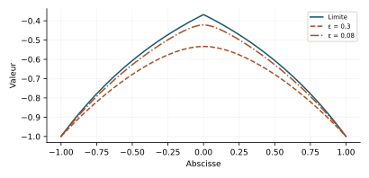

# École polytechnique · MP · Mathématiques B 2019 · Corrigé guidé

*Corrigé rédigé par IA, non officiel. Signalez toute erreur.*

**Rédaction** · GPT-6.2 Astra Ultra · vitesse non renseignée · 24 novembre 2026

**Révision** · GPT-6.2 Astra Ultra · vitesse non renseignée · 26 novembre 2026

L’épreuve construit la solution de viscosité d’une équation de Hamilton-Jacobi sur un segment à l’aide de fonctions test et d’un principe de comparaison. [Sujet officiel](https://banques-ecoles.fr/cms/wp-content/uploads/2019/10/2019_MPI_sujet_MathB.pdf) · [Rapport du jury](https://banques-ecoles.fr/cms/wp-content/uploads/2019/11/19_MP_rap_eMathB.pdf)

## I. Deux profils continus et l’obstruction à une solution classique

### Question 1a

> [!INDICATION]
> Remplacer la valeur absolue par la fonction donnée, puis utiliser la constance locale du signe.

#### Solution

L’équation implique $|u'|=-u\in C^1$. Si $u'(y)\ne0$, le signe $s=\operatorname{sgn}u'(y)$ reste constant au voisinage de $y$ par continuité. On a donc $u'=-s u$ sur ce voisinage (unilatéral à une extrémité). Il suit que $u$ y est $C^2$ et $u''(y)=-s u'(y)=-|u'(y)|=u(y)$.

### Question 1b

> [!INDICATION]
> Contrôler la valeur absolue du quotient de différence de la dérivée.

#### Solution

Si $u'(y)=0$, alors $u(y)=0$. Or $|u'(y+h)|=-u(y+h)$ et $u(y+h)=u(y)+hu'(y)+o(|h|)=o(|h|)$. Ainsi $|(u'(y+h)-u'(y))/h|\to0$, donc $u''(y)=0$.

### Question 2

> [!INDICATION]
> Résoudre l’équation linéaire nécessaire puis la tester dans l’équation initiale.

#### Solution

Les questions 1a et 1b donnent $u''=u$ partout (à un zéro de $u'$, $u=0$ aussi). La dérivée seconde est donc continue. Toute solution s’écrit $A\cosh x+B\sinh x$. Les deux valeurs de bord $-1$ imposent $B=0$, $A=-1/\cosh1$. Alors $u'(0)=0$ et $u(0)=-1/\cosh1\ne0$. Cette fonction ne vérifie pas l’équation initiale en zéro, d’où la non-existence d’une solution $C^1$.

### Question 3

> [!INDICATION]
> Dériver sur les deux demi-intervalles séparément.

#### Solution

Les fonctions $u_0=-e^{-1+|x|}$ et $u_1=-e^{1-|x|}$ sont continues par composition et valent $-1$ en $\pm1$. Pour $x\ne0$, on a $u_0'=u_0\operatorname{sgn}x$ et $u_1'=-u_1\operatorname{sgn}x$, donc $|u_j'|=-u_j$ pour les deux indices.

## II. Pentes de contact et différentiels

### Question 4

> [!INDICATION]
> Dériver la différence avec une fonction test au point de contact.

#### Solution

Tout test supérieur ou inférieur $\phi$ donne un extrémum local de $u-\phi$ en un point intérieur, donc $\phi'(x_0)=u'(x_0)$. En sens inverse, si $u$ est $C^1$ au voisinage, elle est elle-même fonction test des deux types. Ainsi $D^+u(x_0)=D^-u(x_0)=\{u'(x_0)\}$.

### Question 5a

> [!INDICATION]
> Ajuster verticalement les deux fonctions test.

#### Solution

Prenons un test inférieur et un test supérieur fournis par les deux hypothèses de non-vacuité. Ajoutons à chacun la constante qui rend sa valeur en $x_0$ égale à $u(x_0)$. Les dérivées ne changent pas. Les conditions de minimum et maximum locaux donnent, dans un même voisinage assez petit, $\phi_1\le u\le\phi_2$ avec égalité en $x_0$.

### Question 5b

> [!INDICATION]
> Comparer les deux pentes de contact avant de diviser les accroissements.

#### Solution

La différence $\phi_2-\phi_1$ admet un minimum nul en $x_0$, d’où $\phi_1'(x_0)=\phi_2'(x_0)=p$. Par les développements à l’ordre un des deux fonctions et l’encadrement de 5a, $u(x_0+h)=u(x_0)+ph+o(|h|)$. Ainsi $u'(x_0)=p$. Toute autre pente de test égale cette dérivée par la condition d’extrémum. Les deux ensembles non vides valent donc $\{p\}$.

### Question 6a

> [!INDICATION]
> Soustraire la barrière croissante vers les deux bords de l’intervalle.

#### Solution

Sur $I=]x_0-r,x_0+r[$, $\phi(x)=1/(r^2-(x-x_0)^2)$ est lisse et tend vers $+\infty$ aux deux extrémités. Comme $u$ est bornée sur $[-1,1]$, $u-\phi$ tend vers $-\infty$ à ces deux bouts. La fonction atteint son maximum sur un segment compact intérieur à $I$ (hors duquel elle est inférieure à sa valeur en $x_0$). En un maximiseur $y\in I$, $\phi'(y)\in D^+u(y)$.

### Question 6b

> [!INDICATION]
> Appliquer la construction à un petit intervalle contenu dans chaque ouvert.

#### Solution

Tout sous-intervalle ouvert non vide de $]-1,1[$ contient un intervalle $I_{x_0}(r)$ vérifiant les conditions de 6a. Il contient donc au moins un $y$ de sur-différentiel non vide. C’est la densité demandée.

### Question 7a

> [!INDICATION]
> Comparer le reste de u à celui de son contact différentiable.

#### Solution

Après translation verticale, $u\le\phi$ près de $x_0$, $u(x_0)=\phi(x_0)$ et $\phi'(x_0)=p$. Pour tout $\delta>0$ et $y$ assez proche de $x_0$, $u(y)-u(x_0)-p(y-x_0)\le\delta|y-x_0|$. Prendre le supremum sur la boule ponctuée puis la limite donne (3), la limite des supremums emboîtés existant au sens étendu.

### Question 7b

> [!INDICATION]
> Séparer le voisinage du point central et son complément compact.

#### Solution

Notons $Q(y)=(u(y)-u(x_0)-p(y-x_0))/|y-x_0|$. L’hypothèse (3) borne $Q$ supérieurement près de $x_0$. Sur le complément d’un tel voisinage, $Q$ est continue et le dénominateur est minoré par un réel positif. Le supremum demandé est donc fini et pris sur un ensemble non vide. Par définition $Q(x)\le\varphi(|x-x_0|)$ pour $x\ne x_0$, ce qui donne l’inégalité, également vraie avec égalité au centre.

### Question 7c

> [!INDICATION]
> Prolonger la partie positive du quotient puis contrôler le maximum lorsque le rayon varie.

#### Solution

Posons $q(y)=\max(0,Q(y))$ pour $y\ne x_0$ et $q(x_0)=0$. Par (3), $q(y)\to0$ en $x_0$ ; ainsi $q$ est continue sur $[-1,1]$ et uniformément continue. La quantité $\varphi(r)$ est le maximum de $q$ sur $J_r=[x_0-r,x_0+r]\cap[-1,1]$, y compris pour $r=0$. Si $0\le r\le s$, chaque point de $J_s$ se projette sur $J_r$ à distance au plus $s-r$. Dès lors $0\le\varphi(s)-\varphi(r)\le\omega_q(s-r)$, où $\omega_q$ est le module de continuité uniforme de $q$. On obtient la continuité sur toute la demi-droite. Par le théorème fondamental de l’analyse, $\rho(r)=\int_0^r\varphi(s)ds$ est $C^1$, avec $\rho(0)=\rho'(0)=0$.

### Question 7d

> [!INDICATION]
> Restreindre l’intégrale à sa moitié droite.

#### Solution

La fonction $\varphi$ est positive ou nulle et croissante car les $J_r$ sont emboîtés. Ainsi $\rho(2r)\ge\int_r^{2r}\varphi(s)ds\ge r\varphi(r)$ pour $r\ge0$.

### Question 7e

> [!INDICATION]
> Utiliser la primitive dilatée comme correction au plan affine de pente p.

#### Solution

Définissons $\phi(x)=u(x_0)+p(x-x_0)+\rho(2|x-x_0|)$. Comme $\rho(0)=\rho'(0)=0$ et $\rho'$ est continue, le dernier terme est $C^1$ même en $x_0$, où sa dérivée est nulle. Par 7b et 7d, $\phi\ge u$ avec égalité en $x_0$, donc $p\in D^+u(x_0)$. Avec 7a, cela prouve exactement la caractérisation (3) du sur-différentiel.

### Question 8

> [!INDICATION]
> Utiliser la caractérisation par le reste plutôt que de prendre u comme fonction test.

#### Solution

Si $u$ est dérivable en $x_0$, le reste pour $p=u'(x_0)$, divisé par $|y-x_0|$, tend vers zéro. Par 7e et la caractérisation inférieure admise, $p$ appartient aux deux différentiels. Inversement, tout test doit avoir pente $u'(x_0)$ puisque la différence dérivable a un extrémum intérieur. Les deux ensembles sont donc réduits à cette pente.

### Question 9

> [!INDICATION]
> Écrire les conditions sur chaque côté du point et considérer les pentes de cordes.

#### Solution

Pour $s(y)=(u(y)-u(x_0))/(y-x_0)$, la condition de 7e à droite se lit $p\ge\limsup_{y\downarrow x_0}s(y)$, et à gauche $p\le\liminf_{y\uparrow x_0}s(y)$ puisque le dénominateur de (3) est positif. Le sur-différentiel est donc l’intersection de ces deux demi-droites avec $\mathbb R$, avec les conventions usuelles pour les bornes infinies. Il est supposé non vide. C’est un intervalle fermé, éventuellement non borné.

### Question 10a

> [!INDICATION]
> Appliquer la comparaison des trois pentes d’une corde concave selon l’emplacement de x₀.

#### Solution

Pour $a<b<c$, la concavité au point $b$ donne $s(a,b)\ge s(a,c)\ge s(b,c)$, où $s(i,j)=(u(j)-u(i))/(j-i)$. Si $y_1<y_2<x_0$, cela donne $s(y_1,x_0)\ge s(y_2,x_0)$. Si $x_0<y_1<y_2$, on obtient $s(x_0,y_1)\ge s(x_0,y_2)$. Enfin si $y_1<x_0<y_2$, la première et la dernière pente de ce triplet donnent directement l’inégalité.

### Question 10b

> [!INDICATION]
> Encadrer les pentes autour du point intérieur par deux pentes fixes.

#### Solution

Par 10a, $y\mapsto s(y)$ est décroissante sur le domaine ponctué. Près de $x_0$, elle est comprise entre les pentes finies en deux points fixes de part et d’autre. Il existe donc des limites finies à gauche $\ell_-$ et à droite $\ell_+$, avec $\ell_+\le\ell_-$. Par 9, $D^+u(x_0)=[\ell_+,\ell_-]$.

### Question 10c

> [!INDICATION]
> Prolonger la comparaison locale des pentes à toutes les cordes.

#### Solution

Si $p\in[\ell_+,\ell_-]$, pour $y>x_0$ on a $s(y)\le\ell_+\le p$, et pour $y<x_0$, $s(y)\ge\ell_-\ge p$. Les deux signes de $y-x_0$ donnent $u(y)\le u(x_0)+p(y-x_0)$ pour tout $y$. Réciproquement, la droite qui satisfait ces inégalités est une fonction test supérieure. Pour $p=0$, la condition est exactement que $x_0$ donne un maximum global.

## III. Comparaison entre une sous-solution et une sur-solution

### Question 11a

> [!INDICATION]
> Décrire toutes les pentes test du point intérieur considéré.

#### Solution

En chaque point intérieur, par 4 les deux différentiels de $u\in C^1$ sont le singleton $\{u'(x)\}$. Pour son seul élément, $u(x)+H(x,u'(x))=0$ implique à la fois les inégalités de sous-solution et de sur-solution.

### Question 11b

> [!INDICATION]
> Tester à la même pente dans les deux inégalités.

#### Solution

Si $u$ est $C^1$ près de $x$, la pente $u'(x)$ appartient à $D^+u(x)$ et à $D^-u(x)$ par 4. Les deux inégalités opposées imposent donc $u(x)+H(x,u'(x))=0$.

### Question 12

> [!INDICATION]
> Utiliser successivement la compacité, le signe au bord et la continuité uniforme.

#### Solution

La différence continue $u-v$ atteint un maximum $M\ge u(y_0)-v(y_0)>0$. Il est atteint en un point intérieur $x_0$ puisque les valeurs de bord sont $\le0$. Choisissons $\delta_1>0$ avec $\omega(s)<M/2$ pour $0\le s<\delta_1$. La continuité uniforme de $u$ et $v$ sur le segment fournit $r>0$ tel que pour $|x-y|\le r$, la somme de leurs deux oscillations soit $<M/2$ et $|x-y|+2|v(x)-v(y)|<\delta_1$. Prenons $\eta>0$ si petit que $\sqrt{2(\|u\|_\infty+\|v\|_\infty)\eta}\le r$. Les deux conclusions suivent.

### Question 13

> [!INDICATION]
> Évaluer sur la diagonale après avoir établi l’existence d’un maximum.

#### Solution

La pénalisation $\Phi_\eta$ est continue sur le carré compact. Elle atteint son maximum en un couple $(x_\eta,y_\eta)$. En le comparant à $(x_0,x_0)$, on obtient $\Phi_\eta(x_\eta,y_\eta)\ge M$.

### Question 14a

> [!INDICATION]
> Isoler la pénalité et utiliser les normes uniformes.

#### Solution

De 13, $|x_\eta-y_\eta|^2/(2\eta)\le u(x_\eta)-v(y_\eta)-M\le\|u\|_\infty+\|v\|_\infty$. Prendre la racine carrée donne l’estimation voulue.

### Question 14b

> [!INDICATION]
> Si une coordonnée est au bord, appliquer l’inégalité de bord dans cette même coordonnée.

#### Solution

Si $x_\eta$ est au bord, $M\le u(x_\eta)-v(y_\eta)\le v(x_\eta)-v(y_\eta)<M/2$ par 12 et 14a. Si $y_\eta$ est au bord, $M\le u(x_\eta)-v(y_\eta)\le u(x_\eta)-u(y_\eta)<M/2$. Les deux contradictions donnent des coordonnées intérieures.

### Question 14c

> [!INDICATION]
> Fixer chacune des variables et vérifier le signe de la fonction test quadratique.

#### Solution

À $y=y_\eta$ fixé, $u(x)-(x-y_\eta)^2/(2\eta)$ a un maximum en $x_\eta$, donc $p=(x_\eta-y_\eta)/\eta\in D^+u(x_\eta)$. À $x=x_\eta$ fixé, $v(y)+(x_\eta-y)^2/(2\eta)$ a un minimum en $y_\eta$. Le test inférieur $-(x_\eta-y)^2/(2\eta)$ a la même pente $p$ en $y_\eta$. D’où $p\in D^-v(y_\eta)$.

### Question 15

> [!INDICATION]
> Comparer à la diagonale passant par xη afin de contrôler le produit distance-pente.

#### Solution

Écrivons $x=x_\eta,y=y_\eta$. Les deux inégalités de viscosité à la même pente donnent $u(x)-v(y)\le H(y,p)-H(x,p)\le\omega(|x-y|+|x-y|^2/\eta)$. Or $\Phi_\eta(x,y)\ge\Phi_\eta(x,x)$ entraîne $|x-y|^2/(2\eta)\le v(x)-v(y)$. La croissance de $\omega$ donne la majoration demandée, strictement inférieure à $M/2$ par 12 et 14a. Mais $M\le\Phi_\eta(x,y)\le u(x)-v(y)$, contradiction. Ainsi $u\le v$ sur tout le segment.

## IV. Solution de viscosité et régularisation elliptique

### Question 16a

> [!INDICATION]
> Utiliser la dérivée classique à l’extérieur de la pointe.

#### Solution

Pour $x\ne0$ intérieur, $u_0$ est lisse et $D^+u_0(x)=D^-u_0(x)=\{-\operatorname{sgn}(x)e^{-1+|x|}\}$ d’après 4.

### Question 16b

> [!INDICATION]
> Comparer les deux dérivées latérales à la pointe.

#### Solution

La pente de gauche de $u_0$ en zéro est $e^{-1}$, celle de droite $-e^{-1}$. La caractérisation de 9 donne $D^+u_0(0)=[-e^{-1},e^{-1}]$. Pour un test inférieur il faudrait $p\ge e^{-1}$ à gauche et $p\le-e^{-1}$ à droite par la caractérisation de $D^-$, ce qui est impossible.

### Question 16c

> [!INDICATION]
> Vérifier séparément la pointe et les deux branches lisses.

#### Solution

Sur les branches, les deux contraintes sont des égalités d’après 3 et 16a. En zéro, pour $p\in D^+u_0(0)$, $u_0(0)+|p|=-e^{-1}+|p|\le0$. La condition de sur-solution est vraie car aucun $p$ ne se trouve dans $D^-u_0(0)$. Ainsi $u_0$ vérifie les deux définitions.

### Question 16d

> [!INDICATION]
> Inverser l’ordre des pentes latérales pour le deuxième profil.

#### Solution

Pour $u_1$, les deux contraintes sont encore réalisées sur les branches. En zéro, la pente gauche est $-e$, la droite $e$, donc $D^+u_1(0)=\varnothing$ et $D^-u_1(0)=[-e,e]$. La condition de sous-solution est satisfaite. Pour la sur-solution, la pente zéro donnerait $u_1(0)+0=-e<0$. Ainsi $u_1$ est seulement sous-solution.

### Question 16e

> [!INDICATION]
> Comparer toute autre solution au profil dans les deux sens.

#### Solution

Pour $H(x,p)=|p|$, la condition (4) est vraie avec $\omega=0$. Toute solution continue $w$ ayant les mêmes valeurs de bord peut donc être comparée par 15 à $u_0$, d’abord $w$ sous-solution et $u_0$ sur-solution, puis inversement. On obtient $w\le u_0\le w$ et l’unicité demandée.

### Question 17

> [!INDICATION]
> Mettre la branche positive sous forme de combinaison exponentielle et vérifier son raccord pair.

#### Solution

Écrivons $a=\lambda_\varepsilon^+>0$, $b=\lambda_\varepsilon^-<0$ et $D=b e^a-ae^b<0$. Au point $x$ on a $u_\varepsilon(x)=F(|x|)$ avec $F(s)=(-be^{as}+ae^{bs})/D$. On a $F(1)=-1$ et $F'(s)=ab(e^{bs}-e^{as})/D$, donc $F'(0)=0$ et $F'(s)<0$ pour $s>0$. L’extension paire est $C^2$ car la première dérivée se raccorde en zéro et les deux secondes dérivées tendent vers $F''(0)$ (le quotient en zéro donne aussi cette valeur). Les deux exposants satisfont $\varepsilon\lambda^2+\lambda-1=0$, donc $F-F'-\varepsilon F''=0$. Puisque $|u_\varepsilon'(x)|=-F'(|x|)$ des deux côtés, y compris en zéro, l’équation et les deux bords sont vérifiés.

### Question 18a

> [!INDICATION]
> Étudier un maximum strictement positif de la différence de deux solutions.

#### Solution

Soient $u,v$ deux solutions. Si $w=u-v$ est positif quelque part, son maximum est positif et intérieur par les bords communs. À ce point, $w'=0$, $w''\le0$. Par soustraction des équations, $w+|u'|-|v'|-\varepsilon w''=0$. Les dérivées premières y sont égales, donc $w=\varepsilon w''\le0$, contradiction. On a $u\le v$ ; échanger les rôles donne l’unicité.

### Question 18b

> [!INDICATION]
> Isoler le coefficient de l’exponentielle à taux très négatif avant de prendre la limite.

#### Solution

Quand $\varepsilon\downarrow0$, $a=2/(1+\sqrt{1+4\varepsilon})\to1$ et $b\to-\infty$. Posons $r=a/(-b)\to0$. En divisant par $b$, la formule devient
$$F(s)=-\frac{e^{as}+r e^{bs}}{e^a+r e^b},\qquad 0\le s\le1.$$
La couche exponentielle rapide a pour amplitude au plus $r$, car $0<e^{bs}\le1$. De plus $e^{as}\to e^s$ uniformément sur $[0,1]$ par les accroissements finis, et le dénominateur tend vers $e>0$. Ainsi $F(|x|)\to-e^{|x|-1}=u_0(x)$ uniformément, en particulier pour toute suite $\varepsilon_n\to0$.

Une borne uniforme donne aussi la vitesse de cette convergence. L’équation caractéristique donne $1-a=\varepsilon a^2$ et $ab=-1/\varepsilon$, donc $r=1-a=\varepsilon a^2\le\varepsilon$. Écrivons $G=e^{a(s-1)}$, avec $0<G\le1$. En divisant numérateur et dénominateur par $e^a$, on obtient
$$
\bigl|F(s)+G\bigr|
=\frac{r\,|e^{bs-a}-G e^{b-a}|}{1+r e^{b-a}}\le r.
$$
Les deux termes dans la valeur absolue sont dans $[0,1]$. Sur $0\le s\le1$, le théorème des accroissements finis en $a$ donne aussi $|G-e^{s-1}|\le1-a$. La norme uniforme de $u_\varepsilon-u_0$ est donc au plus $2\varepsilon a^2\le2\varepsilon$, même au centre où les deux dérivées unilatérales du profil limite sont différentes.

