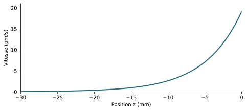
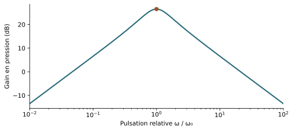
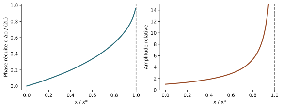

# École polytechnique et ESPCI PC 2019 — Physique A · Corrigé brut

*Corrigé rédigé par IA, non officiel. Signalez toute erreur.*

**Lecture du rapport du jury** · GPT-6.2 Astra Ultra · vitesse non renseignée

**Rédaction** · GPT-6.2 Astra Ultra · vitesse non renseignée

## Étude de la mécanique de l’audition humaine

## I. Le pavillon de l’oreille externe

### Question 1 — Approximation unidimensionnelle

La pression et la vitesse peuvent être décrites par leurs moyennes de section si le diamètre est petit devant la longueur d’onde et si le profil varie assez doucement pour ne pas exciter de modes transverses importants. On conserve un unique mode quasi plan et une vitesse longitudinale $v(z,t)$.

### Question 2 — Évolution isentropique

Une évolution adiabatique réversible conserve l’entropie d’une parcelle d’air. À l’échelle d’une oscillation, on néglige les transferts de chaleur avec les parois, la conduction, la viscosité et les chocs. La compression acoustique est alors modélisée comme isentropique.

### Question 3 — Compressibilité

$\chi_S=-(1/V)(\partial V/\partial P)_S=(1/\rho)(\partial\rho/\partial P)_S$, en $\mathrm{Pa^{-1}}$. On note $\chi_0$ sa valeur à l’équilibre.

### Question 4 — Relation linéaire entre pression et densité

Au premier ordre $\rho_a=(\partial\rho/\partial P)_{S,0}p=\rho_0\chi_0p$. Une surpression positive s’accompagne d’une hausse de masse volumique.

### Question 5 — Bilan de masse

Sur le volume fixe $S(z)dz$, $dm=S\partial_t\rho\,dz\,dt$. Par les deux sections, la même quantité vaut $[(\rho vS)(z)-(\rho vS)(z+dz)]dt=-\partial_z(\rho Sv)\,dz\,dt$. La paroi est imperméable.

### Question 6 — Conservation de la masse au premier ordre

Dans $S\partial_t\rho+\partial_z(\rho Sv)=0$, on pose $\rho=\rho_0+\rho_a$. La quantité $\rho_a v$ est du second ordre. Il reste $\partial_t\rho_a=-(\rho_0/S)\partial_z(Sv)$.

### Question 7 — Action longitudinale des pressions

Les sections exercent la force axiale $P(z)S(z)-P(z+dz)S(z+dz)=-\partial_z(PS)dz$. La paroi latérale apporte $+P S'dz$ au premier ordre en $dz$ (projection axiale de la normale). La somme est $-S\partial_zP\,dz$. En suivant la parcelle d’air, $\rho S dz(\partial_t v+v\partial_zv)=-S\partial_zP\,dz$, pour une description quasi unidimensionnelle sans frottement.

### Question 8 — Dynamique linéarisée

$P_0$ est uniforme et les produits $v\partial_zv$, $\rho_a\partial_t v$ sont quadratiques. Il reste $\rho_0\partial_tv=-\partial_zp$. La géométrie intervient encore dans l’équation de masse.

### Question 9 — Propagation dans un conduit de section variable

Par 4 et 6, $\partial_t p=-(\chi_0 S)^{-1}\partial_z(Sv)$. Dériver 8 dans le temps et substituer cette relation donne

$$
\partial_t^2v-c^2\partial_z\left(\frac{1}{S}\partial_z(Sv)\right)=0,\qquad c^2=\frac1{\rho_0\chi_0}.
$$

### Question 10 — Profil exponentiel

Pour $S=S_0e^{-z/\delta}$, $S'/S=-1/\delta$. Ainsi $S^{-1}\partial_z(Sv)=\partial_zv-v/\delta$. L’équation devient $\partial_t^2v-c^2\partial_z^2v+(c^2/\delta)\partial_zv=0$.

### Question 11 — Influence de la géométrie

Le terme supplémentaire de dérivée spatiale première provient de la variation de section. Il modifie avec $z$ l’amplitude d’une oscillation et entraîne une fréquence de coupure pour la propagation de phase dans ce modèle. Le pavillon est passif, sans terme de dissipation ajouté.

### Question 12 — Nombre d’onde complexe

Le polynôme obtenu est $k^2+ik/\delta-\omega^2/c^2=0$. Ses deux racines sont

$$
k=-\frac{i}{2\delta}\ \pm\sqrt{\frac{\omega^2}{c^2}-\frac1{4\delta^2}}.
$$

Pour une partie imaginaire $k''$, l’amplitude de $e^{ikz}$ varie comme $e^{-k''z}$.

### Question 13 — Coupure et parole

La partie réelle de $k$ s’annule si $\omega\le c/(2\delta)$, soit $f\le f_c=c/(4\pi\delta)$. Pour $\delta=5\,\mathrm{mm}$, $f_c\simeq5,4\,\mathrm{kHz}$. Les fréquences de 100 Hz à 1 kHz sont inférieures à cette valeur. La solution retenue dans la suite est une oscillation à profil spatial exponentiel.

### Question 14 — Amplitude au tympan

Pour $f=1\,\mathrm{kHz}$, $v\propto e^{qz}$ avec $q_+=1/(2\delta)+\sqrt{1/(4\delta^2)-(2\pi f/c)^2}\simeq198\,\mathrm{m^{-1}}$. Entre $z_e=-0,030\,\mathrm m$ et zéro, l’amplitude est multipliée par $e^{0,030 q_+}\simeq3,8\times10^2$. De $v_1=50\,\mathrm{nm\,s^{-1}}$, on passe ainsi à environ $2\times10^{-5}\,\mathrm{m\,s^{-1}}$. L’énoncé impose de garder la branche de forte amplitude.

### Question 15 — Profil à un instant extrémal

À un maximum positif $v(z)=v_1e^{q_+(z-z_e)}$. C’est une exponentielle croissante et convexe de l’entrée au tympan. À un minimum, la courbe est sa symétrique par rapport à l’axe horizontal.

### Question 16 — Fonction du pavillon

Sur la solution de 14, la vitesse acoustique augmente dans la direction de la section décroissante. Le pavillon recueille le son sur une grande aire et concentre le mouvement près du tympan. Le gain d’amplitude calculé ne constitue pas un gain d’énergie du système passif.

## II. Adaptation par l’oreille moyenne

### Question 17 — Raccord air-liquide

Posons $Z_j=\rho_jc_j$. Avec des amplitudes complexes de pression, la continuité de $p$ impose $p_i+p_r=p_{tr}$ et celle de la vitesse normale $(p_i-p_r)/Z_1=p_{tr}/Z_2$. Ainsi $r=(Z_2-Z_1)/(Z_2+Z_1)$ et $\tau=2Z_2/(Z_1+Z_2)$.

### Question 18 — Réflexion et transmission en puissance

La puissance par aire est $I=\tfrac12\Re(pv^*)$. Les fractions positives sont $R=-\Re(p_rv_r^*)/\Re(p_iv_i^*)$ et $T=\Re(p_{tr}v_{tr}^*)/\Re(p_iv_i^*)$. Pour des milieux sans perte,

$$
R=|r|^2=\frac{(Z_2-Z_1)^2}{(Z_1+Z_2)^2},\quad T=\frac{Z_1}{Z_2}|\tau|^2=\frac{4Z_1Z_2}{(Z_1+Z_2)^2}.
$$

Le bilan donne $R+T=1$.

### Question 19 — Transmission directe à l’eau

$Z_{\rm air}=1,25\times340=425\,\mathrm{Pa\,s\,m^{-1}}$ et $Z_{\rm eau}=1,5\times10^6\,\mathrm{Pa\,s\,m^{-1}}$. Ainsi $T\simeq4Z_{\rm air}/Z_{\rm eau}\simeq1,1\times10^{-3}$. L’intensité transmise vaut environ $0,1\,\%$ de l’intensité incidente. Sa valeur absolue dépend de l’intensité incidente.

### Question 20 — Équation du piston

La surpression $p_t$ sur le tympan exerce $+S_tp_t$, tandis que $p_c$ côté liquide exerce $-S_cp_c$. Le ressort rappelle le système vers zéro. Pour la masse mobile $m$ et la raideur $k$, $m\ddot x=S_tp_t-S_cp_c-kx$.

### Question 21 — Impédance vue par l’étrier

En amplitudes complexes $Z_0=p_c/\dot x$. Dans le modèle, $Z_0=\rho_{\rm eau}c_{\rm eau}$ est réel et positif, donc $p_c=Z_0\dot x$. En revenant à 20, $m\ddot x+Z_0S_c\dot x+kx=S_tp_t$.

### Question 22 — Rapport des pressions

Avec $e^{-i\omega t}$, on trouve $X=S_tp_t/(k-m\omega^2-i\omega Z_0S_c)$. Il vient

$$
G(\omega)=\frac{p_c}{p_t}=\frac{-i\omega Z_0S_t}{k-m\omega^2-i\omega Z_0S_c}.
$$

À $\omega_0=\sqrt{k/m}$, les effets réactifs se compensent et $G=S_t/S_c$.

### Question 23 — Gain en décibels

Avec $x_\omega=\omega/\omega_0$ et $Q=\sqrt{km}/(Z_0 S_c)$, on obtient

$$
G_{\rm dB}=20\log_{10}(S_t/S_c)-10\log_{10}[1+Q^2(x_\omega-x_\omega^{-1})^2].
$$

La courbe présente un maximum en $x_\omega=1$ et deux pentes opposées sur l’axe logarithmique. La figure illustre l’allure pour une valeur de $Q$ choisie, car $m$ et $k$ ne sont pas chiffrés.

### Question 24 — Type de filtre et limites

C’est un passe-bande du second ordre, de pulsation propre $\sqrt{k/m}$ et de facteur de qualité $Q=m\omega_0/(Z_0S_c)$. À basse fréquence $|G|\sim\omega Z_0S_t/k$ (pente $+20$ dB/décade). À haute fréquence $|G|\sim Z_0S_t/(m\omega)$ (pente $-20$ dB/décade).

### Question 25 — Gain maximal

$G_{\max}=S_t/S_c=70/3,3\simeq21$, soit environ $26\,\mathrm{dB}$. Le gain en pression est sans dimension.

### Question 26 — Estimation du transfert avec l’oreille moyenne

Dans l’estimation demandée par le sujet, l’augmentation de pression multiplie par $|G|^2$ l’intensité transmise de référence. Au maximum, $T_{\rm eff}\simeq T G_{\max}^2\simeq1,1\times10^{-3}\times21^2\simeq0,5$, soit environ la moitié de la puissance dans cette estimation. Il s’agit du rapprochement des deux modèles demandé par le jury. Un bilan précis des puissances sur deux pistons de sections différentes demanderait leurs débits et l’impédance d’entrée complète.

### Question 27 — Importance du milieu extérieur

Chez l’humain, la grande différence d’impédance air-liquide conduirait à la réflexion de presque toute la puissance sans adaptation. Chez un poisson entouré d’eau, les impédances du milieu extérieur et des tissus riches en eau sont bien plus proches. Une chaîne d’adaptation de même type est beaucoup moins nécessaire.

## III. Sélection de fréquence dans la cochlée

### Question 28 — Modes de corde

Pour une corde de longueur $L_n$ et de célérité $u$, $h(0)=h(L_n)=0$ impose $k_j=j\pi/L_n$, $j\ge1$. Les fréquences sont $f_j=ju/(2L_n)$. Un mode s’écrit $h_j(s,t)=B_j\sin(j\pi s/L_n)\cos(2\pi f_jt+\phi_j)$ pour $0\le s\le L_n$.

### Question 29 — Cordes sélectionnées

Dans le modèle de sélection résonante, répondent fortement les cordes telles que $\omega=ju\pi/L_n$ pour un entier $j$ et pour lesquelles le couplage excitateur au mode est non nul. En particulier, dans le fondamental, $L_n=\pi u/\omega$. Une corde réellement forcée peut également subir une petite réponse hors résonance.

### Question 30 — Lecture d’un spectre par la position

Quand une composante acoustique est proche d’une résonance, le déplacement de la corde correspondante peut dépasser le seuil sensoriel. L’ensemble des positions actives code alors les fréquences présentes. Dans le modèle idéal, les fréquences aiguës sélectionnent des cordes plus courtes que les graves à ordre de mode égal.

### Question 31 — Profils d’amplitude mesurés

Sur la figure 5, le maximum se déplace d’environ 4 mm pour 16 kHz à environ 21 mm pour 500 Hz. Les sons aigus ont donc leur maximum près de l’entrée, les graves plus loin. L’amplitude monte sur une bande continue de positions puis s’effondre après le maximum. La correspondance fréquence-position rejoint Helmholtz, mais l’excitation réelle ne se réduit pas à une série de points résonants isolés.

### Question 32 — Signature d’une onde voyageuse

À fréquence imposée et en partant de l’entrée, le retard de phase augmente progressivement sur de nombreux radians. Les maxima temporels des oscillations se succèdent le long de la membrane. Cela indique un temps de propagation et un raccourcissement local de la longueur d’onde quand la pente de phase augmente.

### Question 33 — Comparaison avec l’air

Dans l’air homogène, $h\propto\cos(\omega t-\omega x/c_{\rm air})$ et le retard de phase est $\omega x/c_{\rm air}$. La droite de pente constante contraste avec les courbes de la figure 5, de pente croissante avant leur plateau. La vitesse de phase locale de l’onde cochléaire varie avec la position.

### Question 34 — Dimension de $c$

$[c^2h/x^2]=[h/t^2]$ impose $[c]=L/T$. La quantité $c$ a la dimension d’une vitesse et dépend ici de $x$ et de la fréquence.

### Question 35 — Nouvelle amplitude

En posant $a=c^2h=A_m(x)e^{-i\omega t}$ dans $\partial_x^2(c^2h)-\partial_t^2h=0$, on obtient $A_m''+(\omega^2/c^2)A_m=0$. Cette écriture vaut en dehors du point où $c^2$ s’annule.

### Question 36 — Milieu homogène

Pour $c>0$ constant, $A_m=C_+e^{i\omega x/c}+C_-e^{-i\omega x/c}$. Avec la dépendance temporelle du sujet, ces ondes se propagent respectivement vers $+x$ et $-x$.

### Question 37 — Dérivées de l’amplitude complexe

Si $A_m=fe^{i\omega g}$,

$$
A_m'=(f'+i\omega fg')e^{i\omega g},\qquad
A_m''=[f''-\omega^2f(g')^2+i\omega(2f'g'+fg'')]e^{i\omega g}.
$$

### Question 38 — Équations de phase et de transport

En reportant dans 35, il vient $f''+\omega^2[c^{-2}-(g')^2]f=0$ et $2f'g'+fg''=0$. La seconde relation équivaut à $(f^2g')'=0$ sur la branche où l’amplitude est non nulle.

### Question 39 — Pente de la phase

La première équation impose $(g')^2\simeq1/c^2$. Sur la branche propagative à $g$ croissante,

$$
g'(x)\simeq \frac{1}{d\sqrt{\omega_b^2 e^{-x/L}-\omega^2}},\qquad x<x_* = L\ln(\omega_b^2/\omega^2).
$$

### Question 40 — Retard de phase prévu

La phase retardée est $\omega[g(x)-g(0)]$. Puisque $1/c$ croît, cette phase est croissante et convexe. Plus précisément, en posant $u=(\omega/\omega_b)e^{x/(2L)}$, on obtient $\omega[g(x)-g(0)]=(2L/d)[\arcsin u-\arcsin(\omega/\omega_b)]$. La pente diverge comme $(x_*-x)^{-1/2}$ dans l’approximation, mais la phase reste finie. La croissance accélérée concorde avec la figure 5 en amont du maximum. Le modèle local se dégrade à l’approche du point où $c=0$.

### Question 41 — Enveloppe de $a$

$f^2g'$ est constant et $g'\simeq1/c$, donc $f=C\sqrt c$ à une constante réelle près dans la région propagative.

### Question 42 — Enveloppe de déplacement

Comme $A_m=c^2 h_m$, on a $|h_m|=|f|/c^2\propto c^{-3/2}$. L’onde se renforce à mesure que sa célérité locale diminue.

### Question 43 — Amplitude en fonction de la position

En amont de $x_*$, $|h_m(x)|\propto[\omega_b^2e^{-x/L}-\omega^2]^{-3/4}$. L’enveloppe croît et tend formellement vers l’infini comme $(x_*-x)^{-3/4}$. La seconde courbe de la figure 3 en montre l’allure. Au-delà, $c^2<0$ et l’approximation d’onde progressive à phase réelle doit être remplacée.

### Question 44 — Écart à l’observation

L’amplification observée avant le maximum et le déplacement du maximum vers l’entrée quand $\omega$ augmente sont bien reproduits. La mesure montre toutefois un pic fini, suivi d’une chute. Près de $x_*$, la variation lente n’est plus vérifiée, et le modèle sans pertes omet l’amortissement mécanique et hydrodynamique. Le calcul formel de divergence ne décrit donc pas la zone du pic réel.
