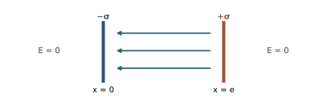
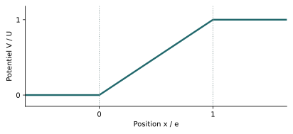
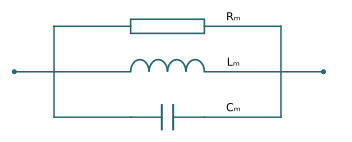
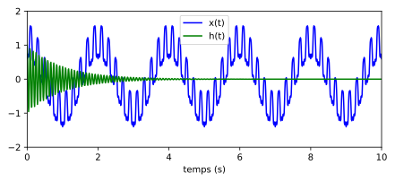
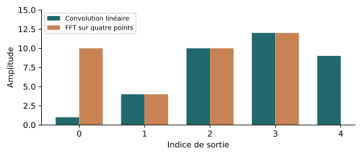

# Banque PT 2020 — Informatique et modélisation · Corrigé brut

*Corrigé rédigé par IA, non officiel. Signalez toute erreur.*

**Rédaction** · GPT-6.2 Astra Ultra · vitesse non renseignée

**Révision (tour 1)** · GPT-6.2 Astra Ultra · vitesse non renseignée

[Sujet officiel](https://www.banquept.fr/documents/2020/info_mod_2020_pt.pdf) · [Rapport du jury](https://www.banquept.fr/documents/ecrit/rapport/2020/rapport_info_model_ecrit_2020.pdf) · [Coefficients de la session](https://www.banquept.fr/documents/2020/Coefficients.pdf#page=1)

**Microphone électrostatique et réverbération à convolution.** Épreuve de quatre heures, sans calculatrice. Le feuillet recommence sa numérotation au début de la seconde partie. M1 à M19 correspondent à la modélisation et I1 à I30 à l’informatique. Les tracés et exemples numériques ci-dessous utilisent des données calculées. Le sujet donne des figures des enregistrements audio.

## Modélisation · Condensateur plan

### Question M1 · Champ électrostatique des armatures

Une plaque positive crée de chaque côté un champ de norme $\sigma/(2\varepsilon_0)$ dirigé vers l’extérieur. Pour la plaque négative, il pointe vers la plaque. La superposition annule les champs pour $x<0$ et pour $x>e$. Entre les armatures, les deux contributions vont de la plaque positive vers la plaque négative. Ainsi, pour $0<x<e$,
$$\vec E=-\frac{\sigma}{\varepsilon_0}\,\vec u_x.$$
Aux surfaces idéalisées, les limites de part et d’autre diffèrent. Le schéma représente les champs de part et d’autre et néglige les effets de bord.



### Question M2 · Profil du potentiel

Le champ ne dépend que de $x$ et $E_x=-\mathrm dV/\mathrm dx$. À gauche, la constante vaut zéro puisque $V(0)=0$. Le potentiel est continu à chaque plaque et croît à pente constante entre elles. D’où
$$V(x)=\begin{cases}0&x\leq 0,\\ \sigma x/\varepsilon_0&0\leq x\leq e,\\ \sigma e/\varepsilon_0&x\geq e.\end{cases}$$
Les sauts du champ deviennent des changements de pente sur la courbe.



### Question M3 · Tension entre les armatures

En orientant la tension de la plaque négative vers la plaque positive, $U=V(e)-V(0)=\sigma e/\varepsilon_0$. Avec la convention opposée, la différence de potentiel change de signe.

### Question M4 · Capacité du condensateur

La plaque positive porte $Q=\sigma S$. Par définition $Q=CU$, donc $C=\varepsilon_0 S/e$. La capacité augmente avec la surface en regard et diminue lorsque l’écartement augmente.

### Question M5 · Ordre de grandeur

En unités SI, $10\ \mu\mathrm m=10^{-5}$ m et $1\ \mathrm{cm}^2=10^{-4}$ m$^2$. Le calcul donne $C\simeq 10^{-11}\times10^{-4}/10^{-5}=10^{-10}$ F, soit environ **100 pF**.

### Question M6 · Densité et énergie électriques

Dans le vide, $w_e=\varepsilon_0\lVert\vec E\rVert^2/2$. Elle vaut $\sigma^2/(2\varepsilon_0)=Q^2/(2\varepsilon_0 S^2)$ dans le volume $Se$ et zéro à l’extérieur. En intégrant sur ce volume on obtient
$$E_e=\frac{Q^2 e}{2\varepsilon_0 S}=\frac{Q^2}{2C}=\frac12 CU^2.$$
La densité se mesure en joules par mètre cube et l’énergie en joules.

### Question M7 · Variation à charge constante

La charge est fixée pendant le déplacement. Dans l’expression précédente, seule la distance change. La variation d’énergie vaut donc $E_e(e+\Delta x)-E_e(e)=Q^2\Delta x/(2\varepsilon_0 S)$. Un écartement positif accroît l’énergie stockée.

### Question M8 · Effort extérieur d’écartement

Pour le déplacement quasi statique, le travail extérieur est $f\,\Delta x=\Delta E_e$. Ainsi $\lVert\vec f\rVert=Q^2/(2\varepsilon_0 S)$. Pour un écartement, l’opérateur tire dans la direction $+\vec u_x$.

### Question M9 · Attraction électrique

À l’équilibre la somme des forces est nulle. La plaque négative exerce sur la plaque positive l’attraction $\vec f_{\mathrm{él}}=-Q^2\vec u_x/(2\varepsilon_0 S)$. On retrouve cette force en multipliant $Q$ par le champ de la seule plaque opposée.

## Modélisation · Circuit et mouvement de la membrane

### Question M10 · Linéarisation de la force

Écrivons $\vec f_{\mathrm{él},0}=-Q_0^2\vec u_x/(2\varepsilon_0 S)$. Comme $(Q_0+q)^2=Q_0^2+2Q_0q+q^2$, on retrouve au premier ordre $\vec f_{\mathrm{él}}(t)\simeq\vec f_{\mathrm{él},0}(1+2q/Q_0)$. L’erreur relative à la force statique est d’ordre $(q/Q_0)^2$.

### Question M11 · Tension d’une capacité mobile

Posons $X=\Delta x$ et $C_0=\varepsilon_0 S/e$. Le produit exact est $u_C=(Q_0+q)(1+X/e)/C_0$. En omettant le terme croisé $qX/(C_0e)$, on trouve
$$u_C\simeq\frac{Q_0}{C_0}+\frac q{C_0}+\alpha X,\qquad \alpha=\frac{Q_0}{C_0e}=\frac{Q_0}{\varepsilon_0 S}.$$
À charge fixée, une hausse de l’écartement fait monter la tension.

### Question M12 · Loi des mailles

Avec $i=\dot q$, la loi des mailles s’écrit $U_0=L\ddot q+R\dot q+Q_0/C_0+q/C_0+\alpha X$ au premier ordre. La polarisation imposée $U_0=Q_0/C_0$ annule les termes statiques, d’où
$$L\ddot q+R\dot q+\frac q{C_0}+\alpha X=0.$$
Le terme de couplage a bien la dimension d’une tension.

### Question M13 · Forces de pression

La face intérieure reçoit $+P_{\rm atm}S\vec u_x$ et la face extérieure $-(P_{\rm atm}+p)S\vec u_x$. Leur somme est $\vec f_{\rm press}=-pS\vec u_x$. Une surpression positive à l’extérieur rapproche les plaques.

### Question M14 · Équation mécanique

L’attraction statique est compensée. La part variable de l’attraction vaut $-\alpha q\vec u_x$. En projetant le principe fondamental de la dynamique, on additionne le rappel, l’amortissement et les efforts électrique et acoustique. Il vient
$$m\ddot X+\lambda\dot X+kX=-\alpha q-Sp.$$
L’abscisse de la membrane est $e+X$, avec la même accélération que $X$.

## Modélisation · Régime sinusoïdal forcé

### Question M15 · Intérêt du régime harmonique

Le système linéarisé à coefficients constants répond à une harmonique par une harmonique de même fréquence en régime forcé établi. Décomposer un son en composantes de Fourier permet donc de calculer leurs gains et déphasages, puis d’additionner les réponses pour reconstruire le signal.

### Question M16 · Équations en amplitudes complexes

Avec la convention $s(t)=\mathrm{Re}(\underline s\,e^{j\omega t})$, les dérivées deviennent $j\omega$ et $-\omega^2$. Posons $D=k-m\omega^2+j\lambda\omega$ et $E=1/C_0-L\omega^2+jR\omega$. Les deux équations s’écrivent
$$E\underline q+\alpha\underline X=0,\qquad D\underline X+\alpha\underline q=-S\underline p.$$
La lettre $E$ désigne ici le coefficient électrique de la charge.

### Question M17 · Élimination du déplacement

La première équation donne $\underline X=-E\underline q/\alpha$. Par substitution, $(DE-\alpha^2)\underline q=\alpha S\underline p$. Or $E=j\omega Z_0$, où $Z_0=R+j(L\omega-1/(C_0\omega))$. Pour $\omega>0$, en regroupant les termes, on trouve
$$A\underline q=\frac{\underline p}{Z},\qquad A=\frac{j\omega D}{\alpha S}=\frac{j\omega C_0eD}{Q_0S},\qquad Z=Z_0-\frac{\alpha^2}{j\omega D}.$$
En particulier, $Z$ contient une contribution du mouvement mécanique de la membrane.

### Question M18 · Équivalent motionnel en parallèle

Écrivons $D=j\omega(\lambda+j\omega m+k/(j\omega))$ et posons $B=\alpha^2/\omega^2=Q_0^2/(C_0^2 e^2\omega^2)$. Alors $Z_m=Z-Z_0=B/(\lambda+j\omega m+k/(j\omega))$. Son **admittance** est additive,
$$\frac1{Z_m}=\frac{\lambda}{B}+\frac{k}{j\omega B}+j\omega\frac mB=\frac1{R_m}+\frac1{j\omega L_m}+j\omega C_m.$$
Ainsi $R_m=B/\lambda$, $L_m=B/k$ et $C_m=m/B$. Ces expressions donnent l’équivalent à la pulsation considérée. Le circuit motionnel parallèle se trouve en série avec $Z_0$.



### Question M19 · Mesure du courant à l’oscilloscope

Mesurer la tension $u_R(t)$ aux bornes de la résistance série de valeur connue $R$. En convention récepteur, $i(t)=u_R(t)/R$. Une lecture à 100 mV/div aux bornes de 1 kΩ correspond par exemple à 0,1 mA/div. Si les bornes de la résistance sont flottantes, utiliser une entrée différentielle.

## Informatique · Signaux et convolution directe

### Question I1 · Durée et nombre d’intervalles

Le premier instant est $t_0=0$ et le dernier $t_{n-1}=(n-1)\,dt$. Entre $n$ échantillons il y a $n-1$ intervalles, donc $T=(n-1)\,dt$.

### Question I2 · Construction de la base de temps

La fréquence vaut 100 Hz, le pas 0,01 s. Entre 0 et 10 s, bornes incluses, on a 1 000 intervalles et **1 001 valeurs**. L’indice entier garantit la présence des deux extrémités.

```python
from math import cos, exp, pi
from cmath import exp as exp_complexe
import struct
import wave

tps = [i / 100 for i in range(1001)]
```

### Question I3 · Réponse impulsionnelle d’essai

Chaque instant fournit un échantillon du cosinus à 12 Hz amorti par l’exponentielle. Le premier vaut 1 et l’enveloppe décroît comme $\exp(-t)$.

```python
def sigh(t):
    return [cos(2 * pi * 12 * ti) * exp(-ti) for ti in t]
```

### Question I4 · Signal à quatre composantes

Pour chaque instant, sommer les quatre cosinus d’amplitudes 1, 0,5, 0,2 et 0,1 aux fréquences respectives 0,5, 5, 10 et 20 Hz. La phase $k\pi$ alterne le signe à l’origine. Par exemple $x(0)=1-0{,}5+0{,}2-0{,}1=0{,}6$.

```python
def sigx(t):
    amplitudes = [1, 0.5, 0.2, 0.1]
    frequences = [0.5, 5, 10, 20]
    return [sum(a * cos(2 * pi * f * ti + k * pi)
                for k, (a, f) in enumerate(zip(amplitudes, frequences)))
            for ti in t]
```

### Question I5 · Tracé des signaux tests

La figure ci-dessous résulte de l’appel de la fonction avec la liste des instants. On retrouve la modulation lente de $x$ et la décroissance rapide de $h$. Les couleurs, la légende et le libellé de l’axe des temps suivent la figure 3 et l’annexe du sujet.

```python
def tracer(t):
    from matplotlib import pyplot as plt
    fig, ax = plt.subplots()
    ax.plot(t, sigx(t), color="blue", label="x(t)")
    ax.plot(t, sigh(t), color="green", label="h(t)")
    ax.set(xlabel="temps (s)", xlim=(0, 10), ylim=(-1.5, 2))
    ax.set_yticks([i / 2 for i in range(-3, 5)])
    ax.legend(loc="upper right")
    return fig, ax

if __name__ == "__main__":
    from matplotlib import pyplot
    tracer(tps)
    pyplot.show()
```



### Question I6 · Convolution par rectangles gauches

Pour chaque $i$, l’équation (4) intègre de $0$ à $t_{n-1}$. Ses $n-1$ rectangles gauches donnent
$$y_i\simeq dt\sum_{j=0}^{n-2} x_jh_{(i-j)\bmod n}.$$
L’indexation circulaire traduit le prolongement demandé des listes. Avec des listes de taille $n$, Python permet aussi de lire directement $h[i-j]$. Pour la convolution circulaire discrète usuelle de $n$ valeurs, la somme va jusqu’à $n-1$ et couvre alors $n$ rectangles. Sur trois points, pour $x=(1,2,3)$, $h=(1,0,2)$ et $dt=0{,}5$, les deux rectangles de (4) donnent $(2{,}5,1,1)$. Cette distinction reparaît à la question I14.

```python
def convolution(x, h, t):
    n = len(t)
    if len(x) != n or len(h) != n or n < 2:
        raise ValueError("Trois listes de même longueur, au moins deux points")
    dt = t[1] - t[0]
    return [dt * sum(x[j] * h[(i - j) % n] for j in range(n - 1))
            for i in range(n)]
```

### Question I7 · Coût de la méthode directe

Chacun des $n$ indices de sortie demande $n-1$ produits et un nombre comparable d’additions. Le nombre de produits avant pondération est $n(n-1)$, donc le temps est en $\Theta(n^2)$. La liste de sortie occupe $\Theta(n)$ cases.

## Informatique · Transformée de Fourier discrète

### Question I8 · Lecture du spectre

Les huit pics correspondent aux quatre composantes de $x$ aux fréquences $f=\pm0{,}5$, $\pm5$, $\pm10$ et $\pm20$ Hz. Un cosinus est la somme de deux exponentielles de fréquences opposées. Pour un signal réel, les deux coefficients sont conjugués, donc de même module. La figure 5 répartit ainsi l’amplitude selon la fréquence. Les phases $k\pi$ changent le signe des coefficients, invisible dans le module. Sur un nombre entier de périodes et une TFD brute de 1 000 points, les hauteurs théoriques sont $500$, $250$, $100$ et $50$ de chaque côté. Un enregistrement de 1 001 points décale légèrement les fréquences des cases et étale certains pics.

### Question I9 · Des rectangles à la transformée discrète

Dans l’équation (9) l’intervalle est maintenant $[0,n\,dt]$. Il y a $n$ rectangles gauches d’abscisses $t_l=l\,dt$. Avec $f_k=k/(n\,dt)$ et $\omega_n=\exp(-2j\pi/n)$, on obtient
$$X(f_k)\simeq dt\sum_{l=0}^{n-1}x_l e^{-2j\pi f_k l\,dt}=dt\sum_{l=0}^{n-1}x_l\omega_n^{kl}.$$
Le pas de fréquence cohérent avec l’équation (7) vaut $df=f_e/n=1/(n\,dt)$. L’écriture $1/T$ utilise ici une durée de fenêtre de $n\,dt$, alors que le dernier instant de la question I1 vaut $(n-1)\,dt$.

### Question I10 · Transformée de Fourier directe

Pour chaque case de fréquence, on additionne les contributions des $n$ instants. Le signe de l’exponentielle est négatif. La fonction renvoie les coefficients sans le facteur physique $dt$, conformément à la convention de la question.

```python
def Fourier_directe(x):
    n = len(x)
    return [sum(x[l] * exp_complexe(-2j * pi * k * l / n)
                for l in range(n)) for k in range(n)]
```

### Question I11 · Complexité de la TFD

Il y a $n$ coefficients. Chacun nécessite $n$ évaluations et produits complexes et une somme. À coût élémentaire constant, la TFD directe est donc en $\Theta(n^2)$.

### Question I12 · Transformée inverse et normalisation

Changer le signe dans l’exponentielle donne la somme inverse demandée avec $df=1$. Pour inverser exactement la TFD brute programmée en I10, il faut en outre diviser cette somme par $n$. En effet, la somme des $n$ racines $\exp(2j\pi(k-l)r/n)$ sur $r$ vaut $n$ si $k=l$ modulo $n$ et zéro sinon. La fonction ci-après réalise cette inverse normalisée. Dans la convention physique, c’est le produit $dt\,df=1/n$ qui apporte ce facteur.

```python
def Fourier_directe_inverse(X):
    n = len(X)
    return [sum(X[k] * exp_complexe(2j * pi * k * l / n)
                for k in range(n)) / n for l in range(n)]
```

### Question I13 · Produit de deux spectres

Les composantes de même indice se multiplient une à une. La longueur reste identique à celle des deux listes. Ce produit demande $n$ multiplications et s’applique aussi aux coefficients complexes.

```python
def produit(x, h):
    if len(x) != len(h):
        raise ValueError("Dimensions différentes")
    return [a * b for a, b in zip(x, h)]
```

### Question I14 · Convolution par produit spectral

Pour les deux listes $x$ et $h$, l’appel de la fonction ci-dessous avec le pas temporel calcule deux TFD, multiplie leurs coefficients puis applique la TFD inverse. L’orthogonalité des exponentielles donne $y_i=dt\sum_{j=0}^{n-1}x_jh_{(i-j)\bmod n}$. Pour la quadrature littérale de l’équation (4), le dernier rectangle est absent. Affecter zéro au dernier échantillon de l’entrée utilisée pour la TFD donne exactement la somme de I6. Pour les signaux d’essai définis en I3–I4 et les temps de I2, l’instruction `y = convolution_tfd(x, h, tps[1] - tps[0])` donne la convolution circulaire pondérée. Sur l’exemple de I6, elle vaut $(2{,}5,4,2{,}5)$. L’option `dernier_rectangle=False` restitue $(2{,}5,1,1)$. Avec des données réelles, la partie imaginaire du résultat traduit seulement l’arrondi.

```python
def convolution_tfd(x, h, dt=1.0, dernier_rectangle=True):
    entree = list(x)
    if not dernier_rectangle:
        entree[-1] = 0
    spectre = produit(Fourier_directe(entree), Fourier_directe(h))
    return [v * dt for v in Fourier_directe_inverse(spectre)]
```

### Question I15 · Coût des trois transformées

Deux TFD directes et une inverse coûtent chacune $\Theta(n^2)$. Le produit terme à terme et la multiplication par $dt$ ajoutent $\Theta(n)$. Au total, $3\,\Theta(n^2)+\Theta(n)=\Theta(n^2)$. C’est le même ordre que la convolution directe calculée en I7, avec davantage d’opérations complexes.

## Informatique · Transformée de Fourier rapide

### Question I16 · Terminaison des appels récursifs

Pour $N=2^p$, $p$ est un entier naturel. Si $p=0$, alors $N=1$ et l’appel retourne aussitôt. Sinon, les deux appels portent sur $N/2=2^{p-1}$. Le variant entier $p$ décroît strictement sur chaque branche et atteint zéro. Les branches sont en nombre fini. On peut donc recombiner les résultats. Le code ci-dessous réalise cette FFT et son inverse par conjugaison. Il calcule une seule fois le produit utilisé pour les deux sorties du papillon.

```python
def Fourier_rapide(x, N):
    if N < 1 or N & (N - 1) or len(x) != N:
        raise ValueError("La taille doit être une puissance de deux")
    if N == 1:
        return list(x)
    demi = N // 2
    pairs = Fourier_rapide(x[::2], demi)
    impairs = Fourier_rapide(x[1::2], demi)
    racine = exp_complexe(-2j * pi / N)
    phase = 1
    y = [0j] * N
    for k in range(demi):
        terme = phase * impairs[k]
        y[k] = pairs[k] + terme
        y[k + demi] = pairs[k] - terme
        phase *= racine
    return y


def Fourier_rapide_inverse(X, N):
    conjugues = [complex(v).conjugate() for v in X]
    return [complex(z).conjugate() / N for z in Fourier_rapide(conjugues, N)]
```

### Question I17 · Puissance de deux inférieure ou égale

Partir de 1 et doubler aussi longtemps que le résultat reste inférieur ou égal à $n$. En sortie, $N\le n<2N$, donc $N$ est la puissance de deux recherchée, y compris lorsque $n$ est déjà une puissance de deux. Par exemple 7 donne 4 et 8 donne 8.

```python
def nextpow2(n):
    if n < 1:
        raise ValueError("Entier positif requis")
    N = 1
    while N * 2 <= n:
        N *= 2
    return N
```

### Question I18 · Multiplications de la FFT imprimée

Sur un papillon de la figure 6, le produit de la composante impaire par $W$ apparaît deux fois et la mise à jour de $W$ en demande un troisième. Pour les produits de la boucle, $M(1)=0$ et $M(N)=2M(N/2)+3N/2$. Au niveau $r$ de l’arbre il y a $2^r$ nœuds de taille $N/2^r$, donc $3N/2$ produits au total. Il y a $p=\log_2N$ niveaux non terminaux, d’où
$$M(2^p)=3p\,2^{p-1},\qquad M(N)=\tfrac32 N\log_2N.$$
Le calcul du facteur exponentiel fait un travail constant par nœud interne, soit $O(N)$ de plus si on l’inclut. Le code de I16 réutilise le produit commun et effectue deux multiplications par papillon. Les deux écritures ont un coût en $\Theta(N\log N)$.

### Question I19 · Pentes du graphe des temps

En coordonnées logarithmiques, une croissance $t=cN^a$ a pour pente $a=\log(t_2/t_1)/\log(N_2/N_1)$. Sur la figure 7, de $N=512$ à $4096$ la taille est multipliée par huit. La convolution directe passe d’environ $0{,}17$ à $11$ s, soit une pente voisine de 2. Celle par TFD passe d’environ $1{,}8$ à $120$ s, soit également 2. La FFT passe d’environ $0{,}016$ à $0{,}15$ s, soit une pente proche de 1,08. Les lectures sont approximatives. Par exemple, $\log(11/0{,}17)/\log(8)\simeq2{,}01$. Cette faible surlinéarité est compatible avec $N\log N$. La FFT devient largement avantageuse aux grandes tailles.

## Informatique · Fichiers musicaux WAVE

### Question I20 · Fréquence d’échantillonnage du CD

Pour reconstruire un signal limité à 20 kHz, le théorème de Shannon impose une fréquence d’échantillonnage supérieure à 40 kHz. La fréquence choisie, 44,1 kHz, place la fréquence de Nyquist à 22,05 kHz et laisse une marge au filtrage antirepliement avant l’échantillonnage.

### Question I21 · Intérêt du complément à deux

Sur $n$ bits, le codage représente $-a$ par $2^n-a$. L’addition binaire ordinaire, en abandonnant la retenue finale, effectue donc les additions et soustractions signées modulo $2^n$. La même unité matérielle suffit et zéro a une représentation unique. La valeur signée obtenue est exacte lorsque le résultat appartient à l’intervalle représentable.

### Question I22 · Bornes d’un mot de 16 bits

Sans signe, tous les bits à un donnent $2^{16}-1=65\,535$. En complément à deux, les codes extrêmes signés sont $0111\ldots1111$ et $1000\ldots0000$, soit respectivement $2^{15}-1=32\,767$ et $-2^{15}=-32\,768$.

### Question I23 · Encodage du minimum signé

Le mot de 16 bits de $-32768$ est $8000$ en hexadécimal. En petit-boutiste, l’octet de poids faible vient en premier. Python renvoie donc la séquence de deux octets de valeurs hexadécimales **00 80**, affichée sous la forme `b'\x00\x80'`.

### Question I24 · Décodage des deux octets

La séquence **2A 00** représente le mot hexadécimal $002A$. Son bit de signe est nul et $2\times16+10=42$. La commande retourne l’entier **42**.

### Question I25 · Opération sur les séquences d’octets

L’opérateur de la figure 10 effectue une **concaténation**. Les deux octets de 12 sont **0C 00**, ceux de 24 sont **18 00**. La séquence résultante contient les quatre octets **0C 00 18 00**, dans cet ordre.

### Question I26 · Codage et normalisation des deux voies

Calculer un maximum commun $M$ de la valeur absolue des échantillons sur les deux voies. Pour chacune, arrondir $32767\,v/M$ à un entier et l’encoder sur deux octets signés de poids faible d’abord. Le gain commun conserve le rapport des amplitudes stéréo. Pour $M=0$, tous les échantillons codés valent zéro. Par exemple, avec $M=2$, la paire $(2,-1)$ produit les mots $32767$ et $-16384$.

```python
def coder_paire(gauche, droite, maxi):
    g = round(32767 * gauche / maxi) if maxi else 0
    d = round(32767 * droite / maxi) if maxi else 0
    gbyte = g.to_bytes(2, byteorder="little", signed=True)
    dbyte = d.to_bytes(2, byteorder="little", signed=True)
    return gbyte, dbyte
```

### Question I27 · Entrelacement et écriture du WAVE

Une trame contient la gauche puis la droite au même instant. L’argument de l’écriture brute est la concaténation des deux mots. Le fichier précise deux voies, deux octets par échantillon et 44 100 trames par seconde. Le nombre de trames est la longueur entière d’une voie.

```python
def creawave_2oct(voieG, voieD, destination):
    if len(voieG) != len(voieD):
        raise ValueError("Les voies doivent avoir la même durée")
    maxi = max((abs(v) for voie in (voieG, voieD) for v in voie), default=0)
    with wave.open(str(destination), "wb") as sortie:
        sortie.setparams((2, 2, 44100, len(voieG), "NONE", "PCM"))
        for gauche, droite in zip(voieG, voieD):
            gbyte, dbyte = coder_paire(gauche, droite, maxi)
            sortie.writeframesraw(gbyte + dbyte)
```

### Question I28 · Compléter une liste par des zéros

Copier les valeurs d’origine puis ajouter exactement $N-\operatorname{len}(\mathrm{voie})$ zéros. Lorsque les tailles coïncident, on obtient la même suite de valeurs. L’entrée reste disponible telle quelle pour une seconde transformation.

```python
def addzeros(voie, N):
    if len(voie) > N:
        raise ValueError("La taille demandée est trop petite")
    return list(voie) + [0] * (N - len(voie))
```

### Question I29 · Réverbération stéréo de deux fichiers

Chaque canal du signal se convolue avec le canal correspondant de la réponse impulsionnelle. Pour des longueurs $N_1$ et $N_2$, les indices de la convolution linéaire vont de 0 à $N_1+N_2-2$. Posons $K=N_1+N_2-1$. On complète chaque entrée par des zéros jusqu’à la première puissance de deux $N\ge K$. Après les FFT, le produit terme à terme et l’inverse, les $K$ premières valeurs forment la convolution entière. Les valeurs réelles des deux voies partagent la même normalisation lors de l’écriture.

La page 16 prescrit aussi $N=\mathrm{nextpow2}(K)$, où I17 définit une puissance de deux **inférieure ou égale**. Pour reproduire cette convention imprimée lorsque les deux entrées tiennent dans $N$, on garde cette valeur, on complète les deux signaux et on écrit les $N$ échantillons de l’inverse. Si $N<K$, les termes d’indices $N$ et suivants se replient au début. Pour les durées indiquées, $K$ avoisine 189 100 et la figure 13 s’arrête à $131072/44100\simeq2{,}972$ s. Pour conserver toute la queue sonore demandée, le programme double la valeur trouvée en I17 si nécessaire, soit 262 144 ici, avant de revenir à $K$. Dans le schéma, pour $x=h=(1,2,3)$, la convolution entière est $(1,4,10,12,9)$. Sur quatre points, sa dernière valeur se replie sur la première et donne $(10,4,10,12)$.

```python
def extrawave_2oct(fichier):
    with wave.open(str(fichier), "rb") as entree:
        p = entree.getparams()
        if (p.nchannels, p.sampwidth, p.framerate) != (2, 2, 44100):
            raise ValueError("PCM stéréo, 16 bits, 44 100 Hz requis")
        brut = entree.readframes(p.nframes)
    gauche, droite = [], []
    for g, d in struct.iter_unpack("<hh", brut):
        gauche.append(g)
        droite.append(d)
    return gauche, droite


def convolution_reverb(fichier1, fichier2, fichier3):
    xg, xd = extrawave_2oct(fichier1)
    hg, hd = extrawave_2oct(fichier2)
    if not xg or not hg:
        raise ValueError("Les deux enregistrements doivent être non vides")
    longueur = len(xg) + len(hg) - 1
    N = nextpow2(longueur)
    if N < longueur:
        N *= 2

    def traiter(x, h):
        X = Fourier_rapide(addzeros(x, N), N)
        H = Fourier_rapide(addzeros(h, N), N)
        y = Fourier_rapide_inverse(produit(X, H), N)
        return [v.real for v in y[:longueur]]

    creawave_2oct(traiter(xg, hg), traiter(xd, hd), fichier3)
```



### Question I30 · Reconnaître la réverbération

Les attaques du signal initial restent repérables. Après elles, l’enveloppe de la figure 13 décroît de façon plus progressive, y compris dans les intervalles où la figure 8 était presque silencieuse. Cette persistance est l’effet attendu de l’addition de copies différées et atténuées du signal. Le résultat affiché dure 2,972 s contre 2,530 s à l’entrée. Une convolution linéaire conservant toute la réponse de 1,758 s durerait environ 4,288 s, à un échantillon près pour les durées exactes. La dernière partie de la décroissance ne figure donc pas entièrement sur le graphe imprimé.
