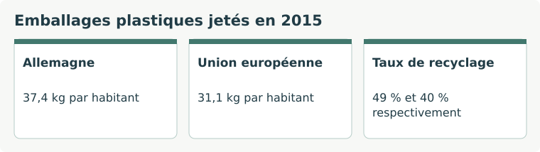
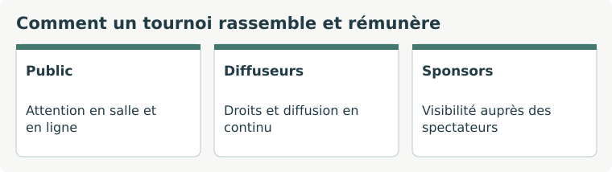
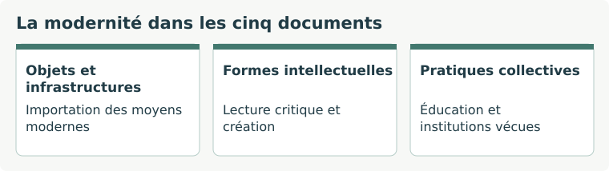
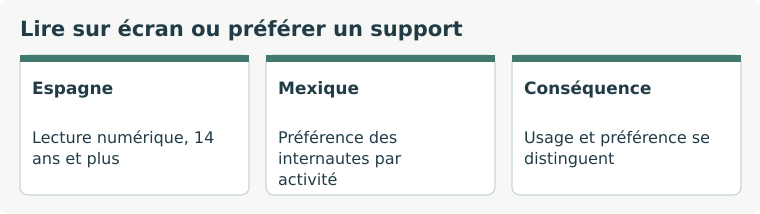
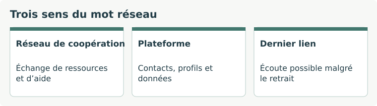

# Banque PT — Langue vivante A 2020 · Corrigé guidé

*Corrigé rédigé par IA, non officiel.*

**Rédaction** · GPT-6.2 Astra Ultra · vitesse non renseignée

L’épreuve dure trois heures. Chaque candidat compose dans la langue choisie à l’inscription. Ce fascicule présente les cinq synthèses de 450 à 500 mots. Le décompte indiqué inclut le titre.

## Allemand

*2050: Eine Erde aus Plastikmüll?*

### Construire la synthèse

Dissocier quantité produite et fraction recyclée. Envisager ensuite deux usages très différents, emballage jetable et composant durable, pour expliquer pourquoi leurs bilans peuvent diverger.

**Document 1** · L’étude pilote de Vienne trouve des microplastiques chez ses huit participants ; leur présence ne démontre ni un effet clinique ni une voie d’exposition précise.

**Document 2** · Der Standard décrit les économies de poids possibles et le rôle du comportement, de la politique et de la conception des produits.

**Document 3** · Lead Innovation illustre la recherche d’emballages de substitution avec des champignons, de la canne à sucre et des composants du lait.

**Document 4** · Le graphique compare les emballages en plastique jetés par habitant et le taux de recyclage en Allemagne et dans l’UE à 28 en 2015.

**Document 5** · La campagne du WWF montre un dauphin à la bouche pleine de déchets et détourne une expression de lassitude.

### Proposition rédigée

**Was im Jahr 2050 vom Kunststoff übrig bleibt**

Ein Delfin öffnet das Maul, und anstelle von Nahrung sieht man weggeworfene Verpackungen. Mit diesem Bild gibt der WWF einem Tier eine Stimme, das selbst nicht gegen die Verschmutzung seines Lebensraums protestieren kann. Die Frage, ob die Erde 2050 unter Plastikmüll zu verschwinden droht, betrifft jedoch auch unsichtbare Teilchen und Entscheidungen, die lange vor der Entsorgung fallen. Wie sich das Problem entwickelt, hängt davon ab, welche Kunststoffe wofür eingesetzt werden und was anschließend mit ihnen geschieht.

Seit Teilchen selbst in abgelegenen Meeresregionen gefunden wurden, lässt sich ihre Ausbreitung kaum noch als örtliches Abfallproblem verstehen. Die Süddeutsche Zeitung berichtet von einer Wiener Pilotstudie, in der die Proben aller acht Teilnehmer Mikroplastik enthielten. Die Menschen lebten auf verschiedenen Kontinenten und hatten in der untersuchten Woche verpackte Lebensmittel oder Getränke aus Kunststoffflaschen konsumiert. Die Untersuchung weist somit einen Kontakt nach, doch aus einer so kleinen Gruppe lassen sich weder der genaue Aufnahmeweg noch die gesundheitlichen Folgen ableiten. Der wissenschaftliche Befund ergänzt die eindringliche Werbung des WWF, ohne dieselbe Beweiskraft für jede dort angesprochene Gefahr zu besitzen.

Auch ein vergleichsweise gutes Recyclingergebnis verlangt eine zweite Betrachtung. Das Institut der deutschen Wirtschaft stellt für 2015 zwei Größen nebeneinander. Deutschland verwertete mit 49 Prozent einen größeren Anteil seiner Kunststoffverpackungen stofflich als die Europäische Union mit 40 Prozent. Zugleich fielen je Einwohner 37,4 Kilogramm an, gegenüber 31,1 Kilogramm im europäischen Durchschnitt. Wer nur die erste Zahl betrachtet, übersieht, wie viel Material zunächst verbraucht und danach überhaupt wieder eingesammelt werden muss. Recycling und Abfallvermeidung beantworten unterschiedliche Fragen.

Der im Standard befragte Innovationsforscher warnt dennoch davor, Kunststoff unabhängig vom Verwendungszweck zu beurteilen. Ein leichteres Bauteil kann etwa im Flugzeug über einen langen Zeitraum Energie einsparen. Eine kurz benutzte Verpackung stellt andere Anforderungen an die Gestaltung. Lead Innovation beschreibt dafür Alternativen aus Pilzen und organischen Reststoffen, aus Zuckerrohr oder Milchbestandteilen sowie eine essbare Hülle für Wasser. Besonders einleuchtend ist der Ersatz schwer abbaubaren Polstermaterials durch eine biologisch abbaubare Verpackung. Ein überzeugender Entwurf muss jedoch auch zeigen, ob er die Ware ausreichend schützt und sich nach Gebrauch in einen funktionierenden Kreislauf einfügt.

Eine Welt voller Plastikmüll ist damit weder eine bloße Übertreibung noch eine feststehende Zukunft. Das Bild des Tieres zeigt, was dort ankommt, wo Sammlung und Wiederverwertung versagen. Die Beispiele aus Industrie und Forschung lenken den Blick dagegen auf den Anfang des Weges. Politik, Hersteller und Verbraucher können beeinflussen, wie viel Material gebraucht wird, wie lange ein Produkt dient und ob seine Bestandteile erneut eingesetzt werden können. Verbote für einzelne Wegwerfartikel erfassen deshalb nur einen Teil der Möglichkeiten. Entscheidend ist eine Gestaltung, bei der der Nutzen eines Werkstoffs gegen die Folgen seines gesamten Lebenswegs abgewogen wird. Dabei zählt die tatsächlich vermiedene Abfallmenge mehr als das gute Image eines einzelnen Materials.

**(458 Wörter, einschließlich Titel)**

## Anglais

*What is at stake with the development of esports?*

### Construire la synthèse

Partir de la photographie, puis élargir la scène aux acteurs que montre le schéma économique. Une analyse de la croissance doit inclure celles et ceux qui ne se sentent pas accueillis.

**Document 1** · La défense des jeux en réseau souligne les liens sociaux et les bourses universitaires tout en reconnaissant les risques d’un usage excessif.

**Document 2** · L’article sur les femmes distingue leur présence dans le public américain des obstacles à leur pleine participation.

**Document 3** · Le texte consacré à la télévision analyse les choix de format et les partenariats susceptibles de toucher un nouveau public.

**Document 4** · L’écosystème met en relation éditeurs, joueurs, équipes, organisateurs, sponsors, plateformes et spectateurs, avec des flux de droits et de revenus distincts.

**Document 5** · Le cliché du tournoi parisien de League of Legends montre à la fois le joueur devant son écran et le public dans une grande salle.

### Proposition rédigée

**Who gets to play when a game becomes a sport?**

A competitor sits at a computer while an arena full of spectators follows the action in Paris. The photograph of a League of Legends event captures a transformation that accounts of solitary screen time can easily miss. Competitive gaming has become a meeting place, a profession and a spectator business. At stake is who will be able to participate in that development and whose interests will shape the entertainment offered to a wider public.

For many young players, the attraction begins with other people. The defence of Fortnite describes games as places to cooperate, talk and compete with friends. Concerns about excessive spending and harmful patterns of play remain legitimate, but the experience of those affected cannot simply stand for every participant. The existence of college scholarships in the United States indicates how seriously some institutions already take the skills involved. The Paris photograph adds another dimension. Although the competitor faces a screen, the crowd has assembled in a physical space and reacts to a shared live performance.

That audience underpins an economy whose participants have different interests. The diagram of the esports ecosystem connects fans, teams, tournament organisers, game publishers, sponsors and broadcasting platforms. A publisher owns the game around which a competition is built. A sponsor pays to associate a brand with a team or event, while a platform can deliver spectators to advertisers. The player at the centre of the Paris image therefore depends on many people who never appear in the photograph. Prize money signals the scale of a particular competition, but the diagram shows why viewing habits matter even to people who never compete for it.

Broadcasters looking to reach young viewers see an opportunity in an audience that already spends hours watching online. The article about television nevertheless identifies a problem. Established fans understand a long contest and its rules, whereas an occasional viewer may struggle to follow either. Simpler formats, familiar sports personalities or partnerships with traditional sports can attract newcomers. Those choices may also change which games and participants get shown. What is accessible to television is not necessarily what initially brought existing fans together.

Nor has commercial expansion automatically made the community equally welcoming. The article about women reports that they represent roughly a quarter of American fans and describes obstacles to their fuller participation. Organisations working to build a more inclusive community see both an issue of fairness and an audience that the industry has failed to serve. A sold-out arena cannot reveal who felt unable to enter it in the first place. Esports may thus offer social connection and professional opportunities while reproducing barriers familiar from other forms of competition. Its growth will be judged not only by the number of spectators reached but by who can belong, compete and help decide what counts as success.

**(477 words, title included)**

## Arabe

*كيف تبدو ملابسات الحداثة وآفاقها في العالم العربي في ضوء الوثائق الخمس؟*

### Construire la synthèse

Relier la juxtaposition photographique à la distinction conceptuelle entre modernité et modernisation. Le dessin laisse ouverte la question du dialogue, sans assigner une identité certaine à chaque silhouette.

**Document 1** · Le premier article distingue modernisation matérielle et transformation profonde des manières de penser.

**Document 2** · Le deuxième examine l’évolution littéraire au contact d’autres cultures et le précédent des réactions au naturalisme espagnol.

**Document 3** · Le troisième associe modernité et démocratie à une culture vécue et une capacité de création, au-delà des slogans.

**Document 4** · Deux profils se font face parmi des symboles intellectuels et culturels, avec points d’interrogation et d’exclamation.

**Document 5** · Un cavalier à dos de chameau passe devant des grues et des pylônes, donnant à voir la coexistence d’infrastructures et de pratiques d’âges différents.

### Proposition rédigée

**بين امتلاك أدوات العصر وصنع الحداثة**

رجل يركب جملا أمام أبراج قيد البناء وخطوط تنقل الكهرباء. تضع الصورة زمنين في مشهد واحد وتدعو إلى التساؤل عما تغير في المجتمع وعن معنى هذا التغير. فهل تكفي الأبنية الحديثة ووسائل الاتصال كي يوصف مجتمع بأنه حديث؟ تكشف الوثائق عن التباس تاريخي في علاقة العرب بالغرب، وعن خلاف يتعلق بما يؤخذ من التجارب الأجنبية وبما يستطيع المجتمع نفسه أن ينتجه من معرفة وفن وقواعد للحياة المشتركة.

يرجع أحد المقالات إلى حملة نابليون على مصر باعتبارها لحظة مواجهة جعلت الفارق في القوة والمعرفة محسوسا. ووجد المفكرون أنفسهم أمام سؤال مزدوج يتعلق بأسباب التأخر وبالطريق الذي يمكن اتباعه لتجاوزه. وقد يتخذ الرد شكل دعوة إلى العودة إلى التراث أو إلى اتباع المثال الغربي. غير أن كلا الموقفين يصبح عاجزا حين يفترض أن الماضي كتلة ثابتة وأن الغرب تجربة واحدة جاهزة للنقل. وفي الرسم الذي يجمع وجهين متقابلين تظهر علامات الاستفهام على أحدهما وعلامات التعجب على الآخر. وبينهما إشارات إلى أفكار وأنشطة مختلفة، وكأن التواصل قائم بالفعل من دون أن يضمن اتفاق الطرفين على معنى ما يتبادلانه.

ويتجلى الفرق بين التحديث والحداثة حين تدخل السيارة والطائرة والهاتف إلى حياة الناس من غير أن تتغير بالقدر نفسه طرق التعليم والبحث والنظر إلى السلطة. ففي استطاعة المجتمع شراء نتيجة العمل العلمي قبل أن يمتلك الشروط التي أنتجتها. ويعيد مشهد الراكب والأبراج طرح السؤال بصورة أخرى. وجود الوسيلتين معا لا يثبت أن القديم عائق ولا أن البناء الجديد دليل على تطور الفكر، ولكنه يكشف قصور الحكم على المجتمع من مظهره وحده. ويلتقي هذا المعنى مع نقد المقال الثالث للاكتفاء بالشعارات أو باستيراد المؤسسات من غير ممارسة يومية تعطيها مضمونا.

أما الأدب فيبين أن التأثر بالخارج لا يقتضي التخلي عن القدرة على الاختيار. فالأشكال الأدبية تتغير مع تغير البيئة ومع الاحتكاك بتجارب الآخرين، ويستطيع الكاتب أن يصوغ من هذا الاحتكاك عملا يرتبط بأسئلة مجتمعه. ويذكر المقال المتعلق بالعرب والغرب أن المقاومة الدينية أو الأخلاقية لاتجاه أدبي جديد لم تكن مقصورة على العالم العربي. فالاعتراض الذي أثارته الطبيعية في إسبانيا يدل على أن ما يقدم اليوم على أنه حداثة غربية مستقرة كان موضع نزاع في الغرب نفسه. وبذلك يصبح التاريخ أداة لفهم الخلاف بدلا من اتخاذه دليلا على تعارض دائم بين ثقافتين.

وتتحدد آفاق الحداثة، في ضوء هذه المقارنات، بقدرة الفاعلين على نقل السؤال من دائرة الاقتناء إلى دائرة الإبداع. فالمؤسسة الديمقراطية تحتاج إلى سلوك يقبل المناقشة، والبحث يحتاج إلى تربية تسمح بالنقد، والابتكار الفني يحتاج إلى معرفة بالموروث حتى يمكن إعادة قراءته. وليس المطلوب حسم الحوار بين الوجهين بإسكات أحدهما، بل إعطاء هذا الحوار مضمونا يستطيع المجتمع اختباره في المدرسة والعمل والفن والحياة العامة. عندئذ يغدو اجتماع الجمل والأبراج بداية للتفكير في الاختيارات الممكنة بدلا من اعتباره الجواب النهائي عن موقع العرب من العصر. فالاختبار الحقيقي يحدث حين تتحول المعرفة من سلعة تصل من الخارج إلى قدرة اجتماعية على طرح مسائل جديدة واقتراح حلول نابعة من واقع الناس.

**(458 كلمة، بما فيها العنوان)**

## Espagnol

*Al cambiar tan rápido la sociedad, ¿en qué medida la lectura, desde la producción de los textos hasta su recepción, debe adaptarse y su práctica evolucionar?*

### Construire la synthèse

Ne pas superposer les deux enquêtes. Une fréquence tous supports numériques en Espagne et une préférence de support pour lire des livres au Mexique ne mesurent pas la même chose.

**Document 1** · Les librairies opposent à la puissance d’Amazon leur sélection, leurs rencontres et leurs liens avec les lecteurs.

**Document 2** · La comparaison entre manuels et tablettes met l’accent sur les apprentissages, la complémentarité et l’accompagnement par les adultes.

**Document 3** · L’autrice qui rencontre ses abonnés en vendant en personne ses livres imprimés illustre les circuits hybrides.

**Document 4** · Le baromètre espagnol porte sur les 14 ans et plus : la lecture numérique atteint 76,3 % en 2017.

**Document 5** · L’enquête mexicaine porte sur les internautes et leurs préférences par activité ; pour les livres, le support traditionnel précède internet.

### Proposition rédigée

**El lector entre la pantalla y la librería**

Una escritora reúne seguidores en Instagram y baja a una plaza de Barcelona con una mochila llena de ejemplares de papel. La escena desmiente dos predicciones fáciles, la desaparición del libro impreso y la continuidad del negocio editorial sin apenas cambios. Lo que está cambiando es la relación entre quienes escriben, seleccionan, venden y leen. Adaptarse supone decidir para qué sirve cada soporte y qué mediaciones conservan su valor cuando el público puede acceder directamente a los textos.

Para los autores, las plataformas permiten iniciar una conversación con los lectores sin esperar primero la aprobación de una editorial. El caso de Elena Codes, presentado por El País, muestra que la atención obtenida en la red puede convertirse en demanda de un libro físico. Las editoriales observan esa actividad y se plantean cómo incorporar voces que ya llegan con un público propio. La intermediación tampoco desaparece en las librerías. Frente al catálogo y a la comodidad de Amazon, algunos establecimientos ofrecen una selección personal, organizan encuentros o se combinan con un bar. Recomendar un título en un lugar donde la gente conversa sobre él convierte la compra en una experiencia que una entrega a domicilio difícilmente reproduce.

Los datos sobre los hábitos de lectura ayudan a entender por qué pueden convivir esos modelos. En la encuesta española a personas de catorce años o más, la proporción que lee en soporte digital pasó de menos de la mitad en 2010 a más de tres cuartas partes en 2017. Eso no significa que todos prefieran las novelas electrónicas. El estudio entre internautas mexicanos distingue las actividades. Para comunicarse con los contactos destaca internet, mientras que, para leer libros, la preferencia por el medio tradicional supera claramente la preferencia por internet. Las poblaciones y las preguntas son diferentes. Juntas, las encuestas muestran que utilizar pantallas con frecuencia es compatible con seguir escogiendo el papel para una actividad determinada.

La elección tiene además una dimensión pedagógica. En el artículo que compara libros de texto y tabletas, el especialista señala que la interactividad puede favorecer la creación y el interés. El libro obliga a sostener otro tipo de atención y mantiene su utilidad para ciertos aprendizajes. El problema se plantea cuando se confunde la presencia de tecnología en el aula con una mejora automática de la comprensión. La orientación de los adultos y unas reglas de uso coherentes importan tanto como el dispositivo.

Desde la primera publicación hasta la lectura en casa, la adaptación consiste, pues, en conocer mejor al destinatario. Un autor puede encontrarse con sus seguidores en persona después de haberlos reunido en línea, igual que una librería puede apoyarse en una red de recomendaciones para alimentar una conversación local. La rapidez del cambio exige combinar instrumentos sin perder aquello que permite elegir, comprender y compartir un texto.

**(472 palabras, incluido el título)**

## Italien

*In che misura in Italia le reti sociali influiscono e contano per i giovani?*

### Construire la synthèse

Relier l’étude archéologique à la fonction sociale de la coopération plutôt qu’à la technologie. Faire ensuite apparaître les différences de champ entre échantillon de jeunes et classement des plateformes.

**Document 1** · L’enquête ludique auprès de soixante adolescents distingue leur connaissance des faux profils et celle du modèle économique des plateformes.

**Document 2** · La recherche archéologique ligure déduit d’objets et d’échanges l’importance d’anciens réseaux de coopération.

**Document 3** · L’article sur les hikikomori distingue retrait social et usage du réseau, qui peut encore servir de contact et de soutien.

**Document 4** · La campagne du Garante place un point d’interrogation parmi des profils connectés et attire l’attention sur les effets indésirables.

**Document 5** · Le graphique compare l’activité des plateformes parmi les internautes de 16 à 64 ans, au-delà des seuls adolescents.

### Proposition rédigée

**Essere connessi e avere una rete su cui contare**

Per un ragazzo italiano il telefono può essere la porta di una cerchia di amici, la vetrina davanti alla quale costruisce la propria immagine o l’unico contatto rimasto con il mondo esterno. Queste situazioni hanno in comune lo strumento, ma non il significato. Per comprendere il peso delle reti sociali occorre distinguere le piattaforme commerciali dalle relazioni umane che esse possono sostenere, trasformare oppure rendere più fragili.

La ricerca presentata da Familyandmedia ha coinvolto sessanta adolescenti di Bari, Perugia e Roma. Attraverso un gioco i ricercatori hanno potuto ascoltare come i partecipanti parlavano dei propri comportamenti. Tutti frequentavano almeno due reti e distinguevano abbastanza chiaramente la scelta di restare anonimi dalla costruzione di una falsa identità. Sapevano che online una persona può presentarsi diversamente da come è nella vita quotidiana. Più incerta risultava invece la loro comprensione dell’interesse commerciale delle piattaforme. Alla domanda sul motivo per cui un servizio gratuito chieda dati personali, molti non sapevano rispondere. La familiarità con le funzioni non comporta dunque una conoscenza altrettanto precisa di ciò che accade alle informazioni condivise.

Il manifesto del Garante per la protezione dei dati personali traduce il problema in una rete di profili collegati, uno dei quali porta un punto interrogativo. Chi si trova all’altro capo di un collegamento, e chi può vedere ciò che viene pubblicato? Il grafico sulle piattaforme più attive colloca YouTube, Facebook e WhatsApp ai primi posti. La rilevazione riguarda però utenti italiani di internet tra sedici e sessantaquattro anni. Offre il contesto in cui crescono gli adolescenti senza descrivere esclusivamente loro, né misurare la qualità delle loro amicizie.

Che una rete sia utile dipende infatti da quello che vi circola. Lo studio archeologico del riparo ligure di Bombrini interpreta strumenti e materiali provenienti da luoghi diversi come tracce di scambi fra gruppi preistorici. Quelle relazioni avrebbero permesso di affrontare meglio una brusca trasformazione ambientale. L’analogia riguarda la capacità di cooperare e di non restare soli davanti a una difficoltà, non l’equivalenza tra un contatto digitale e un aiuto concreto.

Il caso dei giovani che si ritirano dalla scuola e dalla vita sociale rende questa distinzione particolarmente importante. Nell’articolo sugli hikikomori la rete può essere l’ultimo spazio di relazione disponibile. Secondo l’associazione intervistata, il suo uso è spesso conseguenza del ritiro e non basta a spiegarne l’origine. Un servizio di ascolto online potrebbe persino raggiungere persone che rifiutano altri contatti. Ne emerge un criterio più preciso del semplice tempo passato davanti allo schermo. Un collegamento acquista valore quando permette di capire a chi si sta parlando, di conservare il controllo sulla propria identità e di trovare un sostegno altrimenti irraggiungibile. Lo stesso dispositivo assume così funzioni diverse nelle diverse circostanze della vita.

**(456 parole, titolo compreso)**
