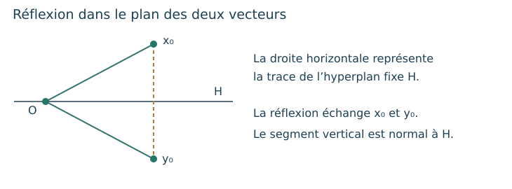

# Banque PT — Mathématiques A · 2020 · Corrigé guidé

*Corrigé rédigé par IA, non officiel. Signalez toute erreur.*

**Rédaction** · GPT-6.2 Astra Ultra · vitesse non renseignée

Les quatre parties d’algèbre étudient les isométries linéaires de l’espace euclidien et leur décomposition en réflexions. L’exercice de probabilités porte sur les premiers passages d’une marche aléatoire à pas $+1$ et $-1$. Sa numérotation est précédée de P.

## Algèbre, partie I · Une isométrie de l’espace

### Question I.1

> [!INDICATION]
> Vérifier les normes et les produits scalaires des trois colonnes.

#### Solution

Les colonnes de $9A$ sont $(-8,4,1)$, $(4,7,4)$, $(1,4,-8)$. Chacune a pour norme au carré $81$. Leurs produits scalaires deux à deux valent $-32+28+4=0$, $-8+16-8=0$ et $4+28-32=0$. Ainsi $A^TA=I_3$.

### Question I.2.a

> [!INDICATION]
> La symétrie est une propriété supplémentaire de cette matrice orthogonale.

#### Solution

$A$ est symétrique réelle. Par le théorème spectral, elle est diagonalisable dans une base orthonormée réelle. Les espaces propres associés à des valeurs distinctes sont orthogonaux.

### Question I.2.b

> [!INDICATION]
> Appliquer la conservation de la norme à un vecteur propre non nul.

#### Solution

Si $Av=\lambda v$ et $\lambda\in\mathbb R$, alors $\|v\|=\|Av\|=|\lambda|\|v\|$. Ainsi les seules valeurs propres réelles possibles sont $-1$ et $1$.

### Question I.2.c

> [!INDICATION]
> Combiner la trace, l’orthogonalité et un vecteur fixe.

#### Solution

La trace vaut $(-8+7-8)/9=-1$. Comme les valeurs propres comptées avec multiplicité sont trois signes, un seul vaut $+1$. On vérifie $A(1,4,1)^T=(1,4,1)^T$. L’espace propre pour $1$ est cette droite. L’espace propre pour $-1$, de dimension deux et orthogonal à la droite, est le plan $x+4y+z=0$, de base $(-4,1,0),(-1,0,1)$.

### Question I.3

> [!INDICATION]
> Une droite fixe et le signe moins sur son plan orthogonal caractérisent un demi-tour.

#### Solution

L’endomorphisme fixe la droite $\mathbb R(1,4,1)$ et envoie tout élément du plan perpendiculaire sur son opposé. Il s’agit de la symétrie orthogonale par rapport à la droite, ou encore de la rotation d’angle $\pi$ autour de cet axe.

## Algèbre, partie II · Involutions

### Question II.1

> [!INDICATION]
> Utiliser les deux identités d’inverse en même temps.

#### Solution

Comme $u\circ u=I$, $u$ est à la fois inverse à droite et à gauche de lui-même. Il est donc inversible et $u^{-1}=u$.

### Question II.2

> [!INDICATION]
> Calculer les images de la demi-somme et de la demi-différence.

#### Solution

Pour $x_+=(x+u(x))/2$ et $x_-=(x-u(x))/2$, la linéarité et $u^2=I$ donnent $u(x_+)=(u(x)+x)/2=x_+$ et $u(x_-)=(u(x)-x)/2=-x_-$. Ainsi $x_+\in E_u^+$ et $x_-\in E_u^-$.

### Question II.3

> [!INDICATION]
> Démontrer séparément que la somme remplit l’espace et que l’intersection est nulle.

#### Solution

On a $x=x_++x_-$ pour tout $x$, donc les deux noyaux engendrent $E$. Si $y$ est dans leur intersection, $y=u(y)=-y$, d’où $y=0$. Ainsi $E=E_u^+\oplus E_u^-$.

### Question II.4

> [!INDICATION]
> Réunir des bases des deux espaces précédents.

#### Solution

Une base de $E_u^+$ suivie d’une base de $E_u^-$ est une base de $E$. Dans cette base, la matrice de $u$ est diagonale avec des coefficients $+1$ puis $-1$. Cela inclut le cas où l’un des deux sous-espaces est nul.

### Question II.5

> [!INDICATION]
> Pour la réciproque, comparer les normes de la somme et de la différence des deux composantes.

#### Solution

Si $u$ est une isométrie, pour $v\in E_u^+$ et $w\in E_u^-$ on a $\langle v,w\rangle=\langle uv,uw\rangle=-\langle v,w\rangle$, donc orthogonalité. Réciproquement, si les sous-espaces sont orthogonaux, $\|u(x)\|^2=\|x_+-x_-\|^2=\|x_+\|^2+\|x_-\|^2=\|x\|^2$. La linéarité donne la conservation de toutes les distances.

## Algèbre, partie III · Symétrie par rapport à un plan de dimension deux

### Question III.1

> [!INDICATION]
> Reconnaître un noyau et déterminer son rang pour la suite.

#### Solution

$F$ est le noyau de l’application linéaire $(x,y,z,t)\mapsto(x-y-z+t,2x-z-t)$. C’est un sous-espace vectoriel. Les deux formes sont indépendantes car leurs coefficients, notamment ceux de $y$, ne sont pas proportionnels. Le rang vaut deux et $\dim F=2$.

### Question III.2

> [!INDICATION]
> Ajouter aux équations de $F$ l’orthogonalité au premier vecteur.

#### Solution

Le vecteur $(1,1,1,1)$ vérifie les deux équations. Sa version unitaire est $u_1=(1,1,1,1)/2$. En imposant en plus la somme nulle des coordonnées, on trouve par exemple $(-1,3,-3,1)$, qui vérifie les trois relations. Posons $u_2=(-1,3,-3,1)/\sqrt{20}$. Ces deux vecteurs orthonormés forment une base de $F$ par dimension.

### Question III.3

> [!INDICATION]
> Utiliser les vecteurs normaux des deux équations de $F$.

#### Solution

Le vecteur $(1,-1,-1,1)$ est le normal à la première équation, donc orthogonal à tout $F$. Prenons $u_3=(1,-1,-1,1)/2$. Du second normal $c=(2,0,-1,-1)$, retranchons sa projection sur $u_3$, soit $\langle c,u_3\rangle u_3=u_3$. On obtient $(3,1,-1,-3)/2$, d’où $u_4=(3,1,-1,-3)/\sqrt{20}$. Les deux derniers vecteurs forment une base orthonormée de $F^\perp$. La famille entière est orthonormée et de cardinal quatre.

### Question III.4

> [!INDICATION]
> Exprimer la symétrie par le projecteur orthogonal sur $F$.

#### Solution

Dans la base adaptée, $s$ a pour matrice $\operatorname{diag}(1,1,-1,-1)$. Dans la base canonique, sa matrice est $2(u_1u_1^T+u_2u_2^T)-I_4$. En développant les deux produits de colonnes, on obtient
$$
\frac15\begin{pmatrix}-2&1&4&2\\1&2&-2&4\\4&-2&2&1\\2&4&1&-2\end{pmatrix}.
$$

### Question III.5

> [!INDICATION]
> Changer de signe sur chacune des deux directions normales séparément.

#### Solution

Pour $j=3,4$, soit $r_j$ la réflexion de normale $u_j$, donnée par $r_j(x)=x-2\langle x,u_j\rangle u_j$. Dans la base adaptée, $r_j$ change le signe du seul coefficient d’indice $j$. La composée $r_3\circ r_4$ réalise les deux changements et fixe $F$. Donc $s=r_3\circ r_4$.

## Algèbre, partie IV · Décomposition en réflexions

### Question IV.1

> [!INDICATION]
> Le complément orthogonal des points fixes est une droite stable.

#### Solution

Si $p_f=1$, $F_f$ est un hyperplan. Sa droite orthogonale est stable car pour $z\perp F_f$, $v\in F_f$, $\langle fz,v\rangle=\langle fz,fv\rangle=0$. Sur cette droite $f$ agit par un signe, nécessairement $-1$, sinon tout serait fixe. Ainsi $f$ est la réflexion par rapport à $F_f$. Pour $p_f=0$, l’identité est le produit vide.

### Question IV.2.a

> [!INDICATION]
> Lire la dimension dans la définition de la codimension.

#### Solution

$\dim F_g^\perp=n-\dim F_g=p_g=k\ge2$, donc $F_g^\perp\ne\{0\}$.

### Question IV.2.b

> [!INDICATION]
> L’isométrie fixe chaque vecteur du sous-espace $F_g$.

#### Solution

Si $y_0=g(x_0)=x_0$, alors $x_0$ est à la fois dans $F_g$ et $F_g^\perp$, donc nul, contradiction. Pour $v\in F_g$, $\langle y_0,v\rangle=\langle g(x_0),g(v)\rangle=\langle x_0,v\rangle=0$. Ainsi $y_0\in F_g^\perp$.

### Question IV.2.c

> [!INDICATION]
> Repérer les vecteurs fixés par les deux facteurs.

#### Solution

Comme $x_0-y_0\in F_g^\perp$, on a $F_g\subset(x_0-y_0)^\perp=F_r$. Ainsi chaque $v\in F_g$ vérifie $r(g(v))=r(v)=v$. D’où $F_g\subset F_{r\circ g}$.

### Question IV.2.d

> [!INDICATION]
> Soustraire et additionner deux vecteurs de même norme.

#### Solution

$\langle x_0-y_0,x_0+y_0\rangle=\|x_0\|^2-\|y_0\|^2=0$. La réflexion $r$ envoie le normal $x_0-y_0$ sur son opposé et fixe $x_0+y_0$. En écrivant $y_0=[(x_0+y_0)-(x_0-y_0)]/2$, on trouve $r(y_0)=x_0$, y compris si la somme est nulle.

### Question IV.2.e

> [!INDICATION]
> Ajouter un nouveau vecteur fixe hors de l’ancien sous-espace.

#### Solution

$r(g(x_0))=x_0$, et $x_0\notin F_g$. Par IV.2.c, $F_{r\circ g}$ contient donc $F_g\oplus\mathbb R x_0$. En passant aux codimensions, $p_{r\circ g}\le p_g-1<p_g$.

### Question IV.2.f

> [!INDICATION]
> Décomposer la composée qui a davantage de points fixes puis annuler la première réflexion.

#### Solution

L’isométrie $r\circ g$ est, par récurrence, un produit d’au plus $p_{r\circ g}\le k-1$ réflexions. Comme $r^2=I$, $g=r\circ(r\circ g)$ en demande au plus $k$. Les cas initiaux et cette étape établissent l’assertion.

## Probabilités · Premiers passages d’une marche à pas unitaires

### Question P.1

> [!INDICATION]
> Énumérer les deux premiers pas et chercher deux valeurs incompatibles.

#### Solution

$X_1=a+1$ avec probabilité $p$ et $a-1$ avec probabilité $q=1-p$. Pour $X_2$, les valeurs $a+2,a,a-2$ ont pour probabilités $p^2,2pq,q^2$. Les événements $X_1=a-1$ et $X_2=a+2$ ont des probabilités positives et une intersection vide. Les variables sont donc dépendantes.

### Question P.2

> [!INDICATION]
> Retrouver chaque pas par différence de deux positions successives.

#### Solution

Pour $r=(r_1,\ldots,r_n)$, posons $\varphi_n(r)_j=a+\sum_{i=1}^j r_i$. La définition des positions donne l’identité demandée. Chaque suite de pas de longueur $n$ ayant une probabilité positive, la valeur de l’application en chaque point est imposée, d’où son unicité. Si ses positions sont $(x_1,\ldots,x_n)$, on retrouve $r_1=x_1-a$ puis $r_j=x_j-x_{j-1}$ pour $j\ge2$. Ainsi elle est injective.

### Question P.3.a

> [!INDICATION]
> La position initiale est exactement un pas sous le niveau visé.

#### Solution

On a $p_0=0$ puisque $X_0=a$, et $p_1=p$ puisque le premier pas doit valoir $+1$.

### Question P.3.b

> [!INDICATION]
> Décrire le premier passage par les sommes partielles de la suite des pas.

#### Solution

Notons $s_j(r)=\sum_{i=1}^j r_i$. On peut prendre $A_k=\{r\in\{-1,1\}^k:s_k(r)=1,\ s_j(r)\le0\text{ pour }1\le j<k\}$. Des pas unitaires ne permettent pas de dépasser $1$ sans l’avoir atteint. Ainsi $\{N_1=k\}=\{(R_1,\ldots,R_k)\in A_k\}$.

### Question P.3.c

> [!INDICATION]
> Comparer la loi des blocs de même longueur.

#### Solution

Les accroissements sont indépendants et de même loi, donc $(R_{n+1},\ldots,R_{n+k})$ a la même loi produit que $(R_1,\ldots,R_k)$. Son appartenance à $A_k$ a par conséquent probabilité $p_k$.

### Question P.3.d

> [!INDICATION]
> Recentrer la marche en son premier passage au niveau $a+1$.

#### Solution

Pour $1\le k<n$, atteindre $a+1$ pour la première fois en $k$ impose que le premier bloc appartienne à $A_k$. Avant $k$, $a+2$ est inaccessible sans franchir $a+1$. Après $k$, le premier passage à $a+2$ est celui d’un pas net supplémentaire, avec maintien au niveau relatif au plus zéro jusqu’au dernier pas. Il équivaut à $(R_{k+1},\ldots,R_n)\in A_{n-k}$. Cela prouve l’égalité des événements dans les deux sens.

### Question P.3.e.i

> [!INDICATION]
> Les deux conditions portent sur des blocs d’accroissements disjoints.

#### Solution

Pour $1\le n_1<n_2$, P.3.d et l’indépendance des blocs donnent $\mathbb P(N_1=n_1,N_2=n_2)=p_{n_1}p_{n_2-n_1}$. La formule reste vraie si $n_1=0$ car $p_0=0$.

### Question P.3.e.ii

> [!INDICATION]
> Le niveau supérieur exige un passage strictement antérieur au niveau intermédiaire.

#### Solution

Si $n_2$ est fini, l’événement $N_2=n_2$ implique $N_1<n_2$ et $N_1$ fini. Donc chacune des probabilités demandées est nulle lorsque $n_1\ge n_2$ ou lorsque $N_1=+\infty$.

### Question P.4

> [!INDICATION]
> Conditionner sur le premier pas puis décomposer suivant le premier temps de passage.

#### Solution

Pour atteindre $a+1$ pour la première fois en $n>1$, le premier pas doit être $-1$. Depuis $a-1$, il faut alors pour la première fois gagner deux unités en $n-1$ pas. Les nouveaux pas étant indépendants du premier et de même loi, $p_n=q\,\mathbb P(N_2=n-1)$. En partitionnant par $N_1$ et en appliquant P.3.e, on trouve $p_n=q\sum_{j=1}^{n-2}p_jp_{n-1-j}$, somme vide pour $n=2$.

### Question P.5

> [!INDICATION]
> Identifier le coefficient du produit de Cauchy en tenant compte des deux premiers rangs.

#### Solution

Pour $s\in[0,1]$, $G(s)=\sum_{n\ge0}p_n s^n$ converge car les événements de premier passage sont disjoints et $\sum p_n\le1$. Le produit de Cauchy est donc autorisé, même en $s=1$. Le coefficient de $s^n$ dans $qsG(s)^2$ est la convolution de P.4. Avec $p_0=0$ et $p_1=p$, on obtient $G(s)-ps=qsG(s)^2$.

### Question P.6

> [!INDICATION]
> Sélectionner la racine continue en zéro et vérifier qu’elle y reste raccordée.

#### Solution

$G(0)=p_0=0$. Pour $s>0$, les racines sont $(1\pm\sqrt{1-4pqs^2})/(2qs)$. Près de zéro, la racine avec signe plus diverge, donc seule la racine moins convient. Pour $0<s<1$ les deux racines ne coïncident pas, car $4pq\le1$. Par continuité, la branche ne peut changer. En rationalisant, on obtient sur tout $[0,1]$, extrémités incluses par convergence uniforme, $G(s)=2ps/(1+\sqrt{1-4pqs^2})$.

### Question P.7

> [!INDICATION]
> L’ensemble des temps finis est une union disjointe.

#### Solution

La somme est $G(1)=2p/(1+|1-2p|)$. Elle vaut donc $p/q$ si $p<1/2$, et $1$ si $p\ge1/2$. Il s’agit de la probabilité $\mathbb P(N_1<+\infty)$ que la marche atteigne au moins une fois le niveau $a+1$.

## Sources et rapport du jury

Le rapport de la Banque PT, p. 2–4, distingue la symétrie orthogonale par rapport à une droite de la réflexion par rapport à un hyperplan. Pour la marche aléatoire, il souligne p. 5 que l’égalité des lois des blocs et l’indépendance des blocs justifient deux étapes différentes.

[Énoncé de la Banque PT](https://www.banquept.fr/documents/2020/math_a_2020_pt.pdf) · [Rapport du jury](https://www.banquept.fr/documents/ecrit/rapport/2020/rapport_math_a_ecrit_2020.pdf)
