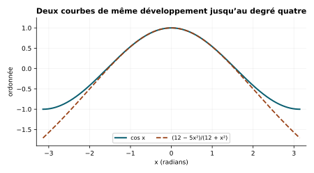
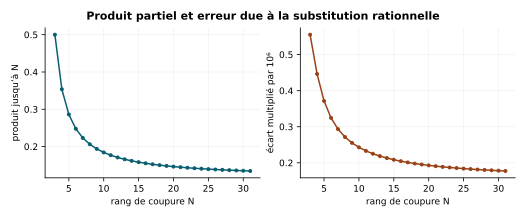

# Banque PT — Mathématiques C · Session 2020 · Corrigé guidé

*Corrigé rédigé par IA, non officiel. Signalez toute erreur.*

**Rédaction** · GPT-6.2 Astra Ultra · vitesse non renseignée

Les parties étudient une approximation rationnelle du cosinus, une équation fonctionnelle, puis deux produits infinis reliés à la fonction Gamma.

Écrit de quatre heures, sans calculatrice. Une feuille de papier millimétré est à rendre avec la copie. La grille exceptionnelle donne le coefficient 6 pour l’admissibilité à l’École polytechnique et 3 pour le classement sur écrits de chacune des ENS Paris-Saclay et Rennes. [Sujet](https://www.banquept.fr/documents/2020/math_c_2020_pt.pdf) · [Grille, p. 1](https://www.banquept.fr/documents/2020/Coefficients.pdf#page=1)

Le rapport, pages 5–9, insiste sur les indices du produit, les sommes finies avant passage à la limite et les bornes intégrables nécessaires pour dériver en III.5.a. [Rapport du jury](https://www.banquept.fr/documents/ecrit/rapport/2020/rapport_math_c_ecrit_2020.pdf)

## Repères de lecture

- Dans I, isolez le terme constant de la fraction avant de développer.
- Dans II, utilisez les produits sans diviser par un cosinus qui pourrait être nul.
- Dans III, conservez le premier facteur et les décalages avant de passer aux produits infinis.

## Préambule. Approximation au voisinage d’un point

### Question P.1

> [!INDICATION]
> Distinguer la formule locale et une majoration uniforme du reste.

#### Solution

Soit $f\in C^n(I)$, $n\ge1$, et $a\in I$. La formule de Taylor–Young est, lorsque $x\to a$ dans $I$,
$$
f(x)=\sum_{k=0}^n\frac{f^{(k)}(a)}{k!}(x-a)^k+o((x-a)^n).
$$
Le quotient du reste par $(x-a)^n$ tend vers zéro, éventuellement d’un seul côté si $a$ est une extrémité.

### Question P.2

> [!INDICATION]
> Évaluer la fonction et ses deux premières dérivées en zéro.

#### Solution

On a $\cos0=1$, $\cos'(0)=-\sin0=0$ et $\cos''(0)=-1$. Taylor–Young à l’ordre deux donne $\cos x=1-x^2/2+o(x^2)$ en zéro.

## I. Une approximation rationnelle du cosinus

### Question I.1

> [!INDICATION]
> Examiner les puissances au numérateur et au dénominateur.

#### Solution

La fonction $\phi(x)=(12-5x^2)/(12+x^2)$ est définie sur $\mathbb R$ car son dénominateur est positif. Comme $\phi(-x)=\phi(x)$, on peut l’étudier sur $[0,+\infty[$ puis réfléchir la courbe par rapport à l’axe des ordonnées.

### Question I.2

> [!INDICATION]
> Réduire la seconde expression au même dénominateur.

#### Solution

Pour tout $x$, $1-6x^2/(12+x^2)=(12+x^2-6x^2)/(12+x^2)=\phi(x)$. Donc $\psi=\phi$.

### Question I.3

> [!INDICATION]
> Isoler une constante pour n’avoir à dériver qu’un inverse.

#### Solution

On écrit $\phi(x)=-5+72/(12+x^2)$. D’où $\phi'(x)=-144x/(12+x^2)^2$.

### Question I.4

> [!INDICATION]
> Le dénominateur est strictement positif.

#### Solution

La dérivée est positive pour $x<0$, nulle en zéro et négative pour $x>0$. La valeur en zéro est 1. Le quotient des coefficients de degré deux donne la limite $-5$ aux deux infinis. Le tableau est donc
$$
\begin{array}{c|ccccc}x&-\infty&&0&&+\infty\\\hline
\phi'&&+&0&-&\\\phi&-5&\nearrow&1&\searrow&-5\end{array}.
$$

### Question I.5

> [!INDICATION]
> Écrire l’inverse du dénominateur avec une série géométrique.

#### Solution

Pour $|x|<\sqrt{12}$, $|x^2/12|<1$ et
$$
\phi(x)=-5+6\sum_{k=0}^\infty(-1)^k(x^2/12)^k
=1+6\sum_{k=1}^\infty(-1)^k x^{2k}/12^k .
$$
À $|x|=\sqrt{12}$ et au-delà les termes ne tendent pas vers zéro. Le rayon est donc $2\sqrt3$.

### Question I.6

> [!INDICATION]
> Comparer les premiers termes non nuls avant de confronter les valeurs aux extrémités.

#### Solution

Les deux courbes sont paires, passent par $(0,1)$ avec tangente horizontale. Les zéros de $\phi$ sont $\pm2\sqrt{3/5}$ et ceux du cosinus sont $\pm\pi/2$ sur le segment. À $\pm\pi$, $\phi$ vaut environ $-1{,}71$, le cosinus $-1$. Les courbes coïncident visuellement près de zéro puis s’écartent. I.5 fournit $\phi(x)=1-x^2/2+x^4/24-x^6/288+O(x^8)$. Pour le cosinus le coefficient en $x^6$ est $-1/720$, donc $\phi(x)-\cos x=-x^6/480+O(x^8)$. La planche d’impression reprend l’échelle de 3 cm par unité sur les deux axes.

Pour reproduire l’échelle du sujet, ouvrez le fichier SVG, puis imprimez en A4 paysage à 100 %, sans ajustement, sans marges et sans en-têtes de navigateur. Vérifiez à la règle que deux graduations entières successives sont distantes de 3 cm. [Télécharger la planche à l’échelle](https://raw.githubusercontent.com/knoel99/corriges-concours/9ff54cac1631b8c479f3ae657dbb042bbc41edc5/2020/banque-pt/banque-pt_pt_maths-c_2020/planches/trace-echelle.svg)

## II. Équation fonctionnelle et sinus cardinal

### Question II.1

> [!INDICATION]
> Appliquer la formule d’addition du sinus à deux angles égaux.

#### Solution

Pour tout réel $a$, $\sin(2a)=\sin a\cos a+\cos a\sin a=2\sin a\cos a$.

### Question II.2

> [!INDICATION]
> Dédoubler à chaque étape le seul sinus restant.

#### Solution

Pour $n=1$, II.1 appliqué à $a=\pi x/2$ donne l’égalité. Supposons-la vraie à l’ordre $n$. Dans le membre de droite, remplaçons $\sin(\pi x/2^n)$ par $2\sin(\pi x/2^{n+1})\cos(\pi x/2^{n+1})$. Cela fournit le facteur supplémentaire et prouve par récurrence
$$
\sin(\pi x)=2^n\sin(\pi x/2^n)\prod_{k=1}^n\cos(\pi x/2^k).
$$

### Question II.3

> [!INDICATION]
> Remonter de x à sa moitié à l’aide de l’équation.

#### Solution

Si $h(2x)=h(x)\cos(\pi x)$, alors $h(x)=h(x/2)\cos(\pi x/2)$. En remplaçant à nouveau $h(x/2)$ par son expression à l’argument moitié et en répétant $n$ fois, on trouve $h(x)=h(x/2^n)\prod_{k=1}^n\cos(\pi x/2^k)$. L’itération est valable même lorsqu’un facteur est nul.

### Question II.4

> [!INDICATION]
> Multiplier les identités pour éviter de diviser par un cosinus.

#### Solution

En multipliant II.3 par $\sin(\pi x/2^n)$ et en utilisant II.2 dans le membre de droite, on a
$$
h(x)\sin(\pi x/2^n)=2^{-n}h(x/2^n)\sin(\pi x).
$$

### Question II.5

> [!INDICATION]
> Utiliser la seule hypothèse de continuité disponible.

#### Solution

Pour $x$ fixé, $x/2^n\to0$. La continuité de $h$ en zéro et $h(0)=1$ donnent $h(x/2^n)\to1$.

### Question II.6

> [!INDICATION]
> Faire apparaître le quotient d’un angle par son sinus.

#### Solution

Pour $x\ne0$ fixé, posons $u_n=\pi x/2^n$. Pour $n$ assez grand $0<|u_n|<\pi$, donc le dénominateur est non nul et
$$
\frac{x}{2^n\sin(\pi x/2^n)}=\frac1\pi\frac{u_n}{\sin u_n}\longrightarrow \frac1\pi .
$$

### Question II.7

> [!INDICATION]
> Une fois l’expression imposée, en vérifier l’existence.

#### Solution

Pour $x\ne0$, II.4–6 donnent $h(x)=\sin(\pi x)/(\pi x)$. En zéro, la valeur prescrite est 1, égale à la limite de cette expression. La formule du sinus double donne $h(2x)=h(x)\cos(\pi x)$ pour $x\ne0$, et l’égalité en zéro est immédiate. C’est donc l’unique solution.

## III. Produits infinis et limite d’Euler

### Question III.1

> [!INDICATION]
> Développer d’abord le cosinus, puis le logarithme près de 1.

#### Solution

Pour $n\ge2$, $0<\cos(\pi/(n+1))<1$. Quand $u\to0$, $\log(\cos u)=\log(1-u^2/2+o(u^2))\sim-u^2/2$. Les termes de la série sont donc équivalents à $-\pi^2/(2(n+1)^2)$. Par comparaison des modules à une série de Riemann d’exposant 2, la série converge absolument sur ces indices. Les premiers indices où le logarithme réel n’existe pas sont exclus.

### Question III.2.a

> [!INDICATION]
> La même somme se calcule par télescopage et par substitution de la récurrence.

#### Solution

Tous les $R_k$ sont positifs car $R_2=1$ et les facteurs suivants sont positifs. D’une part $\sum_{k=4}^n(\log R_k-\log R_{k-1})=\log R_n-\log R_3$. D’autre part la récurrence donne $\sum_{k=4}^n\log \cos(\pi/(k+1))$. Ici $R_3=\cos(\pi/4)$.

### Question III.2.b

> [!INDICATION]
> Ajouter la constante issue du premier terme du télescopage.

#### Solution

Par III.2.a, $\log R_n=\log R_3+\sum_{k=4}^n\log\cos(\pi/(k+1))$. La série de III.1 converge, donc cette suite converge vers un réel fini et $R_n$ vers un réel strictement positif.

### Question III.2.c

> [!INDICATION]
> Identifier précisément le premier facteur du produit demandé.

#### Solution

Pour $N\ge4$, $R_{N-1}=\prod_{j=4}^N\cos(\pi/j)$ par la récurrence. Le produit imprimé de $3$ à $N$ vaut donc $\cos(\pi/3)R_{N-1}=R_{N-1}/2$. Il possède une limite $R>0$, ce qui justifie la notation en produit infini.

### Question III.2.d

> [!INDICATION]
> Contrôler séparément la coupure du produit et l’approximation de chaque facteur.

#### Solution

Pour le produit $P_N$ tronqué au rang $N$, les facteurs appartiennent à $[0,1]$. Par télescopage, $0\le P_N-R\le\sum_{k>N}(1-\cos(\pi/k))\le(\pi^2/2)\sum_{k>N}k^{-2}\le\pi^2/(2N)$. On peut ainsi choisir $N$ pour la précision voulue.

Pour calculer les facteurs avec I, réduire d’abord $v=\pi/k$ à $v/2^m$, prendre $\phi(v/2^m)$ puis appliquer $m$ fois la formule $z\mapsto2z^2-1$ du cosinus double. Comme $0\le v\le\pi/3$, les valeurs initiales appartiennent à $[-1,1]$, intervalle stable pour cette transformation. Elle y est $4$-lipschitzienne. D’après I.6, l’erreur initiale est $O((v/2^m)^6)$, donc l’erreur finale est $O(v^6/16^m)$. Les erreurs du produit fini sont au plus la somme des erreurs des facteurs puisque leurs modules sont au plus un. Pour $N$ fixé elles tendent vers zéro avec $m$. Cette méthode permet donc d’approcher $R$ aussi précisément que voulu.

Par exemple, pour $|s|§§le1$, le reste géométrique après le degré quatre de $§§phi$ est majoré par $|s|^6/288$ et celui du cosinus par $|s|^6/720$ (Taylor avec reste de Lagrange au degré cinq). Ainsi $|§§phi(s)-§§cos s|§§le |s|^6/200$. Comme $§§sum_{k§§ge3}k^{-6}§§le§§int_2^§§infty t^{-6}dt=1/160$, la substitution rationnelle donne une erreur sur le produit fini au plus $§§pi^6/(32000§§cdot16^m)$. Avec $N=100§§,000$ et $m=4$, le calcul du produit fini donne environ $0{,}114948$. Les deux bornes d’erreur totalisent moins de $0{,}000050$. On obtient notamment $R§§simeq0{,}115$ au millième.

### Question III.3.a

> [!INDICATION]
> Multiplier la somme finie par un moins la raison.

#### Solution

Pour $q\ne1$, $(1-q)\sum_{k=0}^{n-1}q^k=1-q^n$ par télescopage. La somme vaut $(1-q^n)/(1-q)$.

### Question III.3.b

> [!INDICATION]
> Identifier le premier terme et la raison.

#### Solution

Pour $0<t\le1$, on peut prendre $q=1-t\ne1$. Ainsi $(1-(1-t)^n)/t=\sum_{k=0}^{n-1}(1-t)^k$.

### Question III.3.c

> [!INDICATION]
> La somme finie donne un prolongement en zéro.

#### Solution

La formule précédente est un polynôme en $t$ qui prend la valeur $n$ en zéro. L’intégrande se prolonge continûment sur $[0,1]$, donc $I_n$ converge.

### Question III.3.d

> [!INDICATION]
> Intégrer chaque puissance de la somme finie.

#### Solution

Pour $k\ge0$, $\int_0^1(1-t)^kdt=1/(k+1)$. Par linéarité, $I_n=\sum_{k=0}^{n-1}1/(k+1)=\sum_{k=1}^n1/k$.

### Question III.4.a

> [!INDICATION]
> Décomposer la fraction en deux termes faciles à primitiver.

#### Solution

Puisque $t/(n(n+t))=1/n-1/(n+t)$, on a $u_n=1/n-\log(n+1)+\log n=1/n-\log(1+1/n)$.

### Question III.4.b

> [!INDICATION]
> Un majorant positif issu de l’intégrale évite toute soustraction approximative.

#### Solution

Pour $t\in[0,1]$, $0\le t/(n(n+t))\le t/n^2$. En intégrant, $0\le u_n\le1/(2n^2)$. La série converge par comparaison.

### Question III.4.c

> [!INDICATION]
> Conserver le décalage d’une unité sur le logarithme.

#### Solution

Écrivons $S_n=\sum_{k=1}^n1/k$. Les logarithmes de III.4.a télescopent et $\sum_{k=1}^n u_k=S_n-\log(n+1)$. Par suite $S_n-\log n=\sum_{k=1}^n u_k+\log(1+1/n)$ converge vers le réel $\gamma=\sum_{k\ge1}u_k$.

### Question III.5.a

> [!INDICATION]
> La singularité en zéro se traite sur un intervalle de paramètres éloigné de zéro.

#### Solution

Fixons $n\ge1$. Pour $x>0$, l’intégrande $b(t,x)=(1-t/n)^nt^{x-1}$ est intégrable près de zéro, et continu pour $t\in]0,n]$. Sa dérivée en $x$ est $b(t,x)\log t$. Pour $x\ge a>0$, sur $0<t\le1$, les deux modules sont majorés respectivement par $t^{a-1}$ et $t^{a-1}|\log t|$, intégrables (poser $t=e^{-u}$). Sur $[1,n]$, pour tout sous-segment de paramètres $[a,b]$, le noyau et sa dérivée sont continus sur un rectangle compact, donc uniformément bornés. Cette localisation suffit en tout point de $[a,+\infty[$, puis de $]0,+\infty[$. Par continuité et dérivation sous l’intégrale, $G_n$ est de classe $C^1$ et $G'_n(x)=\int_0^n(1-t/n)^nt^{x-1}\log t\,dt$.

### Question III.5.b

> [!INDICATION]
> Utiliser une primitive de la puissance d’une fonction affine.

#### Solution

Par $s=t/n$, $G_n(1)=n\int_0^1(1-s)^n ds=n/(n+1)$. La limite est 1.

### Question III.5.c

> [!INDICATION]
> Intégrer par parties sur des intervalles tronqués pour justifier le bord singulier.

#### Solution

Posons $B_j(y)=\int_0^1(1-s)^js^{y-1}ds$ pour $y>0$. Pour $j\ge1$, primitiver $s^{y-1}$ en $s^y/y$ et dériver $(1-s)^j$ donne $B_j(y)=(j/y)B_{j-1}(y+1)$. Les fonctions sont $C^1$ sur les segments intérieurs et les bords $(1-s)^js^y/y$ s’annulent aux deux extrémités. Comme $B_0(y)=1/y$, $n$ itérations et la substitution $t=ns$ donnent
$$
G_n(x)=n^xB_n(x)=\frac{n^x n!}{x(x+1)\cdots(x+n)} .
$$

### Question III.5.d

> [!INDICATION]
> Utiliser le terme quadratique du logarithme.

#### Solution

Pour $x>0$ fixé, $\log(1+x/k)-x/k=-x^2/(2k^2)+O(k^{-3})$ lorsque $k\to\infty$. La série converge absolument par comparaison à $1/k^2$.

### Question III.5.e

> [!INDICATION]
> Exponentier une somme finie avant de passer à la limite.

#### Solution

Le logarithme du produit fini $\prod_{k=1}^N(1+x/k)e^{-x/k}$ est la somme partielle de III.5.d. Par continuité de l’exponentielle, le produit tend vers l’exponentielle de sa limite, un réel strictement positif. Cela justifie aussi l’existence du produit des réciproques.

### Question III.5.f

> [!INDICATION]
> Insérer la somme harmonique dans l’expression de la question c.

#### Solution

En réarrangeant uniquement des produits finis, III.5.c devient
$$
G_n(x)=\frac1x e^{-x(S_n-\log n)}\prod_{k=1}^n(1+x/k)^{-1}e^{x/k}.
$$
Le premier facteur exponentiel tend vers $e^{-\gamma x}$ par III.4.c et le produit converge par III.5.e. Donc $G_n(x)\to x^{-1}e^{-\gamma x}\prod_{k\ge1}(1+x/k)^{-1}e^{x/k}$, un nombre strictement positif.

### Question III.5.g

> [!INDICATION]
> Prendre les réciproques au rang fini pour faire télescoper les facteurs décalés.

#### Solution

Posons $H_n(y)=1/G_n(y)=y n^{-y}\prod_{k=1}^n(1+y/k)$ pour $y>0$. Par III.5.f, $H_n(y)\to H(y)>0$, où $H$ est exactement le produit défini dans le sujet. Pour $0<x<1$,
$$
\frac{H_n(1+x)}{H_n(x)}
=\frac{1+x}{nx}\prod_{k=1}^n\frac{k+x+1}{k+x}
=\frac{n+1+x}{nx}\longrightarrow\frac1x .
$$
D’autre part,
$$
H_n(1+x)H_n(1-x)
=\frac{1-x^2}{n^2}\prod_{k=1}^n\frac{(k+1)^2-x^2}{k^2}
=\frac{(n+1)^2}{n^2}\prod_{j=1}^{n+1}(1-x^2/j^2).
$$
Le membre de gauche converge et le préfacteur tend vers 1. Cela prouve l’existence du produit de droite et les deux identités demandées.

La notice historique de la page 6 imprime une formule supplémentaire pour $h$. Avec $\Gamma(y)=\lim G_n(y)$, la formule de réflexion classique $\Gamma(x)\Gamma(1-x)=\pi/\sin(\pi x)$ donne $h(x)=1/(x\Gamma(1-x)\Gamma(x))$ pour $0<x<1$. Le contrôle en $x=1/2$, où $\Gamma(1/2)=\sqrt\pi$, donne $2/\pi$ d’après II.7. L’expression imprimée dans la notice donnerait $\pi/2$.
